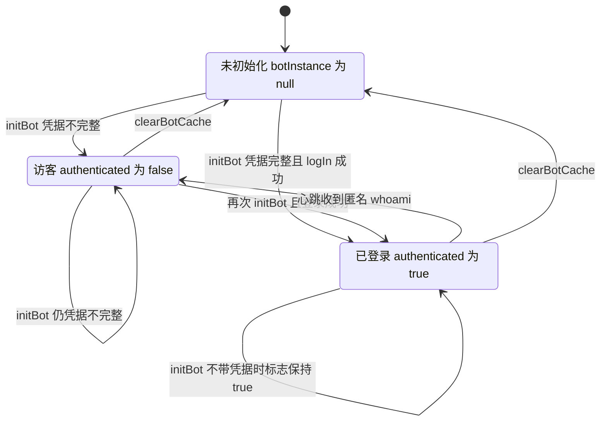
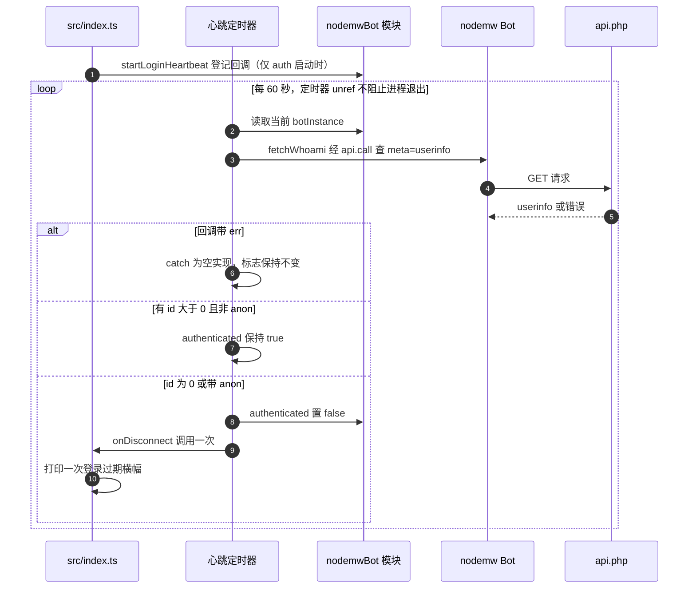
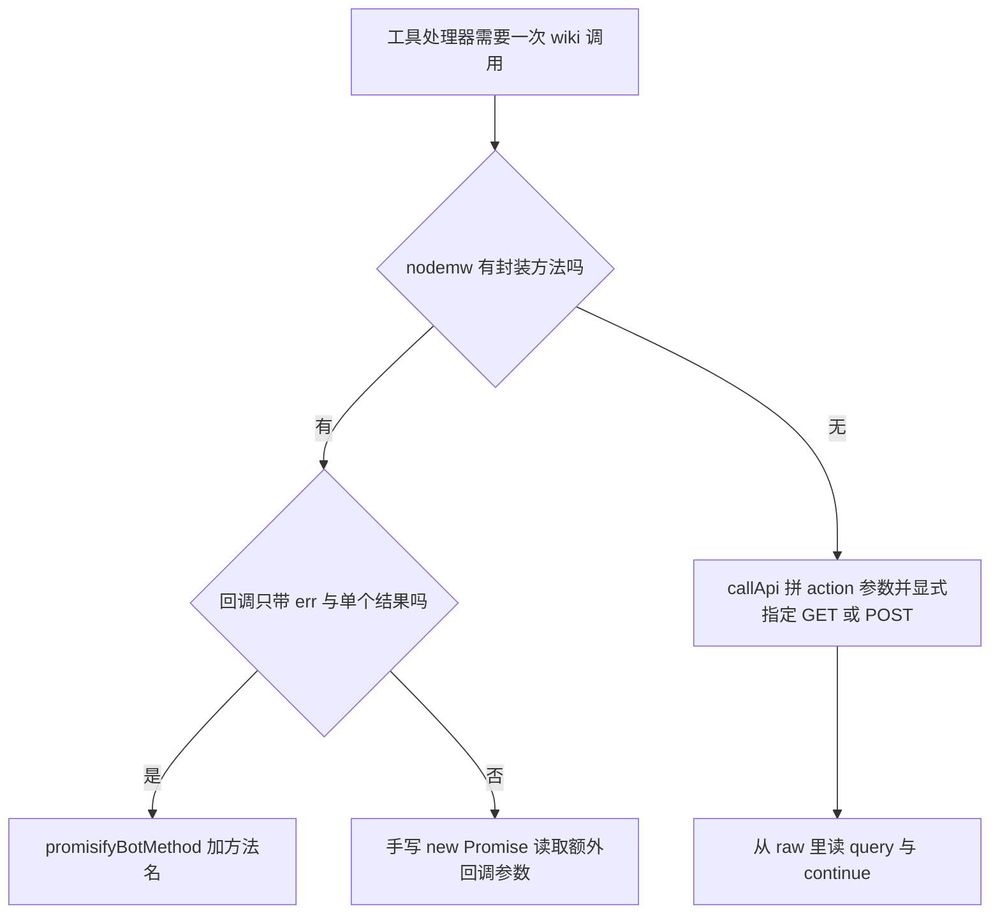

# Bot 运行时：共享状态、配置与 promisified 客户端

[`src/common/nodemwBot.ts`](../../src/common/nodemwBot.ts) 是这个 MCP 服务器与 `nodemw` MediaWiki 客户端之间的运行时适配层。它持有整个进程唯一的 `Bot` 实例，把 `ServerConfig` 翻译成 nodemw 选项（[L133-L174](../../src/common/nodemwBot.ts#L133-L174)），在启动阶段完成一次可选登录，在未显式给出路径时探测 API 脚本路径，缓存 wiki 的 MediaWiki 版本与命名空间表，并用一个 60 秒心跳监视登录是否静默失效。

调用侧有两个助手，分布在两个模块里：

- [`promisifyBotMethod`](../../src/common/nodemwBot.ts#L308-L325) 把 nodemw 的**单结果**方法回调转成 Promise，是绝大多数工具调用的入口。
- [`callApi`](../../src/common/utils.ts#L42-L58) 把未声明的裸传输 `bot.api.call` 的四参数回调转成 Promise，解析完整响应体，是分页、`pageids`/`revids` 寻址与未封装 action 的唯一通道。

服务器对 wiki 做的一切最终都经过这两条路径之一，因此这里的共享状态与调用约定直接决定了服务器能做什么、不能做什么。本页只记录**运行时状态与调用契约**；单个工具的业务逻辑见 [reading-content](../workflows/reading-content.md) 与 [editing-content](../workflows/editing-content.md)，写前读守卫的完整判定见 [read-before-write-guard](../concepts/read-before-write-guard.md)，客户端接口细节见 [nodemw 客户端集成](../integrations/nodemw-client.md)。

## 在进程中的位置

运行时被两个方向消费：

- **启动引导**：[`src/index.ts`](../../src/index.ts#L115-L150) 解析 CLI、按需探测路径、调用 `initServerConfig` 与 `initBot`，随后填充命名空间缓存与版本缓存（[L156-L170](../../src/index.ts#L156-L170)、[L209-L222](../../src/index.ts#L209-L222)），最后用 auth 快照注册工具（[L348-L349](../../src/index.ts#L348-L349)）。完整时序见 [startup-lifecycle](startup-lifecycle.md)。
- **工具处理器**：`src/tools/ro`、`src/tools/editing` 下的每个模块以及 [`src/common/pageState.ts`](../../src/common/pageState.ts#L210-L217) 都在**调用时刻**通过 `getBot()` 取客户端，例如 [`append`](../../src/tools/editing/append.ts#L71-L95) 与 [`block`](../../src/tools/editing/block.ts#L90-L124)。

既没有依赖注入，也没有请求级上下文：工具注册函数拿到的是 `McpServer`，需要客户端时回模块作用域里取。直接后果是**一个 MCP 服务器进程对应一个 wiki、一个会话**，运行时里的一切都是可共享的全局状态，而不是每次调用独立的状态。MCP 客户端重连（`/mcp`）会启动一个全新进程，这一点也写进了给 Agent 的 instructions（[L290-L294](../../src/index.ts#L290-L294)）。注册与门控机制见 [tool-registry](tool-registry.md)，分层关系见 [overview](overview.md)。

## 共享可变状态清单

状态几乎都是文件作用域的 `let` 绑定或模块级容器，生命周期等于进程（或 ESM 模块实例）。

| 状态 | 声明位置 | 写入者 | 读取者 |
|---|---|---|---|
| `botInstance` | [L49](../../src/common/nodemwBot.ts#L49) | `initBot`（[L203](../../src/common/nodemwBot.ts#L203)）、`clearBotCache`（[L230](../../src/common/nodemwBot.ts#L230)） | `getBot`（[L222-L227](../../src/common/nodemwBot.ts#L222-L227)）、心跳（[L100](../../src/common/nodemwBot.ts#L100)） |
| `serverConfig` | [L50](../../src/common/nodemwBot.ts#L50) | `initServerConfig`（[L125-L127](../../src/common/nodemwBot.ts#L125-L127)） | `getServerConfig`（[L129-L131](../../src/common/nodemwBot.ts#L129-L131)），`src/` 内无消费者 |
| `authenticated` | [L51](../../src/common/nodemwBot.ts#L51) | `initBot` 登录成功（[L212](../../src/common/nodemwBot.ts#L212)）、心跳降级（[L105](../../src/common/nodemwBot.ts#L105)）、`clearBotCache`（[L231](../../src/common/nodemwBot.ts#L231)） | `isAuthenticated`（[L304-L306](../../src/common/nodemwBot.ts#L304-L306)）→ `src/index.ts` 两处（[L227](../../src/index.ts#L227)、[L240](../../src/index.ts#L240)） |
| `heartbeatTimer` | [L94](../../src/common/nodemwBot.ts#L94) | `startLoginHeartbeat` / `stopLoginHeartbeat`（[L97-L123](../../src/common/nodemwBot.ts#L97-L123)） | 同上两个函数 |
| `mediaWikiVersion` | [L234](../../src/common/nodemwBot.ts#L234) | `setMediaWikiVersion`（[L236-L238](../../src/common/nodemwBot.ts#L236-L238)） | `getMediaWikiVersion`（[L241-L246](../../src/common/nodemwBot.ts#L241-L246)）→ 4 个管理写工具 + `diff-preview` + 启动描述 |
| `namespaceCache` | [L252](../../src/common/nodemwBot.ts#L252) | `setNamespaceCache`（[L259-L291](../../src/common/nodemwBot.ts#L259-L291)） | `lookupNamespaceId`（[L298-L302](../../src/common/nodemwBot.ts#L298-L302)）→ `get-pages-by-prefix` |
| `readState` | [`pageState.ts` L43](../../src/common/pageState.ts#L43) | `markAsRead`、`recordReadFromApi`、`markAsWritten`、`clearReadState` | `isRead`、`requireRead`、`conflictGuardParams`、`findStaleWrite` |
| `writeCache` | [`pageState.ts` L49](../../src/common/pageState.ts#L49) | `markAsWritten`、`invalidateTitle`、`requireRead`/`clearReadState` 的失效分支 | 同 `readState` 的守卫路径 |

读这张表要得出的三个结论：

- **`serverConfig` 是只写的。** `initServerConfig` 把配置存进变量，`getServerConfig()` 虽然导出，但 `src/` 里没有任何模块调用它（只有测试替身声明了同名方法，[`fakeNodemwBot.ts` L416-L417](../../src/tools/__tests__/fakeNodemwBot.ts#L416-L417)）。它是"配置归属者"这个尚未存在的角色的占位物：删掉启动时的 `initServerConfig` 调用（[L142](../../src/index.ts#L142)）不会有可观察变化，嵌入方改变行为只能靠 `initBot`。
- **重置入口只覆盖一半状态。** `clearBotCache` 只清 `botInstance` 与 `authenticated`（[L229-L232](../../src/common/nodemwBot.ts#L229-L232)）：版本缓存、命名空间缓存、心跳定时器、`readState`/`writeCache` 都不动。因此"重置 bot 后对另一个 wiki 重新初始化"会同时保留上一个 wiki 的版本号与命名空间表。
- **一切随进程消亡。** 登录 cookie 在 `Bot` 自己的 jar 里、读证据在 `pageState` 的 Map 里、版本与命名空间缓存在模块变量里，没有任何一块被持久化。客户端重连等于换进程，于是**登录态与"这页读过"同时清零**：重连后必须重新登录（若无凭据则退回访客），并且任何写操作前都必须重新 `get-article`。这是本运行时最重要的操作事实，也是"读前先写"提示必须写在 instructions 里而不是靠状态的原因。

### `pageState` 的两张表

运行时的另一半可变状态不在 `nodemwBot.ts` 里：[`pageState.ts`](../../src/common/pageState.ts#L38-L49) 维护 `readState`（键 `pageid`，值是含 `revid`、`revTimestamp`、`readAt` 的读记录）与 `writeCache`（键是标题，值是 `pageid` + 本次写出的 `revid`）。与本页相关的只有三点，判定规则本身见 [read-before-write-guard](../concepts/read-before-write-guard.md)：

- **写入者**：`markAsRead`、`recordReadFromApi`、`markAsWritten`；`clearReadState` 一并清空两张表，但只有测试在调用它（[`pageState.test.ts`](../../src/common/__tests__/pageState.test.ts#L29-L36)、[`smoke.test.ts` L136](../../src/tools/__tests__/smoke.test.ts#L136)）。
- **值的用法**：`isRead` 只判断键存在（[L193-L195](../../src/common/pageState.ts#L193-L195)），`conflictGuardParams` 把 `readAt`/`revTimestamp` 变成 `starttimestamp`/`basetimestamp`（[L130-L138](../../src/common/pageState.ts#L130-L138)），`findStaleWrite` 才真正用 `revid` 做整页覆写前的 CAS 比较（[L147-L171](../../src/common/pageState.ts#L147-L171)）。
- **生命周期**：`clearBotCache` 不碰这两张表；它们没有淘汰或过期机制，随进程存活（`writeCache` 只在标题被移动/删除后失效时删掉单条），且**只对本进程有效**——这正是写前读守卫必须依赖"会话内提示"而不是持久凭据的原因。

## 状态机：`botInstance` 与 `authenticated`

这两个变量构成一个只有三个状态的小状态机。`authenticated` 有**两条**离开"已登录"的路径：心跳降级与 `clearBotCache`。



该图展示三个状态的全貌：`initBot` 只能升级、不能降级；把标志翻回 `false` 的只有心跳与 `clearBotCache`，而只有 `clearBotCache` 会回到"未初始化"。

启动顺序本身是有语义的，工具处理器能直接写 `getBot()` 而不用判空，靠的就是下面这条链条：

1. `parseCliArgs` 组装 `ServerConfig`；缺少目标服务器即打印错误并 `process.exit(1)`（[L67-L71](../../src/index.ts#L67-L71)）。
2. 路径不显式时调用 `autoDetectPath`；两个候选都失败则打印 `Error:` 并退出 1（[L131-L140](../../src/index.ts#L131-L140)）。
3. `initServerConfig` 存配置，`initBot` 构造客户端并按需登录；登录失败同样退出 1（[L142-L150](../../src/index.ts#L142-L150)）。
4. 站点信息与统计**是致命步骤**：任何失败都走同一个 `catch`，打印诊断原因后退出 1（[L196-L207](../../src/index.ts#L196-L207)）。
5. 版本探测与 `whoami` 是容错探测：失败只损失信息或精度，不阻断启动（[L209-L237](../../src/index.ts#L209-L237)）。
6. `registerAllTools(server, auth)` 用当时的 auth 快照注册工具，连接 stdio transport，然后（仅已认证时）启动心跳，最后打印横幅（[L348-L384](../../src/index.ts#L348-L384)）。

## 登录、`authenticated` 快照与心跳

### `initBot`：唯一发起登录的地方

`initBot`（[L202-L220](../../src/common/nodemwBot.ts#L202-L220)）只做三件事：按配置构造 bot、**仅在 `username` 与 `password` 同时存在时**调用 `logIn`、在回调报告成功时把 `authenticated` 置 `true`。

登录没有走 `promisifyBotMethod`，而是手写 `new Promise`，因为错误文案是契约的一部分：失败时拒绝并带上 `Login failed for user '<name>': <message>`，让运维者知道是哪对凭据出错。两个容易被忽略的性质：

- **`botInstance` 在登录之前就被赋值**（[L203](../../src/common/nodemwBot.ts#L203)）。登录失败时模块里留下的是一个"已构造但未认证"的客户端：CLI 启动流程会立刻 `exit 1`，但把运行时当库嵌入的调用者会遇到 `getBot()` 可用而 `isAuthenticated()` 为 `false` 的半初始化状态。
- **`initBot` 从不把 `authenticated` 重置为 `false`。** 第二次不带凭据调用会保留之前的 `true`（图中 `Authed --> Authed`）。

### `authenticated` 是启动期快照，不是逐调用门控

`isAuthenticated()` 在整个 `src/` 里只被 `src/index.ts` 读两次（[L227](../../src/index.ts#L227) 决定是否取 groups/rights，[L240](../../src/index.ts#L240) 决定描述与注册面），没有任何工具处理器引用它。写工具是否存在完全由 `registerAllTools(server, auth)` 决定（见 [tool-registry](tool-registry.md)）。

于是**心跳把标志翻成 `false` 不会撤下任何已注册的写工具**：会话中途掉线后工具仍在 `tools/list` 里，失败会以普通工具结果返回。标志变化的唯一可观察后果是下面那行 stderr 横幅。

### 心跳：只有正向的匿名证据才判定掉线

`startLoginHeartbeat`（[L97-L116](../../src/common/nodemwBot.ts#L97-L116)）每 60 秒发一次 `meta=userinfo` 查询，语义刻意做得很窄：



该图展示一次心跳迭代的三个分支：只有"明确报告匿名"才降级，网络错误什么都不做。

关键语义：

- **判定条件是正向的匿名证据。** `isWhoamiAuthenticated` 要求 `userinfo.id != null && id > 0 && !anon`（[L89-L92](../../src/common/nodemwBot.ts#L89-L92)）；匿名会话在 MediaWiki 上表现为 `id: 0` 加 `anon` 标记。凭据失效的会话与真正的访客返回同样的形状，这是心跳能检测到"静默掉线"的全部依据。
- **`onDisconnect` 至多触发一次。** 触发前先把 `authenticated` 置 `false`（[L104-L107](../../src/common/nodemwBot.ts#L104-L107)），条件因此不再成立；调用侧（[L373-L383](../../src/index.ts#L373-L383)）还额外用 `droppedLogged` 闩锁保证横幅只打一次。
- **网络/API 错误被完全忽略。** `.catch` 是空实现（[L109-L112](../../src/common/nodemwBot.ts#L109-L112)）：超时、5xx、JSON 解析失败，乃至 wiki 用 `readapidenied` 拒绝 `userinfo` 查询，都被当作"这一拍不算数"，等下一拍重试。这是刻意的权衡——把瞬时故障当掉线会误报，代价是权限被收紧的 wiki 上心跳永远沉默。
- **定时器 `unref()`。** [L114-L115](../../src/common/nodemwBot.ts#L114-L115) 摘掉事件循环引用，心跳永远不会成为进程不退出原因；stdin 关闭后进程照常结束。
- **只在已认证启动时启动。** 启动代码把 `startLoginHeartbeat` 包在 `if (auth)` 里（[L373-L384](../../src/index.ts#L373-L384)），访客会话一次也不轮询。反过来，掉线之后心跳**不会停止**（`stopLoginHeartbeat` 只被 `startLoginHeartbeat` 自己在重复登记时调用，[L98](../../src/common/nodemwBot.ts#L98)），已完成降级的会话仍每分钟付一次请求，只是再也改不动状态。
- **每拍都重新读 `botInstance`**（[L100](../../src/common/nodemwBot.ts#L100)），因此 `clearBotCache` 之后心跳自动进入"无 bot 就跳过"的空转，而不会持有旧客户端。

<a id="path-auto-detection"></a>

## API 路径自动探测

`autoDetectPath`（[L185-L200](../../src/common/nodemwBot.ts#L185-L200)）存在的原因是 nodemw 按 `${server}${path}/api.php` 拼 URL，而真实 wiki 要么把 API 挂在 `/w/api.php`（MediaWiki 默认安装布局），要么挂在 `/api.php`（短 URL 与部分 wiki farm 布局）。

机制刻意做得很小：对 `['/w', '']` 中的每个候选（[L187](../../src/common/nodemwBot.ts#L187)），用 `{ ...baseConfig, path }` 构造一个临时 `Bot`，通过 `testApiConnection`（[L176-L183](../../src/common/nodemwBot.ts#L176-L183)）经 `promisifyBotMethod` 调一次 `getSiteInfo(['general'])`；第一个应答的候选胜出，都不应答则抛出同时点名两个 URL、要求显式给出 `--path` 的错误。

几点值得知道：

- **探测是匿名的。** `createBotFromConfig` 会把 `username`/`password` 交给 nodemw 构造函数，但只有 `initBot` 会调 `logIn`，所以即使配置了凭据，探测请求也未经认证。
- **探测实例是用后即弃的。** 它们从不赋给 `botInstance`，探测 bot 的 cookie 与内部缓存全部丢弃；在 `/w` 布局的 wiki 上，这等于在构造真客户端前多一次 `siteinfo` 往返。
- **顺序是硬编码的**（先 `/w` 后根路径）。要加候选（比如 `/wiki`）只能改这个数组，没有探测路径的配置钩子。
- **显式空路径无法强制。** `pathExplicit` 由 `!!(values.path ?? values.endpoint ?? pathFromEnv)` 计算（[L91-L92](../../src/index.ts#L91-L92)），所以 `--path ""` 为假值、自动探测照旧运行；而运行时自己的错误文案还在推荐根路径安装使用 `--path ""`，这种写法实际不生效，根路径安装靠第二个候选成功。

<a id="mediawiki-version-cache"></a>

## MediaWiki 版本缓存

`setMediaWikiVersion` / `getMediaWikiVersion`（[L236-L246](../../src/common/nodemwBot.ts#L236-L246)）存一个版本字符串，并对外提供可用于比较的数值形式。解析只有一条正则 `/^(\d+)\.(\d+)/` 加一次 `parseFloat`：`"1.43.1"` 变成 `1.43`，无法解析或从未抓取则返回 `null`。

> **需要注意：`getMediaWikiVersion()` 返回的是 major.minor 浮点数，而不是字符串。** 函数签名是 `number | null`，"1.23" → `1.23`；补丁号被丢弃，因此任何比较的精度单位只有两段，永远无法用补丁号区分行为。字符串形态只存在于模块内部变量里，不对外暴露。

> **需要注意：与 `get-mediawiki-version` 工具口径不同。** nodemw 自己的 `getMediaWikiVersion` 从 `general.generator` 里正则抽出 `1.43.0` 这类**完整字符串**（[`patches/UPSTREAM.md` L43-L44](../../patches/UPSTREAM.md#L43-L44) 记录了这条 `version.match(/[\d.]+/)[0]` 及其对缺失字段的脆弱性），[`get-mediawiki-version` 工具](../../src/tools/ro/get-mediawiki-version.ts#L56-L59)直接调 nodemw 并把原始字符串返回给客户端；本模块的缓存只保留前两段数值。同一个 wiki 在这两个界面上给出的类型与精度并不一致。

> **需要注意：启动代码里的 `{ version }` 归一化是防御性代码。** 引导阶段按 `{ version?: string } | string` 处理返回值（[L211-L219](../../src/index.ts#L211-L219)），但 nodemw 的类型声明是 `NodeJSCallback<string>`，正常路径只会拿到裸字符串；对象分支是为上游变体预留的，不是现有契约。

填充只发生一次，在启动引导里，包在吞掉所有异常的 `catch` 中（[L220-L222](../../src/index.ts#L220-L222)）—— **版本探测不致命**，工具必须能处理 `null`。

缓存的存在意义是让请求规则对版本敏感。目前有五个消费者，形态分两类：

- **token 类型选择。** MediaWiki 1.24 把 token 统一到 `csrf`，更早的 wiki 使用按动作区分的 token。四个管理写工具读缓存决定 token 类型：[`block`](../../src/tools/editing/block.ts#L94-L102)、[`protect`](../../src/tools/editing/protect.ts#L82-L90)、`unblock`（[L75-L83](../../src/tools/editing/unblock.ts#L75-L83)）、`undelete`（[L69-L77](../../src/tools/editing/undelete.ts#L69-L77)），形态一致：

```ts
const mwVersion = getMediaWikiVersion();
const tokenType = (mwVersion !== null && mwVersion >= 1.24) ? 'csrf' : 'block';
```

- **能力门控。** [`diff-preview`](../../src/tools/ro/diff-preview.ts#L95-L113) 用同一份缓存做两件事：低于 1.24 直接返回"该功能需要 1.24+"的错误，`null` 或 ≥ 1.27 才附加 `topst` 参数；遇到"unrecognized parameter topst"再退回无该参数的请求。

版本为 `null` 或低于阈值时会静默选择旧式行为，因此探测失败的后果要到具体工具调用时才显现，启动日志不会提示。版本依赖的请求规则见 [api-compatibility](../concepts/api-compatibility.md)。

`clearBotCache` **不会**清这个缓存，除 `setMediaWikiVersion` 外没有别的写入路径。任何"运行时切换 wiki"的能力都必须显式清它，否则第二个 wiki 会继承第一个 wiki 的版本号，并据此发出错误的 token 请求。

<a id="namespace-cache"></a>

## 命名空间缓存

同一模块还持有第三块缓存：`namespaceCache`（[L248-L252](../../src/common/nodemwBot.ts#L248-L252)）把**小写化的命名空间名**映射到数字 id，让工具可以接受"文件:"、"Widget:"、"Image:" 这类带命名空间前缀的标题，而不必硬编码数字。

- **填充点只有一处。** 启动引导的 `getSiteInfo(['general', 'languages', 'namespaces', 'namespacealiases'])` 成功后调用 `setNamespaceCache(info.namespaces, info.namespacealiases)`（[L160-L170](../../src/index.ts#L160-L170)）。这次请求也顺便取 `general` 与 `languages`，所以缓存填充与站点信息共享同一个 `try`。
- **登记三个来源。** `setNamespaceCache`（[L259-L291](../../src/common/nodemwBot.ts#L259-L291)）为每个命名空间登记本地名 `'*'`、`canonical` 名，以及可选的 `alias`（字符串或数组）；随后再遍历 `namespacealiases` 平铺列表，把本地化别名（`文件:`、`Image:`、`模组:`）补进去。注释里记录了实测结论：真实 wiki 的 `namespaces` 对象通常**不带** inline `alias` 字段，别名只出现在 `siprop=namespacealiases` 里。
- **负 id 被跳过。** `id < 0` 的 `Special:`/`Media:` 伪命名空间不入表，因为它们不能作为可编辑标题的前缀。
- **`null` 表示"无法判定"而不是"不存在"。** `lookupNamespaceId`（[L298-L302](../../src/common/nodemwBot.ts#L298-L302)）在缓存未填充与查不到名字时都返回 `null`，契约要求调用方保持旧的宽松行为。目前唯一的消费者是 [`get-pages-by-prefix`](../../src/tools/ro/get-pages-by-prefix.ts#L100)，用它解析前缀里的冒号段。
- **同样不受 `clearBotCache` 影响**，原因与版本缓存相同：它是模块变量，不在 `Bot` 内部。

## 两个回调转 Promise 的助手

nodemw 全量方法是回调风格。仓库里对它只有三种消费方式：通用桥 `promisifyBotMethod`、裸传输桥 `callApi`、以及少量手写 `new Promise`。



该图展示一次调用的三条路线及其选择依据：回调形态决定桥，还是决定手写包装；有没有封装方法决定走不走裸传输。

### `promisifyBotMethod`：单结果方法

`promisifyBotMethod`（[L308-L325](../../src/common/nodemwBot.ts#L308-L325)）把一个 Node 风格 `(err, result)` 回调追加到实参末尾，通过 `(bot as any)[method](...args, callback)` 动态派发；`err` 变成拒绝，否则 `result` 成为解析值。它是工具面最常用的入口——三十多个工具模块从 `nodemwBot.js` 导入它，覆盖 `getSiteInfo`、`getArticleInfo`、`getArticle`、`doEdit` 等。

行为约定：

- **只支持单结果回调。** 回调会收到第二个结果或续延游标的 API 都不走这个桥：`getToken(title, type, cb)`（[`block`](../../src/tools/editing/block.ts#L97-L102)）、`getArticle(title, followRedirect, cb)` 的两结果形式（[`get-article`](../../src/tools/ro/get-article.ts#L202-L214)）都是手写 `new Promise`。
- **方法名拼错是拒绝而不是同步抛错。** 动态调用在 `Promise` 执行器里抛出 `TypeError`，语言会把它转成被拒绝的 promise，调用方看到的是普通的工具失败（"not a function"）。
- **`this` 绑定保留**，因为是在 `bot` 上做方法调用，而不是取出函数引用再调用。
- **泛型 `<T>` 是调用方断言。** nodemw 的返回类型不会被折进签名，形状写错得到静默的错误结果而不是编译错误。

### `callApi`：裸传输的四参数回调

`callApi`（[`utils.ts` L42-L58](../../src/common/utils.ts#L42-L58)）是二十多个工具模块与 `pageState` 共用的裸传输通道。

nodemw 的 `api.call(params, cb, 'GET' | 'POST')` 回调是**四参数**的：`(err, info, next, data)`，三者的含义完全不同（形状由 [`utils.ts` L32-L41](../../src/common/utils.ts#L32-L41) 的注释固定下来，并在那里成为 `callApi` 的契约）：

| 参数 | 内容 | 是否被本仓库使用 |
|---|---|---|
| `info` | `data[actionName]`，即已被剥掉信封的动作负载（`query` 动作则是 `data.query`） | 否，`callApi` 一律忽略 |
| `next` | 旧式 `query-continue[list 或 prop]`，缺失时退成 `data.continue` | 否，改用 `data.continue` |
| `data` | 完整 JSON 响应体，含 `query`、`continue`、`error` 等键 | **是，`callApi` 解析的就是它** |

`callApi` 只解析第四个参数，这是一个承重决定：解析 `info` 会丢掉顶层的兄弟键（`continue`、`batchcomplete`、`warnings`、`error`），分页因此不可能；解析 `next` 会把"续延游标"误当成结果。解析 `data` 才保留了 `query`/`continue`/`error` 的完整拓扑，于是：

- **分页是可能的。** 需要多批结果的工具都读 `raw.continue` 并把整个对象回灌进下一次请求：[`get-pages-by-prefix`](../../src/tools/ro/get-pages-by-prefix.ts#L142-L147)、[`get-pages-transcluding`](../../src/tools/ro/get-pages-transcluding.ts#L105-L110)、[`get-user-contribs`](../../src/tools/ro/get-user-contribs.ts#L146-L150)、[`get-article-revisions`](../../src/tools/ro/get-article-revisions.ts#L111-L112)（后者还同时读 `continue.rvcontinue`）。
- **批量寻址是可能的。** `pageids`、`revids`、`titles` 这类封装表达不了的参数靠它发出，例如 [`get-articles`](../../src/tools/ro/get-articles.ts#L88-L109) 一次取多页并顺带读 `query.normalized`。
- **`GET` 与 `POST` 必须显式选。** 该方法默认走 GET（参数进查询串），写动作与管理动作显式传 `'POST'`（参数进 form body），例如 [`block`](../../src/tools/editing/block.ts#L124)、[`protect`](../../src/tools/editing/protect.ts#L116)、[`parse`](../../src/tools/ro/parse.ts#L167)。
- **形状必须自己校验。** `api` 在 nodemw 的类型声明里根本不存在，所以调用点是 `(bot as any).api.call(...)`；`callApi<T>` 的泛型同样是调用方断言。

一条容易被误解的错误语义：**顶层 `error` 到不了解析值。** `api.call` 只校验 HTTP 状态、JSON 可解析性与 MediaWiki 的 `error` 键，看到它就转成回调错误，消息是 `Error returned by API: <info>`（[`patches/UPSTREAM.md` L11-L13](../../patches/UPSTREAM.md#L11-L13)、[`nodemw+0.26.0.patch` L16-L33](../../patches/nodemw+0.26.0.patch#L16-L33)；patch 只补了 falsy body 这一条旁支）。因此 `callApi` 会走拒绝路径，而消息里**只剩 `info`、丢了 `code`**。后果有两层：

1. 工具里那些 `if (raw.error) { ... raw.error.code ... }` 分支（[`block`](../../src/tools/editing/block.ts#L126-L128)、[`protect`](../../src/tools/editing/protect.ts#L118-L120)、[`diff-preview`](../../src/tools/ro/diff-preview.ts#L128-L137) 等）在锁定的 nodemw 版本上不可达，属于防御性代码。
2. 结构化错误码在传输边界消失，于是"登录过期"与"编辑冲突"只能靠匹配消息文本识别——这正是 [`utils.ts` L95-L134](../../src/common/utils.ts#L95-L134) 里两张正则表（`LOGIN_EXPIRED_PATTERNS`、`EDIT_CONFLICT_PATTERNS`）与 `errorResult` 的注解逻辑存在的原因。

### 重复定义：一处仍然存在的改造陷阱

[`src/common/utils.ts`](../../src/common/utils.ts#L60-L77) 里还有一份语义完全相同的 `promisifyBotMethod`。它**不是**在用的那份：所有工具模块、`pageState.ts` 与 `src/index.ts` 都从 `nodemwBot.js` 导入（例如 [`pageState` L29](../../src/common/pageState.ts#L29)、[`get-mediawiki-version` L32](../../src/tools/ro/get-mediawiki-version.ts#L32)），而 `utils.ts` 的这份只有定义、没有导入方。

危险因此很具体：谁在 `utils.ts` 里"修好"或扩展这个 helper（加超时、加重试、改错误包装、改类型），运行时毫无变化，而 `callApi` 就在同一个文件里，很容易被当作"改对了"。

顺带纠正一个自然的误解：删掉副本**不会**让 `utils.ts` 与客户端库解耦——`callApi` 本身就需要 `Bot` 类型（[L29](../../src/common/utils.ts#L29)）。删副本的唯一理由是它是不影响运行时行为的死代码；权威位置仍是 `src/common/nodemwBot.ts`。

## User-Agent 组装

客户端身份字符串在 [`src/server.ts` L33-L37](../../src/server.ts#L33-L37) 组装并导出为 `DEFAULT_USER_AGENT`：nodemw 版本、Node 版本、`platform arch`、本包名与版本、MCP SDK 版本。

```ts
const require = createRequire(import.meta.url);
const nodemwPkg = require('nodemw/package.json');
const sdkVersion: string = require('@modelcontextprotocol/sdk/package.json').version;

export const DEFAULT_USER_AGENT = `nodemw/${nodemwPkg.version} (node.js ${process.version}; ${process.platform} ${process.arch}) nodemw-mcp/${pkg.version} (${pkg.name}@${pkg.version}; @modelcontextprotocol/sdk@${sdkVersion})`;
```

为什么偏偏在这里、用 `createRequire` 读两份 `package.json`：

- **`nodemw` 与 SDK 是 bundle external。** 构建把两者留在 `dist/index.js` 的 import 里、由 npm 在安装方解析，所以它们的版本只有在运行时从**已安装包**读取才准确；构建期内联会把发布者的版本固化进产物，与实际跑的客户端不符。`createRequire(import.meta.url)` 是绕过这一点的手段：直接 ESM 导入外部包的 JSON 在产物里不成立。
- **本包自己的版本走另一条路。** `import pkg from '../package.json' with { type: 'json' }`（[L31](../../src/server.ts#L31)）会被 esbuild 在构建期内联，所以同一条 UA 里有两个时钟：`nodemw`/SDK 段反映安装时解析到的依赖，`nodemw-mcp` 段反映构建时的源码。
- **放在 `server.ts` 而不是运行时模块。** `server.ts` 是唯一装配 `McpServer` 身份（name/version）的地方，本来就需要本包版本；把 UA 放这里让依赖方向保持单向：`nodemwBot.ts` → `server.ts`（[L30](../../src/common/nodemwBot.ts#L30)），反向导入会成环。想改默认 UA 只能改这个文件。
- **`nodemw/package.json` 必须始终可解析。** 这是一次包内子路径 require；上游若收紧 `exports`，服务器会在 import 阶段崩溃，那时 transport 还没连上，没有任何工具级错误能解释它。

`createBotFromConfig` 在此之上做三分支解析（[L150-L157](../../src/common/nodemwBot.ts#L150-L157)）：

| `userAgent` | `userAgentAppend` | 最终 UA |
|---|---|---|
| 有 | `true` | `DEFAULT_USER_AGENT + ' ' + userAgent` |
| 有 | 假值 | `userAgent`（**完全替换**默认值） |
| 无 | 任意 | `DEFAULT_USER_AGENT` |

两点容易混淆：

- **`userAgentAppend` 单独设置没有任何效果。** 它只在 `userAgent` 同时存在时才参与拼接，因此 `--user-agent-append` 而不给 `-A` 等价于什么都没做，也不会告警。
- **`userAgent` 与 `userAgentAppend` 都不会原样传给 nodemw。** 传给 nodemw 的只有解析后的 `resolvedUA`，`userAgentAppend` 到此为止。默认 UA 的逐段含义与"哪一段来自安装、哪一段来自构建"的完整讨论见 [nodemw 客户端集成](../integrations/nodemw-client.md)。

<a id="configuration-surface-honored-vs-dropped"></a>

## 配置面：哪些字段真正到达 nodemw

`ServerConfig`（[L32-L47](../../src/common/nodemwBot.ts#L32-L47)）是运行时的配置契约；`createBotFromConfig`（[L133-L174](../../src/common/nodemwBot.ts#L133-L174)）是唯一把契约变成 nodemw `BotOptions` 的地方；`parseCliArgs`（[L48-L112](../../src/index.ts#L48-L112)）是发行二进制里唯一的生产者。

| `ServerConfig` 字段 | CLI / 环境变量来源 | 是否传给 nodemw |
|---|---|---|
| `server` | `--server` / `-s`、首个位置参数、`NODEMW_MCP_SERVER`（URL 解析后取主机名） | 是 |
| `path` | `--path`、`--endpoint`、`NODEMW_MCP_ENDPOINT_PATH`，或自动探测结果 | 是 |
| `protocol` | 由 URL scheme 推导 | 是，缺省 `'https'` |
| `port` | 由 URL 端口推导 | 是 |
| `proxy` | **CLI 无法设置** | 是（程序化设置时） |
| `userAgent` | `--user-agent` / `-A`、`NODEMW_MCP_USER_AGENT` | 是，经拼接/替换后 |
| `userAgentAppend` | `--user-agent-append`、`NODEMW_MCP_USER_AGENT_APPEND=1` | **被消费**，不转发 |
| `concurrency` | **CLI 无法设置** | 是（程序化设置时） |
| `debug` | `--debug`、`NODEMW_MCP_DEBUG=1` | 是 |
| `username` | `--user` / `-u`、`NODEMW_MCP_MW_USER` | 是（空串归一为 `undefined`），同时决定是否登录 |
| `password` | `--pass` / `-p`、`NODEMW_MCP_MW_PASS` | 是（空串归一为 `undefined`），同时决定是否登录 |
| `token` | `--token`（README 另称 `NODEMW_MCP_MW_TOKEN`） | **否，被丢弃** |
| `domain` | **CLI 无法设置** | 是（程序化设置时） |
| `dryRun` | `--dry-run` | 是，需要 `@ts-expect-error` |

三处缺口必须当成"已知实现事实"而不是想当然：

- **`token` 从未进入 `Bot`。** `createBotFromConfig` 的解构列表（[L134-L148](../../src/common/nodemwBot.ts#L134-L148)）里没有 `token`，`new Bot({...})` 里也没有这个键，登录还只以 `username && password` 为条件（[L205-L217](../../src/common/nodemwBot.ts#L205-L217)）。更进一步，nodemw 的 `BotOptions` 与构造函数本身就没有 token 字段，所以这不是"漏传了一个可用字段"，而是上游没有对应能力。README 把 `--token` 描述为用户名/密码的替代品（[README L37](../../README.md#L37)）并把 `NODEMW_MCP_MW_TOKEN` 映射到它（[README L78](../../README.md#L78)），但那个环境变量在 `src` 里根本没有被读取——只提供 token 会得到一个静默的匿名只读会话，没有任何警告。
- **`dryRun` 必须靠类型抑制传入。** nodemw 运行时确实尊重 `options.dryRun`（以及环境变量 `DRY_RUN=1`），但发布的 `BotOptions` 类型里没有这个字段，因此该选项是在 `// @ts-expect-error: dryRun is supported by nodemw at runtime but missing from BotOptions types` 之后传入的（[L171-L172](../../src/common/nodemwBot.ts#L171-L172)）。上游一旦补上类型，这行抑制就会变成"未使用的 `@ts-expect-error`"错误，必须同步删除——这是唯一一处保证会被 `tsc` 发现的客户端类型变更。
<!-- openwiki: broken internal link [#mediawiki-version-cache] heading anchor "mediawiki-version-cache" does not exist in /openwiki/architecture/bot-runtime.md. Fix the href or restore the target, then delete this comment. -->
- **版本查询的返回类型不要想当然。** 见 [MediaWiki 版本缓存](#mediawiki-version-cache)：缓存对外是 `number`，工具对外是 `string`。

另外，`proxy`、`concurrency`、`domain` 从未被 `parseCliArgs` 填充，只可能通过程序化调用 `initBot(config)` 到达——让这个运行时被嵌入而不是作为 CLI 启动时才会用到。面向运维的完整 flag 矩阵见 [configuration](../operations/configuration.md)。

## 失败模式与不变量

| 情形 | 行为 |
|---|---|
| 无 bot 时调用工具（嵌入使用、测试夹具） | `getBot()` 抛 `Bot not initialized. Server must be started first.`（[L222-L227](../../src/common/nodemwBot.ts#L222-L227)） |
| 两个路径候选都不通 | `autoDetectPath` 抛错；引导阶段打印并退出 1 |
| 凭据存在但错误 | `initBot` 以点名用户的文案拒绝；引导阶段在 transport 连接前退出 1，但模块里留下已构造、未认证的 bot |
| 无凭据，或只有一半凭据 | 不发起登录；访客会话，只注册读工具，且不启动心跳 |
| 站点信息 / 统计探测失败 | 打印诊断块并退出 1（[L196-L207](../../src/index.ts#L196-L207)） |
| 版本探测失败 | 被吞掉；`getMediaWikiVersion()` 返回 `null`；token 类型与 `diff-preview` 门控都回落旧式假定 |
| `whoami` 探测失败 | 被吞掉；Agent 描述里缺少 groups/rights 两行 |
| 登录 cookie 静默失效 | 心跳在下一拍（≤60 秒）把 `authenticated` 置 `false`、打一次过期横幅；写工具仍在注册表里 |
| 心跳遇到网络错误或 API 错误 | 空 `catch`，状态不变，等下一拍 |
| 工具调用了不存在的 nodemw 方法 | 返回的 promise 以 `TypeError` 拒绝，表现为普通工具错误 |
| `api.call` 返回非 200 / 非 JSON / 空 body | 以客户端自己的错误文案拒绝；工具以普通失败返回 |
| 只提供 `--token` | 无错误、无登录，得到匿名只读会话 |
| nodemw 回调在 I/O 栈上抛异常 | `process.on('uncaughtException')` 吞掉并打一行 stderr（[L127-L129](../../src/index.ts#L127-L129)）；该次工具调用挂起，会话存活 |

需要维持的不变量：每个进程恰好一个 `Bot`；`authenticated` 为 `true` 只能由本进程内一次成功的 `logIn` 造成，且只能被心跳的匿名证据或 `clearBotCache` 撤销；`getBot()` 只在一次成功的 `initBot` 之后有效；`mediaWikiVersion` 与 `namespaceCache` 描述的是**本进程第一次成功抓取**时那个 wiki。

## 观测与测试

`npm test` 就是 `vitest run`（[`package.json` L22](../../package.json#L22)），测试分布在两处：

- **`src/common/__tests__`**：`namespaceCache.test.ts` 是唯一直接导入真实 `nodemwBot.js` 的测试，覆盖 `setNamespaceCache` / `lookupNamespaceId` 的本地名、canonical 名、别名、大小写与负 id 规则（[L29-L31](../../src/common/__tests__/namespaceCache.test.ts#L29-L31)、[L70-L112](../../src/common/__tests__/namespaceCache.test.ts#L70-L112)）；`pageState.test.ts` 覆盖读记录与冲突时间戳；`utils.test.ts` 只覆盖 `errorResult` 的注解逻辑。
- **`src/tools/__tests__`**：`smoke.test.ts` 用 `InMemoryTransport` 跑全部工具的 happy path，`readGuard.test.ts` 覆盖守卫加固，`annotations.test.ts` 覆盖工具的 MCP annotation 提示（`readOnlyHint`、`destructiveHint` 等）。它们**不碰真实运行时**：整个 `nodemwBot.js` 模块被 `vi.mock` 换成 [`fakeNodemwBot.ts`](../../src/tools/__tests__/fakeNodemwBot.ts#L387-L424)，里面是一个 Proxy 假 bot 加一份桩模块（`getBot`、`isAuthenticated: () => true`、空实现的心跳与缓存函数）。

由此可以明确说出**没有被自动化覆盖**的部分：单例生命周期、`initBot` 的登录路径与错误文案、`authenticated` 状态机、心跳的降级与一次性语义、`promisifyBotMethod` 与 `callApi` 的转换行为（含四参数回调与 `continue` 拓扑）。

仓库里另一个可执行检查是 [`test-server.js`](../../test-server.js#L11-L56)，它也没有被接进 `npm test`。它唯一的硬断言是 `dist/index.js` 存在（[L11-L18](../../test-server.js#L11-L18)）；随后 spawn 该产物、把 `stdout`/`stderr` 各截 500 字符打印、2 秒后 `kill`，无论子进程退出码是什么都打印 `✓ Server test completed`。它启动时**不传目标服务器**（只额外注入一个 `CONFIG` 环境变量，[L22-L25](../../test-server.js#L22-L25)），所以在干净环境里子进程会立刻因"缺少目标服务器"退出 1，而脚本仍报告成功——这段输出适合当冒烟观察，不能当通过/失败判据。

实践中的运行时观测点全部在 stderr：

- 探测成功后的 `Auto-detected API path: /w`（或空后缀）（[L135](../../src/index.ts#L135)）。
- 自动探测、登录或站点信息失败时的 `Error:`/诊断文本加退出码 1（[L137](../../src/index.ts#L137)、[L148](../../src/index.ts#L148)、[L196-L207](../../src/index.ts#L196-L207)）。
- 登录过期的 `⚠ LOGIN SESSION EXPIRED` 横幅（[L373-L384](../../src/index.ts#L373-L384)）——它是心跳降级的唯一外部信号。
- 最后的启动横幅，报告站点、endpoint、`MediaWiki <major.minor>`、认证状态与工具数量（[L386-L403](../../src/index.ts#L386-L403)）——确认"到底哪份配置进了 bot"最快的办法。

## 安全修改这个运行时的要点

- **要做多 wiki / 多租户，就得把状态搬走而不是往上加。** `botInstance`、`authenticated`、`mediaWikiVersion`、`namespaceCache`、`heartbeatTimer`（以及 `pageState` 的两张表）都需要移入每个会话各自的上下文并随工具注册传入，`getBot()` 变成一次查表。只加一个"当前 wiki"变量只会让多个全局状态互相打架。
- **加配置字段需要三处协同改动**：`ServerConfig` 接口、`createBotFromConfig`（既解构**也**转发）、`parseCliArgs` 加 README 表格。`token` 就是"改了两处半"的反面教材：接口与 CLI 有，转发与生效没有。
- **任何重置/拆除路径都要一并清 `mediaWikiVersion`、`namespaceCache`、心跳与 `pageState`**：`clearBotCache` 现在一个都不清。
- **动心跳时保住三条性质**：只有正向匿名证据才降级（网络错误一律忽略）、`onDisconnect` 至多一次、定时器 `unref()`。任一丢失都会分别造成误报掉线、重复横幅或进程无法退出。
- **不要给心跳或桥接层加 `console.log`**：stdout 专供 JSON-RPC，任何输出都会污染协议流。
- **修重复的桥接函数应当删掉 `utils.ts` 的副本**，而不是把导入重指过去——现有消费者全部来自 `nodemwBot.js`，重指只会扩大改动面。

延伸阅读：[overview](overview.md)、[startup-lifecycle](startup-lifecycle.md)（这些状态在启动序列里被填充的时序）、[tool-registry](tool-registry.md)（auth 快照如何决定工具面）、[nodemw 客户端集成](../integrations/nodemw-client.md)（客户端接口、UA 与回调形态）、[api-compatibility](../concepts/api-compatibility.md)（依赖版本缓存的请求规则）、[read-before-write-guard](../concepts/read-before-write-guard.md)（`readState`/`writeCache` 的完整判定规则）、[configuration](../operations/configuration.md)（面向运维的 flag 矩阵）、[validation](../testing/validation.md)（测试与验证策略）。
