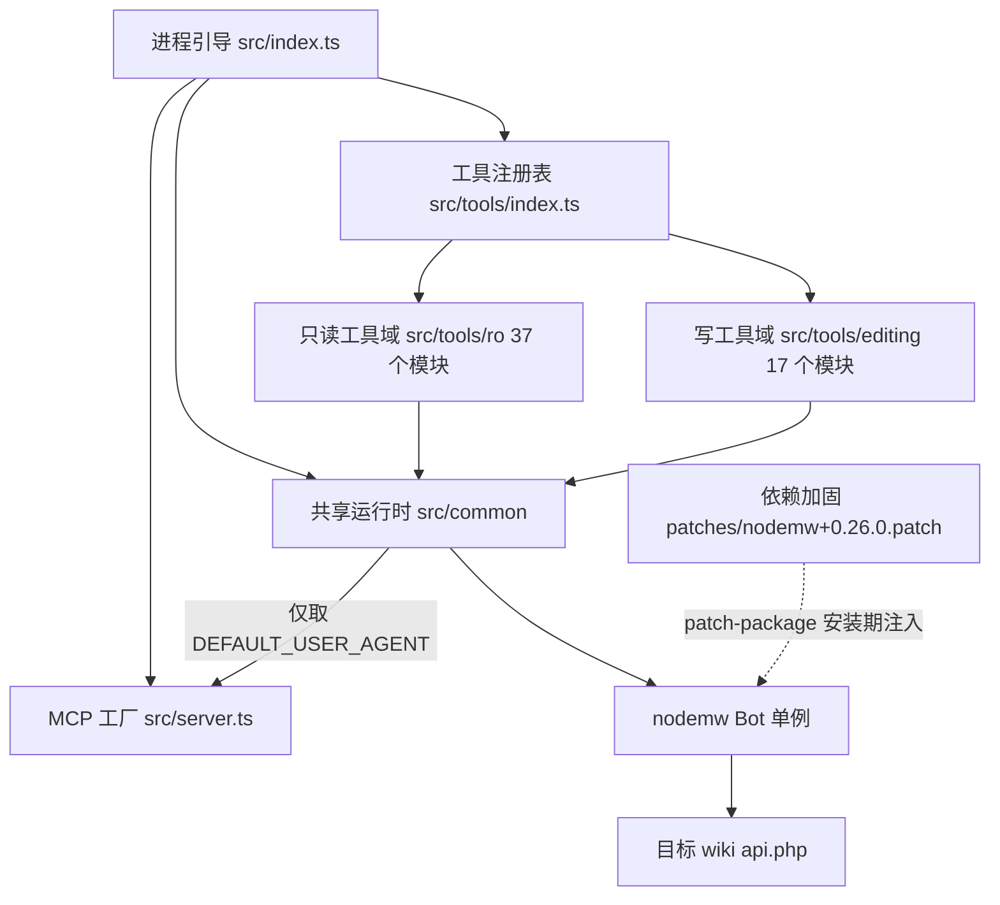
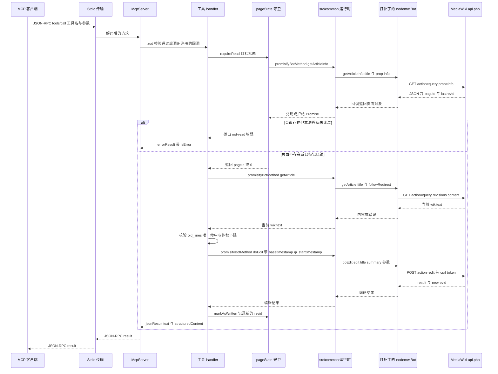

# 架构总览：五个域与依赖方向

本仓库是一个把**单个** MediaWiki 站点暴露给 AI agent 的 Model Context Protocol（MCP）服务器。它是一座单进程、单 wiki、单会话的桥：一个 Node.js 进程只被赋予一个目标 wiki，只经 `nodemw` 打一个 `api.php`，只服务一个经 stdio 连接的客户端。当前快照由 54 个工具（37 只读 + 17 写，[`src/tools/index.ts` L89-L147](../../src/tools/index.ts#L89-L147)）、一批 `.ts` 源文件（含测试，全部在 `src/` 下）和一份第三方依赖补丁（[`patches/nodemw+0.26.0.patch`](../../patches/nodemw+0.26.0.patch)）组成。

先看边界，再看五个域，最后看一次工具调用如何穿过它们。

## 三方系统边界

| 边界 | 方向 | 本仓库拥有的部分 |
|---|---|---|
| MCP 客户端（agent 宿主）经 stdio JSON-RPC | 入站请求、出站结果 | 工具目录、输入 schema、工具描述、面向 agent 的 instructions 与 prompt |
| 目标 wiki 的 `api.php`（HTTP/HTTPS） | 出站调用 | 什么也不拥有——内容、权限、token、历史都由 wiki 拥有 |
| `nodemw`（**打补丁的 0.26.0**）、`@modelcontextprotocol/sdk`、`zod`（npm） | 依赖库 | `src/common` 里的适配代码、`src/tools` 里的工具模块，以及 `patches/` 里的行为补丁 |

由此得出两条容易被忽略的结论：服务器能做的事全部经 MCP 工具目录暴露，没有 HTTP 监听器、没有数据库、没有队列、没有调度器——**一个能力如果不是一个已注册的工具，它就不存在**；而任何"状态"只要写在 wiki 侧（页面文本、修订历史、封禁记录），本仓库就只能通过 `api.php` 观察，无法成为事实来源。

唯一的出站例外是 `upload-by-url`：它从任意 URL 取素材，因此不经过 wiki 会话，而走 [`src/common/safeFetch.ts`](../../src/common/safeFetch.ts#L104-L157) 这条自带边界的通道（见下文"依赖加固"）。

## 五个自有域

代码量小到可以用五个域描述，每个域只有一处归属。

| 域 | 归属文件 | 负责 | 不负责 |
|---|---|---|---|
| 进程引导 | [`src/index.ts`](../../src/index.ts#L48-L404) | CLI 与环境解析、API 路径自动探测、`initBot` 与可选登录、站点信息与统计、版本与命名空间缓存、面向 agent 的描述、创建 server 并注册工具与 prompt、stdio 接线、登录心跳、stderr 横幅、致命失败退出 | 任何工具行为或请求内逻辑 |
| MCP 表面 | [`src/server.ts`](../../src/server.ts#L37-L51) + [`src/tools/index.ts`](../../src/tools/index.ts#L149-L163) | `McpServer` 身份与 `instructions`、`tools` capability、`DEFAULT_USER_AGENT`、54 个 registrar 的静态目录与"访客 vs 已登录"的 gating | 站点知识——工厂刻意不做 site-aware；注册表不实现工具 |
| 工具实现 | `src/tools/ro/`（37 个模块）、`src/tools/editing/`（17 个模块） | 单工具 zod schema、annotations、参数校验、请求成形、结果/错误成形 | 进程状态、传输、认证 |
| 共享运行时 | `src/common/`：`nodemwBot.ts`（bot 单例、Promise 桥、版本与命名空间缓存、登录心跳）、`pageState.ts`（读前写守卫与冲突参数）、`utils.ts`（`callApi`、`jsonResult`、`errorResult`）、`safeFetch.ts`（受控 HTTP 抓取）、`siteInfo.ts`/`compareOutput.ts`/`parseOutput.ts`（响应整形） | 全部可变进程状态，以及通往 wiki 的唯一通路 | 工具语义 |
| 依赖加固 | [`patches/nodemw+0.26.0.patch`](../../patches/nodemw+0.26.0.patch)、[`patches/UPSTREAM.md`](../../patches/UPSTREAM.md#L1-L7)、[`package.json` L18-L26](../../package.json#L18-L26) 的 `postinstall: patch-package` | 在安装期修正第三方客户端的崩溃、超时、cookie 泄漏与口令日志缺陷 | 业务逻辑；不改 `src/` |

该图给出五个域的依赖方向：引导向下驱动工厂、注册表与运行时；注册表引用两个工具域；两个工具域只向下依赖共享运行时；运行时经 `nodemw` 抵达 `api.php`，而补丁在安装期改写这个第三方库本身。

依赖规则有一条例外，另有一条必须知道的边界事实：

- **唯一向上的边。** `nodemwBot.ts` 从 `server.ts` 导入 `DEFAULT_USER_AGENT`（[`src/server.ts` L33-L37](../../src/server.ts#L33-L37)、[`src/common/nodemwBot.ts` L30](../../src/common/nodemwBot.ts#L30)），并按其与 `--user-agent`/`--user-agent-append` 的组合算出最终 UA（[L150-L157](../../src/common/nodemwBot.ts#L150-L157)）。改 UA 文案属于工厂，改 UA 如何拼进 `Bot` 选项属于运行时。
- **工具模块是叶子。** 它们只从 `../../common/*` 与 npm 包（`zod`、SDK 类型）导入；`src/tools/ro` 与 `src/tools/editing` 之间没有任何互相导入，唯一的交叉引用是注册表导入它们。两个域共享约定与运行时，不共享代码。

### 两条写进代码的硬约定

**每个 `.ts` 文件都以 BSD-2-Clause 头开始。** `src/` 下的每一个 `.ts` 文件——包括 `src/common/__tests__/` 与 `src/tools/__tests__/` 里的测试与假 client——第 1 行就是 `/*` 与 `SPDX-License-Identifier: BSD-2-Clause`（示例见 [`src/index.ts` L1-L27](../../src/index.ts#L1-L27)）。构建脚本把同一段声明作为 esbuild `banner` 重新贴到产物上，并补 `#!/usr/bin/env node` shebang（[`scripts/build.js` L24-L52](../../scripts/build.js#L24-L52)），因此 `dist/index.js` 是唯一对外发布的许可表面：新文件漏了头部不会让构建失败，但会让"每个源文件都带许可"这条约定失效。

**没有依赖注入层。** registrar 的签名是 `(server: McpServer) => RegisteredTool`，除了 server 什么也拿不到；handler 在**调用时刻**回模块作用域里取 `getBot()`、`requireRead()`、`markAsWritten()`、`conflictGuardParams()`。没有容器、没有请求上下文、没有按会话的构造参数。因此：

- "一个进程 = 一个 wiki = 一个会话"是结构事实，不是需要自觉遵守的策略；MCP 客户端重连（`/mcp`）会启动一个全新进程，读证据与登录态一并归零。
- 可测性不是靠注入，而是靠 `vi.mock('../../common/nodemwBot.js', …)` 把整个运行时换成假 client，再用 SDK 的 `InMemoryTransport` 走真实 MCP 协议（[`src/tools/__tests__/annotations.test.ts` L35-L39](../../src/tools/__tests__/annotations.test.ts#L35-L39)、[`fakeNodemwBot.ts`](../../src/tools/__tests__/fakeNodemwBot.ts)）。
- 想在 handler 里"传一个配置进去"没有落点；配置只能经 `initServerConfig`/`initBot` 进运行时，再经模块函数读回来。

## 状态归属：`src/common` 里有什么，什么不在本仓库

进程内可变状态全部位于 `src/common`，全部随进程退出而消失：

| 状态 | 声明位置 | 写入者 | 读取者 |
|---|---|---|---|
| `botInstance`（`Bot` 单例） | [`nodemwBot.ts` L49](../../src/common/nodemwBot.ts#L49) | `initBot`、`clearBotCache` | `getBot`、登录心跳 |
| `serverConfig` | [L50](../../src/common/nodemwBot.ts#L50) | `initServerConfig` | `getServerConfig`，`src/` 内无消费者 |
| `authenticated` 布尔标志 | [L51](../../src/common/nodemwBot.ts#L51) | 登录成功回调置 `true`、心跳降级置 `false`、`clearBotCache` 置 `false` | `isAuthenticated` → `src/index.ts` |
| `heartbeatTimer` | [L94](../../src/common/nodemwBot.ts#L94) | `startLoginHeartbeat` / `stopLoginHeartbeat` | 同两个函数 |
| `mediaWikiVersion` 字符串缓存 | [L234](../../src/common/nodemwBot.ts#L234) | `setMediaWikiVersion` | `getMediaWikiVersion` → 启动描述与版本敏感工具 |
| `namespaceCache`（小写名 → id） | [L252](../../src/common/nodemwBot.ts#L252) | `setNamespaceCache` | `lookupNamespaceId` → `get-pages-by-prefix` |
| `readState`（`pageid` → `{revid, revTimestamp, readAt}`） | [`pageState.ts` L43](../../src/common/pageState.ts#L43) | `markAsRead`、`recordReadFromApi`、`markAsWritten`、`clearReadState` | `isRead`、`requireRead`、`conflictGuardParams`、`findStaleWrite` |
| `writeCache`（标题 → `{pageid, revid}`） | [`pageState.ts` L49](../../src/common/pageState.ts#L49) | `markAsWritten`、`invalidateTitle`、`requireRead` 的失效分支 | 守卫路径 |

不属于本仓库、也不应试图在本仓库维护的东西：

- **页面内容与修订历史**——只有 `api.php` 是事实来源，`get-article` 每次读到的都是那一刻的远端状态。
- **用户、用户组与权限**——启动时的 `whoami` 只把结果写进面向 agent 的描述文本（[`src/index.ts` L224-L237](../../src/index.ts#L224-L237)），不参与任何判定。
- **登录凭据、cookie 与 CSRF token**——由 `initBot` 交给 `nodemw` 实例，之后由 `nodemw` 在内存中持有；需要 token 的工具现取现用（如 [`block`](../../src/tools/editing/block.ts#L94-L102)），本仓库不落盘、不缓存。
- **任何持久化**——八处状态都没有序列化路径；`clearReadState` 只有测试调用，`clearBotCache` 也只清 `botInstance` 与 `authenticated`。

各状态的生命周期、`authenticated` 状态机与心跳语义见 [bot 运行时](bot-runtime.md)，本页只固定归属关系。

## Agent 描述在 `src/index.ts` 生成，工具在注册期定型

面向 agent 的站点自述**在引导里拼装**，不在工厂里：`main()` 把站点名、语言、生成器、MediaWiki 版本、主页面、API endpoint、站点统计、登录身份与 groups/rights，以及一大段 OPERATING PRINCIPLES 拼成一个字符串（[`src/index.ts` L239-L346](../../src/index.ts#L239-L346)），然后 `createServer(description)` 只是把它作为 `instructions` 原样存进 `McpServer` 选项（[`src/server.ts` L39-L51](../../src/server.ts#L39-L51)）。同一份字符串还被注册成名为 `operating-principles` 的 prompt，供不会自动注入 instructions 的客户端手动拉取（[L351-L364](../../src/index.ts#L351-L364)）——两条投递路径共用一个来源，因此不会漂移。

工具可用性同样是启动期事实，而不是每次调用的检查：

- 引导把当时的 `isAuthenticated()` 作为 `auth` 传入 `registerAllTools(server, auth)`（[L348-L349](../../src/index.ts#L348-L349)）。访客进程只注册 `readToolRegistrars`，根本没有 `write`、`edit`、`delete`、`block` 这些工具——agent 无法调用从未被声明的能力（[`src/tools/index.ts` L149-L153](../../src/tools/index.ts#L149-L153)）。
- `auth` 是启动时的快照。已登录时启动的 60 秒登录心跳在检测到匿名 `userinfo` 后会把 `authenticated` 翻成 `false` 并在 stderr 打印提示（[`src/common/nodemwBot.ts` L94-L123](../../src/common/nodemwBot.ts#L94-L123)、[`src/index.ts` L370-L384](../../src/index.ts#L370-L384)），但**已注册的写工具不会被撤下**，后续写操作只会以普通工具错误的形式失败。
- 反过来，访客进程即使之后凭据可用也不会追加工具：注册只发生一次。

## 一次工具调用：从注册到 MediaWiki 返回

注册只发生一次，调用发生无数次，但两者共用同一条通路。下图以写工具 `edit` 为例——它最长，因为要穿过读前写守卫、重读当前内容、算出冲突参数；只读工具在第一次 `query` 往返之后即结束。

按域拆开看这条路径：

1. **传输。** `StdioServerTransport` 是唯一传输（[`src/index.ts` L366-L368](../../src/index.ts#L366-L368)）。stdout 只承载 JSON-RPC，进程内所有诊断——启动横幅、debug 轨迹、路径探测提示、注册失败、登录过期提示——都走 stderr 的 `console.error`。`src/` 里没有一处 `console.log`，因为任何写 stdout 的输出都会破坏协议流。
2. **分发。** MCP SDK 的 `McpServer` 按工具名匹配 `registerAllTools` 建立的注册，用工具的 zod schema 校验参数，再调用 handler 闭包。服务器对象是唯一把目录当作协议表面看待的组件；目录内容由注册表决定。
3. **前置条件。** handler 自己做语义校验（例如 `get-article` 要求 `title` 与 `id` 恰有其一，[`src/tools/ro/get-article.ts` L121-L133](../../src/tools/ro/get-article.ts#L121-L133)），写侧再调用读前写守卫；`edit`/`write`/`revert` 还各自有体积与冲突前置检查。
4. **运行时访问。** handler 经 `getBot()` 取进程级 bot，然后走两个助手之一：`promisifyBotMethod` 把 nodemw 的**单结果**方法回调转成 Promise（[`src/common/nodemwBot.ts` L308-L325](../../src/common/nodemwBot.ts#L308-L325)）；`callApi` 把裸 `bot.api.call` 的四参数回调转成 Promise，并解析完整响应体，供需要 `pageids`/`revids`、非常规参数、显式 token 类型或 nodemw 未封装 action 的调用使用（[`src/common/utils.ts` L42-L58](../../src/common/utils.ts#L42-L58)）。取舍规则见 [nodemw client](../integrations/nodemw-client.md)。
5. **wiki。** `nodemw` 拼出 `${protocol}://${server}${path}/api.php` 并完成 HTTP 交换（含 cookie/token 状态）；这个 endpoint 也会回显进启动描述（[`src/index.ts` L243-L251](../../src/index.ts#L243-L251)）。
6. **结果成形。** handler 从不向传输层抛异常：失败翻译成 `errorResult`，成功翻译成 `jsonResult`（[`src/common/utils.ts` L85-L148](../../src/common/utils.ts#L85-L148)）。`jsonResult` 同时设置人类可读的 `text` 与 `structuredContent`；`errorResult` 设置 `isError`，并在错误文本像"登录已静默过期"或"编辑冲突"时追加恢复提示。工具目录的规模与逐工具形状见 [工具注册表](tool-registry.md)。

## 同一工具层里的两个域

`src/tools/index.ts` 是唯一决定"存在哪些工具"的地方：两个静态 registrar 数组，`readToolRegistrars`（37）与 `writeToolRegistrars`（17），`registerAllTools(server, includeWriteTools = true)` 把它们拼起来（[L89-L163](../../src/tools/index.ts#L89-L163)）。

- **读写切分只是位置与数组归属。** 没有共享基类、没有必须实现的接口、也没有"`ro/` 下的模块不得写入"的运行时断言。唯一的硬约束来自测试：全部 54 个工具都必须显式声明四个 hint，且只读集合必须严格是全集子集（[`annotations.test.ts` L106-L133](../../src/tools/__tests__/annotations.test.ts#L106-L133)）。
- **注解是粗粒度信号，风险等级在描述文本里。** 37 个只读工具一律 `readOnlyHint: true, destructiveHint: false`；17 个写工具一律 `readOnlyHint: false`，其中 15 个 `destructiveHint: true`，只有 `purge` 与 `undelete` 被标为非破坏性（[`purge.ts` L43-L49](../../src/tools/editing/purge.ts#L43-L49)）；`idempotentHint` 只对 `purge`、`protect`、`unblock`、`write` 为真。因此以 `destructiveHint` 做审批门控的客户端会把几乎整个写域视作同等危险——连自我描述为 "LOW RISK" 的 `append`、`prepend` 也是——真正起区分作用的仍是描述里的 `LOW`/`MEDIUM`/`HIGH RISK` 前缀。
- **溯源是每个写调用的义务。** 编辑摘要、删除/封禁理由、上传注释都加上 `[nodemw-mcp.<tool>] ` 前缀（例如 [`edit` L151](../../src/tools/editing/edit.ts#L151)、[`write` L141](../../src/tools/editing/write.ts#L141)、[`block` L104](../../src/tools/editing/block.ts#L104)），这是运维人员事后从 wiki 历史里辨认"这条动作来自本服务器而非人类编辑者"的唯一依据。
- **输出契约不齐。** 48 个工具通过 `tool.update({ outputSchema })` 声明结构化输出；`get-article`、`get-article-by-revision`、`expand-templates`、`parse` 主要返回纯文本块（wikitext/HTML/XML 本身就是返回值，套进 JSON 只增加噪声），而 `get-articles`、`get-module-source` 返回 JSON 却未声明 schema。新增工具时补 schema 是默认做法，不补则算例外。

## 读前写守卫

`src/common/pageState.ts` 是服务器自己强制执行的唯一跨切面行为不变量。它维护两张模块作用域的表：`readState` 记录已读页面的 `(pageid, revid, revTimestamp, readAt)`，`writeCache` 记录本会话刚写过的标题（[L38-L49](../../src/common/pageState.ts#L38-L49)）。

- **写入者只有读内容类工具，且必须是完整视图。** `get-article`（经 `recordReadFromApi`）、`get-article-with-lineno`、`get-articles`、`get-module-source` 会记录状态，但仅当返回给 agent 的内容覆盖整页：`get-article` 在 `offset > 0`、`maxlen` 截断或带 `revision` 参数时不记录（[L50-L54](../../src/tools/ro/get-article.ts#L50-L54)、[L193-L198](../../src/tools/ro/get-article.ts#L193-L198)、[L226-L231](../../src/tools/ro/get-article.ts#L226-L231)），`get-article-with-lineno` 在 `offset`/`limit`/`maxlen` 切片时不记录（[L189-L196](../../src/tools/ro/get-article-with-lineno.ts#L189-L196)）。`search`、`get-article-info`、`get-log` 等不能解锁写操作。
- **检查者是 17 个写工具里的 8 个。** `edit`、`write`、`append`、`prepend`、`revert`、`move`（针对 `from`）、`delete`、`protect` 在变更前调用 `requireRead(title)`。其余 9 个——`purge`、`block`、`unblock`、`undelete`、`upload`、`upload-by-url`、`send-email`、`create-account`、`add-flow-topic`——不调用，因为它们作用于用户、文件、缓存或全新内容，而不是既有页面正文。
- **解析方式。** `requireRead` 每次都经 `getArticleInfo` 把标题重新解析成页面对象，再判定三种情况：页面存在但 `pageid` 不在 `readState` 里 → 抛出点名 `get-article`/`get-article-with-lineno` 的错误；页面不存在且本会话没写过 → 返回 `0`，这是写工具能新建页面的原因；页面不存在但本会话写过它 → 抛错，要求先确认（[L210-L267](../../src/common/pageState.ts#L210-L267)）。标题重绑（move 后留下重定向、delete 后重建）也会被拒：缓存的 `pageid` 与当前解析结果不一致时先失效再抛错。

守卫在最近一轮加固后不再只是"读没读过"，而是承担冲突检测的前半段：

- **读记录带时间戳，用于 MediaWiki 原生冲突检测。** `conflictGuardParams(pageid)` 把 `readAt` 变成 `starttimestamp`、把读到的 `revTimestamp` 变成 `basetimestamp`，由 `edit`、`write`、`append`、`prepend`、`revert` 合并进 `action=edit`（[L130-L138](../../src/common/pageState.ts#L130-L138)、[`write.ts` L141-L163](../../src/tools/editing/write.ts#L141-L163)）。
- **整页覆写额外做 CAS。** `findStaleWrite` 比较记录的 `revid` 与当前 `lastrevid`，不同则拒绝——因为完整替换在 MediaWiki 的三方合并里总是能"干净地"合并，原生 `basetimestamp` 检查抓不到这种丢失。`write` 与 `revert` 都调用它（[L147-L171](../../src/common/pageState.ts#L147-L171)、[`revert.ts` L86-L89](../../src/tools/editing/revert.ts#L86-L89)）。
- **残余缺口。** 只做 `appendtext`/`prependtext` 或行替换的工具没有 CAS，只有 `basetimestamp`；`revert` 刻意**不**调用 `markAsWritten`，避免用自己的写出来"洗白"读证据（[`revert.ts` L179-L183](../../src/tools/editing/revert.ts#L179-L183)）；`clearReadState` 只被测试调用，所以两张表覆盖整个进程生命周期，"读过"永远意味着"本进程内某个时刻读过"。

除守卫之外，写工具还有各自的体量闸门：`write` 按声明的 `intent`（`add`/`revise`/`rewrite`/`delete`）核对字节变化（[L91-L130](../../src/tools/editing/write.ts#L91-L130)），`edit` 要求 `old_lines` 恰好命中一次且不接受把页面压缩到 1/10 以下的替换（[L111-L149](../../src/tools/editing/edit.ts#L111-L149)），`revert` 对"恢复到不足当前 1/10"同样拒绝。判定细节与测试见 [read-before-write-guard](../concepts/read-before-write-guard.md)。

## 授权不在本仓库

服务器不自带任何授权逻辑。它对写操作施加的唯一前置条件就是读前写守卫与前述体量/冲突检查；用户组与权限只出现在启动描述里作为说明性文字（[`src/index.ts` L262-L276](../../src/index.ts#L262-L276)），不参与判定；真正的权限实施交给 MediaWiki，API 返回的错误（例如 [`block` L124-L128](../../src/tools/editing/block.ts#L124-L128) 检查的 `raw.error`）被当作普通工具结果返回给 agent。要在本仓库里"限制某个工具"，能做的是注册期 gating（决定工具是否存在），而不是在 handler 里判断权限。

## 不变量与失败语义

| 不变量 | 成立位置 | 破坏方式 |
|---|---|---|
| 每进程恰好一个 wiki、一个会话 | `src/common/nodemwBot.ts` 的模块作用域 `botInstance` 与各缓存 | 二次 `initBot`，或期待多 wiki 支持 |
| 启动期致命失败直接退出，因此 handler 可以假设 `getBot()` 成功 | 路径探测、登录、站点信息三处的 `process.exit(1)`（[`src/index.ts` L131-L150](../../src/index.ts#L131-L150)、[L196-L207](../../src/index.ts#L196-L207)） | 未 `initBot` 就使用运行时——`getBot()` 抛 `Bot not initialized…` |
| 访客进程无法调用写工具 | `registerAllTools` 的注册期 gating | 会话在启动后才认证；工具不会在运行时被追加 |
| 页面必须被完整读过，写工具才能改它 | 8 个写工具里的 `requireRead` | 跳过它的 9 个写工具；除 `write`/`revert` 的 CAS 外，守卫本身不比对内容 |
| 工具失败变成结果而不是崩溃 | handler 的 `try/catch` → `errorResult`（裸 API 调用还要检查 `data.error`） | handler 的 `try/catch` 之外的抛错，或任何写 stdout 的输出 |
| stdout 只属于协议 | 引导与运行时一律 `console.error` | 新增一个 `console.log` |
| 第三方响应畸形不会杀死会话 | 补丁 + `uncaughtException` 兜底（[`src/index.ts` L117-L129](../../src/index.ts#L117-L129)） | 删除补丁或删掉兜底处理器 |

注册失败被刻意设计成非致命且有损：`registerAllTools` 为每个 registrar 单独包一层 `try/catch`，打印 `Error registering tool: …` 后继续，并返回成功注册的 `RegisteredTool[]`（[L149-L163](../../src/tools/index.ts#L149-L163)）。引导**丢弃**这个返回值，横幅里的数量来自数组长度（[`src/index.ts` L386-L403](../../src/index.ts#L386-L403)），所以横幅可能报告 `54 (37 read + 17 write) loaded` 而某个工具其实注册失败——横幅数的是意图，不是注册结果。

## 依赖加固：打补丁的 `nodemw`

这是第五个域，也是本仓库唯一一处直接拥有第三方行为的地方。`package.json` 用 `postinstall: patch-package`（[L18-L26](../../package.json#L18-L26)）在每次 `npm install` 后把 [`patches/nodemw+0.26.0.patch`](../../patches/nodemw+0.26.0.patch) 应用到 `node_modules/nodemw`，补丁针对 0.26.0 锁版，升级 `nodemw` 必须先重做补丁。四类修复（每类都附了 CWE 编号与建议的 PR 拆分，见 [`patches/UPSTREAM.md`](../../patches/UPSTREAM.md#L1-L87)）：

1. **畸形但 HTTP 200 的响应不再炸掉宿主进程。** `Api.prototype.call` 只校验状态码、JSON 可解析与 `error` 键；`lib/api.js` 会在 `data` 为 `null` 时抛 `TypeError`，`lib/bot.js` 的多个便捷方法（`getFirstItem`、`getToken`、`doEdit`、`delete`、`purge`、`upload`、`createAccount`、`logIn`、`getMediaWikiVersion` 等）在缺字段或错误路径上无保护解引用。这些回调运行在 `@cypress/request` 的 `complete` 监听器里，任何 `try/catch` 都接不住，等于一次恶意/异常 wiki 的单条响应就能杀死整个 MCP 通道。补丁逐个加守卫，并把空响应体转成正常错误回调。
2. **每个请求都有 30 秒超时。** 否则停滞的 `api.php` 会永久占用共享 `async.queue`（默认并发 3），三条卡死的请求就冻结全部库流量。
3. **`fetchUrl` 不再泄漏会话 cookie。** 原本把登录后的共享 `RequestJar` 附到任意 URL 上（RFC 6265 只按主机名匹配、且 `Domain=` 会匹配兄弟子域），既可能回放会话，也可被远端覆写后续 API 用的 cookie；现在只有目标与 wiki 同源才复用 jar。
4. **不再把 `process.argv` 写进日志。** 下游 CLI 常把口令放在 argv（`-p <password>`、`--token`），原实现在 debug 与文件日志里把它写到 stdout 和磁盘。

补丁之外还有两道仓库内的兜底，两者都不能替代补丁：

- `main()` 在解析完 CLI、发起任何网络调用之前就注册 `process.on('uncaughtException')`，只打印一行 stderr 并继续存活（[`src/index.ts` L117-L129](../../src/index.ts#L117-L129)）。代价是触发它的那次工具调用会悬挂，由 MCP 客户端自己的超时收尾。
- `upload-by-url` 的源抓取由 [`src/common/safeFetch.ts`](../../src/common/safeFetch.ts) 执行：只允许 http/https、拒绝 `localhost`/`unix`/私有与保留地址（含云元数据 `169.254.169.254`，且对解析结果再次判定）、每一跳重定向都重新校验、50 MB 字节上限、30 秒墙钟截止、不复用任何 cookie jar 或代理（[L33-L36](../../src/common/safeFetch.ts#L33-L36)、[L68-L92](../../src/common/safeFetch.ts#L68-L92)、[L104-L157](../../src/common/safeFetch.ts#L104-L157)）。

## 扩展点

- **新增工具**是三步改动：实现带单个导出 registrar 的模块（含 BSD-2-Clause 头）、在 `src/tools/index.ts` 里导入、加入 `readToolRegistrars` 或 `writeToolRegistrars`。注册是静态的，没有插件发现；没有被任何数组引用的工具文件不会进入产物，因为 bundle 只以 `src/index.ts` 为入口，并把 `nodemw`、`@modelcontextprotocol/*`、`zod` 保持 external（[`scripts/build.js` L12-L23](../../scripts/build.js#L12-L23)、[`package.json` L35-L39](../../package.json#L35-L39)）。改完还要补两个测试钩子：`annotations.test.ts` 会检查四个 hint 与 37/17 计数，`smoke.test.ts` 的 `TOOL_ARGUMENTS` 要求每个工具都有一份最小参数（[`smoke.test.ts` L53-L115](../../src/tools/__tests__/smoke.test.ts#L53-L115)）。
- **新增域或 gating 规则**属于 `registerAllTools`，不属于单个工具。当前签名只接受一个布尔值；更细的粒度（按命名空间或按权限）必须把决策搬到那里或搬进 handler。
- **新增安全前置条件**属于工具层或守卫，因为传输与工厂都是直通的。守卫的存储与调用方是可分离的：`writeCache`、`findStaleWrite` 都是后来在不改 8 个调用点的前提下加进 `pageState.ts` 的。
- **改变 agent 所知道的信息**属于 `src/index.ts` 的描述拼装；`instructions` 与 `operating-principles` prompt 由同一个字符串喂入。
- **改第三方行为**属于 `patches/`：先改 `patches/nodemw+0.26.0.patch`（或在 `node_modules` 里改完重新 `npx patch-package nodemw`），再同步 `patches/UPSTREAM.md`；忘记 `postinstall` 会让 CI 与本地行为分叉。

## 验证与运维信号

`npm test` 跑 `vitest run`，全部离线：`src/common/__tests__/` 有 7 个模块级单元测试（`pageState`、`safeFetch`、`siteInfo`、`compareOutput`、`parseOutput`、`utils`、命名空间缓存），`src/tools/__tests__/` 有 4 个走真实 MCP 协议的工具级测试，靠 `fakeNodemwBot.ts` 与 `InMemoryTransport` 替代网络与 wiki。其中三条直接保护本页描述的架构：`annotations.test.ts` 断言工具总数、只读子集与四个 hint；`smoke.test.ts` 逐个调用全部 54 个工具；`readGuard.test.ts` 覆盖局部读取不解锁写、标题重绑拒绝、`revert` 的 CAS 与"不洗白读证据"、`edit` 的体量下限（[L104-L214](../../src/tools/__tests__/readGuard.test.ts#L104-L214)）。[`test-server.js`](../../test-server.js#L11-L56) 仍是手写的冒烟脚本（检查 `dist/index.js` 存在、启动两秒不崩），没有接进 `npm test`。

运行时验证仍靠启动横幅：自动探测到的路径、任何致命的 `Error:` 行（随后退出码 1）、站点信息失败的诊断块，以及收尾横幅里的站点、endpoint、版本、认证状态与工具数量——已登录时是 `54 (37 read + 17 write)`，访客模式是 `37 read-only`（[`src/index.ts` L386-L403](../../src/index.ts#L386-L403)）。读那一行横幅是确认引导、注册表与 gating 决策三者一致的最快方式。

## 相关页面

- [bot 运行时](bot-runtime.md) — 共享客户端适配器、状态模型、Promise 桥与登录心跳。
- [启动生命周期](startup-lifecycle.md) — `main()` 的排序约束与致命/降级分支。
- [工具注册表](tool-registry.md) — 两个 registrar 数组与逐工具契约。
- [写前必读守卫](../concepts/read-before-write-guard.md) — `readState`/`writeCache` 的完整判定与冲突检测。
- [安全模型](../concepts/safety-model.md) — 风险分级、输入边界与"服务器不自带授权"的取舍。
- [MCP 传输与客户端](../integrations/mcp-transport-and-clients.md) — stdio 会话、instructions 与 prompt 的投递。
- [nodemw client](../integrations/nodemw-client.md) — 何时用高层方法、何时用 `callApi`，以及补丁边界。
- [读取内容](../workflows/reading-content.md) 与 [编辑内容](../workflows/editing-content.md) — 两个工具域的实际用法与安全约束。
- [新增工具](../workflows/adding-a-tool.md) 与 [测试与验证](../testing/validation.md) — 扩展与验收路径。
