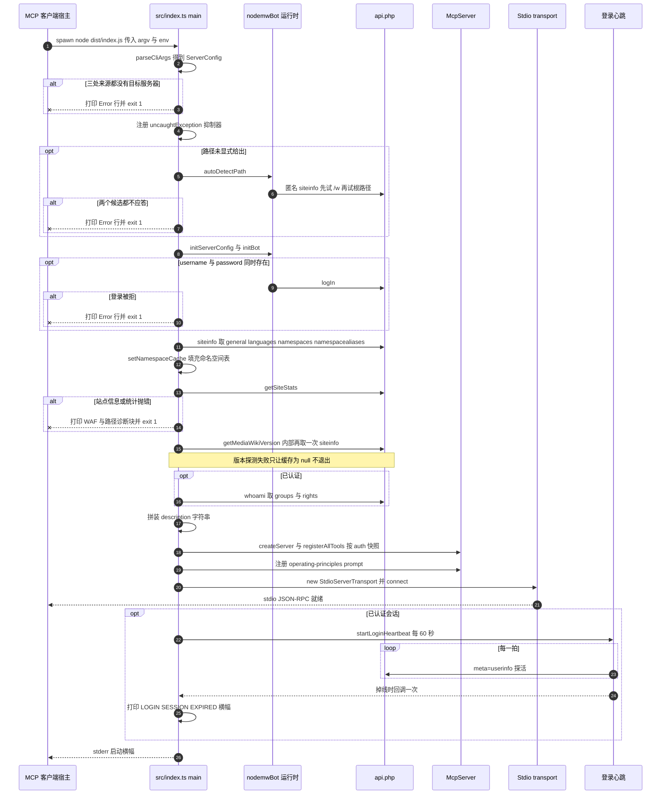

# 启动生命周期：从 argv 到可用的 MCP 会话

启动就是 [`src/index.ts`](../../src/index.ts#L114-L404) 里的一个线性 `main()`：没有 supervisor 循环，没有惰性初始化，也没有按会话的 setup。这段序列只跑一次，跑完之后 stdio transport 才接入，JSON-RPC 才开始被应答。正因为如此，所有进程级事实都在这几十行里一次定死：连哪个 wiki、API 挂在哪条路径、会话是否已认证、客户端能看见哪些工具（写工具是否注册）、Agent 在发出第一次工具调用之前读到的站点自述，以及进程会不会被一次畸形响应杀掉。

入口文件同时是构建入口：esbuild 把 `src/index.ts` 打成 `dist/index.js`，把 `nodemw`、`@modelcontextprotocol/*`、`zod` 保持 external（[`scripts/build.js`](../../scripts/build.js#L11-L26)）；`package.json` 把 `nodemw-mcp-server` 这个 bin 指向该产物（[`package.json`](../../package.json#L14-L17)）。入口模块的最后一句是 `main().catch(console.error)`（[L406](../../src/index.ts#L406)），它决定了"没有被 `process.exit(1)` 覆盖的异常"如何表现。

## 顺序总览

| # | 步骤 | 位置 | 致命？ |
|---|---|---|---|
| 1 | 解析 CLI flag 与环境变量得到 `ServerConfig` | [L48-L112](../../src/index.ts#L48-L112) | 是（完全没有目标服务器时） |
| 2 | 安装 `uncaughtException` 抑制器 | [L117-L129](../../src/index.ts#L117-L129) | 否（它本身是兜底） |
| 3 | 路径未显式给出时自动探测 API 脚本路径 | [L131-L140](../../src/index.ts#L131-L140) | 是 |
| 4 | `initServerConfig` 存配置，`initBot` 构造 client，凭据完整时登录 | [L142-L150](../../src/index.ts#L142-L150) | 是（登录被拒时） |
| 5 | 抓取站点信息（含 `namespaces`/`namespacealiases`）与站点统计 | [L152-L207](../../src/index.ts#L152-L207) | 是（打印诊断块后退出 1） |
| 6 | 抓取并缓存 MediaWiki 版本 | [L209-L222](../../src/index.ts#L209-L222) | 否（静默） |
| 7 | 已认证时查询本账号的 groups 与 rights | [L224-L237](../../src/index.ts#L224-L237) | 否（静默） |
| 8 | 拼装给 Agent 的描述字符串 | [L239-L346](../../src/index.ts#L239-L346) | 否 |
| 9 | `createServer(description)` 并以 auth 快照调 `registerAllTools` | [L348-L349](../../src/index.ts#L348-L349) | 否 |
| 10 | 注册 `operating-principles` prompt | [L351-L364](../../src/index.ts#L351-L364) | 否 |
| 11 | 连接 stdio transport | [L366-L368](../../src/index.ts#L366-L368) | 否（失败落到顶层 `catch`） |
| 12 | 仅已认证会话启动 60 秒登录心跳 | [L370-L384](../../src/index.ts#L370-L384) | 否 |
| 13 | 把启动横幅打到 stderr | [L386-L403](../../src/index.ts#L386-L403) | 否 |

顺序上有三条硬约束：描述字符串必须在 `createServer(description)` 之前存在（它是 `instructions` 的构造参数），而描述又引用了第 5、6、7 步的结果，所以探测必须排在描述拼装之前；工具与 prompt 必须在 `connect` 之前注册，因为 SDK 在 transport 接上之后拒绝再登记能力，而这个服务器从不发 `list_changed` 通知；心跳只能排在 `connect` 之后，否则它会与尚在进行的引导探测抢同一个请求队列。相反，auth 布尔量在第 4 步就已经确定：第 7、9、12、13 步读的都是同一个值。

## 时序图



图注：`main()` 的十三个编号步骤与三条致命出口；心跳是唯一在 `connect` 之后才启动的组件，且只存在于已认证会话。

## 步骤 1：CLI 与环境解析

`parseCliArgs`（[L48-L112](../../src/index.ts#L48-L112)）用 Node 的 `util.parseArgs`，`strict: false` + `allowPositionals: true`。声明的选项只有 `--server/-s`、`--path`、`--endpoint`、`--user/-u`、`--pass/-p`、`--token`、`--debug`、`--dry-run`、`--user-agent/-A`、`--user-agent-append`；由于 `strict: false`，任何未声明的 flag 都被静默接受为松散值，而不是报错。

真正有语义的规则：

- **目标服务器优先级。** `--server` 优先于第一个位置参数，后者优先于 `NODEMW_MCP_SERVER`。三者都空是整个解析阶段唯一的致命错误：向 stderr 打印点名三处来源的 `Error:` 行并以退出码 1 结束（[L67-L71](../../src/index.ts#L67-L71)）。位置参数与 `-s` 同时给出不会被判为冲突，只是被前者覆盖。
- **URL 归一化。** 目标以 `http://` 或 `https://` 开头时用 `new URL` 解析，只保留 hostname、protocol 与 port；URL 里的路径段被丢弃，之后由自动探测重新推导。`new URL` 抛错时退回原始字符串作为主机名，protocol 留空（[L76-L89](../../src/index.ts#L76-L89)）。
- **路径是否显式。** `pathExplicit` 取 `!!(values.path ?? values.endpoint ?? process.env.NODEMW_MCP_ENDPOINT_PATH)`（[L91-L92](../../src/index.ts#L91-L92)）。空值判断发生在 `??` 之后，所以 `--path ""` 与"没有给"无法区分，自动探测照跑；挂在网站根目录的 wiki 只能靠第二个候选探测成功。返回配置里的 `?? '/w'` 默认值（[L100](../../src/index.ts#L100)）实际上不可达。
- **环境变量回退**与 flag 一一对应：用户、密码、User-Agent、User-Agent 追加（`=1`）、debug（`=1`）（[L101-L107](../../src/index.ts#L101-L107)）。`--token` 会被读入 `ServerConfig.token`，但既不会转给 `nodemw`，也不参与登录，`NODEMW_MCP_MW_TOKEN` 在这里根本没有被读取；因此只给 token 的调用会静默进入 guest 会话。这一点在 [Bot 运行时](bot-runtime.md)的「配置面：哪些字段真正到达 nodemw」一节有更完整的说明。

`proxy`、`concurrency`、`domain` 虽然存在于 `ServerConfig`（[`src/common/nodemwBot.ts`](../../src/common/nodemwBot.ts#L32-L47)），但这个入口无法触达它们 —— 只有把运行时当作库来嵌入时才设置得了。面向运维的完整 flag 矩阵见 [Configuration](../operations/configuration.md)；仓库根目录的 [`.mcp.json`](../../.mcp.json#L1-L18) 是一种用环境变量接线的本地样例，形态说明见 [MCP transport and clients](../integrations/mcp-transport-and-clients.md)。

## 步骤 2：进程级兜底 —— `uncaughtException` 抑制器

`main()` 在解析完 CLI、发起任何网络请求之前，注册一个进程级处理器（[L117-L129](../../src/index.ts#L117-L129)）：

```ts
process.on('uncaughtException', (err: Error) => {
    console.error(`[nodemw-mcp] Suppressed uncaught exception in wiki response handling: ${err.message}`);
});
```

它存在的理由与 `nodemw` 的回调风格直接相关：适配层把回调包成 Promise，但回调**本身**并不是在 Promise 链里执行的 —— 它由 `@cypress/request` 的 `'complete'` EventEmitter 监听器调用，也就是跑在 socket I/O 栈上。回调体内如果抛出（典型如 wiki 返回 200 但 JSON 形状不对，nodemw 在 `data.error`、`data.pages`、`tokens` 这些字段上直接解引用），这个异常既不经过 `promisifyBotMethod` 的 Promise，也不经过任何工具处理器的 `try/catch`，而是直接冒到事件循环。在"一进程一会话"的架构下，那等于一个畸形的 200 响应就杀掉整条 MCP 通道。

三个必须一起理解的性质：

- **它能救会话，救不了这次调用。** 处理器只打一行 stderr 就返回，进程存活；但受影响的那次工具调用永远不会 settle —— 对应的 JSON-RPC id 不会得到应答，唯一的边界是 MCP 客户端自己的超时。会话仍可服务后续请求。
- **它是兜底，不是修复。** 仓库自带 [`patches/nodemw+0.26.0.patch`](../../patches/nodemw+0.26.0.patch#L1-L35)（`postinstall` 跑 `patch-package`），已经在 nodemw 内部补了空 body、缺失 `tokens`/`pages`、`general.generator` 无法解析等分支，并给每个 API 请求加了 30 000 ms 超时；抑制器负责的是补丁没有覆盖到的形状。`src/index.ts` 的注释把"响应形状校验"明确记为属于上游的正式修法。
- **它是全进程的，不是 nodemw 专用的。** 任何位置的真实 bug（包括引导过程中的）都会被降级成一行 stderr 而不是崩溃，所以"会话挂了但 stderr 有恰好一行 Suppressed..."和"某次调用静默悬挂"往往是同一件事。它不覆盖 `unhandledRejection`：`main()` 自身的拒绝仍由 `main().catch(console.error)` 处理（[L406](../../src/index.ts#L406)）。

## 步骤 3：API 路径自动探测（致命）

只有路径不显式时才调用 `autoDetectPath`，成功结果会以 `Auto-detected API path: <path>` 打到 stderr（[L131-L140](../../src/index.ts#L131-L140)）。探测按 `/w`、空后缀的顺序各构造一个临时 `Bot`，用一次 `getSiteInfo(['general'])` 探活，第一个应答者胜出；两个都失败时抛出的错误同时点名两个候选路径并建议显式给出 `--path`，引导层把 `Error: <message>` 打到 stderr 并退出 1（[`src/common/nodemwBot.ts`](../../src/common/nodemwBot.ts#L185-L200)）。

两个容易忽略的性质：探测是**匿名**的，即使配置了凭据也只由 `initBot` 调 `logIn`，因此访问受限的 wiki 可能探测失败却接受之后的已认证请求；探测实例是**用后即弃**的，cookie 与内部缓存全部丢弃，所以 `/w` 布局的 wiki 在真客户端出现前多付一次 `siteinfo` 往返。机制细节见 [Bot 运行时](bot-runtime.md)的「API 路径自动探测」一节、[Configuration](../operations/configuration.md)。

## 步骤 4：构造 client 与可选登录（失败致命）

`initServerConfig(config)` 先把配置存进模块变量 —— 一个只写字段，`src/` 内没有任何读取者（[`src/common/nodemwBot.ts`](../../src/common/nodemwBot.ts#L125-L131)）；随后 `initBot(config)` 构造真正的 bot，并**仅在用户名与密码同时存在时**调用 `logIn`（[L202-L220](../../src/common/nodemwBot.ts#L202-L220)）。登录回调报错时 Promise 以 `Login failed for user '<name>': <message>` 拒绝，引导层打印 `Error: …` 并在 transport 存在之前退出 1（[L144-L150](../../src/index.ts#L144-L150)）。`authenticated` 只在成功回调里翻成 `true`，所以只给半个凭据对的结果是"bot options 里带用户名，但会话是 guest"。

这一步建立了后续所有工具处理器依赖的不变量：第 4 步成功后 `getBot()` 不可能失败。反过来，`getBot()` 抛 `Bot not initialized. Server must be started first.` 只在嵌入运行时而没有走 `initBot` 时才可能发生（[L222-L227](../../src/common/nodemwBot.ts#L222-L227)）。

## 步骤 5：站点信息、命名空间与统计（致命）

一个 `try` 块包住三件事（[L152-L207](../../src/index.ts#L152-L207)）：

1. `getSiteInfo(['general', 'languages', 'namespaces', 'namespacealiases'])`，`--debug` 时把原始响应 dump 成一行 `[DEBUG]`；
2. 若响应里有 `namespaces`，调用 `setNamespaceCache(namespaces, namespacealiases)` 填充进程级命名空间表（[L168-L170](../../src/index.ts#L168-L170)）；
3. `getSiteStats`，缺字段按 0 补齐。

成功时填充 `siteInfo`（sitename、base、generator、mainpage、语言代码，以及把 `general.lang` 拿到 `languages` 数组里匹配出来的人类语言名）与 `siteStats`（pages、articles、edits、users、activeusers、admins）。

**这里的失败是致命的，而且是有意设计成可诊断的。** 任一步抛错（包括统计）都会进入 `catch`，打印一个四行猜测清单再 `exit 1`（[L196-L207](../../src/index.ts#L196-L207)）：WAF/CAPTCHA 拦截 API 访问（点名阿里云 WAF）、`--path` 给错（建议再试 `/w` 或 `""`）、目标根本不是 MediaWiki 站点、网络或防火墙问题。运行时的实际错误文本作为 `Cause:` 附在其中。

后果值得写清楚：

- **不再有"信息不全但能只读启动"这条路径。** 站点信息是硬前置条件，所以被 WAF 挡住匿名 `api.php`、或反向代理返回 HTML 200 的部署，连只读会话也起不来。
- **`siprop=namespaces` 也被这一步带成硬依赖。** 命名空间表只服务 `get-pages-by-prefix` 这类按前缀解析命名空间的工具，但既然它在同一个请求里，任何让该 section 报错的 wiki 都会导致启动失败。
- **非致命的子分支只剩"响应成功但内容缺项"。** 若响应里没有 `general`，代码不抛错、`siteInfo` 保持 `undefined`，于是描述里的 sitename 退成 `config.server`、语言退成 `en`；若没有 `namespaces`，命名空间缓存不填充，`lookupNamespaceId` 一律返回 `null`，调用方按契约保持旧的宽松行为（[L259-L302](../../src/common/nodemwBot.ts#L259-L302)）。

## 步骤 6：MediaWiki 版本缓存（非致命）

探测结果（裸字符串或 `{ version }`）被归一化后经 `setMediaWikiVersion` 缓存，对外由 `getMediaWikiVersion()` 暴露为 major+minor 的数值（[L209-L222](../../src/index.ts#L209-L222)，[`src/common/nodemwBot.ts`](../../src/common/nodemwBot.ts#L236-L246)）。这里的 `catch` 是空块，没有任何日志。

这一步是一次**重复请求**：`nodemw` 的 `getMediaWikiVersion` 内部自己调用 `getSiteInfo(['general'])` 并从中正则抽出 `general.generator`，而第 5 步已经取过同一个字段。`nodemw` 会把这个结果缓存到 bot 实例上，所以代价只付一次。

容错并非免费：缓存值决定四个写工具用现代 `csrf` token 还是旧式按动作 token，也决定 `diff-preview` 的版本门控，所以在探测失败的 wiki 上，[`block`](../../src/tools/editing/block.ts#L94-L102)、[`protect`](../../src/tools/editing/protect.ts#L82-L90)、`unblock`、`undelete` 都会退回旧式 token 类型，错误要到具体调用时才暴露，启动日志不会有任何提示。缓存语义与消费者的完整清单见 [Bot 运行时](bot-runtime.md)与 [API compatibility](../concepts/api-compatibility.md)。

## 步骤 7：已登录用户自省（非致命，且形状不匹配）

仅当 `isAuthenticated()` 为真时调用 `promisifyBotMethod(bot, 'whoami')`，并尝试读 `whoami.user.groups` 与 `whoami.user.rights`（[L224-L237](../../src/index.ts#L224-L237)），`catch` 同样是空的。

这里假设的形状是 `whoami` **工具**返回给客户端的形状 `jsonResult({ user: userInfo })`（[`src/tools/ro/whoami.ts`](../../src/tools/ro/whoami.ts#L61-L72)），但锁定的 `nodemw` 0.26.0（[`package-lock.json`](../../package-lock.json#L4047-L4057)）里 `whoami` 直接把 `data.userinfo` 交给回调，`userinfo` 上没有 `user` 字段。于是 `whoami?.user` 恒为 `undefined`，描述里的 `User groups:` 与 `Key rights:` 两行目前不可达 —— 与其它降级同属一类：不 warn、不退出，只是提示词更薄。

对照之下，登录心跳用的是同一个 wiki 查询的**另一种**读法：`fetchWhoami` 直接走 `bot.api.call({ action: 'query', meta: 'userinfo', uiprop: 'groups|rights' })` 并读 `data.userinfo`（[L70-L92](../../src/common/nodemwBot.ts#L70-L92)），形状是对的。同一个进程里有两条形状互不兼容的 self-lookup，这正是这一步容易被写错的原因。

## 步骤 8：Agent 描述拼装

描述是按顺序推入数组再 `join('\n')` 的单个字符串（[L239-L346](../../src/index.ts#L239-L346)）。它同时充当 MCP `instructions` 与 `operating-principles` prompt 的正文，所以它是把运行时事实带给 Agent 的唯一载体 —— 兜底文案就是"降级启动"的契约：

| 片段 | 来源 | 探测失败时的兜底 |
|---|---|---|
| 身份行：sitename、语言代码、generator、版本 | `siteInfo.general` + 版本缓存 | sitename 退成 `config.server`，语言退成 `en`，generator 为 `MediaWiki`，版本为 `an unknown MediaWiki version` |
| 首页 | `general.mainpage` | `"Main Page"` |
| API 端点 | 由 `${protocol ?? 'https'}://${server}${path}/api.php` 重建 | 始终可用；`siteInfo.base` 被采集但从未使用，非默认 `port` 也不出现在这里 |
| 语言指令 | 由 `languages` 匹配出的 `langName` | 另一句提示 Agent 从正文自行判定语言 |
| 统计 | `siteStats` | 整行省略 |
| 认证状态 | `isAuthenticated()` 快照 | 已认证：`You are logged in as "<user>".`，有 groups/rights 时再补两行（当前不可达，见步骤 7）；guest：一句显式 GUEST 提示 |
| 操作原则 | 常量文本块 | 始终存在 |

操作原则块是整段字符串里最大的部分：读前先写、**会话说明**（每个客户端连接都是一个全新进程，`/mcp` 重连后读前写状态清零、写失败要先重连）、优先精确编辑、禁止编造、管理工具与破坏性写工具的危害、内容工具的公共可见性、`edit` 的 `old_lines` 必须原样照抄、提示注入识别、"拿不准就问"。它让这段描述同时充当安全契约；背后的模型见 [Safety model](../concepts/safety-model.md)。

有两处细节值得单独记：

- **guest 提示里的 flag 名是错的。** 那句 `Start with --username --password or set NODEMW_MCP_MW_USER and NODEMW_MCP_MW_PASS for full access.`（[L275](../../src/index.ts#L275)）指的是并不存在的 `--username`/`--password`；实际 flag 是 `--user`/`-u` 与 `--pass`/`-p`，而 `strict: false` 会让这两个错误拼写被静默接受并忽略，所以照它操作只会得到另一个 guest 会话。
- **登录行用的是配置里的用户名。** `You are logged in as "${config.username}"` 取的是 `ServerConfig`，不是 API 回报的账号名，因此大小写或规范化差异不会在这里体现。

同一段字符串有两条投递路径，因此不可能彼此漂移：`createServer(description)` 把它作为 MCP `instructions`（[`src/server.ts`](../../src/server.ts#L39-L51)），而 `operating-principles` prompt 又把它原样包进一条 user 消息返回给不支持自动注入的客户端（[L351-L364](../../src/index.ts#L351-L364)）。`src/server.ts` 本身**没有站点感知**：它只装配 `McpServer` 的名字、版本、描述与 `instructions`，关于 wiki 的每一个字都来自 `main()`。投递面与 capability 的合并规则见 [MCP transport and clients](../integrations/mcp-transport-and-clients.md)。

## 步骤 9-11：注册、transport

`registerAllTools(server, auth)` 带着 auth 快照被调用（[L348-L349](../../src/index.ts#L348-L349)）；guest 模式下写工具数组根本不会被拼接，只注册 37 个读工具 registrar（[`src/tools/index.ts`](../../src/tools/index.ts#L149-L163)）。每个 registrar 各自包在自己的 `try/catch` 里，坏掉的工具只打 `Error registering tool: …` 然后继续。注册必须早于 `connect`，否则客户端的第一个 `tools/list` 会看到不完整的集合；prompt 注册同理。

transport 只有 `StdioServerTransport` 一种，并且是最后一步（[L366-L368](../../src/index.ts#L366-L368)）。只有 `server.connect` 兑现之后才打印横幅（[L386-L403](../../src/index.ts#L386-L403)），已认证会话的横幅形如：

```text
nodemw-mcp-server v0.3.1
  Site:      Example Wiki <https://example.org/w/api.php>
  Version:   MediaWiki 1.43
  Auth:      authenticated as Example@Bot
  Tools:     54 (37 read + 17 write) loaded
  Stats:     12345 pages, 678 users, 90123 edits
```

guest 会话时 `Auth:` 是 `guest (read-only)`、`Tools:` 是 `37 read-only`、版本探测失败时 `Version:` 是 `an unknown MediaWiki version`，而没有站点统计时 `Stats:` 整行被过滤掉（`filter(Boolean)`）。注意站点统计现在几乎总是存在：第 5 步会让启动在拿不到统计时直接退出。

读这行横幅有两个坑：工具数取自**registrar 数组长度**（[L388-L390](../../src/index.ts#L388-L390)），不是实际注册成功的数量，所以注册失败的工具仍被计入；`Version:` 行显示的是缓存值经 `toFixed(2)` 的结果，第 6 步被吞掉时会显示 `an unknown MediaWiki version`。

`--debug`（或 `NODEMW_MCP_DEBUG=1`）除了打开引导层自己对 `getSiteInfo` 与 `getMediaWikiVersion` 响应的 `[DEBUG]` 转储（[L167](../../src/index.ts#L167)、[L212](../../src/index.ts#L212)），还会作为 `debug` 传进 `nodemw` 的 client options（[`src/common/nodemwBot.ts`](../../src/common/nodemwBot.ts#L133-L174)）。在锁定的依赖版本里，`nodemw` 的 winston console transport 只在 `debug` 打开时才升到 debug 级，而它把非 error 级别写到 **stdout** —— 也就是说详尽调试与干净的 JSON-RPC 通道是相互拉扯的。本仓库自己不写 stdout：`src/**` 里没有任何 `console.log`，横幅、探测提示、`[DEBUG]`、诊断块与告警全部走 `console.error`。

## 步骤 12：登录心跳（仅已认证会话）

`connect` 之后，若 `auth` 为真，`main()` 才调用 `startLoginHeartbeat`（[L370-L384](../../src/index.ts#L370-L384)）。回调里用一个 `droppedLogged` 闩锁保证过期横幅只打一次：

```text
⚠ LOGIN SESSION EXPIRED — the wiki no longer accepts this session as logged in.
  Write tools may fail with "not allowed to edit" errors.
  Reconnect the MCP server via /mcp to log in again.
```

心跳本身（[`src/common/nodemwBot.ts`](../../src/common/nodemwBot.ts#L94-L123)）每 60 秒发一次 `meta=userinfo`，只有在拿到**正向的匿名证据**（`userinfo.id` 缺失、为 0，或带 `anon`）时才把 `authenticated` 置 `false` 并触发回调；网络与 API 错误一律进入空 `catch`，等下一拍重试。定时器 `unref()`，因此永远不会成为进程不退出原因。

对启动生命周期而言，三条后果最要紧：

- **它不改变工具目录。** 写工具是在第 9 步按启动时的 auth 快照注册的，掉线后仍留在 `tools/list` 里，失败会以普通工具结果返回；标志变化的唯一可观察后果是那行 stderr 横幅。想真正恢复写能力只能让客户端重连（新进程、新登录）。
- **访客会话一次也不轮询。** 没有登录就没有可失去的会话，所以 `if (auth)` 既省掉每分钟一次请求，也避免把"本来就是匿名"误报成掉线。
- **掉线后心跳不会停。** `stopLoginHeartbeat` 只被 `startLoginHeartbeat` 自己在重复登记时调用，已完成降级的会话仍每分钟付一次请求，只是再也改不动状态。

## 决定点：guest 与已认证的注册分叉

"能不能写"是在第 4 步一次性决定、并冻结进 auth 布尔量的：第 7、9、12、13 步读的都是同一个值。`registerAllTools(server, auth)` 的语义就是"是否把 17 个写 registrar 拼进数组"（[`src/tools/index.ts`](../../src/tools/index.ts#L149-L153)），工具自身不会在调用时刻复查 `isAuthenticated()`。因此 guest 会话的客户端在 `tools/list` 里根本看不到 17 个写工具，"写能力"这一事实在启动时就已经确定，进程生命周期内不会改变。

值得在改动这条规则前权衡的后果：

- **guest 模式等于"没有发起登录"。** 没有 `--user`/`--pass` 对就没有登录，所以只配 token、或手工维护 cookie 的运维者拿到的仍是只读会话。
- **没有广告的工具就是不可调用的。** 隐藏写工具比调用时报错是更强的保证，也让只读上下文更小；代价是从客户端一侧除了 `tools/list` 之外看不到任何提示。
- **没有人按调用复查。** 会话中途丢失 cookie 时写工具仍在，API 错误会以普通工具结果返回；guest 会话想变可写只能重启进程。
- **凭据只配一半会静默倒向安全侧。** 有用户名没密码不是错误，只是得到一个 options 里带用户名的 guest 会话。
- **`--dry-run` 不属于这个分叉。** 它只在解析期被读入并转发给 `nodemw` client（[L104](../../src/index.ts#L104)，[`src/common/nodemwBot.ts`](../../src/common/nodemwBot.ts#L171-L172)），既不改变注册面，也不出现在 Agent 描述里 —— 从 Agent 的视角看，dry-run 会话与真实会话完全一样。dry-run 的实际拦截语义见 [Configuration](../operations/configuration.md)。

## 失败语义汇总

| 情形 | 退出 | 运维可见信号 |
|---|---|---|
| 三处来源都没有目标服务器 | 1 | `Error: target server is required (-s, positional arg, or NODEMW_MCP_SERVER env)` |
| 两个路径候选都探测失败 | 1 | `Error: Could not auto-detect MediaWiki API path…` |
| 登录被拒 | 1 | `Error: Login failed for user '<name>': <message>` |
| 站点信息、命名空间或统计抓取失败 | 1 | 以 `Could not reach the MediaWiki API — the server did not return a valid response.` 开头的 WAF/CAPTCHA/路径/网络诊断块加 `Cause:` |
| 版本探测失败 | 无 | 无（后果在具体写工具调用时以旧式 token 显现） |
| `whoami` 失败或形状不符 | 无 | 无（groups/rights 两行缺失） |
| 单个工具注册失败 | 无 | `Error registering tool: <message>` |
| 登录 cookie 静默失效 | 无 | 下一拍（≤60 秒）打出 `⚠ LOGIN SESSION EXPIRED` |
| nodemw 回调在 I/O 栈上抛异常 | 无 | `[nodemw-mcp] Suppressed uncaught exception in wiki response handling: <message>`，该次调用悬挂 |
| transport 连接失败或 `main()` 内未捕获的拒绝 | 不强制 | `main().catch(console.error)` 打印原始 error 对象，退出码交给事件循环 |

这张表的形状是：**`main()` 内部有四个检查点会打印明确文案并 `process.exit(1)`，都在 transport 存在之前**；之后的一切都落到顶层 `.catch`，它只把 error 打到 stderr，不设置退出码。按退出码判断会话好坏的 supervisor 因此看不到"transport 坏了"这种干净的失败，也看不到任何运行期的会话故障。

## 启动成本与顺序不变量

- **探测都发生在握手之前，次数可数。** 匿名启动要 3 次请求（`siteinfo`、统计、版本）加 0–2 次路径探测；已认证再加 1 次 `whoami`，即 4 到 6 次。全部串行，客户端在此期间收不到任何东西。
- **版本探测重复取了已有的数据。** 第 5 步已经解析过 `general.generator`，而 `nodemw` 的 `getMediaWikiVersion` 会为同一个字段再取一次 `siteinfo`；改用 `setMediaWikiVersion(siteInfo.generator)` 可以省掉一次往返和一个静默失败点。
- **每次请求都有 30 秒上限。** 这是 [`patches/nodemw+0.26.0.patch`](../../patches/nodemw+0.26.0.patch#L5-L15) 加的，所以"卡住的启动"最坏表现为几十秒后以诊断块退出 1，而不是永远挂着。
- **第 5 步不能挪到 `createServer` 之后。** 描述是构造参数，任何进入描述的探测结果都必须先完成；连命名空间缓存也搭在同一请求上，虽然后者理论上可以后移，代价是与第一个工具调用竞态。
- **`initServerConfig` 与顺序无关。** 它在探测之后、`initBot` 之前被调用，但 `src/` 里没有代码读回存储的配置（`getServerConfig` 只被测试替身声明），所以它的位置是文档性的，不是承重的。

## 验证与扩展点

`npm test` 就是 `vitest run`（[`package.json`](../../package.json#L18-L25)），测试分布在 `src/common/__tests__` 与 `src/tools/__tests__`：前者覆盖 `setNamespaceCache`/`lookupNamespaceId`、`pageState` 与结果助手；后者用 `InMemoryTransport` 跑工具目录的 happy path、写前读守卫与 MCP 注解，并把整个 `nodemwBot.js` 换成 [`fakeNodemwBot.ts`](../../src/tools/__tests__/fakeNodemwBot.ts)（`smoke.test.ts` 的 `vi.mock` 见 [L37-L52](../../src/tools/__tests__/smoke.test.ts#L37-L52)）。

**但没有任何测试进入 `main()`。** 没有测试文件导入 `src/index.ts`（测试里的 `'../index.js'` 都指 `src/tools/index.ts`），所以 CLI 解析、四处致命出口的诊断文案、描述拼装的兜底、注册顺序与心跳的启动条件全部无自动化覆盖。CI 也不跑测试：[`npm-publish.yml`](../../.github/workflows/npm-publish.yml#L11-L24) 只有 `npm ci` + `npm run build` + 发布两个 job。

唯一可执行的端到端检查是手工脚本 [`test-server.js`](../../test-server.js#L11-L56)：确认 `dist/index.js` 存在、spawn 它、2 秒后 `kill`、打印截断的 stdout/stderr，然后无论子进程退出码是什么都打印 `✓ Server test completed`。它没有接进 `npm test`，而且**不传目标服务器**（只注入一个 `CONFIG` 环境变量），所以在干净环境里子进程会立刻因"缺少目标服务器"退出 1，而脚本仍报告成功 —— 它适合当冒烟观察，不能当通过/失败判据。

所以验证启动靠读 stderr，顺序是：自动探测路径那一行 → 可能出现的致命 `Error:`/诊断块与退出码 1 → 最后的横幅，横幅是确认"引导、注册表与门控三者一致"最快的方式。整体验证策略见 [Validation](../testing/validation.md)。

改动启动代码时：

- **新的致命前置条件**应放在 `parseCliArgs` 里或 `initBot` 之前，用 stderr 打消息并 `process.exit(1)`，以维持"处理器可以假定 `getBot()` 可用"。
- **结果会到达 Agent 的新探测**应放在第 5-7 步与描述拼装之间，并在描述里给出显式兜底，绝不要直接 `throw`；同时记住多数探测失败现在会被当作致命，加探测时要明确选边。
- **新的工具面或新的门控规则**属于 `registerAllTools`，不属于 `main()`；见 [Tool registry](tool-registry.md)。
- **任何会改变 Agent 所知信息的内容**都属于描述的各个片段，这样才天然地同时进入 `instructions` 与 `operating-principles` prompt。
- **任何打印**都必须用 `console.error`；`connect` 之后哪怕一个 `console.log` 也会污染协议流。

## 相关页面

- [Architecture overview and system boundaries](overview.md) —— 这段序列所衔接的分层结构与不变量。
- [Bot 运行时](bot-runtime.md) —— `autoDetectPath`、`initBot`、版本/命名空间缓存与心跳的完整机制。
- [Tool registry](tool-registry.md) —— auth 快照如何决定工具面。
- [Safety model](../concepts/safety-model.md) —— 描述所承载的操作原则从何而来。
- [MCP transport and clients](../integrations/mcp-transport-and-clients.md) —— `connect` 之后发生什么，以及 `instructions`/prompt 的投递面。
- [Configuration](../operations/configuration.md) —— 完整 flag 与环境变量矩阵。
- [Validation](../testing/validation.md) —— 测试与验证策略。
