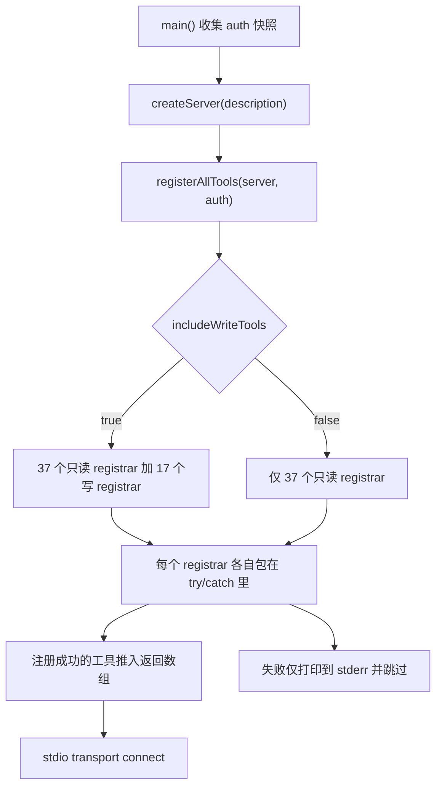
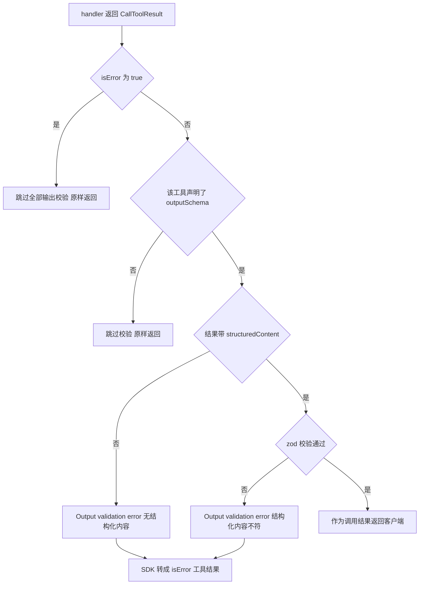
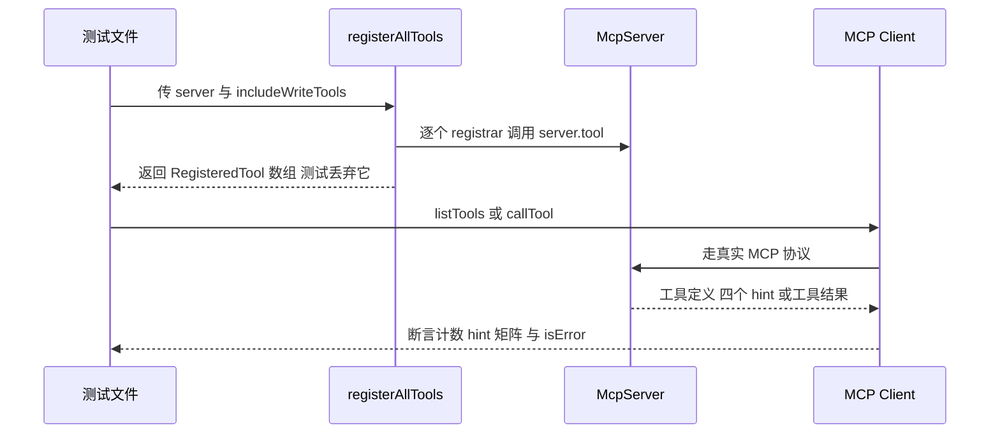

# 工具注册表与工具模块契约

这个服务器能做的每一件事都是一件已注册的 MCP 工具，而工具目录只在唯一一处被拼装：[`src/tools/index.ts`](../../src/tools/index.ts#L89-L163)。那个模块回答两个不同的问题，改代码时两个都要紧：

- **哪些工具存在？** 两份静态的 registrar 函数引用清单，一份只读、一份可写。
- **一个工具模块必须长什么样？** 没有显式的共享 interface，所谓"统一形态"是模块之间共享的约定，由注册表（返回值必须能塞进 `RegisteredTool[]`）、SDK（位置参数重载的解析规则）和测试（四个 hint 与计数断言）三方共同强制。

本页先讲注册表的选择逻辑与失败语义，再讲这份逐工具契约的每一条款及其后果，最后讲哪些自动化信号能在 CI 里抓住违约。

## 两个 registrar 数组，没有发现机制

一个 *registrar* 是形状为 `(server: McpServer) => RegisteredTool` 的函数。每个工具模块恰好导出一个，命名为 `<tool>Tool`，被 [`src/tools/index.ts`](../../src/tools/index.ts#L31-L87) 导入后，以裸函数引用的形式出现在 `readToolRegistrars` 或 `writeToolRegistrars` 里：

| 数组 | 条目数 | 来源目录 | 含义 |
|---|---|---|---|
| `readToolRegistrars` | 37 | `src/tools/ro/` | 不改变 wiki 状态 |
| `writeToolRegistrars` | 17 | `src/tools/editing/` | 可能改变 wiki（页面、权限、账号、缓存） |

合计 54 件工具。注册完全是静态的：没有插件发现、没有动态 import（生产代码里唯一的 `import(` 出现在测试的 `vi.mock` 工厂中，用来按需加载假 bot）、也没有逐工具配置开关——**数组成员资格就是工具目录**。由于产物由唯一入口 `src/index.ts` 经 esbuild 打包（[`scripts/build.js`](../../scripts/build.js#L11-L23)），一个没有被任何数组引用的工具文件根本不在产物里：它能编译、能过 lint，但 agent 永远看不到它。

这两个数组同时是**测试的唯一真源**：[`annotations.test.ts`](../../src/tools/__tests__/annotations.test.ts#L106-L116) 直接断言 `readToolRegistrars.length === 37`、`writeToolRegistrars.length === 17`、`tools/list` 的数量等于两数组之和、名字互不重复，且只读集合是全集子集；[`smoke.test.ts`](../../src/tools/__tests__/smoke.test.ts#L54-L115) 的 `TOOL_ARGUMENTS` 表要求每件工具都有一份最小参数。换句话说，往数组里加一件工具却忘了改测试，会红；往数组里漏加一件工具，也会红。

目录归属同样不是权威，只有数组条目是。读写拆分是一条约定，把 `src/tools/ro/` 与 `readToolRegistrars` 配对、`src/tools/editing/` 与 `writeToolRegistrars` 配对；`purge` 则展示了"写"与"破坏性"的区别：它因为会改服务端缓存而住在 `editing/`，annotations 却仍然声明非破坏性（[`purge.ts`](../../src/tools/editing/purge.ts#L43-L49)）。

## gating 是注册期的一个布尔量

```ts
export function registerAllTools(server: McpServer, includeWriteTools = true): RegisteredTool[]
```

`includeWriteTools` 为 true 时 `registerAllTools` 拼接两个数组，为 false 时只用只读数组，然后逐个调用 registrar，并把注册成功的工具收集返回（[`src/tools/index.ts`](../../src/tools/index.ts#L149-L163)）：



图注：注册表如何把两份静态数组加一个布尔量变成客户端看到的工具目录。

这个决策有三条承重性质：

1. **引导阶段传入的是认证快照。** `main()` 先取 `const auth = isAuthenticated()`，然后在创建 server 之后调用 `registerAllTools(server, auth)`（[`src/index.ts`](../../src/index.ts#L348-L349)）。访客进程因此根本不注册写域：`edit`、`write`、`delete`、`block` 及其同族在 `tools/list` 里不存在，也就无法被调用。server instructions 也会明说这一点（`You are in GUEST mode — all write tools are hidden`，[`src/index.ts`](../../src/index.ts#L274-L276)）。
2. **没有任何逐调用复检。** `isAuthenticated()` 在 `src/` 里只被 `src/index.ts` 消费（拼装 agent 描述、取注册快照、决定是否启用心跳）；没有任何工具 handler 引用它。cookie 过期的会话仍然持有写工具，问题会表现为普通工具结果里的 API 错误（见 [bot 运行时](bot-runtime.md)）。
3. **默认值是宽松的。** `includeWriteTools` 默认 `true`，省略第二个实参的调用方会注册全套件。`main()` 总是显式传 auth 标志，测试也同时覆盖两种取值；新增调用点的安全做法是显式传参。

布尔量也是唯一的 gating 维度：没有逐工具启用开关，没有命名空间或用户权限过滤，handler 除了返回 `errorResult` 之外也无法因权限原因拒绝调用。更细的 gating 只能加在 `registerAllTools` 或 handler 内部。

## 注册失败被逐工具隔离（排障要点）

`registerAllTools` 为**每一个** registrar 单独包了 `try/catch`，失败时打印 `Error registering tool: <message>` 就继续下一个（[`src/tools/index.ts`](../../src/tools/index.ts#L155-L161)）。因此一个坏模块只会让目录少一件工具，而不会中断启动。这是刻意的取舍——不该让一件坏工具毁掉整个会话——但它有几个锋利的边角，排障时按这个顺序想：

- **失败对客户端不可见。** 注册失败的工具就是不存在，与"从未写过"或"被 gating 掉"在 `tools/list` 里完全无法区分。唯一信号是那行 stderr。
- **启动横幅检测不到它。** 引导过程丢弃了 `registerAllTools` 的返回值，横幅里的数量是用数组**长度**算出来的（[`src/index.ts`](../../src/index.ts#L386-L390)），所以某个 registrar 抛错时横幅照样打印 `54 (37 read + 17 write)`。横幅证明的是"数组与 gating 一致"，不是"注册全成功"。
- **现实中的触发点都是名字与形状写错。** SDK 的 `server.tool` 在工具名重复时抛 `Tool <name> is already registered`；在实参列表无法解析时抛出 `Tool <name> expected a Zod schema or ToolAnnotations, but received an unrecognized object`——典型原因是本该放 annotations 的位置传了含嵌套对象的字面量（ToolAnnotations 的值都是原始类型，SDK 用"有没有嵌套对象"来区分 schema 与 annotations）（[`mcp.js`](../../node_modules/@modelcontextprotocol/sdk/dist/cjs/server/mcp.js#L660-L698)）。两者都是程序错误，只在启动时经由这个 catch 表现为"少了一件工具"。
- **没有重试，也没有健康检查面。** 注册在 `server.connect` 之前跑一次；没有任何东西会重试失败的 registrar，也没有 MCP resource 报告注册表状态。

由此得到一条实操判据：**怀疑缺工具时，先搜 stderr 里的 `Error registering tool:`，再看 `tools/list` 的条数是否等于 54（或访客模式下的 37），最后才怀疑 gating。** 另一条更早的防线是 `npm test`：`annotations.test.ts` 的数量与 hint 断言会因为一个 registrar 抛错而失败，所以这类缺陷在 CI 里暴露，而不是只在生产环境的 stderr 里。

## 注册模板：一个工具模块的六步

54 个模块共享同一个形态；没有 `outputSchema` 的那六个是明确例外（[见下文](#没有-outputschema-的六个工具)）。最短的规范样例是 [`src/tools/editing/edit.ts`](../../src/tools/editing/edit.ts#L36-L82)。按顺序：

1. **导出唯一的工厂函数。** `export function <tool>Tool(server: McpServer): RegisteredTool`，模块内是 BSD-2-Clause 头加只从 `../../common/*` 与 npm 包导入（[`edit.ts`](../../src/tools/editing/edit.ts#L29-L36)）。
2. **`server.tool(name, description, zodRawShape, annotations, handler)` 注册。** 这是位置参数重载，描述里承载风险等级与使用说明，第四个位置是 `ToolAnnotations`，第五个是返回 `CallToolResult` 的 handler（[`edit.ts`](../../src/tools/editing/edit.ts#L37-L71)）。返回的 `RegisteredTool` 必须被接住，因为下一步要用它。
3. **需要结构化输出就 `tool.update({ outputSchema })` 合并 schema。** 位置参数重载没有 schema 槽位（[`edit.ts`](../../src/tools/editing/edit.ts#L72-L80)）。
4. **handler 只返回结果，永不抛异常。** 成功走 `jsonResult(data)`，失败走 `errorResult(message, error)` 并包在 `try/catch` 里（[`edit.ts`](../../src/tools/editing/edit.ts#L84-L185)）。
5. **会改既有页面文本或保护状态的工具先过读前写守卫**，并把摘要/理由/评论前缀成 `[nodemw-mcp.<tool>]`（[`edit.ts`](../../src/tools/editing/edit.ts#L93-L93)、[`edit.ts`](../../src/tools/editing/edit.ts#L151-L151)）。
6. **把工厂加进且只加进一个数组**，并在 `annotations.test.ts` 的期望矩阵与 `smoke.test.ts` 的 `TOOL_ARGUMENTS` 里登记它。

闭合处的性质值得单独说：handler 是一个只捕获自身实参的闭包，工具模块不持有请求上下文、也没有注入依赖——调用时它们经模块作用域去取 `getBot()`，写工具再去取 `requireRead()`（[`pageState.ts`](../../src/common/pageState.ts#L210-L267)）。这正是"一个进程 = 一个 wiki = 一个会话"成为结构事实、而不是工程约定的原因；也是测试能用 `vi.mock` 整个替换掉运行时、再用 `InMemoryTransport` 走真实 MCP 协议的前提。

## 输入 schema 是 zod raw shape，`.describe()` 就是文档

第三个位置实参是 zod 字段组成的普通对象——raw shape，而不是 `z.object(...)`——由 SDK 转成客户端看到的 JSON Schema（[`mcp.js`](../../node_modules/@modelcontextprotocol/sdk/dist/cjs/server/mcp.js#L169-L184)）。两条约定实际上是强制的，因为 agent 没有别的文档可读：

- **每个字段都带 `.describe()`。** 文本从一句话（`title: z.string().describe('Page title to edit')`）到一整段协议辅导，例如 `edit` 的 `old_lines` 里关于 JSON 转义规则的说明（[`edit.ts`](../../src/tools/editing/edit.ts#L48-L61)）。
- **默认值声明在 schema 上**，而不是写在 handler 体内，这样客户端看得见，且取值在 handler 之前就已生效：`minor` 默认 `false`（[`edit.ts`](../../src/tools/editing/edit.ts#L60-L60)）、`followRedirect` 默认 `true`（[`get-article.ts`](../../src/tools/ro/get-article.ts#L68-L83)）、`block` 的 `expiry` 默认 `'indefinite'`（[`block.ts`](../../src/tools/editing/block.ts#L42-L55)）。

对这份 shape 的校验发生在 SDK 分发之前，因此畸形实参永远到不了 handler：校验失败会被 SDK 转成一个工具错误结果返回给客户端（`Input validation error: Invalid arguments for tool <name>: ...`），而不是协议层异常（[`mcp.js`](../../node_modules/@modelcontextprotocol/sdk/dist/cjs/server/mcp.js#L138-L145)）。

### 命名与语义约定

工具名与描述承担了契约里相当一部分语义，因为它们既是模型选工具的依据，也是唯一的"调用说明书"：

- **`edit` 是行级精确替换，`write` 是全页覆盖，`revert` 是整页回滚到某个修订。** `edit` 只接受一次命中：它用 `old_lines` 在整页文本里做精确字符串匹配，零次命中或多于一次都返回 `errorResult`，只有唯一命中才写回，并且同样套用"不得把页面缩到不足 1/10"的体量下限（[`edit.ts`](../../src/tools/editing/edit.ts#L111-L149)）。`write` 整页替换，用 `intent`（`add`/`revise`/`rewrite`/`delete`）加字节比例校验拦"误删整页"，再用 `findStaleWrite` 做一次 revid 的 CAS 预检（[`write.ts`](../../src/tools/editing/write.ts#L85-L139)）。`revert` 是这两者的原子合体：先 CAS，再取目标修订的 wikitext，再套同一个 1/10 下限（[`revert.ts`](../../src/tools/editing/revert.ts#L78-L150)）。这条分工也被写进面向 agent 的 OPERATING PRINCIPLES：`Use edit (line-based exact match) for targeted changes. Use write (full-page overwrite) only when replacing most of the page.`（[`src/index.ts`](../../src/index.ts#L296-L298)）。
- **风险等级以 `LOW RISK` / `MEDIUM RISK` / `HIGH RISK` 前缀写在 description 里**，而且只有 description 承载它：`LOW` 是 `edit`、`append`、`prepend`、`purge`（4 个），`MEDIUM` 是 `write`、`revert`、`move`、`upload`、`upload-by-url`、`add-flow-topic`（6 个），`HIGH` 是 `delete`、`protect`、`undelete`、`block`、`unblock`、`send-email`、`create-account`（7 个）。同一套分级在以 `OPERATING PRINCIPLES` 开头的 agent 描述段里被重述（[`src/index.ts`](../../src/index.ts#L278-L344)），并且这份描述同时注册为 `operating-principles` prompt，供不自动注入 instructions 的客户端手动拉取（[`src/index.ts`](../../src/index.ts#L353-L364)）。
- **XOR 双参数校验写在 handler 里。** 同时接受两个互斥标识符的工具，用 zod raw shape 表达"恰好其一"既不强制也很难被模型读懂，因此判定放在 handler 的第一句并返回 `errorResult`（[`whois.ts`](../../src/tools/ro/whois.ts#L61-L67)）：

```ts
if (!username && id == null) {
    return errorResult('Either "username" or "id" must be provided');
}
if (username && id != null) {
    return errorResult('Provide either "username" or "id", not both');
}
```

一共 12 件工具实现了这种互斥对：7 件围绕 `title`/`id`（`get-article`、`get-article-with-lineno`、`get-article-info`、`get-article-categories`、`get-article-properties`、`get-article-revisions`、`diff-revisions`），4 件围绕 `username`/`id`（`whois`、`get-user-contribs`、`block`、`unblock`），`whoare` 则是 `usernames`/`ids`（[`whoare.ts`](../../src/tools/ro/whoare.ts#L58-L67)）。`parse` 另有一套 `text`/`page` 的模式互斥（[`parse.ts`](../../src/tools/ro/parse.ts#L111-L119)）。两边的 schema 字段因此都是 `.optional()`，互斥规则只活在散文（每个字段的 `.describe()` 点名另一个替代项）和这条运行时判定里。`get-articles` 是反面例子：`titles` 为必需、`ids` 为可选，两者同时给出时静默以 `ids` 为准，不做互斥校验（[`get-articles.ts`](../../src/tools/ro/get-articles.ts#L87-L98)）。

参数级细节（各工具的字段、默认值、XOR 组合）留给 [阅读内容](../workflows/reading-content.md) 与 [编辑内容](../workflows/editing-content.md)。

## ToolAnnotations：四个 hint 都必须显式给布尔值

第四个位置实参是客户端唯一能程序化处理的安全元数据。本仓库的约定比 MCP 规范更严：**`readOnlyHint`、`destructiveHint`、`idempotentHint`、`openWorldHint` 四个键在每一件工具上都必须是显式 boolean**，外加一个人类可读的 `title`（如 `Edit page (line-based)`）（[`edit.ts`](../../src/tools/editing/edit.ts#L62-L68)）。全目录的矩阵是：

| 域 | `readOnlyHint` | `destructiveHint` | `idempotentHint` | `openWorldHint` |
|---|---|---|---|---|
| 37 个只读工具 | 全部 `true` | 全部 `false` | 全部 `true` | 全部 `true` |
| 17 个写工具 | 全部 `false` | 15 个 `true`；只有 `purge` 与 `undelete` 为 `false` | 只有 `purge`、`protect`、`unblock`、`write` 为 `true` | 全部 `true` |

四条取值规则背后的判据：

- **只读工具四个 hint 完全同构。** 读 wiki 是幂等的、非破坏的、且触碰的是外部世界（`openWorldHint: true` 在这里表示"结果取决于进程外的可变状态"，不是"会修改外部世界"）。
- **`destructiveHint` 按"是否销毁数据"给，不按"是否危险"给。** 只有 `purge`（纯缓存失效）与 `undelete`（恢复已删除修订）标为非破坏性；`protect` 虽然可逆仍标破坏性，因为它限制他人编辑。
- **`idempotentHint` 按"重复同一调用是否收敛到同一 wiki 状态"给。** `write` 写同样内容两次得到同样页面、`protect` 设同一保护级别、`unblock` 对已解封用户、`purge` 再清一次缓存，都是收敛的；`edit`、`append`、`prepend`、`revert`、`delete`、`block`、`send-email` 等重复执行会产生新的修订、新邮件或不同的最终状态，因此为 `false`。
- **这四条规则是可执行的，不是文档。** [`annotations.test.ts`](../../src/tools/__tests__/annotations.test.ts#L57-L73) 把上面两个例外集合（`NON_DESTRUCTIVE_WRITES = {purge, undelete}`、`IDEMPOTENT_WRITES = {purge, protect, unblock, write}`）写成期望矩阵，逐个工具比对整份 hint 取值，并验证每个 hint 的 `typeof` 是 `boolean`（[`annotations.test.ts`](../../src/tools/__tests__/annotations.test.ts#L118-L133)）。它同时断言每件工具的 description 长度大于 10，所以"空的 annotations / 空的描述"这种退化会立刻失败。

依赖这些 hint 之前值得知道两点：

- **标注与散文分级不一致。** `append` 与 `prepend` 自称 `LOW RISK: Additive only, easy to revert`，却仍然 `destructiveHint: true`（[`append.ts`](../../src/tools/editing/append.ts#L36-L54)）；`purge` 标为非破坏性但仍不是只读，因为它改缓存（[`purge.ts`](../../src/tools/editing/purge.ts#L35-L49)）。
- **以 `destructiveHint` 做审批门控的客户端会把整个写域看成同一种危险。** 15/17 件写工具都标 `true`，这个 hint 无法区分"加个分类"与"删一个页面"。这是保守的失效方向，不是安全漏洞；细化它是对 17 个写模块的改动，不是对注册表的改动。更完整的理由见[安全模型](../concepts/safety-model.md)。

## 结果成形：`jsonResult` 与 `errorResult`

handler 从不把异常漏给 transport。成功是 [`jsonResult(data)`](../../src/common/utils.ts#L85-L93)，失败是 [`errorResult(message, error)`](../../src/common/utils.ts#L136-L148)，两者刻意填充不同的通道：

| | `content[0].text` | `structuredContent` | `isError` |
|---|---|---|---|
| `jsonResult(data)` | `JSON.stringify(data, null, 2)` | `data`（同一个对象） | 不设置 |
| `errorResult(message, error)` | `{ "error": message, "details": details }` 的格式化 JSON | 不设置 | `true` |

所以一次成功调用会把载荷送两遍：给模型文本通道的美化 JSON，以及给能渲染或后处理结果的客户端的结构化对象。失败只送文本，外加标记该结果为错误的标志位。

`details` 不是裸的 `error.message`：`errorResult` 会先看错误文本是否命中登录过期与编辑冲突的模式表，命中就把 `details` 换成带恢复建议的句子（`your login session has likely expired. Reconnect via /mcp`、`Edit conflict: ... Re-read it with get-article`），因此错误路径本身也承担了一部分自愈引导（[`utils.ts`](../../src/common/utils.ts#L95-L148)）。

## `outputSchema` 与 `tool.update`

这个不对称正是 `outputSchema` 条款可用的原因。SDK 的工具调用管线**只在**工具声明了 `outputSchema` 且结果不是错误时才校验输出：非错误结果声明了 schema 却没有 `structuredContent` 会被拒，`structuredContent` 不符合 schema 也会被拒（[`mcp.js`](../../node_modules/@modelcontextprotocol/sdk/dist/cjs/server/mcp.js#L188-L210)）。校验抛出的 `McpError` 会在调用处理器的最外层被转成一个 `isError: true` 的工具结果，而不是协议错误，所以客户端看到的是"这次调用失败"而不是"这个服务器坏了"（[`mcp.js`](../../node_modules/@modelcontextprotocol/sdk/dist/cjs/server/mcp.js#L103-L146)）：



图注：SDK 的输出校验路径——错误结果与未声明 schema 的工具都被豁免，违约则以工具错误的形式返回。

实操结论：

- **声明 `outputSchema` 就是承诺所有成功路径都返回 `jsonResult`。** 在声明了 schema 的工具上用裸文本块表示成功，会变成一句 `Output validation error: ... has an output schema but no structured content was provided` 的错误文本。
- **错误路径被豁免**，所以 `errorResult` 可以携带任意消息而不受 schema 约束。这也是为什么 handler 能对着 `{ result, pageid, title, ... }` 的 schema 返回 `errorResult('old_lines not found ...')`（[`edit.ts`](../../src/tools/editing/edit.ts#L111-L149)）。
- **schema 不符破坏的是单次调用，不是启动。** schema 只在每次调用时校验，所以漏一个必需字段的表现是运行期某次调用失败——这也是为什么 `smoke.test.ts` 逐个工具断言 `isError` 为假，它把"每个成功路径都符合自己的 schema"变成了 CI 检查。

### 注册之后再 `tool.update`

`outputSchema` 从不传给 `server.tool`，而是在注册之后用 `tool.update({ outputSchema: ... })` 合并上去。原因是位置重载的历史：`tool(name, description, paramsSchema, annotations, callback)` 这种形态在协议版本 2025-03-26 就被冻结、没有 output-schema 槽位，SDK 源码里明写"未来新增的工具定义字段不应再加到这个形态上"，而 `RegisteredTool.update` 接受 `outputSchema` 并按 raw shape 归一化（[`mcp.js`](../../node_modules/@modelcontextprotocol/sdk/dist/cjs/server/mcp.js#L624-L651)、[`mcp.js`](../../node_modules/@modelcontextprotocol/sdk/dist/cjs/server/mcp.js#L660-L698)）。SDK 另外提供带 `outputSchema` 字段的 `registerTool(config, callback)`（[`mcp.js`](../../node_modules/@modelcontextprotocol/sdk/dist/cjs/server/mcp.js#L702-L708)），但本仓库没有一个模块使用它——`server.tool` 加 `tool.update` 是既定风格。

54 个模块里有 48 个声明了 `outputSchema`，且 schema 是照着 `jsonResult` 载荷逐键写的。读工具里最一致的是 `get-article-with-lineno`：它返回 `{ title, totalLines, shownLines, offset, lines }`，schema 就声明这五个字段，`lines` 为 `z.array(z.object({ lineno, content }))`（[schema](../../src/tools/ro/get-article-with-lineno.ts#L66-L72)）。

写工具普遍更宽松：它们把 MediaWiki 响应原样丢进 `jsonResult`，只声明自己在意的子集，其余标为可选。`edit` 声明 `result`、`pageid`、`title`、`newrevid` 为必需，`contentmodel`、`newtimestamp`、`oldrevid` 为可选，然后原样返回 API 的响应（[`edit.ts`](../../src/tools/editing/edit.ts#L72-L80)、[`edit.ts`](../../src/tools/editing/edit.ts#L156-L181)）。`revert` 沿用同一份键集但把 `newrevid` 也标成可选，`write` 则要求它必需（[`revert.ts`](../../src/tools/editing/revert.ts#L61-L69)、[`write.ts`](../../src/tools/editing/write.ts#L68-L68)）。因为 zod 对象解析会剥掉未声明的键、只强制已声明的键，所以 API **新增**字段永远不会破坏契约，而某个必需字段被改名或消失则会让该工具的每次调用都变成输出校验错误。`append` 则是"handler 多报了字段、schema 必须跟上"的例子：它返回 `{ success, title, pageid, newrevid }`，schema 里后两项是 `.optional()`，源码注释直接写明"strict MCP clients reject the structured content"（[`append.ts`](../../src/tools/editing/append.ts#L57-L59)）。

值得知道的是，这批 schema 有明确的来历：它们最初由一次性 codemod [`scripts/add-output-schema.mjs`](../../scripts/add-output-schema.mjs#L6-L49) 批量注入——脚本内置一张 40 项、按工具名索引的 schema 表（其中 16 项当时只是 `z.object({}).passthrough()` 占位），skip 集合只有 `get-article.ts`、`expand-templates.ts`、`parse.ts` 三个文件名——之后才被手工收紧成今天这些具体字段。脚本对已经含 `tool.update` 的文件会直接跳过（[`add-output-schema.mjs`](../../scripts/add-output-schema.mjs#L62-L65)），所以它现在对新增工具没有帮助，也不是"再次运行即可补齐"的工具：`revert`、`get-module-source`、`get-articles` 都是脚本之后才出现的。

## 没有 `outputSchema` 的六个工具

有六个读工具不声明 `outputSchema`，它们的返回约定分成两类：

| 工具 | 返回 | 为什么不声明 schema |
|---|---|---|
| `get-article` | 条目 wikitext 文本块，可选带重定向说明与 `maxlen`/`offset` 截断标记 | 载荷**就是**文档，包成 JSON 大约让体积翻倍 |
| `get-article-by-revision` | 单个修订的裸 wikitext | 同上 |
| `expand-templates` | 展开后的 wikitext 文本块 | 同上 |
| `parse` | 默认是 HTML/XML 文本块；带 `include` 或 `limit_report` 时切换成 `jsonResult` | 同一个工具两种返回形态，声明一个 schema 就必然否定另一种 |
| `get-module-source` | `jsonResult({ title, pageid, revid, content, ... })` | 结构化返回，但 schema 从未补上 |
| `get-articles` | `jsonResult({ pages: [...] })` | 同上 |

前四个是刻意的设计：`get-article-with-lineno` 之所以存在，正是因为它是 `get-article` 的结构化对应物——同样的内容，以行对象返回并声明 schema；`get-module-source` 与 `get-articles` 则更像是遗留缺口，它们已经在用 `jsonResult`，只是没人给它们写 schema。

代价与顺手之处都要记住：

- **没有 schema 就没有输出校验。** 这六个工具的任何返回都不会被 SDK 拒绝，所以返回形态漂移也没有断言能抓住——`smoke.test.ts` 只看"有没有文本块"和 `isError` 是否为假。
- **`jsonResult` 与 `outputSchema` 是两件独立的事。** `get-module-source`、`get-articles` 证明 `jsonResult` 可以在没有 schema 时使用（此时只是把载荷同时放进 text 与 `structuredContent`，不做任何校验）；反过来，声明 schema 而不返回 `jsonResult` 则一定失败。
- **`get-article` 因此可以内联构造错误结果。** 它直接拼 `{ content: [{ type: 'text', ... }], isError: true }` 而不是调用 `errorResult`（[`get-article.ts`](../../src/tools/ro/get-article.ts#L121-L133)）：这里既没有 schema 要对齐，也不存在"错误结果不能带结构化内容"的约束。

## 新增工具必须满足什么

注册表让"加一个工具"变得机械，但契约里的每一条就是评审清单：

1. **一个模块，一个 registrar**，只从 `../../common/*` 与 npm 包导入，并带 BSD-2-Clause 头。
2. **恰好进入一个数组。** 不会改变 wiki 状态就进 `readToolRegistrars`，会改变就进 `writeToolRegistrars`。这个选择本身就是 gating 决策，也是读写边界唯一被声明的地方。
3. **为 agent 写 zod shape。** 每个字段 `.describe()`，默认值写在 schema 上，互斥参数在 handler 入口用 `errorResult` 校验。
4. **四个 hint 全部显式给布尔值，并把风险等级写进 description。** annotation 是客户端能强制执行的部分，`LOW/MEDIUM/HIGH RISK` 前缀是模型读到的部分；两者都需要，因为它们并不一致。同时更新 `annotations.test.ts` 的两个例外集合。
5. **选定结果约定并让 schema 与之一致。** 结构化数据用 `jsonResult` + `outputSchema`（注册后用 `tool.update` 挂上）；文档形态的输出用裸文本块并且**不**声明 `outputSchema`。
6. **会改已有页面文本或保护状态的工具先调 `requireRead(title)`**（现有 8 件：`edit`、`write`、`revert`、`append`、`prepend`、`delete`、`move`、`protect`），并把编辑摘要、理由或评论前缀成 `[nodemw-mcp.<tool>]`，让 wiki 历史能归因该操作（[`append.ts`](../../src/tools/editing/append.ts#L70-L73)）。
7. **补测试的两处钩子。** `annotations.test.ts` 的计数、hint 矩阵与只读子集，`smoke.test.ts` 的 `TOOL_ARGUMENTS` 最小参数；忘记任何一处都会让 `npm test` 失败。

分步流程见[新增工具](../workflows/adding-a-tool.md)；annotations 与守卫背后的安全理由见[安全模型](../concepts/safety-model.md) 与[读前写守卫](../concepts/read-before-write-guard.md)。

## 验证与运维信号

注册表与这份契约有真正的自动化覆盖：`npm test` 跑 `vitest run`（[`package.json`](../../package.json#L18-L26)），`src/tools/__tests__/` 下三个文件把契约固定在 CI 里：

- **`annotations.test.ts`**：用真实 `McpServer` + `InMemoryTransport` 起两个服务器（全套件与仅只读），断言工具总数、名字唯一、只读集合是全集子集、每个工具四个 hint 与期望矩阵逐项相等、每件工具的描述长度大于 10（[`annotations.test.ts`](../../src/tools/__tests__/annotations.test.ts#L106-L140)）。
- **`smoke.test.ts`**：给每件工具一份最小参数并真的调用一遍，断言返回里至少有一个文本块且 `isError` 为假（[`smoke.test.ts`](../../src/tools/__tests__/smoke.test.ts#L140-L161)）。这是输出 schema 违约的唯一自动化探测点：漏字段会被 SDK 转成 `isError`，测试随即失败。
- **`readGuard.test.ts`**：覆盖局部读取不解锁写、标题重绑被拒、`revert` 的 CAS 与"不洗白读证据"、`edit` 的 1/10 体量下限（[L104-L214](../../src/tools/__tests__/readGuard.test.ts#L104-L214)）。

三个测试都通过 `vi.mock('../../common/nodemwBot.js', …)` 把运行时换成假 bot，并自己连上 `InMemoryTransport`，所以注册与调用走的是与生产完全相同的 SDK 路径（[`annotations.test.ts`](../../src/tools/__tests__/annotations.test.ts#L83-L100)）：



图注：测试如何绕过网络却不绕过注册表——注册与调用都走真实的 SDK 路径。

剩下的运维信号是给人看的：

- **stderr 横幅**在已登录时报告 `54 (37 read + 17 write)`，访客模式报告 `37 read-only`（[`src/index.ts`](../../src/index.ts#L386-L403)）。它证明数组与 gating 一致，但数的是意图而不是注册结果。
- **`Error registering tool: ...`** 是 registrar 失败在运行时的唯一报告。如果横幅里的数字看起来对、而 `tools/list` 里少了某件工具，这行就是解释。
- **[`test-server.js`](../../test-server.js#L11-L56) 是遗留的手工冒烟脚本**：检查 `dist/index.js` 存在、拉起它、"两秒内不崩"就算通过，没有接进 `npm test`。它验证的是"打包产物能启动"，不验证工具契约。

## 相关页面

- [架构总览](overview.md) — 注册表在五层结构中的位置，以及一次调用如何抵达 wiki。
- [启动生命周期](startup-lifecycle.md) — 为什么注册必须在 `server.connect` 之前完成，以及横幅在哪个步骤打印。
- [bot 运行时](bot-runtime.md) — handler 经 `getBot()` 取到的单例、认证状态的生命周期。
- [测试与验证](../testing/validation.md) — 三个工具级测试的跑法与其余测试层。
- [安全模型](../concepts/safety-model.md) — annotations、读前写守卫与描述里的风险分级。
- [读前写守卫](../concepts/read-before-write-guard.md) — `requireRead` 与 `readState` 的机制细节。
- [新增工具](../workflows/adding-a-tool.md) — 新 registrar 的端到端流程。
- [阅读内容](../workflows/reading-content.md) 与 [编辑内容](../workflows/editing-content.md) — 各工具的参数级用法。
