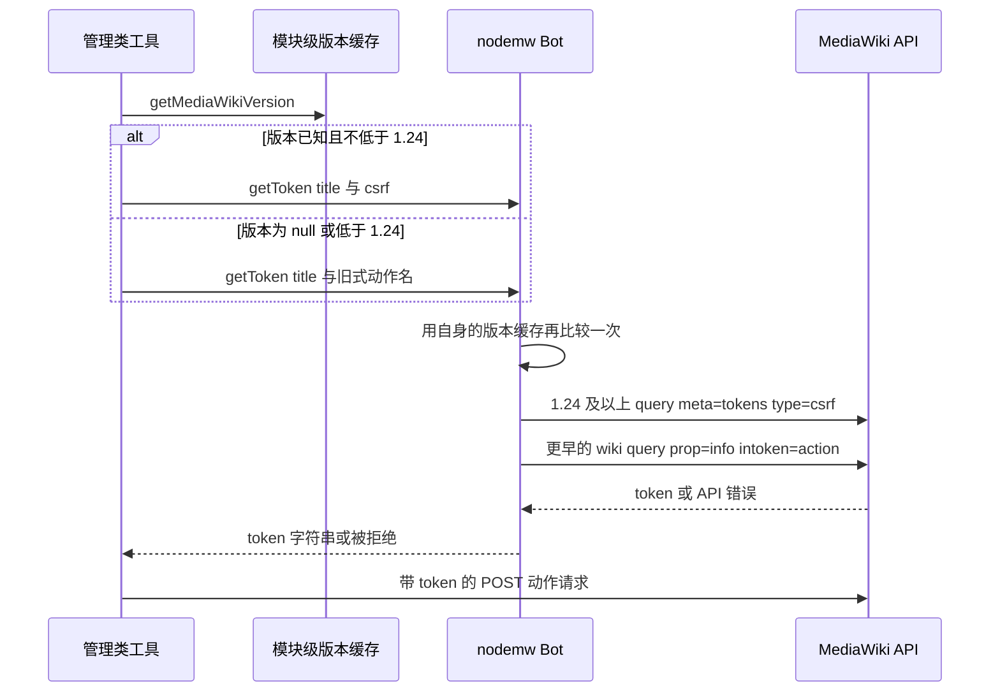

# MediaWiki 版本兼容性与回退

服务器只会经一个客户端依赖 `nodemw`（`^0.26.0`）与 MediaWiki 通信，而这层依赖在本仓库里是被**打过补丁的**：`package.json` 的 `postinstall` 跑 `patch-package`，把 [`patches/nodemw+0.26.0.patch`](../../patches/nodemw+0.26.0.patch) 注入 `node_modules/nodemw`（[package.json L18-L26](../../package.json#L18-L26)）。于是在任何一次请求上，"这条请求是否有效"由三条互不相干的约定共同决定：

- **目标 wiki 的协议版本**：它接受哪种 token、哪些参数还存在、响应里有哪些字段；
- **nodemw 0.26.0 的封装行为**：高层方法允许传入什么，以及它自己硬编码了什么；
- **本地补丁**：它改掉了库内的一些崩溃与泄漏路径，却没有改封装允许表达的范围；
- **传输层的响应形状**：四参数回调与不带 `formatversion=2` 的 JSON，被所有直连点当成固定契约。

本页记录的是**版本这一轴**上的全部决策点：每个门控的阈值、被守卫的参数或 token 类型、版本未知时的回退、判定回退为什么只能靠错误文案，以及新增一处直连 API 调用时必须遵守的规则。运行时机制（单例、登录、版本缓存的填充与不清理）在 [Bot 运行时](../architecture/bot-runtime.md)；客户端适配层的构造参数与回调形态在 [nodemw 客户端集成](../integrations/nodemw-client.md)。

## 四条依赖线各自怎么失效

| 依赖 | 由谁决定 | 本仓库能否控制 | 变化时的信号 |
|---|---|---|---|
| wiki 协议版本 | 目标 wiki | 否，只能读缓存后分流 | [`getMediaWikiVersion()`](../../src/common/nodemwBot.ts#L234-L246) 返回 `null` |
| nodemw 封装行为 | `^0.26.0` 加 lockfile 锁到 `0.26.0` | 只有 `0.26.x` 补丁级会静默装上 | semver 之外的假设都收在本文末尾的"需要随升级复核的假设"表里 |
| 补丁注入 | `postinstall: patch-package` | 是，但补丁针对 0.26.0 写死 | 升级 nodemw 后补丁不再应用 |
| 响应形状（legacy 键名、四参数回调） | nodemw 传输层 | 否，补丁只补了崩溃旁支 | 所有直连点的解析同时出错 |

<a id="version-gates"></a>

## 版本门控清单

一共七个位置按目标 wiki 的版本分流。前三个读本仓库的版本缓存，其余**故意不读**缓存——它们的阈值只作为"什么时候不必尝试"的知识存在，实际判定交给请求本身；最后一行的决定权在 nodemw 自己的缓存里。

| 门控 | 阈值 | 被守卫的参数 / token 类型 | 版本未知时的行为 |
|---|---|---|---|
| token 类型 | 1.24 | `getToken(title, type, cb)` 的第二个实参 | 假定旧式，传 `block` / `protect` / `undelete`（安全，见下节） |
| 文本对比能力 | 1.24 | `action=compare` 的 `totext` | 放行；**已知**低于 1.24 时明确拒绝并给出替代路径 |
| 预保存转换 | 1.27 | `action=compare` 的 `topst` | 照发（乐观），被拒即去掉重发 |
| compare 富 `prop` | 1.32 | `prop` 中的 `user` / `comment` / `timestamp` | 不看版本，先发富集合，被拒回退到 `prop=diff` |
| compare 响应标题字段 | 1.24 | 响应里的 `fromtitle` / `totitle` | 缺失时退到解析出的页面标题，再退到修订对字面量 |
| `generatexml` | 1.36 移除 | `action=parse` / `action=expandtemplates` 的该参数 | 永不发送：绕开封装，改用 `prop` 自选输出 |
| 旧式 `intoken` 获取 | pre-1.24 | `prop=info&intoken=<action>` | 由 nodemw 内部按它自己的版本缓存决定 |

<a id="the-124-token-boundary"></a>

### 读缓存的那一处：1.24 的 token 边界

四个管理类工具写法完全一致（[`block`](../../src/tools/editing/block.ts#L94-L102)、[`unblock`](../../src/tools/editing/unblock.ts#L74-L83)、[`protect`](../../src/tools/editing/protect.ts#L82-L90)、[`undelete`](../../src/tools/editing/undelete.ts#L69-L77)），以 `block` 为代表：

```ts
const mwVersion = getMediaWikiVersion();
const tokenType = (mwVersion !== null && mwVersion >= 1.24) ? 'csrf' : 'block';

const token = await new Promise<string>((resolve, reject) => {
    (bot as any).getToken(tokenTitle, tokenType, (err: Error | null, t: string) => {
        if (err) reject(err);
        else resolve(t);
    });
});
```

| 工具 | 旧式 token 类型 | `tokenTitle` 传什么 |
|---|---|---|
| `block` | `block` | `User:<username>` 或 `User:<id>` |
| `unblock` | `block` | `User:<username>` 或 `User:<id>` |
| `protect` | `protect` | 页面标题 |
| `undelete` | `undelete` | 页面标题 |

标题参数只在旧式路径上有意义——那时 token 是通过 `prop=info&intoken=<action>&titles=<title>` 取回的。在 `csrf` wiki 上 token 是全局的，标题因此只是顺手传过去的装饰。

#### 版本为 `null` 时为什么不会立刻出错

启动探测失败、或返回的字符串无法解析时，`getMediaWikiVersion()` 返回 `null`（填充点在[`src/index.ts` L209-L222](../../src/index.ts#L209-L222)，整个填充包在吞掉异常的 `catch` 里）。四个工具都把它当作"假定旧式"处理，而这个兜底不会静默发错请求，原因有两层：

1. **nodemw 的 `getToken` 自己再比较一次。** 它用 `node-version-compare` 把**自己缓存的**版本与 `1.24.0` 比较，决定发 `meta=tokens&type=csrf` 还是 `prop=info&intoken=<action>`（[`patches/nodemw+0.26.0.patch` L112-L145](../../patches/nodemw+0.26.0.patch#L112-L145)）。在 1.24+ 的 wiki 上，传进去的动作名被忽略。
2. **nodemw 的探测失败会向上报错，而不是默默走旧式路径。** 补丁在 `getToken` 的版本回调开头加了 `if (err) { callback(err); return; }`（同上）。也就是说，兜底的安全条件是"nodemw 自己的探测成功"；两边都失败时，取 token 的调用直接拒绝，工具返回 `Failed to block user` / `Failed to protect page` 之类的结果，token 错误落在 `details` 里。这正是 `CLAUDE.md` 记录的预期降级（[CLAUDE.md L75-L84](../../CLAUDE.md#L75-L84)）。



该图展示两条版本信号如何叠加：工具侧的分支只决定传给 `getToken` 的提示，真正的请求形态由库内比较决定。

几种实际组合：

- **现代 wiki、模块缓存为空** —— 工具要 `block`/`protect`/`undelete`，nodemw 换成 `csrf`，写入成功。兜底安全。
- **真正的 pre-1.24 wiki** —— 按动作区分的名字正是 `intoken` 需要的，这个分支为它而存在。
- **两次探测都失败** —— 取 token 以错误回调；工具返回失败结果，不会带着一个错类型的 token 去写。
- **`getToken` 没有走 promise 桥。** 每个调用点都手写 `new Promise` 把回调收敛成一个 `string`。`(err, token)` 形状其实适配 `promisifyBotMethod`，这份重复是风格而非必要；真正的理由是 token 类型必须在发请求之前按调用点算出来。

#### 版本号本身只有两段精度

`getMediaWikiVersion()` 用 `/^(\d+)\.(\d+)/` 抽出前两段再 `parseFloat`（[nodemwBot.ts L234-L246](../../src/common/nodemwBot.ts#L234-L246)），因此所有阈值比较都发生在**浮点数**上，而不是版本元组。两个后果：补丁号被丢弃，永远无法按补丁级分流；单段 minor 会被读成小数位——`1.9` 变成 `1.9`，大于 `1.24`，于是一个真正古老的 wiki 会被判成"现代"。写新的门控时不要扩大这个精度假设，判定细节见[验证策略](../testing/validation.md)。

### 不读缓存的那几处

**文本对比（`totext`，1.24）。** `diff-preview` 只有在**已知**版本低于 1.24 时才拒绝，因为那时 `to` 侧没有修订可比较，API 会回 `inputneeded`（[diff-preview L95-L113](../../src/tools/ro/diff-preview.ts#L95-L113)）。拒绝文案直接给出替代路径：用 `get-article` / `get-article-by-revision` 取两版自己比。版本未知时它照发，并在 `catch` 里把 `inputneeded` 或"unrecognized parameter … totext"也映射成同一句"需要 1.24+"（[L152-L167](../../src/tools/ro/diff-preview.ts#L152-L167)）——**能力缺失被统一表达为一条可操作的错误，而不是一个空 diff**。

**预保存转换（`topst`，1.27）。** 同一个工具用相反方向的默认值：版本为 `null` **或** 不低于 1.27 都附加 `topst=1`，只有被 API 明确拒绝时才删掉参数重发（[L110-L126](../../src/tools/ro/diff-preview.ts#L110-L126)）。它敢于乐观，是因为错误可识别、重发无副作用。

**compare 的富 `prop`（1.32+）。** `callCompareApi` 总是先请求 `prop=diff|ids|title|user|comment|timestamp`，只在失败时退到 `prop=diff`（[compareOutput.ts L215-L239](../../src/common/compareOutput.ts#L215-L239)）。这条路完全不问版本：较老的 MediaWiki 会拒绝未知的 prop 值，拒绝本身就是探测结果。代价是每次在旧 wiki 上调用都多一次往返，收益是不必给这套逻辑再添一个阈值。

**`generatexml`（1.36 移除）。** `parse` 与 `expand-templates` 都不走 nodemw 的封装，理由写在源码注释里：`bot.parse()` 硬编码 `generatexml=1`，该参数在 1.36 被移除、在 1.43 上失败得无声无息；而旧版本上它返回的是语法树而不是展开后的 wikitext（[parse L121-L167](../../src/tools/ro/parse.ts#L121-L167)、[expand-templates L63-L80](../../src/tools/ro/expand-templates.ts#L63-L80)）。解法是**永不发送**该参数，用 `prop=text|parsetree` 或 `prop=wikitext` 自己选输出。这是唯一一类不需要版本判断的门控：被移除的参数根本不出现在请求里。

**compare 响应的标题字段。** 低于 1.24 的 `action=compare` 响应没有 `fromtitle`/`totitle`。`diff-revisions` 因此有一条三段回退链：响应字段 → 自己解析出的页面标题 → `revisions <from>→<to>` 的字面量（[diff-revisions L203-L210](../../src/tools/ro/diff-revisions.ts#L203-L210)）。

另外，`compare` 返回的是一段 HTML 表格片段，解析器必须跨版本容错：`diff-lineno`/`diff-deletedline`/`diff-addedline`/`diffchange` 这些类名跨版本稳定，但内联改动在旧版本是 `<div class="diffchange">`、新版本是 `<ins|del class="diffchange diffchange-inline">`，属性引号也有单双两种写法（[compareOutput.ts L56-L93](../../src/common/compareOutput.ts#L56-L93)、[L132-L187](../../src/common/compareOutput.ts#L132-L187)）。解析器对认不出的行降级成去标签文本，从不抛错。

### 未知版本时为什么方向相反

同样是"版本未知"，token 走旧式、`topst` 走新式。这不是不一致，而是按**猜错的代价**分的四类取舍：

| 取舍 | 用在 | 猜错的代价 |
|---|---|---|
| 悲观假定旧式 | token 类型 | 无害：现代 wiki 由 nodemw 覆盖成 `csrf`；旧 wiki 只有这条路能走 |
| 乐观 + 请求期回退 | `topst`、compare 富 `prop` | 多一次往返，可识别、可重发 |
| 绕开参数 | `generatexml` | 无，参数从不发送 |
| 明确拒绝 | `totext`（已知 <1.24） | 工具不可用，但错误文案给出替代路径 |

需要守住的规则只有一条：**版本未知时不能静默做错事**——要么给出等价结果，要么明确失败并说明原因。

<a id="new-call-site-rule"></a>

### 新增直连调用点必须遵守的规则

`AGENTS.md` 与 `CLAUDE.md` 把这条约定写在两处（[AGENTS.md L33](../../AGENTS.md#L33)、[CLAUDE.md L75-L84](../../CLAUDE.md#L75-L84)）：**在低层 `api.call` 里使用任何版本相关参数之前，先用 `getMediaWikiVersion()` 判断，并让未知版本降级而不是失败。** 具体到代码：

1. 版本相关的东西只有 token 类型与少数几个参数；先确认目标参数确实有版本阈值，不要凭直觉加门控。
2. `null` 必须走"能成功的那条分支"：token 用旧式名，能力性参数用乐观 + 回退，无法等价表达的才拒绝。
3. 拒绝的分支要把替代路径写进错误文案（`diff-preview` 是范例），否则调用方只能盲试。
4. 任何依赖响应形状的读取，都以 `callApi` 解析出的完整信封为准（见下节）。

## promisifyBotMethod 与 api.call

<a id="promisifybotmethod-versus-apicall"></a>

`promisifyBotMethod` 是默认路径：它把 Node 风格回调追加到某个 nodemw 方法名之后，并把第一个结果解析为 promise（[nodemwBot.ts L308-L325](../../src/common/nodemwBot.ts#L308-L325)）。裸传输则统一走 [`callApi`](../../src/common/utils.ts#L42-L58)，它把 `api.call` 的四参数回调收敛成**完整响应体**。选择规则在 `CLAUDE.md` 里有概括（[L53-L60](../../CLAUDE.md#L53-L60)），下表记录的是 `src/` 里实际出现的理由。

| 工具 | 走哪条路径 | 原因 |
|---|---|---|
| `block`、`unblock`、`undelete` | `callApi`，POST（[block L124-L128](../../src/tools/editing/block.ts#L124-L128)、[unblock L98](../../src/tools/editing/unblock.ts#L98)、[undelete L91](../../src/tools/editing/undelete.ts#L91)） | nodemw 没有这些 action 的封装 |
| `protect` | `callApi`，POST（[L116](../../src/tools/editing/protect.ts#L116)） | 封装的 token 类型硬编码（且自带 protections/expiry 格式化规则），见下 |
| `revert` | 读旧修订用 `callApi`，写用 `promisifyBotMethod('doEdit')`（[L92-L177](../../src/tools/editing/revert.ts#L92-L177)） | 读侧需要 `revids` 寻址；写侧刻意留在封装里以继承版本感知 token 与 dry-run 守卫 |
| `write`、`edit`、`append`、`prepend` | `promisifyBotMethod('doEdit', …)`（[write L143-L163](../../src/tools/editing/write.ts#L143-L163)、[append L75-L95](../../src/tools/editing/append.ts#L75-L95)） | 签名匹配；`doEdit` 同时提供 token 与 dry-run |
| `delete`、`move`、`purge`、`send-email`、`upload`、`upload-by-url`、`add-flow-topic`、`create-account` | `promisifyBotMethod`（[delete L71-L79](../../src/tools/editing/delete.ts#L71-L79)、[create-account L67-L72](../../src/tools/editing/create-account.ts#L67-L72)） | 有封装且参数足够 |
| `parse`、`expand-templates` | `callApi`（[parse L167](../../src/tools/ro/parse.ts#L167)、[expand-templates L77-L80](../../src/tools/ro/expand-templates.ts#L77-L80)） | 封装的 `generatexml` 在 1.36 被移除，且回调形态丢字段 |
| `diff-preview`、`diff-revisions` | `callCompareApi` → `callApi` | `action=compare` 没有封装；需要富 `prop` 与响应回退 |
| `get-article`（仅标题） | `promisifyBotMethod('getArticle')`；`redirectInfo` 为真时手写 Promise 读第三个回调参数（[L201-L250](../../src/tools/ro/get-article.ts#L201-L250)） | 封装按标题工作，只是多值回调不适合桥 |
| `get-article`（带 `id` 或 `revision`） | `callApi` + `prop=revisions&pageids`/`rvstartid`（[L135-L155](../../src/tools/ro/get-article.ts#L135-L155)） | 封装只能按标题；`redirects` 只在标题路径发送，因为 MediaWiki 在 `pageids` 下忽略它 |
| `get-article-with-lineno` | 标题走 `getArticle`，`id` 走 `callApi`，另有一次 `callApi` 取 `revid`/时间戳（[L97-L147](../../src/tools/ro/get-article-with-lineno.ts#L97-L147)） | 同一封装限制；时间戳是冲突保护需要的 |
| `get-article-by-revision` | `callApi`，`revids`（[L59-L71](../../src/tools/ro/get-article-by-revision.ts#L59-L71)） | 没有 revids 封装 |
| `get-article-info` / `-categories` / `-properties`（`id`） | `callApi`，`prop=info`/`categories`/`pageprops` + `pageids` | 封装只构造 `titles` 列表 |
| `get-article-revisions`（`id`） | `callApi` + 自建 `rvcontinue` 循环（[L79-L112](../../src/tools/ro/get-article-revisions.ts#L79-L112)） | 封装只按标题；循环上限 10 000 条 |
| `get-user-contribs` | `callApi` + `continue`/`query-continue` 双形态循环（[L133-L154](../../src/tools/ro/get-user-contribs.ts#L133-L154)） | 需要原始续延信封；用户名存在性校验仍走 `promisifyBotMethod('whois')` |
| `get-users` | `callApi`，`list=allusers`（[L68-L85](../../src/tools/ro/get-users.ts#L68-L85)） | `auwitheditsonly` 语义问题，见下 |
| `whois` / `whoare`（数字 id） | `callApi`，`list=users&ususerids`（[whois L70-L84](../../src/tools/ro/whois.ts#L70-L84)、[whoare L70-L84](../../src/tools/ro/whoare.ts#L70-L84)） | nodemw 的 `whois`/`whoare` 只接受用户名 |
| `get-articles`、`get-pages-by-prefix`、`get-pages-transcluding` | `callApi` | 批量 `titles`/`pageids` 寻址与自管分页 |
| `search` | `callApi` + `continue` 循环（[L121-L146](../../src/tools/ro/search.ts#L121-L146)） | 多批结果要合并，桥只交回第一批 |
| `get-module-source` | `callApi`（[L82-L92](../../src/tools/ro/get-module-source.ts#L82-L92)） | 需要固定的 `rvprop` 组合与原始修订结构 |
| `whoami` 心跳、读记录的 `revid` 解析 | `callApi`（[nodemwBot.ts L70-L82](../../src/common/nodemwBot.ts#L70-L82)、[pageState L74-L99](../../src/common/pageState.ts#L74-L99)） | 需要 `userinfo` / `revid` 的原始结构 |
| 其余读工具（站点信息、各类列表、日志等） | `promisifyBotMethod`，多结果回调的手写 Promise | 签名匹配 |

`(bot as any).api.call` 现在只出现在**两个咽喉点**：`callApi` 本身（[utils.ts L42-L58](../../src/common/utils.ts#L42-L58)）与 `fetchWhoami`（[nodemwBot.ts L70-L82](../../src/common/nodemwBot.ts#L70-L82)）。全仓有 26 个模块经 `callApi` 发起共 28 处调用（`compareOutput` 与 `get-article-with-lineno` 各两处）。这仍是**封闭清单**：新增一处调用就新增一处本页负责的兼容性面，而"没有类型"的代价已经集中在那一个 helper 里。

### 两条最容易被"简化"回去的旁路

- **`get-users`**：nodemw 的 `getUsers` 总是发送 `auwitheditsonly`——没有要求过滤时传的是 `0`——而 MediaWiki 把这个值当成生效的过滤条件，用户因此被隐藏。工具自己构造 `list=allusers`，把调用方的 `limit` 直接作为 `aulimit`，只在 `onlyWithEdits` 为真时加 `auwitheditsonly=1`（[L68-L85](../../src/tools/ro/get-users.ts#L68-L85)）。**需要随 nodemw 升级复核**：若上游改成"只在需要时发送该参数"，这条旁路就只剩"`aulimit` 由调用方决定"这一个理由。
- **`protect`**：nodemw 的 `protect` 封装把 token 类型固定成 `csrf`，在 pre-1.24 wiki 上必然失败（[CLAUDE.md L59](../../CLAUDE.md#L59)）。工具顺带接管了整条请求：自己拼 pipe 连接的 `protections` 与 `expiry`，省略的 `level` 变 `all`、省略的 `expiry` 变 `infinite`，`cascade` 只在为真时发送（[L92-L114](../../src/tools/editing/protect.ts#L92-L114)）。两条字符串按位置对应，必须同长同序。

### 直连的代价

1. **没有 dry-run 保护。** nodemw 的写方法在 dry-run 下拒绝执行，`api.call` 不会（见下面 dry-run 一节）。
2. **没有内部翻页。** 走封装的方法会一直取到耗尽；裸调用必须自己循环，并自己决定上限。
3. **没有版本感知的 token。** 任何带 token 的直连动作都要自己算 token 类型，这是本页第一节的全部内容。
4. **错误码丢失。** 见下一节。

## 回退判定为什么只能匹配错误文案

nodemw 的传输层只校验 HTTP 状态、JSON 可解析性与 MediaWiki 的 `error` 键；看到 `error` 就把回调转成 `new Error('Error returned by API: ' + data.error.info)`（[patches/UPSTREAM.md L9-L20](../../patches/UPSTREAM.md#L9-L20)、[nodemw+0.26.0.patch L16-L33](../../patches/nodemw+0.26.0.patch#L16-L33)）。**`error.code` 在这条路上被丢弃，只有 `info` 活下来**；补丁只补了 falsy body 这一条旁支，没有把 code 保留下来。再往后 `errorResult` 又把 `.message` 当作 `details`（[utils.ts L136-L147](../../src/common/utils.ts#L136-L147)），于是工具层能看到的信息只剩一段**由 wiki 渲染、且随 wiki 语言变化**的文本。

由此推出一条硬约束，以及它带来的后果：

- **`if (raw.error)` 分支是防御性代码，不是主要错误通道。** 真实失败在 `callApi` 的拒绝里，落进各工具的 `catch`，以 `errorResult('Failed to protect page', err)` 的形式上报（[block L126-L141](../../src/tools/editing/block.ts#L126-L141)、[protect L118-L125](../../src/tools/editing/protect.ts#L118-L125)）。`raw.error.code` 在锁定的 nodemw 版本上不可达。
- **需要分流的重试与提示只能匹配文案。** 现有匹配表：

| 匹配式 | 位置 | 换来的行为 |
|---|---|---|
| `/unrecognized parameter[^]*topst/i` | [diff-preview L120](../../src/tools/ro/diff-preview.ts#L120) | 删掉 `topst` 重发（1.27 前的 wiki） |
| `/inputneeded/i`、`/unrecognized parameter[^]*totext/i` | [diff-preview L162](../../src/tools/ro/diff-preview.ts#L162) | 把"能力缺失"翻译成"需要 1.24+" |
| `/missingtitle/i`、`/does not exist\|不存在/i` | [diff-preview L156](../../src/tools/ro/diff-preview.ts#L156) | 指出这是新建页面，不是 diff 失败 |
| `/unrecognized (?:value for parameter\|parameter)[^]*"?prop/i` | [compareOutput L234](../../src/common/compareOutput.ts#L234) | 回退到 `prop=diff`（1.32 前的 wiki） |
| `/nosuchrevid/i` 与"revision/版本 + 不存在"组合 | [diff-revisions L232](../../src/tools/ro/diff-revisions.ts#L232) | 提示用 `get-article-revisions` 找有效 revid |
| `/editconflict/i`、`/edit conflict/i`、`/编辑冲突/` | [utils.ts L104-L110](../../src/common/utils.ts#L104-L110) | 给"重新读取再改"的恢复提示 |
| 登录过期四式（`not logged in`、`assertuserfailed` 等） | [utils.ts L95-L102](../../src/common/utils.ts#L95-L102) | 提示会话可能已过期，需重连 |

三条必须记住的性质：

1. **文案匹配是单向降级，不是等价判定。** 匹配不上时行为退化成"普通失败"，不会产生错误结果——所以正则失效是**静默变差**，不是崩溃，加新门控时要同时写下"没有回退时会发生什么"。
2. **本地化 wiki 需要本地化正则。** `编辑冲突` 那条就是为中文 wiki 加的（[utils.test.ts L44-L48](../../src/common/__tests__/utils.test.ts#L44-L48)）；词条改动或翻译差异会让回退静默失效。
3. **只在失败后匹配。** 富 `prop` 与 `topst` 都是先发请求、被拒才回退，因此正常路径没有额外分支，也不必先读版本。

<a id="reading-responses-from-the-raw-transport"></a>

## 裸传输的响应读法

`callApi` 只解析第四个回调参数，也就是**完整响应体**：顶层同时有 `query`、`continue`、`batchcomplete`、`warnings`、`error`（[utils.ts L32-L58](../../src/common/utils.ts#L32-L58)）。这统一了此前分散在各调用点的读法，也把三条规则固定下来：

- **读 `raw.query.pages`，不要再往下剥一层。** `pages` 是以 pageid 为键的对象而不是数组，每个调用点都自己做"取第一项"遍历，并用 `page.missing !== undefined` 当不存在的哨兵（[get-article L152-L161](../../src/tools/ro/get-article.ts#L152-L161)、[diff-revisions L159-L161](../../src/tools/ro/diff-revisions.ts#L159-L161)）。列表结果同理位于 `raw.query.allusers`、`raw.query.users`、`raw.query.usercontribs`。
- **续延在顶层 `raw.continue`，并且要整体回灌。** `get-user-contribs` 兼容 `continue` 与旧式 `query-continue` 两种形态（[L146-L153](../../src/tools/ro/get-user-contribs.ts#L146-L153)）；`get-article-revisions` 读 `continue.rvcontinue` 驱动循环（[L111-L112](../../src/tools/ro/get-article-revisions.ts#L111-L112)）。
- **内容键是 `revisions[0]['*']`。** 传输层强制 `format=json` 且不带 `formatversion=2`，所以解析点面对的都是这份 legacy 键名形态（[get-article-by-revision](../../src/tools/ro/get-article-by-revision.ts)、[get-article L184-L186](../../src/tools/ro/get-article.ts#L184-L186)）。**需要随 nodemw 升级复核**：如果上游开始发 `formatversion=2`，内容键会变成 `content`，所有解析点会同时失效。

## dry-run 的传播

<a id="dry-run-propagation"></a>

`dryRun` 经 `createBotFromConfig` 传给 nodemw，并带一条抑制注释——因为 nodemw 运行时认这个选项，却没把它写进公开的 `BotOptions` 类型：

```ts
        domain,
        // @ts-expect-error: dryRun is supported by nodemw at runtime but missing from BotOptions types
        dryRun
```

（[nodemwBot.ts L159-L173](../../src/common/nodemwBot.ts#L159-L173)；CLI 开关是 `--dry-run`，在 [`src/index.ts` L58](../../src/index.ts#L58) 声明、[L104](../../src/index.ts#L104) 解析进 `ServerConfig.dryRun`。）如果某个 nodemw 版本把该字段补进类型，这条抑制会变成编译错误，必须删掉——这正是想要的升级信号。

除构造之外，**没有任何工具读这个开关**：`getServerConfig()` 现在导出了（[nodemwBot.ts L125-L131](../../src/common/nodemwBot.ts#L125-L131)），但全仓没有工具调用它。保护完全来自 nodemw 每个方法内部的检查，因此只有走过被检查方法的工具才继承它。

| 工具 | 路径 | dry-run 行为 |
|---|---|---|
| `edit`、`write`、`append`、`prepend`、`revert` | `doEdit`（[write L143-L163](../../src/tools/editing/write.ts#L143-L163)、[revert L159-L177](../../src/tools/editing/revert.ts#L159-L177)） | 以 `In dry-run mode` 拒绝 |
| `delete`、`move`、`purge`、`send-email` | `bot.delete` 等封装 | 拒绝 |
| `upload` | `bot.upload` | 在发出任何上传请求前拒绝 |
| `upload-by-url` | 先抓 URL，再 `bot.upload` | 上传被拒绝，但出站 URL 抓取已经发生 |
| `add-flow-topic` | `bot.addFlowTopic` | 拒绝 |
| `create-account` | `bot.createAccount`（[L67-L72](../../src/tools/editing/create-account.ts#L67-L72)） | **没有保护**——服务器不判 dry-run，nodemw 0.26.0 的该方法自身也没有 dry-run 分支（**需要随 nodemw 升级复核**） |
| `block`、`unblock`、`protect`、`undelete` | `callApi` | **完全没有**——请求照常发出 |

要守住的不变式：

- dry-run 是**拒绝，不是模拟**。封装拒绝，处理函数的 `catch` 把它变成 `errorResult`，调用方拿到 `isError` 结果，`details` 里是 `In dry-run mode`。
- 四个裸 API 管理动作恰好是运维者最期待"演练一下"的工具，而它们会真实写入。把 `--dry-run` 理解为只覆盖内容编辑。
- 新写工具若选择 `api.call`，就继承了全部负担：版本敏感 token、自己的 dry-run 保护、自己的错误处理。开关现在是可读的（`getServerConfig()?.dryRun`），但没有任何现成的检查可复用——这是留给新工具的一个显式扩展点。

<a id="needs-recheck"></a>

## 需要随升级复核的假设

前四条的行为都能在补丁与 [`patches/UPSTREAM.md`](../../patches/UPSTREAM.md) 里核对（补丁针对 0.26.0 写死），后面的只能靠实测；升级 `nodemw` 时 `patch-package` 会先失败一次，那是最便宜的复核提醒。

| 假设 | 钉在哪 | 一旦不成立会怎样 |
|---|---|---|
| `getToken` 内部与 `1.24.0` 比较并统一取 `csrf` | [patch L112-L145](../../patches/nodemw+0.26.0.patch#L112-L145) | 缓存为 `null` 时的"旧式兜底"会真的向现代 wiki 请求错类型的 token |
| `getToken` 在版本探测失败时以错误回调 | [patch L112-L121](../../patches/nodemw+0.26.0.patch#L112-L121) | 会静默落进 legacy 路径，向现代 wiki 发 `intoken` |
| `getMediaWikiVersion` 对畸形 `generator` 以错误回调 | [patch L217-L224](../../patches/nodemw+0.26.0.patch#L217-L224) | 启动探测的 `catch` 会退化成崩溃或 `null` |
| 带 `data.error` 的响应被转成拒绝、且 `code` 丢失 | [UPSTREAM.md L9-L20](../../patches/UPSTREAM.md#L9-L20) | 所有文案匹配型回退失去前提，`raw.error.code` 分支反而变成主通道 |
| `protect` 封装固定使用 `csrf` | 未被补丁修改 | `protect` 的旁路理由消失，可能被误"简化"回封装（在旧 wiki 上再出问题） |
| `getUsers` 总是发送 `auwitheditsonly` | 未被补丁修改 | `get-users` 的旁路理由变成纯"`aulimit` 由调用方决定" |
| `getArticleInfo` 只构造 `titles` | 未被补丁修改 | 各 id 路径直连的必要性要重新论证 |
| 传输层强制 `format=json` 且不带 `formatversion=2` | 未被补丁修改 | `revisions[0]['*']` 的所有解析点失效 |
| 回调第二参数是 `response[action]`、第四参数是整信封 | 未被补丁修改 | `callApi` 的契约失效，全部直连点一起错 |
| `BotOptions` 类型缺少 `dryRun` | 未被补丁修改 | `@ts-expect-error` 变成编译错误（设计好的信号，照做即可） |
| `createAccount` 没有 dry-run 分支 | 未被补丁修改 | `--dry-run` 下建号行为要重新评估 |
| 补丁能在下一个 nodemw 版本上应用 | `postinstall` | `npm install` 失败，或补丁静默过时 |

## 失败模式

| 症状 | 原因 | 查看位置 |
|---|---|---|
| 旧 wiki 上 `Failed to protect page` 并附带 token 错误 | 两份版本探测都失败，旧式 `intoken` 路径跑在了已移除它的 wiki 上 | 启动横幅里的版本、`--debug` 输出 |
| pre-1.24 wiki 上 `diff-preview` 报"需要 1.24+" | `totext` 能力缺失，或 `inputneeded` 被映射成同一条拒绝 | [diff-preview L152-L167](../../src/tools/ro/diff-preview.ts#L152-L167) |
| 老 wiki 上 diff 只有增删行、没有作者与时间戳 | 富 `prop` 被拒且回退生效；回退只降级、不报错 | [compareOutput L215-L239](../../src/common/compareOutput.ts#L215-L239) |
| 老 wiki 上 diff 显示 `revisions 12→13` 而不是标题 | 响应缺 `fromtitle`/`totitle`，走了三段回退链的最后一档 | [diff-revisions L203-L210](../../src/tools/ro/diff-revisions.ts#L203-L210) |
| 1.27 前 wiki 的 `diff-preview` 少了预保存转换 | `topst` 被拒后已删除参数重发；提示里说"1.27+"的语义与结果一致 | [diff-preview L110-L126](../../src/tools/ro/diff-preview.ts#L110-L126) |
| 版本探测失败后管理动作全部失败 | `getMediaWikiVersion()` 为 `null` 且 nodemw 自己的探测也失败，`getToken` 以错误回调 | [nodemwBot.ts L234-L246](../../src/common/nodemwBot.ts#L234-L246) |
| 写工具返回 `In dry-run mode` | 预期行为：nodemw 的保护，不是错误 | 本文 dry-run 一节 |
| `--dry-run` 下仍然发生了 block / unblock / protect / undelete | 这四个动作走 `callApi`，不经过 nodemw 的检查 | 同上 |
| 升级 nodemw 后 `npm install` 在 `patch-package` 阶段失败 | 补丁按 0.26.0 的行号写死，必须在 `node_modules` 里重做 | [`patches/UPSTREAM.md`](../../patches/UPSTREAM.md) |

## 验证一次兼容性改动

自动化覆盖比上一版多，但仍**不覆盖任何旧版本分支**：

1. **`smoke.test.ts` 跑全部工具的 happy path**，其中包括 `diff-preview` 与 `diff-revisions`（[L91-L92](../../src/tools/__tests__/smoke.test.ts#L91-L92)）。但 fake bot 的版本是硬编码的 `1.43`（[fakeNodemwBot.ts L334](../../src/tools/__tests__/fakeNodemwBot.ts#L334)、[L420](../../src/tools/__tests__/fakeNodemwBot.ts#L420)），所以 `<1.24` 与 `<1.27` 分支一次都不会被走到。
2. **`fakeApiCall` 永远以 `null` 错误回调**（[L302](../../src/tools/__tests__/fakeNodemwBot.ts#L302)），因此所有**请求期回退**（`topst` 重发、富 `prop` 回退、`inputneeded` 映射）在测试里都不可达；要验证它们只能构造一个返回 `data.error` 的假 bot。
3. **`compareOutput.test.ts` 覆盖跨版本 HTML 容错**：真实 1.43 片段、旧式 `<div class="diffchange">`、单引号属性、实体解码、未知类名降级（[L53-L118](../../src/common/__tests__/compareOutput.test.ts#L53-L118)）。这是本页唯一有直接单测的版本相关行为。
4. **`utils.test.ts` 覆盖文案匹配的两条正例与一条反例**（英文冲突、中文 `编辑冲突`、`permissiondenied` 不被注解，[L36-L59](../../src/common/__tests__/utils.test.ts#L36-L59)）。
5. **手工验证版本分流**：`get-mediawiki-version` 直接返回 nodemw 自己的探测结果（原始字符串，[get-mediawiki-version L56-L60](../../src/tools/ro/get-mediawiki-version.ts#L56-L60)），因此它检验的是"wiki 是否应答 `siteinfo`"，而不是模块缓存是否被填充；启动横幅打印 `MediaWiki <major.minor>` 或 `an unknown MediaWiki version`（[`src/index.ts` L241-L242](../../src/index.ts#L241-L242)），是判断本次会话走哪条 token 分支最快的方式；`--debug` / `NODEMW_MCP_DEBUG=1` 会把 `getMediaWikiVersion` 的原始载荷写到 stderr。
6. **旧式分支只能对着真实的 pre-1.24 安装验证**：兜底 token、`intoken` 请求、`totext` 缺失、`topst` 被拒，都无法用当前 fake bot 模拟。

延伸阅读：[Bot 运行时](../architecture/bot-runtime.md)（版本缓存、`callApi` 的四参数契约、单例生命周期）、[nodemw 客户端集成](../integrations/nodemw-client.md)（构造参数、回调形态、external 依赖的发布影响）、[读取内容](../workflows/reading-content.md)（id 路径与分页语义）、[编辑内容](../workflows/editing-content.md)（token 所认证的写入路径）、[验证策略](../testing/validation.md)（测试覆盖与缺口清单）。
