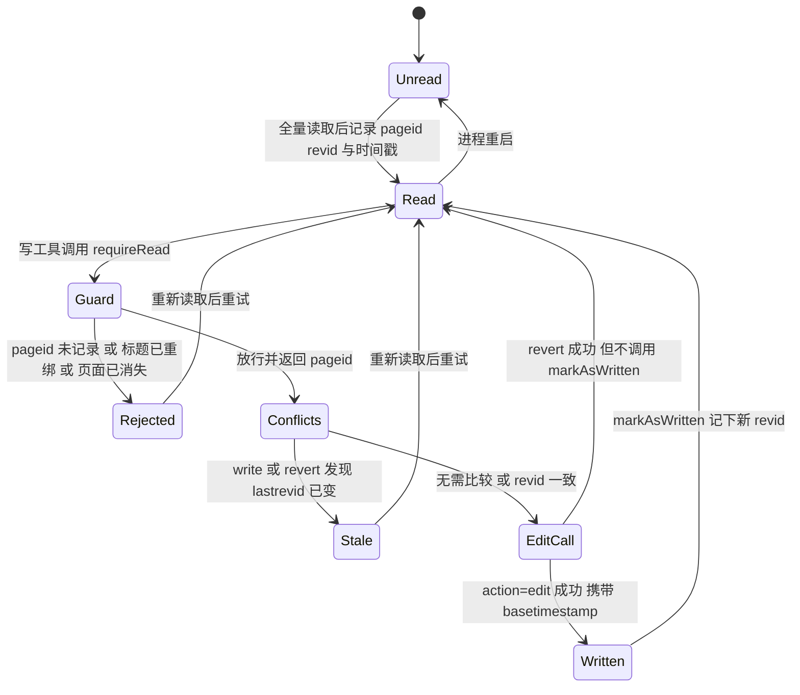

# 写前必读守卫与编辑冲突保护

写前必读是本服务唯一一条由代码执行、而不只是"请求模型遵守"的写侧规则，但它实际上由三层叠成：

- **提示层**：生成的 server instructions 写着 "READ BEFORE WRITE: Never call any write tool without first reading the target page with get-article or get-article-with-lineno"，并附加一条 SESSION NOTE 说明进程按连接重启、重连后必须重新读（[`src/index.ts`](../../src/index.ts#L286-L294)）。同一段文本也注册成 `operating-principles` prompt，供不自动注入 instructions 的客户端拉取（[`src/index.ts`](../../src/index.ts#L353-L364)）。
- **读证据层**：`src/common/pageState.ts` 维护进程级的"读过哪些页面、读到哪一版、什么时候读的"，并由八个写工具在动手前调用 `requireRead` 强制检查。
- **冲突保护层**：读证据同时被翻译成 `action=edit` 的 `starttimestamp`/`basetimestamp`，交给 MediaWiki 自己的三方合并做冲突检测；对整页覆写另外加一道显式的 revid 比较（CAS）。

三层各自独立失效：提示层可以无视，读证据层只保证"看过一次"，冲突层只在内容真正并发变化时才生效。读本页时应把它们分开评估。

## 状态：两张表、一个进程

```ts
interface ReadRecord { revid: number; revTimestamp?: string; readAt: Date }
const readState = new Map<number, ReadRecord>();            // pageid -> 读证据
const writeCache = new Map<string, { pageid: number; revid: number }>(); // title -> 本会话写过什么
```

[`src/common/pageState.ts`](../../src/common/pageState.ts#L38-L49)

对外暴露的函数构成整个守卫表面积：`markAsRead`、`recordReadFromApi`、`markAsWritten`、`isRead`、`requireRead`、`findStaleWrite`、`conflictGuardParams`、`invalidateTitle`、`getReadRecord`、`getReadTime`、`clearReadState`（[`src/common/pageState.ts`](../../src/common/pageState.ts#L59-L272)）。几个结构性事实：

1. **读证据以 `pageid` 为键，标题从不入键。** MediaWiki 会把下划线、首字母大小写、命名空间前缀等变体归一化到同一个 `pageid`，因此这些标题共享一条记录；重定向页和它的目标页有各自的 `pageid`，是两条记录。
2. **写缓存以标题为键，是唯一与标题绑定的状态。** 它的职责不是"跳过 API 调用"（`requireRead` 每次都会重新解析标题，见下节），而是记住"本会话在这个标题上写过哪个 `pageid`"，用来发现标题被移动或删除后重建（[`src/common/pageState.ts`](../../src/common/pageState.ts#L240-L254)）。文件头部注释仍写着缓存能让 `requireRead` 省掉 API 往返（[L45-L49](../../src/common/pageState.ts#L45-L49)），这句已经和实现不符，改动这段代码时不要按注释理解。
3. **两条记录都带时间戳。** `revid` 用于 revid CAS，`revTimestamp`（读到的修订时间）用于 `basetimestamp`，`readAt`（读取时刻）用于 `starttimestamp`（[`src/common/pageState.ts`](../../src/common/pageState.ts#L32-L42)、[L118-L138](../../src/common/pageState.ts#L118-L138)）。
4. **状态活在模块作用域，与进程同寿。** `clearReadState()` 会同时清空两张表，但 `src/` 内只有测试调用它（[`src/common/pageState.ts`](../../src/common/pageState.ts#L269-L272)）。"按会话隔离"因此不是代码保证，而是运行方式的结果：instructions 声明的模型是"每个客户端连接启动一个新进程（含 /mcp 重连）"，于是重连等于状态清零。若把服务器改成常驻进程，这个前提会立即失效。

`getReadRecord(pageid)` 证明读证据还有第二个消费者：`diff-revisions` 在未显式给出 `from_rev` 时，用本会话读到的 `revid` 作为比较基线，没有记录就报错要求先 `get-article`（[`diff-revisions.ts`](../../src/tools/ro/diff-revisions.ts#L168-L179)）。

## 证据如何产生：四个会写状态的读取工具

只有四个只读工具调用 `markAsRead` / `recordReadFromApi`，其余读取工具对守卫完全不可见：

| 工具 | 留下证据的条件 | 记录内容 | 证据 |
|---|---|---|---|
| `get-article` | 内容视图覆盖整页（非局部、非旧版） | 通过 `recordReadFromApi` 重新解析当前 `revid` + 时间戳，并按需跟随重定向 | [`get-article.ts`](../../src/tools/ro/get-article.ts#L36-L42)、[L184-L198](../../src/tools/ro/get-article.ts#L184-L198)、[L246-L258](../../src/tools/ro/get-article.ts#L246-L258) |
| `get-article-with-lineno` | `offset === 0` 且未给 `limit` 且响应未被 `maxlen` 截断 | 直接 `markAsRead(pageid, lastrevid, revTimestamp)` | [`get-article-with-lineno.ts`](../../src/tools/ro/get-article-with-lineno.ts#L189-L196) |
| `get-articles` | 批量读取中每个存在的页面 | 每个页面的 `pageid` + `revid` + 时间戳 | [`get-articles.ts`](../../src/tools/ro/get-articles.ts#L138-L141) |
| `get-module-source` | 成功取到主槽内容即记录 | `pageid` + `revid` + 时间戳 | [`get-module-source.ts`](../../src/tools/ro/get-module-source.ts#L127-L130) |

`get-article` 的记录走 `recordReadFromApi`，它自己发一次 `action=query&prop=revisions&rvprop=ids|timestamp` 来取"当前修订"，因此记录的是**页面最新一版**的 `revid` 与时间戳，而不是工具把内容交给模型的那一刻的猜测值；失败被 `try { … } catch { }` 吞掉（注释：best-effort，写前必读守卫此时退回严格模式）。这意味着一次"内容已交付但证据没记下"的读会让下一次写被拒——方向安全，但对模型是困惑的失败（[`src/common/pageState.ts`](../../src/common/pageState.ts#L74-L104)）。

### 重定向与身份

`recordReadFromApi(identifier, followRedirect)` 的第二个参数不是装饰：当按标题读取且 `followRedirect` 为真时，它会在自己的解析查询里也带上 `redirects`，使记录的 `pageid`/标题属于**内容实际来自的页面**（重定向目标），而不是重定向页（[`src/common/pageState.ts`](../../src/common/pageState.ts#L74-L99)）。这是本页最容易被误改的一处不变量：记录的页面必须与交付的正文同源。

`get-article` 在跟随重定向后还会在响应里追加一段提示，告诉模型正文来自哪个标题、读证据记在哪个标题上，并建议把该标题传给 `edit`/`write`，因为 `action=edit` 不跟随重定向（[`get-article.ts`](../../src/tools/ro/get-article.ts#L246-L258)）。`get-article-with-lineno` 没有 `followRedirect` 参数，标题路径固定跟随重定向，随后用带 `redirects` 的查询解析目标页，与上面同一规则（[`get-article-with-lineno.ts`](../../src/tools/ro/get-article-with-lineno.ts#L125-L155)）。`get-articles` 与 `get-module-source` 不发送 `redirects`，因此它们交付的正文与记录的身份都是重定向页本身，同样自洽。

由此推出使用者必须记住的两条：读重定向标题不会给目标页的 `pageid` 留下证据（随后 `edit` 目标标题仍会被拒）；反过来，读目标页也不能用来"授权"覆写那条 `#REDIRECT` 单行页。

### 明确不产生证据的读取

守卫的语义是"基于模型真正看到的整页内容"，因此以下读取都被有意识地排除在证据之外：

| 读取方式 | 为什么不算 | 证据 |
|---|---|---|
| `get-article` 带 `revision` 参数 | 旧版视图与当前版无关，记录会认证成"当前版"而放行对未见内容的覆写；代码在此路径上直接返回 | [`get-article.ts`](../../src/tools/ro/get-article.ts#L163-L182) |
| `get-article` 带 `offset > 0` | 只看到后半段，`isFullView` 返回假 | [`get-article.ts`](../../src/tools/ro/get-article.ts#L44-L54) |
| `get-article` 的 `maxlen` 截断（`content.length > maxlen`） | 同上 | 同上 |
| `get-article-with-lineno` 的 `offset > 0`、任意 `limit`、或 `maxlen` 截断 | `fullView = offset === 0 && limit === undefined && !truncated` | [`get-article-with-lineno.ts`](../../src/tools/ro/get-article-with-lineno.ts#L186-L196) |
| `get-article-by-revision` | 整个模块不引用 `pageState`，取到旧修订也不留证据 | [`get-article-by-revision.ts`](../../src/tools/ro/get-article-by-revision.ts#L87-L95) |

此外还有两处"提前返回即无证据"的细节。`revision` 找不到对应内容时以错误返回，而 `get-article` 的 id-only 路径在 `revisions[0]['*']` 缺失时以 `"Page … is empty."`（`isError: false`）返回，都发生在记录之前；相反 `content === ''` 会被记录并渲染成 `(empty page)`。所以"读到了空结果"并不总能解锁写入，取决于走的是哪条分支（[`get-article.ts`](../../src/tools/ro/get-article.ts#L184-L198)）。

## `requireRead`：判定顺序与身份检查

`requireRead(title)` 是异步闸门，每次调用固定多花一次 `getArticleInfo(title, { prop: 'info' })` 往返，判定顺序完全写在控制流里（[`src/common/pageState.ts`](../../src/common/pageState.ts#L210-L267)）：

1. **总是先解析标题。** 无论写缓存里有没有这个标题，都重新向 API 要 `pageid` —— 标题不是稳定身份，缓存不能替代解析。
2. **结果不是数组或为空 → 返回 `0`。** 不做任何校验。
3. **页面不存在时看缓存。** 判据是 `page.missing !== undefined`（MediaWiki 在 `format=json` 下用 `missing: ""` 表示缺失，空串是假值，真值判断会漏掉它，代码库别处同样用 `!== undefined`）。若本会话写过这个标题，说明它被别人删掉了：清掉缓存并抛 `no longer exists`，要求先 `get-article` 确认后再有意识地重建；否则返回 `0` 允许创建新页面。
4. **缓存与解析结果不一致时抛错。** 若缓存里的 `pageid` 与刚解析出的 `pageid` 不同，说明标题被移动（旧标题变成重定向）或被删除后重建，清缓存并抛 `moved or recreated`，`pageid` 与冲突时间戳都不能跨页面复用。
5. **存在但未读 → 抛错。** 当页面同时有 `pageid` 与 `lastrevid` 且 `isRead(pageid)` 为假时抛出错误，消息含标题、`pageid`、点名 `get-article` / `get-article-with-lineno`，并声明这是防止数据丢失的安全要求。
6. **其他情况返回 `page.pageid ?? 0`。**

`isRead` 只做 `readState.has(pageid)`（[`src/common/pageState.ts`](../../src/common/pageState.ts#L193-L195)），所以 `requireRead` 本身从不比较修订号：它回答"本进程读过这个页面吗"，不回答"你读的那版还是当前版吗"。版本新鲜度由下一节的冲突层负责。

失败方向并不统一，需要分清：

- **API 抛错时失败关闭**：`getArticleInfo` 的异常一路传出 `requireRead`，被写工具处理函数的 `catch` 变成 `errorResult`，写入没有发生。
- **信息响应缺字段时失败开放**：如果页面对象缺少 `pageid` 或 `lastrevid`，第 5 步的抛错条件不成立，函数直接返回 `page.pageid ?? 0` 放行。这是守卫内部唯一"校验消失"而非"阻断"的形态。
- **标题解析不到页面时按设计放行**：这是创建页面的必经之路；`undelete` 之类作用在已删除标题上的工具也因此结构性地无法被守卫保护。

## 八个受守卫的写工具

十七个注册的写工具中，八个以 `await requireRead(...)` 开始（注册表见 [`tools/index.ts`](../../src/tools/index.ts#L129-L147)）：

| 工具 | 被守卫的标题 | 使用返回的 `pageid` | 携带冲突参数 | 成功后 `markAsWritten` | 证据 |
|---|---|---|---|---|---|
| `write` | `title` | 是（CAS + 时间戳） | 是 | 是 | [`write.ts`](../../src/tools/editing/write.ts#L83-L168) |
| `edit` | `title` | 是（时间戳） | 是 | 是 | [`edit.ts`](../../src/tools/editing/edit.ts#L93-L179) |
| `append` | `title` | 是（时间戳） | 是 | 是 | [`append.ts`](../../src/tools/editing/append.ts#L72-L100) |
| `prepend` | `title` | 是（时间戳） | 是 | 是 | [`prepend.ts`](../../src/tools/editing/prepend.ts#L70-L98) |
| `revert` | `title` | 是（CAS + 时间戳） | 是 | **否**（故意的） | [`revert.ts`](../../src/tools/editing/revert.ts#L80-L183) |
| `delete` | `title` | 否 | 否 | 否，改为 `invalidateTitle` | [`delete.ts`](../../src/tools/editing/delete.ts#L68-L83) |
| `move` | 仅 `from` | 否 | 否 | 否，改为 `invalidateTitle(from)` | [`move.ts`](../../src/tools/editing/move.ts#L69-L86) |
| `protect` | `title` | 否 | 否 | 否 | [`protect.ts`](../../src/tools/editing/protect.ts#L78-L82) |

调用点都在处理函数的开头，因此守卫先于该工具的其他工作：在 `edit` 匹配 `old_lines` 之前、在 `write` 计算字节比例之前、在 `protect` 取 token 之前。这也意味着守卫拦截的成本是"一次 `getArticleInfo` 往返"，而不是"一次失败的编辑"。

被拒绝的守卫不会到达传输层：写工具的 `try/catch` 把它转成 `errorResult('Failed to <action>', error)`，文本通道是 `{ "error": "Failed to edit page", "details": "<守卫消息>" }` 且 `isError` 为 `true`（[`utils.ts`](../../src/common/utils.ts#L136-L148)）。模型看到的是一条带指令的工具错误，而不是崩溃。

其余九个写工具从不引用 `pageState`，这是观察到的覆盖范围，不是书面策略：

| 工具 | 作用于 | 证据 |
|---|---|---|
| `block` / `unblock` | 用户账号与 IP | [`block.ts`](../../src/tools/editing/block.ts)、[`unblock.ts`](../../src/tools/editing/unblock.ts) |
| `send-email` | 某个用户的收件箱 | [`send-email.ts`](../../src/tools/editing/send-email.ts) |
| `create-account` | 新的 wiki 身份 | [`create-account.ts`](../../src/tools/editing/create-account.ts) |
| `upload` / `upload-by-url` | File 命名空间中的文件 | [`upload.ts`](../../src/tools/editing/upload.ts#L57-L85)、[`upload-by-url.ts`](../../src/tools/editing/upload-by-url.ts) |
| `purge` | 服务端页面缓存 | [`purge.ts`](../../src/tools/editing/purge.ts#L43-L61) |
| `undelete` | 已删除页面的修订 | [`undelete.ts`](../../src/tools/editing/undelete.ts#L59-L84) |
| `add-flow-topic` | Flow 版块的新话题 | [`add-flow-topic.ts`](../../src/tools/editing/add-flow-topic.ts#L62-L77) |

其中三个值得单独辨析。`undelete` 在结构上免疫：页面已删除，`getArticleInfo` 不返回 `pageid`，即便加上调用也只会返回 `0`。`add-flow-topic` 往一个确实存在的版块发新内容，补上守卫是有意义的——它缺席意味着模型可以在从未读过的讨论页发帖。`purge` 只动缓存，这也是它带 `destructiveHint: false` 的原因。

## 两层冲突保护

读证据不只用于放行，它还驱动两道互相独立的冲突检测。二者覆盖的失败模式不同，不能互相替代。

### 第一层：`basetimestamp` / `starttimestamp` 交给 MediaWiki 三方合并

`conflictGuardParams(pageid)` 在存在读记录时返回 `starttimestamp`（读取时刻，能发现页面在读与写之间被删除或重建），并在 `revTimestamp` 已知时追加 `basetimestamp`（读到的那一版的编辑时间）（[`src/common/pageState.ts`](../../src/common/pageState.ts#L122-L138)）。这组参数被合并进 `action=edit`，由五个走 `doEdit` 的工具使用：`edit`、`write`、`append`、`prepend`、`revert`（[`write.ts`](../../src/tools/editing/write.ts#L146-L163)、[`revert.ts`](../../src/tools/editing/revert.ts#L159-L177)）。用 `doEdit` 而不是 `bot.edit()` 的原因很直接：后者无法传 `starttimestamp`。

这一层的盲点写在注释里：MediaWiki 的冲突检测是三方合并，只有在文本改动**重叠**时才报 `editconflict`；一次干净的整页覆写总能合并成功，因此它会静默覆盖别人刚写的段落。参数缺失时（没有读记录、或读记录里没有修订时间）这一层同样不生效。命中冲突时，`errorResult` 会通过文本模式匹配把错误转成带恢复提示的消息——因为 nodemw 丢了错误码，只剩 `info` 文本（[`utils.ts`](../../src/common/utils.ts#L104-L134)）。

### 第二层：显式 revid CAS，专治整页覆写

`findStaleWrite(title, pageid)` 补上第一层的盲区：重新查一次页面的 `lastrevid`，与读记录里的 `revid` 比较，不同就返回拒绝消息（含读时 revid、当前 revid、"Overwrite refused to prevent data loss"、以及"重新读、重放改动、再保存"的指令）（[`src/common/pageState.ts`](../../src/common/pageState.ts#L140-L171)）。调用者是两个整页覆写工具：`write` 在体积校验之后、`doEdit` 之前调用（[`write.ts`](../../src/tools/editing/write.ts#L133-L139)），`revert` 在守卫之后立即调用（[`revert.ts`](../../src/tools/editing/revert.ts#L82-L89)）。因此这两条路径每次写要多付一次 `getArticleInfo` 往返。

CAS 有三处**文档化的失败开放**，都写成注释，改动时应当视为设计而非疏漏：

1. 没有读记录，或记录的 `revid` 为假值 → 返回 `null`（注释：从未读过、或页面是本会话创建的，无可比较对象）。
2. `getArticleInfo` 的结果没有 `lastrevid` → 返回 `null`（注释：页面没了或信息不可用，交给 MediaWiki 决定）。
3. 这次查询抛错 → `catch` 返回 `null`（注释：fail open，MediaWiki 自己的三方合并仍在生效）。

### 写成功后如何续期：`markAsWritten` 与 `revert` 的例外

`markAsWritten(title, pageid, revid, revTimestamp)` 做两件事：用新修订调用 `markAsRead`，并把 `{pageid, revid}` 写进 `writeCache`（[`src/common/pageState.ts`](../../src/common/pageState.ts#L173-L183)）。前者让下一次 `requireRead` 命中，后者让后续写的 `basetimestamp` / `starttimestamp` 指向刚保存的版本，而不是若干分钟前的那次读。`edit`、`write`、`append`、`prepend` 在响应里同时有 `pageid` 与 `newrevid` 时才调用它。

`revert` 刻意不调用。revert 是写、不是读：它恢复的内容模型通常并没有读过（它来自一个旧修订号），若用它自己的输出重置读记录，就等于用一次写"洗白"了读证据，让后续整页覆写跳过 CAS。代码里留了注释说明这一取舍，并且测试用 spy 断言 `markAsWritten` 未被调用（[`revert.ts`](../../src/tools/editing/revert.ts#L179-L183)）。后果是：revert 成功后，读记录仍指向 revert 之前的 `revid`，下一次 `write`（或下一次 `revert`）的 revid CAS 会拒绝——因为页面的 `lastrevid` 已经是 revert 产生的新修订——直到模型真正重新读一遍页面。

### 标题重绑时的缓存失效

`invalidateTitle(title)` 只删 `writeCache` 的条目，不动 `readState`（`pageid` 级别的证据仍然有效，只是不再和这个标题绑定）。`move` 在成功后使旧标题（现在是重定向）失效，`delete` 在成功后使被删除标题失效（[`move.ts`](../../src/tools/editing/move.ts#L84-L87)、[`delete.ts`](../../src/tools/editing/delete.ts#L81-L84)）。`requireRead` 的第 3、4 步是这条规则的另一半：即便缓存没被主动清掉，标题被移动/重建后解析出的 `pageid` 不同，或页面已经消失，也会被拒绝并顺手清理缓存。

## 完整生命周期



图注：一次"读 → 守卫 → CAS → `action=edit` → `markAsWritten`"的状态迁移；只有 `write` 与 `revert` 会经过 CAS 状态，`revert` 停留在旧读证据上，`clearReadState` 仅在测试中使用，生产路径只靠进程重启回到未读状态。

## 不变量、缺口与下游缓解

> 在本进程内，任何受守卫的写工具触碰某页面之前，该页面必须被全量读取过一次；读证据以 `pageid` 为键并与修订号、修订时间戳、读取时刻一起保存，供冲突检测使用，但 `requireRead` 本身不比较修订号。

由此排除在外的范围，以及别处的缓解措施：

| 缺口 | 后果 | 别处的缓解 |
|---|---|---|
| `requireRead` 只看"读过没有" | 读与写之间的外部编辑不会被守卫发现 | `edit`/`write` 用 `basetimestamp` 交给 MediaWiki；`write`/`revert` 另外做 revid CAS |
| CAS 只存在于 `write` 与 `revert` | `append`、`prepend`、`delete`、`protect`、`move` 的整页/结构改动只靠三方合并，甚至完全没有版本参数（`delete`、`move`、`protect` 走非 edit 的 action） | `append`/`prepend` 仍是增量编辑，冲突风险最低 |
| 局部读取、旧版读取不算已读 | 模型可能覆写它从未看过的段落——但必须先在别处获得整页证据 | 无（这是刻意的取舍，不是漏洞） |
| 记录失败被吞掉 | 内容已交付、证据缺失，下一次写被拒 | 无；失败方向安全，可读性差 |
| 只在内存、只能靠重启清空 | 无法按会话/对话隔离；常驻进程会跨用户累积证据 | 每个连接一个新进程（instructions 声明的前提） |
| `requireRead` 在页面缺 `lastrevid` 时静默放行 | 极少见的元数据缺失会跳过校验 | 无 |
| 未参与守卫的九个工具 | 上传、删除恢复、Flow 发帖、账号操作都不需要读证据 | 无；属于策略选择而非结构性保证 |
| `move` 只守卫 `from` | 移动到已存在页面（覆盖目标）不受读证据约束 | 无 |

## 状态机之外的失败模式

从运维角度看，绝大多数守卫失败都是"阻止写入"：

| 场景 | 表现 |
|---|---|
| `getArticleInfo` 抛错（网络、token、错误 API） | `requireRead` 拒绝，`errorResult` 返回，写入未发生 |
| 页面存在但本会话未读过 | `details` 只点名 `get-article` 与 `get-article-with-lineno`（尽管 `get-articles`、`get-module-source` 也会留下证据），写入未发生 |
| 局部读取后写 | 同上，`details` 仍是 `has NOT been read`——错误信息不会说明"因为你只读了十行" |
| 本会话写过的标题被别人删除 | 拒绝并提示 `no longer exists`，要求先确认再重建 |
| 标题被移动或被删除后重建 | 拒绝并提示 `moved or recreated`，要求重新读取 |
| 读后页面被改，且是整页覆写 | `write`/`revert` 拒绝并给出两个 revid；`edit`/`append`/`prepend` 只在重叠改动时被 MediaWiki 拒绝 |
| 页面缺 `lastrevid` | 守卫静默放行——唯一"校验消失"而非"阻断"的形态 |
| 标题解析不到页面 | 按设计放行，这就是创建页面的路径 |

## 扩展点

存储与调用方分离得比较干净，收紧或放宽守卫的成本都很低：

- **把 CAS 推广到 `edit`/`append`/`prepend`**：只需在相应处理函数里调用 `findStaleWrite(title, pageid)`（它们已经拿到 `pageid`），不必改 `pageState.ts`；代价是每次写多一次 `getArticleInfo` 往返。
- **让 `delete`/`move`/`protect` 也携带版本参数**：`starttimestamp` 语义依赖 `action=edit`，对这三个 action 需要逐 API 确认可用性，不能直接套用 `conflictGuardParams`。
- **按会话隔离**：需要给 `clearReadState` 一个真实调用者（连接建立或关闭时的生命周期钩子），而不是依赖进程重启。当前 `src/` 内除测试外没有调用点（[`src/common/pageState.ts`](../../src/common/pageState.ts#L269-L272)）。
- **修正 `writeCache` 的注释**：文件头仍暗示它能省掉 `requireRead` 的解析往返，实际用途是重绑检测；这类"注释比代码旧"的地方是后续改动的陷阱。
- **覆盖另一个写工具**：在其处理函数第一句加 `await requireRead(title)` 即可，注册表不做这项检查，所以它是评审清单项而不是结构性保证（见[工具注册表](../architecture/tool-registry.md)）。

## 验证：测试即不变量

守卫有离线自动化测试，且它们是本页断言的可执行版本。测试文件位置与覆盖重点：

- [`src/tools/__tests__/readGuard.test.ts`](../../src/tools/__tests__/readGuard.test.ts) —— 通过真实 MCP 协议（`InMemoryTransport`）调用工具，`nodemwBot.js` 被 `vi.mock` 换成 `fakeNodemwBot.ts`。它锁定的不变量是：`offset` 越界、截断 `maxlen`、`revision` 参数、`get-article-with-lineno` 的行窗口都不解锁写入；全量读取解锁；标题重绑与"会话内写过却被删除"被拒；`revert` 的 CAS 拒绝与"不洗白读证据"；`edit` 的 1/10 体量下限（[L104-L214](../../src/tools/__tests__/readGuard.test.ts#L104-L214)）。
- [`src/tools/__tests__/smoke.test.ts`](../../src/tools/__tests__/smoke.test.ts) —— 断言 `get-module-source`、`get-articles` 的读记录真的带出 `basetimestamp`，且 `revert` 不修改读记录里的修订时间（[L163-L190](../../src/tools/__tests__/smoke.test.ts#L163-L190)）。
- [`src/common/__tests__/pageState.test.ts`](../../src/common/__tests__/pageState.test.ts) —— 时间戳格式化、`conflictGuardParams` 的两级参数、`markAsWritten` 的 `readAt` 盖章（[L38-L78](../../src/common/__tests__/pageState.test.ts#L38-L78)）。

`fakeNodemwBot.ts` 暴露 `setFakePageContent` / `setFakePageMissing` / `setFakeLastrevid` / `setFakeHistoricalContent`，用来在同一进程内模拟"外部改动"与"页面被删"，这是测试 CAS 与重绑路径的关键装置（[`fakeNodemwBot.ts`](../../src/tools/__tests__/fakeNodemwBot.ts#L40-L67)）。测试的组织方式见[验证与测试策略](../testing/validation.md)。

改动守卫时值得手工确认的三个行为，现有测试没有直接覆盖：`findStaleWrite` 的三条 fail-open 分支、`requireRead` 在信息响应缺 `lastrevid` 时的静默放行，以及 `get-article` 跟随重定向后提示里给出的目标标题。

## 相关页面

- [安全模型](safety-model.md) — 该机制所支撑的注释、风险分级与提示层规则。
- [编辑内容](../workflows/editing-content.md) — 守卫试图强制的"读 → 改 → 验证"循环，以及各写工具的体量与摘要约定。
- [读取内容](../workflows/reading-content.md) — 四个会写读状态的读取工具与其余只读工具的差别。
- [Bot 运行时](../architecture/bot-runtime.md) — `getBot()` 单例、`promisifyBotMethod` 与 `requireRead` 每次解析标题所用的 API 通道。
- [工具注册表与单工具契约](../architecture/tool-registry.md) — 为什么"先调用 `requireRead`"是约定，而不是注册表能强制的东西。
- [验证与测试策略](../testing/validation.md) — 守卫相关测试在整体测试体系中的位置。
