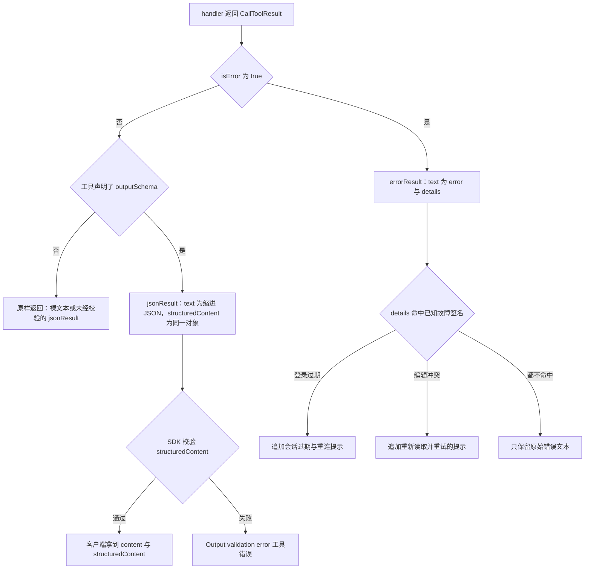

# 工具结果与输出整形

工具 handler 的返回值是这个服务端唯一的产品面。模型看到的是 `content[0].text`，宿主可能额外消费 `structuredContent`，而 wiki 上真正发生了什么只体现在这两条通道里。因此"结果长什么样"不是装饰性问题：`maxlen` 标记落在正文里会让 agent 知道该续读，`isError` 缺失会让一次失败的保存看起来像成功，`parse` 的警告缺席会让一个带 `class="error"` 的破损页面被当成渲染成功。

本页讲三层，它们各自有独立的失败模式：

| 层 | 由什么实现 | 回答的问题 |
|---|---|---|
| 结果信封 | [`src/common/utils.ts`](../../src/common/utils.ts#L85-L148) 的 `jsonResult` / `errorResult` | 这次调用成功还是失败，载荷放在哪条通道 |
| 共享整形 helper | [`siteInfo.ts`](../../src/common/siteInfo.ts#L39-L63)、[`parseOutput.ts`](../../src/common/parseOutput.ts#L29-L112)、[`compareOutput.ts`](../../src/common/compareOutput.ts#L125-L239) | 原始 API 响应太大、太吵或格式不适合 agent 时怎么压 |
| 逐工具内联预算 | 各 handler 里的 `maxlen`、`offset`、`limit`、`*limit` 与切片 | 一次响应能带多少，被截断时怎么告知 |

目录与逐工具的 `outputSchema` 清单见[工具注册表](../architecture/tool-registry.md)；读取侧的分页与游标语义见[读取内容](../workflows/reading-content.md)；写侧的形状校验后果见[编辑内容](../workflows/editing-content.md)。

## 结果信封：两条通道，三种形状

```ts
// 省略了两个注解 helper，见下文
export function jsonResult(data: unknown): CallToolResult {
    return {
        content: [{ type: 'text', text: JSON.stringify(data, null, 2) }],
        structuredContent: data as Record<string, unknown>
    };
}

export function errorResult(message: string, error?: Error): CallToolResult {
    const details = annotateLoginError(message, error) ?? annotateEditConflict(message, error) ?? error?.message ?? '';
    return {
        content: [{ type: 'text', text: JSON.stringify({ error: message, details }, null, 2) }],
        isError: true
    };
}
```

| 形状 | 构造方式 | `content[0].text` | `structuredContent` | `isError` | 当前工具 |
|---|---|---|---|---|---|
| 结构化成功 | `jsonResult(data)` | `data` 的缩进 JSON | 同一个对象的引用 | 不设置 | 51 件（含 `parse` 的 `include`/`limit_report` 模式） |
| 文本成功 | handler 手写 `content` | 正文本身（wikitext、HTML、XML） | 无 | 不设置 | `get-article`、`get-article-by-revision`、`expand-templates`、`parse` 默认模式 |
| 工具失败 | `errorResult(message, error)` | `{"error": …, "details": …}` 的缩进 JSON | 无 | `true` | 除 `get-article` 外的全部工具 |
| 手写失败 | `return { content: [...], isError: true }` | 一句话，例如 `Page "X" not found.` | 无 | `true` | 仅 `get-article` 的 7 处 |

`jsonResult` 不做克隆、不做校验、不排序：`structuredContent` 就是传进去的那个对象，`text` 是它的 2 空格缩进编码（[`utils.ts`](../../src/common/utils.ts#L85-L93)）。两条通道携带同一份数据，所以"读哪条"是客户端偏好问题；但文本通道是唯一全覆盖的——纯文本工具没有结构化通道，所有错误也没有。`errorResult` 相反，只填文本通道（[`utils.ts`](../../src/common/utils.ts#L136-L148)），错误路径因此不受输出 schema 约束。

### 为什么有几件工具必须返回纯文本

`get-article` 直接把 wikitext 作为文本返回，截断标记也落在同一段文本里（[`get-article.ts`](../../src/tools/ro/get-article.ts#L180-L197)）；`expand-templates` 返回展开后的 wikitext（[`expand-templates.ts`](../../src/tools/ro/expand-templates.ts#L91-L93)）；`get-article-by-revision` 返回裸的修订内容（[`get-article-by-revision.ts`](../../src/tools/ro/get-article-by-revision.ts#L93-L95)）。这些工具的成功载荷**就是文档本身**，套一层 JSON 只会带来二次转义，并让"把 `lines` 或正文直接复制到 `edit` 的 `old_lines`"这条工作流变难。`get-article-with-lineno` 正是为此存在的结构化对应物：同样的内容，行对象 + 声明的 `outputSchema`（[`get-article-with-lineno.ts`](../../src/tools/ro/get-article-with-lineno.ts#L66-L72)）。

`parse` 是混合体：默认返回 HTML 或 XML 文本块，一旦传 `include` 或 `limit_report` 就切换成 `jsonResult`（[`parse.ts`](../../src/tools/ro/parse.ts#L184-L238)）。同一个工具两种返回形态，意味着它不可能声明一个既正确又不撒谎的 `outputSchema`——这正是它保持 schema-less 的理由。`get-module-source` 与 `get-articles` 是另一种情况：它们已经是 `jsonResult({...})`，却从未调用 `tool.update({ outputSchema })`（[`get-module-source.ts`](../../src/tools/ro/get-module-source.ts#L132-L141)、[`get-articles.ts`](../../src/tools/ro/get-articles.ts#L146-L146)），于是结构化通道存在但完全不受校验，属于遗留缺口而非设计。

### 声明 `outputSchema` 就是承诺成功路径走 `jsonResult`

48 个工具在 `server.tool(...)` 之后调用 `tool.update({ outputSchema })`，把 zod 形状挂到 `tools/list` 的条目上。SDK 的校验只在**非错误结果**上执行：声明了 schema 却没有 `structuredContent`，或 `structuredContent` 不符合 schema，都会被转成一条 `Output validation error: …` 的工具错误（`isError: true`），而不是协议错误；`isError` 结果直接跳过校验（[`mcp.js`](../../node_modules/@modelcontextprotocol/sdk/dist/esm/server/mcp.js#L185-L207)）。



图注：一次工具调用的结果分派——校验只发生在"成功且声明了 schema"的分支，所以错误形状永远不会被 schema 约束，而声明 schema 却返回文本成功会变成一次调用失败。

这个条款有两个实际推论。其一，写工具普遍把 MediaWiki 的 `action=edit` 响应原样丢进 `jsonResult`，schema 只声明自己依赖的键，其余标为可选（`write` 的 schema 与返回值见 [`write.ts`](../../src/tools/editing/write.ts#L68-L68)、[`write.ts`](../../src/tools/editing/write.ts#L170-L170)）；API 新增字段不会破坏契约，但改掉一个必需键会让该工具的每次调用成为输出校验错误。其二，zod 对象会剥掉未声明的键，所以 `structuredContent` 里"多出来的字段"对结构化客户端不可见——文本通道反而是唯一无损通道。

## 错误注解：把 wiki 的失败签名翻译成恢复步骤

`errorResult` 在两个正则数组上匹配"故障气味"，命中就把恢复步骤追加到 `details`（[`utils.ts`](../../src/common/utils.ts#L97-L134)）：

| 数组 | 模式 | 追加的提示 |
|---|---|---|
| `LOGIN_EXPIRED_PATTERNS` | `You're not allowed to edit this wiki through the API`、`not logged in`、`login required`、`assertuserfailed` | `— your login session has likely expired. Reconnect via /mcp to log in again.` |
| `EDIT_CONFLICT_PATTERNS` | `editconflict`、`edit conflict`、`编辑冲突` | `— Edit conflict: the page was modified by someone else after it was read in this session. Re-read it with get-article (or get-article-with-lineno), re-apply your change, then save again.` |

优先级是登录过期 → 编辑冲突 → 原始 `error.message` → 空串；`error` 字段始终保留 handler 传入的概括（如 `Failed to write page`），`details` 承载原始错误与提示。

**为什么是文本匹配而不是错误码。** nodemw 的 `api.call` 在 `data.error` 存在时只留下 `new Error('Error returned by API: ' + data.error.info)`，`code` 被丢弃（[`api.js`](../../node_modules/nodemw/lib/api.js#L158-L170)）。因此 `editconflict`、`assertuserfailed` 这类机器可读信号到达本服务端时已经只剩本地化散文，正则成了唯一可用的判据。这也解释了三个设计约束：

- **新增失败签名必须同时扩展数组。** 一个新的错误码、或一种尚未覆盖的语言/措辞，除非写进 `LOGIN_EXPIRED_PATTERNS` 或 `EDIT_CONFLICT_PATTERNS`，否则只会以裸 `error.message` 出现在 `details` 里，agent 得不到"重新读取后重试"或"重连"的指令。模式都不带 `/g`、多数带 `/i`（第一条 `You're not allowed to edit this wiki through the API` 是大小写敏感的），匹配对象是工具自己的 message 与底层 error 两处文本。
- **注解是纯增量，不改变成功/失败判定。** 它只在已经失败的结果上加句子，不会把失败变成成功，也不会阻止重试。
- **唯一绕过注解的路径是 `get-article`。** 它手写 7 处 `isError: true` 结果（参数校验、页面不存在、修订不存在等），从不调用 `errorResult`（[`get-article.ts`](../../src/tools/ro/get-article.ts#L122-L133)、[`get-article.ts`](../../src/tools/ro/get-article.ts#L264-L268)），所以它的失败永远不带登录/冲突提示。写工具是注解的主要受益者，因为编辑冲突与静默掉线都发生在它们身上。

两个边角不值得单独修，但读输出时看得见：`details` 为空时登录分支返回工具 message，于是 `error` 与 `details` 内容重复；编辑冲突分支无条件拼接，若底层 `error` 不存在，`details` 会以 ` — Edit conflict: …` 开头。这些行为由 [`utils.test.ts`](../../src/common/__tests__/utils.test.ts#L36-L60) 的四个用例固定住——英文冲突、中文冲突、无关错误原样透传、登录过期仍被注解。

## 站点信息压缩：一个目前没有生效的整形

`meta=siteinfo` 的载荷由 `extensions` 主导：一个有上百个扩展的 wiki 会让每个扩展的 `description`、`author`、`url`、`license`、`credits` 占满上下文，而 agent 通常只想知道"装了什么、什么版本"。`compactSiteInfo(info, full)` 的设计就是在 `full === false` 时把每个扩展压成 `{name, type, version}`（只保留存在的键），其余 `siprop` 段原样透传；`full === true`、`info` 为 `null`、或 `extensions` 不是数组时直接返回入参（[`siteInfo.ts`](../../src/common/siteInfo.ts#L39-L63)）。单元测试锁住了四点：full 模式返回**同一个对象**、其它段不受影响、扩展被压成三键、缺失 `extensions` 与 `null` 都不抛错（[`siteInfo.test.ts`](../../src/common/__tests__/siteInfo.test.ts#L46-L69)）。

真实接线里有两处错位，都发生在 `get-site-info` 这一侧（[`get-site-info.ts`](../../src/tools/ro/get-site-info.ts#L36-L76)）：

1. **双层信封。** 工具返回 `jsonResult({ siteinfo: compactSiteInfo(info || {}, full) })`，而 nodemw 的 `getSiteInfo` 回调交回的是整个 `query` 信封：`api.call` 的第二个回调参数是 `data[actionName]`（此处 `actionName` 为 `query`），`getSiteInfo` 再把它原样传出去（[`api.js`](../../node_modules/nodemw/lib/api.js#L129-L164)、[`bot.js`](../../node_modules/nodemw/lib/bot.js#L1327-L1343)）。于是真正的站点信息落在 `siteinfo.siteinfo` 下，`general`、`extensions` 等键都不在顶层。
2. **压缩因此是空操作。** `compactSiteInfo` 只在顶层 `info.extensions` 是数组时才压缩；真实载荷的 `extensions` 在 `siteinfo` 下一层，条件不成立，函数原样返回。结果是 `full: false` 并不会让扩展列表变小，而 `outputSchema` 是 `z.record(z.unknown())`，对两种形状都放行，不会给出任何提示。

对 agent 的实际含义：读 `get-site-info` 时按 `siteinfo.siteinfo.extensions` 取值，并且把 `full` 当作无效开关；要省 token 就只请求需要的 `properties`（工具描述本身也这么建议）。对改动者的含义：整形函数假设的层级必须与封装层实际交回的层级一致，`compactSiteInfo` 的单元测试用的是扁平 fixture，所以永远测不到这层错位。

## `parse`：把"渲染成功但内容已坏"变成可见警告

扩展会把失败写进 HTML 而不是让 API 调用失败：Widgets 对编译失败的微件输出 `<div class="error">`，`#iferror` 输出 `<span class="error">`，Scribunto 输出 `<strong class="error">`，而 API 仍然返回 `isError=false`。一个只扫 HTML 的 agent 会静默发布一个坏页面，所以 `parse` 自己做一次启发式检测（[`parseOutput.ts`](../../src/common/parseOutput.ts#L29-L94)）：

- 用 `class="[^"]*\berror[^"]*"` 统计所有带 error 类名的元素——`error`、`errorbox` 都算，`errata`、`terror` 因为词边界不算。匹配只覆盖**双引号**属性写法。
- 最多保留 3 个样本，每个样本取命中点前 100 / 后 400 字符的窗口，去标签、解实体、折叠空白，再截到 160 字符。
- `count` 是完整计数，不是样本数；样本可能少于 `count` 也可能少于 3（空文本样本会被丢弃）。

`formatHtmlErrorWarnings` 把报告渲染成纯文本行（[`parseOutput.ts`](../../src/common/parseOutput.ts#L97-L112)）：

```
[parse warning] 3 error element(s) detected in the rendered output:
  - 微件Foo出错: Unable to load template
  … and 1 more
The API call itself succeeded — inspect the HTML around these markers before publishing.
```

报告怎么进入结果取决于模式：默认文本模式下警告行被拼到 HTML **之前**（`filter(s => s !== '')` 会去掉原本作为分隔的空行）（[`parse.ts`](../../src/tools/ro/parse.ts#L186-L205)）；`include`/`limit_report` 的结构化模式下它们变成 `result.warnings` 数组（[`parse.ts`](../../src/tools/ro/parse.ts#L207-L238)）。`format: 'xml'` 时根本不计算警告，因为检测只对 HTML 文本执行（[`parse.ts`](../../src/tools/ro/parse.ts#L178-L182)）。同一段代码还会在未请求 `limit_report` 时发 `disablelimitreport` 去掉 NewPP 报告注释，省下重复的 token。

检测的边界必须自己记住：它按类名匹配，不解析 HTML 结构，所以一个包裹整段内容的 `<div class="error">` 会命中一次但样本可能被窗口截断；没有 `error` 类名的失败（纯文本提示、CSS 隐藏的元素）不会被发现。警告是"去看 HTML"的指令，不是失败判定。

## diff：服务端算好的 HTML 表格转成行文本

`action=compare` 在服务端算 diff，但只交回渲染好的 HTML 表格片段。`parseCompareDiff` 做纯格式转换——这里不做任何 diff 计算（[`compareOutput.ts`](../../src/common/compareOutput.ts#L32-L41)、[`compareOutput.ts`](../../src/common/compareOutput.ts#L125-L187)）。转换后的约定是 GNU diff 加 wdiff 的混合记法：

```
@@ 第112行 @@
 === 附加包 ===
-map_icon_BE.[-png-]
+map_icon_BE2.{+jpg+}
```

- `@@ … @@` 头来自 `diff-lineno` 单元格：保留原文（行号前缀是本地化的，如 `第112行：` / `Line 112:`），只去掉尾部冒号，重复的一对折叠，多个值用 ` | ` 连接。
- 上下文行以空格开头；`diff-context` 与 `diff-side-deleted`/`diff-side-added` 是同一内容的两半，相邻重复只保留一份。
- 删除行前缀 `-`，新增行前缀 `+`；行内的词级变化用 `[-removed-]`（删除侧）与 `{+added+}`（新增侧）包裹，来自 `<ins>/<del>/<span>/<div class="diffchange">` 的两种引号写法。
- `diff-marker` 单元格（`−`/`+` 标记列）被跳过；无法识别的行退化为去标签后的原文而不是抛错——这个解析器对任何输入都不抛异常。
- `added` / `removed` 统计的是**变化行数**，不是字符数；两个工具都用 `added === 0 && removed === 0` 推导 `identical`（[`diff-preview.ts`](../../src/tools/ro/diff-preview.ts#L139-L151)、[`diff-revisions.ts`](../../src/tools/ro/diff-revisions.ts#L203-L228)）。

`formatDiffLines(lines, maxlen)` 把行数组压进字符预算：`maxlen` 未给或 `<= 0` 表示不截断；超预算时按行累加（每行加 1 个换行的开销），**至少保留一行**（即使这一行本身超过预算），然后追加 `\n\n[truncated — diff exceeds maxlen; N more line(s) omitted]` 并置 `truncated: true`（[`compareOutput.ts`](../../src/common/compareOutput.ts#L189-L213)）。与 `get-article` 的标记不同，这里的标记带着被省略的行数，并且结果里另有一个布尔量——调用方不必解析文本就能知道是否完整。

请求侧还有一层兼容整形：`callCompareApi` 先带富元数据 props（`diff|ids|title|user|comment|timestamp`，其中 user/comment/timestamp 是 1.32+），命中"unrecognized value for parameter … prop"时自动退回只请求 `diff`（[`compareOutput.ts`](../../src/common/compareOutput.ts#L215-L239)）。因此在老版本 MediaWiki 上，diff 仍然可用，只是 `from`/`to` 里的 user、timestamp、comment 缺失；`diff-preview` 在 1.24 以下则直接给出降级建议而不是空结果（[`diff-preview.ts`](../../src/tools/ro/diff-preview.ts#L95-L126)）。

## 预算、截断与封顶：三种标记，一个共同前提

截断在这套工具里不是统一中间件，而是每个 handler 自己的算术。可辨认的约定只有三类：

| 位置 | 参数 | 粒度 | 标记形态 | 其它细节 |
|---|---|---|---|---|
| `get-article` | `maxlen`、`offset` | 字符 | 正文末尾追加 `\n\n[truncated — article exceeds maxlen, call get-article again with offset=<n> to continue reading]` | `maxlen` 未给或 `<= 0` 关闭截断；`offset >= 长度` 返回 `(reached end of article)`（[`get-article.ts`](../../src/tools/ro/get-article.ts#L96-L107)） |
| `get-article-with-lineno` | `offset`、`limit`、`maxlen` | 先按行、再按字符 | `lines` 里插入一条 `[truncated]` 伪条目，编号为最后保留行 + 1（什么都没留下时 `offset + 1`） | 伪条目计入 `shownLines`，所以可能等于 `limit + 1`；它看起来和正文行一样，喂给 `edit` 的 `old_lines` 前必须删掉（[`get-article-with-lineno.ts`](../../src/tools/ro/get-article-with-lineno.ts#L76-L91)、[`get-article-with-lineno.ts`](../../src/tools/ro/get-article-with-lineno.ts#L198-L209)） |
| `diff-preview`、`diff-revisions` | `maxlen` | 行数组（按字符记账） | `[truncated — diff exceeds maxlen; N more line(s) omitted]`，另有 `truncated` 布尔量 | 至少保留一行；`identical` 独立于截断（[`compareOutput.ts`](../../src/common/compareOutput.ts#L189-L213)） |

标记的共同前提是**带内告知**：文本工具没有信封可以放 `truncated` 字段，所以标记必须落进正文；结构化工具则可以把布尔量放在载荷里。两者的代价相同——响应长度是"预算 + 标记"，`maxlen` 是前缀的软边界而不是响应的硬上限。截断的动机写在 `maxlen` 的 `.describe()` 里：部署在会限制响应体积的 HTTP 代理之后（如阿里云 FC）时，宁可拿到半个页面加一个明确的续读指令。

**请求上限与输出上限不是一回事。** 一批 MediaWiki 请求能取多少，由各工具硬编码的 `*limit` 决定：`get-user-contribs` 用 `perPage = Math.min(limit, 500)` 循环取到 `limit` 条为止（[`get-user-contribs.ts`](../../src/tools/ro/get-user-contribs.ts#L113-L154)），`search` 与 `get-pages-transcluding` 每批 `500`（[`search.ts`](../../src/tools/ro/search.ts#L105-L148)、[`get-pages-transcluding.ts`](../../src/tools/ro/get-pages-transcluding.ts#L80-L110)），`get-pages-by-prefix` 每批 `5000`（[`get-pages-by-prefix.ts`](../../src/tools/ro/get-pages-by-prefix.ts#L110-L147)）。这些是"每请求"的量，靠 `continue` 续延可以多取几批；真正封顶输出的是循环里那个硬编码的 `10000` 条守卫——`search`、`get-pages-by-prefix`、`get-pages-transcluding`、`get-article-revisions` 都有它，而且到达上限时**不插入任何标记、也不交出游标**。这是与 `maxlen` 相反的一种截断：静默、不可察觉，调用方只能从"结果长度已经逼近 10000"来猜测它被截断了，没有续读指令可用。

### 截断与写前必读证据的耦合

`maxlen` 与 `offset` 不只是省 token，它们决定一次读取能否算作"读过"。两个读取工具都用同一判据：**只有覆盖整页的视图才记录读状态**。`get-article` 的 `isFullView` 在 `offset > 0` 或 `maxlen` 实际切掉了内容时返回 false（[`get-article.ts`](../../src/tools/ro/get-article.ts#L44-L54)、[`get-article.ts`](../../src/tools/ro/get-article.ts#L193-L195)）；`get-article-with-lineno` 要求 `offset === 0`、未传 `limit`、且 `maxlen` 没有截断（[`get-article-with-lineno.ts`](../../src/tools/ro/get-article-with-lineno.ts#L189-L196)）。带 `revision` 参数的历史视图一律不记录（[`get-article.ts`](../../src/tools/ro/get-article.ts#L163-L181)）。

后果是硬的：用 `maxlen: 2000` 读了半页，随后 `write` 会以 `Page "X" (pageid …) has NOT been read` 拒绝（[`pageState.ts`](../../src/common/pageState.ts#L256-L263)），因为写工具的 `requireRead` 只按 pageid 查有无记录。这条耦合是刻意的——守卫的目的是让破坏性编辑基于 agent 真正看到的内容，所以"看到一部分"和"没看到"被视作同一件事。细节见[写前必读守卫](read-before-write-guard.md)。

还有一条与截断同属"带内注解"的机制：`get-article` 在跟随重定向且解析出的标题与请求标题不同时，会在正文后追加一段 `[Note: "X" is a redirect; the content above is from "Y". …]`，并说明读状态记在哪个标题上（[`get-article.ts`](../../src/tools/ro/get-article.ts#L246-L259)）。它只在完整视图（即记录读状态的那条路径）上出现，作用是把"读到的是哪个页面"这件事从隐式状态变成可见输出。

## 改动这份契约时的检查清单

1. **成功路径选一种形状并贯彻。** 结构化数据用 `jsonResult` + `tool.update({ outputSchema })`，schema 逐键对照实际载荷；整篇文档用裸文本并且不声明 schema。二者混用（声明 schema 却返回文本成功）会在调用时变成 `Output validation error`，而不是启动报错。
2. **错误一律走 `errorResult`。** 它只有一个入口、自动获得两类恢复提示；手写 `isError: true`（如 `get-article`）会失去注解，也会让错误文本格式与其它工具不一致。
3. **新的失败签名要加进模式数组。** 换一个 MediaWiki 版本、加一种 wiki 语言、或遇到一个新的权限/冲突措辞，都可能产生未覆盖的 `data.error.info`；nodemw 已经把 `code` 丢了，正则数组是唯一的扩展点。
4. **新的截断要复用既有标记语汇。** 正文用结尾追加句，行视图用伪条目，结构化结果用布尔量 + 带省略计数的标记；同时让 `.describe()` 里的文字与真实字符串一致，因为描述是 agent 能看到的唯一文档。截断视图绝不能记录读状态。
5. **整形函数要按封装层实际交回的层级写。** `compactSiteInfo` 是反例：它假设 `extensions` 在顶层，而 `getSiteInfo` 交回的是 `query` 信封，于是压缩静默失效。
6. **测试锚点是格式而非实现。** [`compareOutput.test.ts`](../../src/common/__tests__/compareOutput.test.ts#L53-L139) 用真实 `action=compare` 片段固定 `@@` 头、`[-…-]`/`{+…+}` 与截断标记；[`parseOutput.test.ts`](../../src/common/__tests__/parseOutput.test.ts#L32-L95) 固定计数、样本上限、160 字符与溢出提示；[`siteInfo.test.ts`](../../src/common/__tests__/siteInfo.test.ts#L46-L69) 固定压缩语义；[`smoke.test.ts`](../../src/tools/__tests__/smoke.test.ts#L149-L161) 要求每件工具都返回非错误文本，因此 schema 漂移会以 `isError` 的形式让 CI 失败。唯一测不到的正是 `get-site-info` 的信封错位。

## 相关页面

- [工具注册表与工具模块契约](../architecture/tool-registry.md)
- [读取内容：返回形态、截断与分页](../workflows/reading-content.md)
- [编辑内容：写工具的返回与错误路径](../workflows/editing-content.md)
- [写前必读守卫](read-before-write-guard.md)
- [API 兼容性](api-compatibility.md)
- [安全模型](safety-model.md)
- [校验与测试](../testing/validation.md)
- [新增工具](../workflows/adding-a-tool.md)
