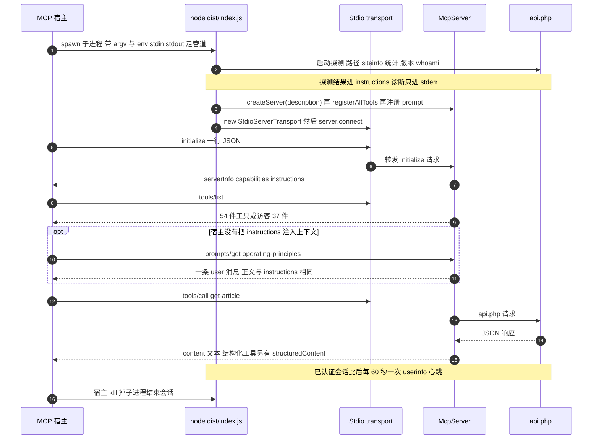

# MCP 传输、服务器身份与客户端接线

本页只讲服务器作为 MCP 对端的一面：宿主 spawn 了什么、`initialize` 回了什么、宣告的能力里哪些是真的、重连到底重置了什么，以及运维者怎么把它接进客户端。引导顺序的逐行跟踪在[启动生命周期](../architecture/startup-lifecycle.md)，工具目录的逐工具契约在[工具注册表](../architecture/tool-registry.md)，结果形状的细节在[工具结果与输出整形](../concepts/tool-results-and-output-shaping.md)，那段文字契约的内容与边界在[安全模型](../concepts/safety-model.md)。

一句话版本：这是一个**只走 stdio 的 JSON-RPC 子进程**。它不开端口、不服务第二个 wiki、也不在同一个进程里服务第二个客户端；整个 MCP 面就是一份工具目录（guest 37 件、已认证 54 件）加一个 prompt，而让这些工具能被正确使用所需的运行期事实，全部装在 `initialize` 响应的 `instructions` 字段里。

## 握手面：一次 `initialize` 里的全部情报

客户端在调用任何工具之前能知道的关于这个服务器的一切，都在一次 `initialize` 响应里：

| 字段 | 值 | 来源 |
|---|---|---|
| `protocolVersion` | 回显请求里受支持的版本（`2025-11-25`、`2025-06-18`、`2025-03-26`、`2024-11-05`、`2024-10-07`），否则回最新版本 | SDK 的 `_oninitialize`，不在本仓库 |
| `serverInfo.name` | 常量 `nodemw-mcp-server` | `McpServer` 构造实参 |
| `serverInfo.version` | `package.json` 的版本（当前 `0.3.1`） | JSON import |
| `serverInfo.description` | `MediaWiki API bridge for AI agents` | 同一处构造实参 |
| `capabilities` | `tools` 与 `prompts`，各自带 `listChanged: true` | 声明在 `createServer`，由 SDK 合并 |
| `instructions` | 站点自述加操作原则 | `createServer(description)`，[`src/index.ts`](../../src/index.ts#L348-L349) |

[`createServer`](../../src/server.ts#L39-L51) 刻意保持得很薄：它不持有任何 wiki 知识，只装配身份与默认值。每一个站点相关的字符串都由 `main()` 通过 `description` 参数注入，所以"站点信息过期"永远不是 `serverInfo` 的问题，wiki 事实全在 `instructions` 里。

三个容易被错过的细节：

- **`serverInfo.name` 不是 npm 包名。** 服务器自称 `nodemw-mcp-server`，而包里发出去的名字是 `@xiedada/nodemw-mcp-server`（[`package.json`](../../package.json#L2-L3)）。按 server 名字做策略或去重的宿主看到的是裸名，多实例并存时这些名字完全相同。
- **`protocolVersion` 不是本仓库决定的。** 版本协商由 SDK 完成：请求里给一个受支持的版本就原样回显，给一个不认识的版本就回最新的，而不是报错（[`types.js`](../../node_modules/@modelcontextprotocol/sdk/dist/esm/types.js#L2-L4)、[`server/index.js`](../../node_modules/@modelcontextprotocol/sdk/dist/esm/server/index.js#L270-L281)）。宿主不会因为版本字符串不匹配而被拒绝，但也不该由此推断服务器实现了那个版本的全部特性（本服务器只用到 `tools`、`prompts` 与 `instructions`）。
- **`instructions` 只在非空时出现。** SDK 用 `...(this._instructions && { instructions })` 组装响应（[`server/index.js`](../../node_modules/@modelcontextprotocol/sdk/dist/esm/server/index.js#L275-L280)）。本服务器的字符串永远非空（原则块是无条件拼进去的），所以一个没有 `instructions` 的 `initialize` 结果说明是客户端侧过滤掉了它，而不是服务端降级了。

## 传输：只有 stdio，一个进程就是一个会话

transport 只有 `StdioServerTransport` 一种。类在入口文件顶部导入（[`src/index.ts`](../../src/index.ts#L29)），并且在所有工具与 prompt 注册完成之后只实例化一次（[L366-L368](../../src/index.ts#L366-L368)）。SDK 自带 HTTP、SSE 与 streamable-HTTP transport，但从这份代码里一个都到不了：`src/` 里没有任何 `node:http` 服务端、没有端口、没有 URL、没有 session header，协议前面也没有任何认证层。

分帧方式值得写下来，因为中间层的代理或包装脚本最容易在这里出错：stdio 上跑的是**逐行 JSON**——每条消息序列化成一行 `JSON.stringify(...) + '\n'`，读端按 `\n` 切分（容忍行尾 `\r`）再 `JSON.parse`，没有 `Content-Length` 之类的头部（[`shared/stdio.js`](../../node_modules/@modelcontextprotocol/sdk/dist/esm/shared/stdio.js#L9-L30)）。一行必须是一条完整消息；宿主或中间层重新分包、加壳、或把多行合并成一行，都会让对端解不出消息。



图注：一次连接的消息往返——握手、首次取目录、可选的 prompt 回退、一次工具调用与已认证会话的心跳，以及必须由宿主承担的两侧进程边界。

### <a id="the-stdout-invariant"></a>stdout 不变量：只承载 JSON-RPC

**排查"客户端连上了但没有任何响应"时，第一件事是确认没有东西往 stdout 打印。** 协议流写在 stdout 上，所以 stdout 必须是且只能是 JSON-RPC 帧。这件事在这个仓库里是结构性的，不是约定：

- **本仓库自己不写 stdout。** `src/` 里没有任何 `console.log`，也没有 `process.stdout` 写入。所有面向运维的消息——`Auto-detected API path:` 提示（[L135](../../src/index.ts#L135)）、`[DEBUG]` 转储（[L167](../../src/index.ts#L167)、[L212](../../src/index.ts#L212)）、站点不可达诊断块（[L197-L206](../../src/index.ts#L197-L206)）、致命错误（[L69](../../src/index.ts#L69)、[L137](../../src/index.ts#L137)、[L148](../../src/index.ts#L148)）、被抑制的异常通知（[L127-L129](../../src/index.ts#L127-L129)）、工具注册失败（[`src/tools/index.ts`](../../src/tools/index.ts#L155-L161)）、登录过期横幅（[L373-L384](../../src/index.ts#L373-L384)）、启动横幅（[L395-L403](../../src/index.ts#L395-L403)）以及顶层 `main().catch(console.error)`（[L406](../../src/index.ts#L406)）——全部走 `console.error`。stderr 因此是唯一诊断通道；丢掉 stderr 的宿主丢掉的是这个服务器的全部自述。
- **横幅在 `server.connect` 兑现之后才打印，而且只打 stderr**（[L366-L403](../../src/index.ts#L366-L403)）。顺序是刻意的：它同时是"transport 已接上"的第一个信号，和"这一行若跑到 stdout 会毁掉会话"的示范。
- **一条多余的行是会话级故障，不是警告。** 宿主的读端按行 `JSON.parse`，非 JSON 行会让该帧解析失败并被丢弃；对客户端来说表现就是"没有响应"或"连接坏了"，而不是一条可读的错误。
- **`--debug` 会削弱这条不变量。** 该开关被转发进 `nodemw` 客户端选项（[`src/common/nodemwBot.ts`](../../src/common/nodemwBot.ts#L133-L174)，来源见 [L93](../../src/index.ts#L93)），于是在同一个进程里激活了一个第三方 logger；在锁定的依赖版本里它有 console transport，而 console 输出是 stdout。详细调试与干净的协议流因此互相拉扯：调试时抓宿主捕获的 stderr，并预期可能出现分帧噪音，而不是假定它不会发生。覆盖范围与后果见[配置](../operations/configuration.md)。
- **入站方向更沉默。** 客户端发来的一行若解析失败，错误只会走到 `Protocol` 的可选 `onerror` 回调（[`shared/protocol.js`](../../node_modules/@modelcontextprotocol/sdk/dist/esm/shared/protocol.js#L215-L247)），而 `McpServer` 从不注册这个回调；也就是说坏帧会被静默丢掉，服务端 stderr 上什么都没有。这一条常常是"客户端说发了请求、服务器日志一片空白"的唯一解释。

### 客户端视角的存活期与失败语义

子进程的生死归宿主。`src/` 没有安装 `SIGINT`/`SIGTERM` 处理器，不调用 `server.close()` 也不调用 `transport.close()`，没有优雅关闭路径；SDK 的 stdio transport 只监听 `stdin` 的 `data` 与 `error`（[`server/stdio.js`](../../node_modules/@modelcontextprotocol/sdk/dist/esm/server/stdio.js#L26-L33)），**连 `end` 都不监听**，所以宿主关掉自己那一侧写端并不会触发一次干净的关闭——进程仍然活着，等宿主 kill 它。也没有重连或重新初始化逻辑：一个进程，一个会话。

两条与"会话健康"直接相关的运行期机制：

- **进程级异常抑制器。** `main()` 在解析完参数后立刻注册 `process.on('uncaughtException')`，只把一行 `[nodemw-mcp] Suppressed uncaught exception in wiki response handling: …` 打到 stderr（[L117-L129](../../src/index.ts#L117-L129)）。动机是 nodemw 的响应回调跑在 `@cypress/request` 的事件栈上，位于所有 promise 链与 tool handler 的 `try/catch` 之外；一条形状异常的 200 响应本来可以杀死整个单进程会话。代价是那一次工具调用会挂住，等客户端自己的超时。
- **登录心跳（仅已认证会话）。** `connect` 之后启动，每 60 秒发一次 `meta=userinfo`（[L370-L384](../../src/index.ts#L370-L384)、[`src/common/nodemwBot.ts`](../../src/common/nodemwBot.ts#L94-L123)），定时器 `unref()` 所以不会阻止退出。确认掉线后打印一次 `⚠ LOGIN SESSION EXPIRED … Reconnect the MCP server via /mcp to log in again.`，并把内部 `authenticated` 置 `false`——但**不改变工具目录**：17 件写工具仍在 `tools/list` 里，调用它们会得到 wiki 的权限错误。心跳是检测器，不是回收器。

失败有三种出口，而且彼此不对称：

| 情形 | 进程行为 | 宿主看到什么 |
|---|---|---|
| 没有目标 wiki、路径自动探测失败、登录被拒、站点信息/统计拿不到 | stderr 打印 `Error: …`（或站点不可达诊断块），然后 `process.exit(1)`（[L64-L70](../../src/index.ts#L64-L70)、[L132-L140](../../src/index.ts#L132-L140)、[L145-L150](../../src/index.ts#L145-L150)、[L196-L207](../../src/index.ts#L196-L207)） | spawn 成功，随后子进程在 `initialize` 之前以非零码退出 |
| 上述检查点之后的任何抛出（transport 连接、意外的 throw） | `main().catch(console.error)` 打印原始 error（[L406](../../src/index.ts#L406)），不设非零退出码 | 退出码 0，但握手从未完成；按退出状态判断健康度的 supervisor 会误判 |
| 工具内部的失败（页面不存在、权限被拒、schema 不符、输出校验失败） | handler 自己捕获，或由 SDK 的调用处理器包装 | 一个普通的 `CallToolResult`，带 `isError: true`，而不是 JSON-RPC error |

最后一行是最要紧的一条。工具层的失败——包括**未知工具名、输入校验失败、输出校验失败**——都被 SDK 的 `tools/call` 处理器 catch 成 `isError: true` 的结果（[`mcp.js`](../../node_modules/@modelcontextprotocol/sdk/dist/esm/server/mcp.js#L100-L143)），而 wiki 层的失败由工具自己用 [`errorResult`](../../src/common/utils.ts#L136-L148) 包装成同样的形状。换言之：一个只把 JSON-RPC error 当作失败的宿主，会把这个服务器的全部失败都看成静默成功。一个具体后果是——在 guest 会话里手工调用缓存中的写工具名（例如宿主自己记得 `edit`），你得到的是 `isError` 结果，而不是"方法不存在"的协议错误。

### 重连语义：新进程 = 新的读状态 + 新的登录

"宿主重连"在这个服务器上不是一次协议层的重新握手，而是**换一个进程**。这条事实决定了客户端和运维者能期待什么：

| 重连后 | 是否保留 | 依据 |
|---|---|---|
| `readState` / `writeCache`（写前必读的证据） | **不保留** | 两张模块级 `Map`，随进程消失（[`pageState.ts`](../../src/common/pageState.ts#L38-L49)）；已认证会话的 `bot` 单例与 cookie 同理 |
| 登录会话（cookie） | **重新建立** | 登录只在启动期发生一次（[`nodemwBot.ts`](../../src/common/nodemwBot.ts#L202-L220)） |
| `instructions`（sitename、统计、认证状态行） | **重新探测** | 描述字符串在 `connect` 之前一次性拼装（[L239-L346](../../src/index.ts#L239-L346)），统计与会话身份都可能与上次不同 |
| 工具目录 | 重新按启动时的认证快照生成 | `registerAllTools(server, auth)`（[L348-L349](../../src/index.ts#L348-L349)） |
| 协议 `instructions` 已投递的内容 | 不会自动更新 | 没有 `notifications/*/list_changed`，也没有推送到上下文的通道 |

这条语义被写进了给模型看的文本里：原则块中的 `SESSION NOTE` 明说"这个服务端进程对每次客户端连接（含 `/mcp` 重连）都是新启动的，读前必读状态只属于本次连接——任何重连之后都要重新 `get-article` 再改"，并提示写失败若报 `not allowed / login required`，多半是登录过期，应重连（[L290-L294](../../src/index.ts#L290-L294)）。README 从工具使用者角度重复了同一条（[`README.md`](../../README.md#L130-L137)），`errorResult` 也会在命中登录失效特征时追加 `Reconnect via /mcp to log in again`（[`utils.ts`](../../src/common/utils.ts#L95-L134)）。读写守卫本身的状态机见[写前必读守卫](../concepts/read-before-write-guard.md)。

对集成者的两条推论：

- **不要把"重连"实现成"再发一次 `initialize`"。** 同一个进程再初始化一次不会刷新登录、不会清空读状态，也不会重算 `instructions`；要恢复这些只能让宿主杀掉并重新 spawn 子进程（多数客户端的 `/mcp` 重连做的就是这件事，但那属于宿主的行为，不是本服务器的保证）。
- **长时间运行 != 长时间有效。** 已认证会话的 cookie 可能静默过期，心跳只能把这件事变成 stderr 上的一行提示；而 guest 与已认证之间的差别在启动期就冻结了，运行期改不了。

### 为什么一个进程只对应一个 wiki 目标

目标 wiki 在参数解析时一次性定下（[L48-L112](../../src/index.ts#L48-L112)），之后的每一个消费者读的都是模块级单例：一个 `Bot`、一份存下来的配置、一个 `authenticated` 布尔量（[`src/common/nodemwBot.ts`](../../src/common/nodemwBot.ts#L49-L51)）。`getBot()` 是唯一访问器，它抛 `Bot not initialized…` 而不是按需造客户端（[L222-L227](../../src/common/nodemwBot.ts#L222-L227)）。`instructions` 字符串同样是单目标的：一个 sitename、一个 `api.php` URL、一种语言、一个登录身份（[L239-L346](../../src/index.ts#L239-L346)）。

把 transport 加进来，映射就被锁死了：一个进程 → 一对 stdio → 一个客户端 → 一个 wiki。于是：

- **多 wiki 就是多个条目。** 宿主必须为每个 wiki 起一个子进程，各自带自己的环境。由于工具名在所有实例里完全相同（`get-article` 到处都是 `get-article`），区分只能靠宿主自己的 server key 与它对工具名的前缀处理。
- **运行期无法改指向。** 换 wiki、换凭据、改 debug 级别都要结束进程再起一个；没有任何工具、prompt 或通知能重配一个正在跑的会话。

## capabilities：宣告的与真正存在的

`createServer` 声明的字面量只有 `capabilities: { tools: {} }`（[`src/server.ts`](../../src/server.ts#L46-L49)），但那不是最终答案。SDK 在注册处理器时通过 `registerCapabilities` 合并片段：注册第一件工具时贡献 `tools.listChanged`（[`mcp.js`](../../node_modules/@modelcontextprotocol/sdk/dist/esm/server/mcp.js#L62-L66)），注册第一个 prompt 时贡献 `prompts.listChanged`（[`mcp.js`](../../node_modules/@modelcontextprotocol/sdk/dist/esm/server/mcp.js#L397-L407)）。客户端真正收到的是合并后的集合：

| 能力 | 是否宣告 | 背后的处理器 |
|---|---|---|
| `tools` | 是（`listChanged: true`） | `tools/list`、`tools/call`，覆盖读与写两套 registrar |
| `prompts` | 是（`listChanged: true`） | `prompts/list`、`prompts/get`，只有一个 `operating-principles` |
| `resources`、`logging`、`completions`、`sampling`、`tasks` | 否 | 一个都没注册 |

三条实用读法：

- **`prompts` 之所以存在，只是因为那个 prompt 被注册了。** 显式的能力字面量只列了 tools；删掉 `server.prompt(...)` 这一次调用，prompt 支持会同时从握手和 `prompts/list` 里消失。代码里没有任何地方把这两件事关联起来，所以只改一处的后果很容易让人意外。
- **缺席的能力是真的不可用。** 没有资源可读，也没有日志通道；`src/` 里没有任何地方调用 `sendLoggingMessage`，客户端不应该为这个服务器打开 resources 视图。
- **`listChanged` 是乐观的。** 目录在 `connect` 之前就冻结了——`registerAllTools` 与 prompt 注册都先跑（[L348-L364](../../src/index.ts#L348-L364)）——而且从不发送 `notifications/tools/list_changed` 或 `notifications/prompts/list_changed`。SDK 在 transport 接上之后再注册能力会直接抛错（[`server/index.js`](../../node_modules/@modelcontextprotocol/sdk/dist/esm/server/index.js#L86-L91)），所以这个宣告的标志在这个服务器上永远不会真的变真。客户端可以整段会话缓存目录。

关键的一点是：**认证状态改变的是目录内容，不是能力集。** guest 会话与已认证会话都宣告 `tools`，区别在于 guest 注册时根本不拼接写数组（[`src/tools/index.ts`](../../src/tools/index.ts#L149-L153)），于是 `tools/list` 返回 37 条而不是 54 条（37 读 + 17 写，[`annotations.test.ts`](../../src/tools/__tests__/annotations.test.ts#L106-L116)）。客户端无法从握手推断写能力——它要么数工具，要么读 `instructions` 里的身份行。这就是[能力门控](../concepts/safety-model.md)的投递机制。

## 结果通道与审批元数据：客户端最低要求

工具结果的完整形状在[工具结果与输出整形](../concepts/tool-results-and-output-shaping.md)，逐工具的 `outputSchema` 清单在[工具注册表](../architecture/tool-registry.md)。对写客户端代码的人来说，只需要记住三件事：

- **文本通道是唯一全覆盖的通道。** 54 件工具里 48 件声明了 `outputSchema` 并用 [`jsonResult`](../../src/common/utils.ts#L85-L93) 把同一份数据同时放进 `content[0].text` 与 `structuredContent`；`get-article`、`get-article-by-revision`、`expand-templates` 只返回文本块，`parse` 在默认模式下也只返回文本（[`get-article-by-revision.ts`](../../src/tools/ro/get-article-by-revision.ts#L93-L95)、[`expand-templates.ts`](../../src/tools/ro/expand-templates.ts#L92)、[`parse.ts`](../../src/tools/ro/parse.ts#L184-L205)）。错误结果只有文本加 `isError: true`（[`utils.ts`](../../src/common/utils.ts#L136-L148)）。只读 `structuredContent` 的宿主会在这些路径上拿到空载荷。
- **`structuredContent` 是可选优化，不是替代品。** 有就跳过 JSON 解析，没有就回退到文本块；两个通道在成功路径里装的是同一份数据。注意 `get-module-source` 与 `get-articles` 会返回 `structuredContent` 却**没有**声明 schema（[`get-module-source.ts`](../../src/tools/ro/get-module-source.ts#L132-L141)），所以"有结构化内容"不等于"有可校验契约"。
- **审批门控要读 `tools/list` 里的注解，不要猜。** 每个条目都带 `title`、`annotations`（四个 hint 全部是显式布尔）与可选的 `outputSchema`（[`mcp.js`](../../node_modules/@modelcontextprotocol/sdk/dist/esm/server/mcp.js#L67-L99)）：37 件读工具全是 `readOnlyHint: true`；17 件写工具全是 `readOnlyHint: false`，其中 15 件 `destructiveHint: true`，只有 `purge` 与 `undelete` 为 `false`（[`delete.ts`](../../src/tools/editing/delete.ts#L47-L53)、[`purge.ts`](../../src/tools/editing/purge.ts#L43-L49)、[`undelete.ts`](../../src/tools/editing/undelete.ts#L48-L55)）。这套矩阵由测试锁定（[`annotations.test.ts`](../../src/tools/__tests__/annotations.test.ts#L57-L133)）。

一个仍然成立的不对称：**声明了 `outputSchema` 却返回不匹配的成功结果，会变成一次 `Output validation error: …` 的工具失败**（[`mcp.js`](../../node_modules/@modelcontextprotocol/sdk/dist/esm/server/mcp.js#L185-L207)），所以宿主应当把它当成"这次调用失败"，而不是"服务器坏了"或"会话该重连"。

## 双向身份

服务器出示两个不同的身份，把它们混为一谈会产出很难查的 bug 报告。

**向内（`serverInfo`）**——宿主 UI 里显示的东西：常量名 `nodemw-mcp-server`、包版本、一行描述。名字跨 wiki、跨版本都不变，所以一个宿主配了多个 wiki 就会显示多个同名服务器，除非它自己给条目改名。

**向外（`User-Agent`）**——wiki 访问日志里看到的东西：`DEFAULT_USER_AGENT` 组合了 `nodemw` 版本、Node.js 版本、平台与架构、包名与包版本、以及解析到的 MCP SDK 版本（[`src/server.ts`](../../src/server.ts#L33-L37)）。`--user-agent` 整体替换这个字符串，`--user-agent-append` 则改为追加（[`src/common/nodemwBot.ts`](../../src/common/nodemwBot.ts#L150-L157)）——追加是保留 wiki 运维者可能正在依赖的标识前缀的那一种。组合规则的细节见[配置](../operations/configuration.md)。

## `instructions` 是主通道，prompt 是回退

`instructions` 是把运行期上下文送到模型面前的主要方式，也是唯一承载它的产物。一个字符串在 `main()` 里拼装（[L248-L346](../../src/index.ts#L248-L346)），被用了两次——这正是两条投递路径不可能漂移的原因：

1. **主通道——`instructions`。** 传给 `createServer`，出现在 `initialize` 结果里。任何把服务器 instructions 注入对话的客户端都能免费拿到 sitename、MediaWiki 版本、主页面、`api.php` 端点、语言要求、站点统计、认证状态（已登录用户名、用户组、关键权限，或 `GUEST mode` 提示），以及那条操作原则块。
2. **回退——prompt。** 名为 `operating-principles` 的 prompt，参数 schema 为空，handler 返回一条 user 消息，正文是 `Read and follow these rules:\n\n` 加上同一个字符串（[L351-L364](../../src/index.ts#L351-L364)）。它的 description 直接把意图写出来：首次连接、且服务器 instructions 没有被自动注入时调用它。源码注释点名了动机客户端 Cherry Studio。

字符串本身被一行方框字符分成两半（[L278-L281](../../src/index.ts#L278-L281)、[L343](../../src/index.ts#L343)）：先是机器生成的事实，再是常量 `OPERATING PRINCIPLES — violations cause real harm:` 块。只有前一半随 wiki 与会话变化，后一半是静态散文——包括那条关于重连后必须重新读取的 `SESSION NOTE`。

三个运维层面的事实：

- **没有东西主动推送这段文本。** 宿主既不注入 `instructions` 也不调 `prompts/get` 时，这个会话除了每件工具的描述之外没有任何行为契约。回退只有在有人去取的时候才是回退。
- **两条路径投递的是整段 `description`，不只是原则块。** 站点信息、统计、身份行、语言要求都在里面，这是有意的：改 `descriptionParts` 会同时作用于 `instructions` 与 prompt。
- **README 完全不提这条通道。** 两版 README 只讲 CLI、环境变量与工具清单（[`README.md`](../../README.md#L7-L99)），既没写 `instructions`，也没写 `operating-principles` prompt。因此"客户端该怎么拿到行为契约"目前只能从源码得知，这也是为什么本页把它写成第一等话题。

因为 `createServer` 需要这个字符串，而字符串引用了启动探测的结果，所以探测必须在握手能被应答之前全部结束。这个顺序正是首响应延迟以 HTTP 往返计的原因，见[启动生命周期](../architecture/startup-lifecycle.md#启动成本与顺序不变量)。

## 把服务器接进客户端

三种受支持的形态启动的是同一个 Node 入口、同一套配置面，差别只在宿主如何解析可执行文件。

| 形态 | `command` / `args` | 什么时候合适 |
|---|---|---|
| 仓库内的本地配置 | `node` / `["dist/index.js"]` | 宿主把这份仓库当作它的项目 |
| 已发布包 | `npx` / `["@xiedada/nodemw-mcp-server"]` | 没有 checkout，也不需要构建步骤 |
| 直接构建产物 | `node` / `["dist/index.js", "<wiki>"]` 加 flag | 本地开发与调试 |

### `.mcp.json`：一份本地样例，既不是分发文件也不是模板

仓库工作副本的根目录有一份项目级 [`.mcp.json`](../../.mcp.json#L1-L18)：`mcpServers` 下只有一个键 `nodemw`，`command: node`、`args: ["dist/index.js"]`，`env` 块提供 `NODEMW_MCP_SERVER`、`NODEMW_MCP_MW_USER`、`NODEMW_MCP_MW_PASS` 三个变量。

关于这份文件有两件事必须一起看：

- **它的 `env` 里填的是具体站点与账号口令形式的明文值。** 本页不复述这些值，也不建议任何人复制它们；要接线就写自己的环境变量，或交给宿主的密钥管理。把它当作"活凭据"而不是示例来对待。
- **`.mcp.json` 在 `.gitignore` 里被忽略**（[`.gitignore`](../../.gitignore#L148)）。所以它既不是 clone 会带下来的文件，也不是可以提交、共享或当作模板分发的配置；新环境里需要自己写一份。

形态上有两个机械细节：`dist/index.js` 是**相对**路径，会按宿主为子进程设定的工作目录解析（绝对路径是更稳的选择）；而 `dist/` 被 gitignore（[`.gitignore`](../../.gitignore#L83)），由 esbuild 从 `src/index.ts` 生成（[`scripts/build.js`](../../scripts/build.js#L11-L23)）。`npm install` 会触发 `prepare`，也就是同一个构建（[`package.json`](../../package.json#L23)），所以装过依赖的新 clone 已经可以直接跑。

### 发布包形态

README 的配置文件示例换成 `npx` 加包名（[`README.md`](../../README.md#L83-L99)）：

```json
{
  "mcpServers": {
    "nodemw": {
      "command": "npx",
      "args": ["@xiedada/nodemw-mcp-server"],
      "env": {
        "NODEMW_MCP_SERVER": "mywiki.example.com",
        "NODEMW_MCP_MW_USER": "editor",
        "NODEMW_MCP_MW_PASS": "secret"
      }
    }
  }
}
```

它能工作是因为 `package.json` 把 `nodemw-mcp-server` 这个 bin 指向 `dist/index.js`、`main` 也是同一个文件（[`package.json`](../../package.json#L14-L17)）、只把 `dist` 打进 tarball（[L51-L53](../../package.json#L51-L53)）、并要求 Node.js 18 或更新（[L54-L56](../../package.json#L54-L56)）。bundle 的目标是 `node18`，并把 `nodemw`、`@modelcontextprotocol/*`、`zod` 保持 external（[`scripts/build.js`](../../scripts/build.js#L12-L23)），所以宿主端的 `npx` 是在运行期解析这些依赖，而不是把它们打进产物里。

这个形态有一个值得知道边界：**tarball 里只有 `dist`**，所以仓库根下的 `src/`、`scripts/` 与 `patches/` 都不随包发布。也就是说 [`patches/nodemw+0.26.0.patch`](../../patches/nodemw+0.26.0.patch) 只在 checkout（`postinstall: patch-package`，[`package.json`](../../package.json#L24)）里生效，`npx` 使用者拿到的是注册表上的原版依赖；依赖层加固（每请求 30 秒上限、cookie jar 作用域等）在那种形态下不能假定存在。细节见[安全模型](../concepts/safety-model.md)。

### 直接形态与 CLI flag

README 的快速开始直接用位置参数加可选 `-u`/`-p`/`--path`/`--dry-run` 跑构建产物（[`README.md`](../../README.md#L9-L19)）。flag 放进宿主的 `args` 数组里和放进 shell 里一样有效，而且对它覆盖的每一项都优先于环境变量——合并规则是 `flag ?? env`（[L95-L111](../../src/index.ts#L95-L111)）。用 flag 接线和用 env 接线得到的是同一个会话，区别只在值存在哪里。

### <a id="environment-variable-surface-for-client-configs"></a>客户端配置里的环境变量面

| 变量 | 作用 | 读取位置 |
|---|---|---|
| `NODEMW_MCP_SERVER` | 目标 wiki 主机；没有 flag 或位置参数时使用 | [L67](../../src/index.ts#L67) |
| `NODEMW_MCP_ENDPOINT_PATH` | 显式的 API 脚本路径，同时抑制自动探测 | [L91-L92](../../src/index.ts#L91-L92) |
| `NODEMW_MCP_MW_USER` | 登录用户名 | [L101](../../src/index.ts#L101) |
| `NODEMW_MCP_MW_PASS` | 登录密码 | [L102](../../src/index.ts#L102) |
| `NODEMW_MCP_USER_AGENT` | 替换默认 `User-Agent` | [L105](../../src/index.ts#L105) |
| `NODEMW_MCP_USER_AGENT_APPEND` | 设为 `1` 时改为追加到默认值之后 | [L106](../../src/index.ts#L106) |
| `NODEMW_MCP_DEBUG` | 设为 `1` 打开调试输出 | [L93](../../src/index.ts#L93) |

既然 env 配置是宿主配置文件里的常态形态，它的四个怪癖应该在接线层就说清，而不是埋进启动流程里：

- **有一个文档化的变量从来没被读。** README 列了 `NODEMW_MCP_MW_TOKEN`（[`README.md`](../../README.md#L78)），但没有任何代码路径读它，`createBotFromConfig` 也不把 `token` 交给 `nodemw`（[L133-L174](../../src/common/nodemwBot.ts#L133-L174)）。只配 token 的 env 块会得到一个静默的 guest 会话：没有写工具，也没有任何警告。同一个缺口也存在于 `--token`（[L56](../../src/index.ts#L56) 解析进 `config.token`，随后被丢弃），见[配置](../operations/configuration.md)。
- **省略端点路径要付出一次探测。** 没有 `NODEMW_MCP_ENDPOINT_PATH` 时，服务器会在握手完成之前先试 `/w` 再试根路径（[`nodemwBot.ts`](../../src/common/nodemwBot.ts#L185-L200)）；显式设置能省掉一到两次匿名往返。
- **`NODEMW_MCP_DEBUG` 会和 transport 打架。** 它打开的是"stdout 不变量"那一节描述的调试路径，所以诊断时最后才加、诊断完最先去掉。
- **配置在 spawn 时冻结。** 所有配置都在 `parseCliArgs` 里读一次，改 env 块只对下一个进程生效；多数宿主还需要重启这个 server 条目，而不只是重连。

完整的 flag 与环境变量矩阵，包括只能编程设置的字段，见[配置](../operations/configuration.md)。

## 客户端作者的运维清单

- **两条流都要抓。** stdout 是协议，stderr 是唯一诊断通道；启动横幅是确认"哪个 wiki、哪种认证状态、实际拿到几件工具"最快的方式。
- **"没有响应"先查 stdout。** 确认宿主、包装脚本与 `--debug` 打开的第三方 logger 都没有往 stdout 写东西——一条多余的行就足以让宿主解不出帧。反过来，如果帧已经发出而服务端 stderr 一片空白，考虑坏帧被静默丢弃（`McpServer` 没有 `onerror`）。
- **预期第一次 `initialize` 会慢。** 路径探测、`siteinfo`、统计、版本探测以及（已认证时）`whoami` 全部发生在 `connect` 之前，全新会话三到六次串行 HTTP 请求；不要把这段延迟当成卡死。
- **不要靠退出码判断会话坏了。** 四个检查点会 `exit 1`，而检查点之后的抛出可以带着退出码 0 结束、握手却没完成。
- **重连要真的重启进程。** 读状态、登录 cookie 与 `instructions` 都只属于一个进程；宿主重连之后，模型必须重新 `get-article` 才能写。
- **读 `instructions`。** 宿主不能注入时，每个会话取一次 `operating-principles` prompt。
- **结果双通道都要处理。** 文本通道全覆盖，`structuredContent` 覆盖 51 件工具的成功路径；`isError: true` 一定要当一等失败处理，因为 wiki 错误永远不会以 JSON-RPC error 的形式到达。
- **`tools/list` 在进程生命周期内是稳定的，随认证状态变化而不随能力集变化。** 一次性缓存它。
- **一个 wiki 一个条目，各自带自己的凭据。** 改指向必须重新 spawn。

## 验证与扩展点

协议面现在有测试，但**只覆盖服务器对象，不覆盖 stdio 与握手**：

- **`tools/list` 与 `tools/call` 在真实 MCP 客户端下被跑过。** 三个测试文件用 SDK 的 `InMemoryTransport.createLinkedPair()` 把 `McpServer` 与 SDK `Client` 对接，不经过 stdio、不起子进程（[`annotations.test.ts`](../../src/tools/__tests__/annotations.test.ts#L83-L104)、[`smoke.test.ts`](../../src/tools/__tests__/smoke.test.ts#L122-L133)、[`readGuard.test.ts`](../../src/tools/__tests__/readGuard.test.ts#L72)）。`annotations.test.ts` 断言 registrar 数量恰为 37 + 17、guest 注册是严格子集、每件工具四个 hint 都是显式布尔；`smoke.test.ts` 用假的 nodemw client 对全部 54 件工具各调用一次，要求有文本块且 `isError` 为假。这也从侧面证明服务器对象与 transport 是解耦的：同一份注册代码换个 transport 就能跑。
- **它们绕过了 `createServer`。** 测试自己 `new McpServer(..., { capabilities: { tools: {} } })`，因此 `instructions`、`prompts/list`、`prompts/get` 与 `prompt` 注册带来的 `prompts` 能力都没有断言覆盖；`initialize` 的版本协商与行分帧同理。
- **`test-server.js` 仍然不是协议测试。** 它只 spawn `node dist/index.js`、接上管道、等两秒、把捕获的两条流转储出来再杀掉（[`test-server.js`](../../test-server.js#L20-L56)），从不写一个 JSON-RPC 帧，所以只证明进程能起且不死。
- **发布流水线不跑这些测试。** `npm test` 是 `vitest run`（[`package.json`](../../package.json#L22)），但 npm 发布工作流只做 `npm ci`、`npm run build`、`npm publish`（[`.github/workflows/npm-publish.yml`](../../.github/workflows/npm-publish.yml#L11-L43)）。闸门的整体覆盖与手工检查阶梯见[验证](../testing/validation.md)。

要手工证明端到端行为，最有效的仍是往 `node dist/index.js <wiki>` 的 stdin 灌一条 `initialize`，然后确认 stdout 上只有一行 JSON、`capabilities` 里有 `tools` 与 `prompts`、`instructions` 带 sitename，并确认横幅只出现在 stderr 上。

扩展这个协议面时：

- **新的 prompt 或能力必须在 `server.connect` 之前注册**（[L348-L368](../../src/index.ts#L348-L368)）。SDK 在 transport 接上之后注册能力会直接抛错（[`server/index.js`](../../node_modules/@modelcontextprotocol/sdk/dist/esm/server/index.js#L86-L91)），而那个时点的失败会落进同一个没有类型信息的顶层 catch。
- **客户端需要能配置的任何东西都要在 `parseCliArgs` 里有一个 env 变量**，否则它在 `.mcp.json` 和多数宿主的配置 UI 里都不可达。
- **任何新日志都必须用 `console.error`。** 工具 handler 里一个 `console.log` 就能毁掉那次会话的协议流，而且症状在客户端表现为解析错误，不像服务端 bug。
- **只加能力不加处理器、或只加处理器不加能力，都是 bug。** `createServer` 里的 `tools` 字面量与 prompt 注册贡献的 `prompts` 片段是宣告面的两半；改一侧时把另一侧对齐。
- **新增结构化输出要同时给 `outputSchema` 与 `jsonResult`。** 声明了 schema 却用裸文本表示成功，会变成运行期的输出校验失败，而不是启动失败；反过来，文档形态的输出（整篇 wikitext）应保持无 schema、单文本块。
- **要验证 `instructions` 或 prompt 就得上真实 transport 或直接测 `createServer`。** 现有的 InMemoryTransport 测试用自建 `McpServer` 绕开了这两条路径，改这段文本时没有任何自动断言会失败。

## 相关页面

- [启动生命周期](../architecture/startup-lifecycle.md) —— `connect` 之前那段序列、登录心跳，以及横幅与退出码。
- [工具注册表](../architecture/tool-registry.md) —— 目录、annotations、`jsonResult`/`errorResult` 与 `outputSchema` 的逐工具契约。
- [工具结果与输出整形](../concepts/tool-results-and-output-shaping.md) —— 结果信封、错误注解与截断标记。
- [写前必读守卫](../concepts/read-before-write-guard.md) —— 随进程消失的读状态与两层冲突保护。
- [安全模型](../concepts/safety-model.md) —— `instructions` 与 prompt 承载的行为契约、能力门控、会话失效检测。
- [配置](../operations/configuration.md) —— flag 与环境变量的完整矩阵、User-Agent、debug 与 dry-run。
- [bot 运行时](../architecture/bot-runtime.md) —— `getBot()` 单例与认证状态的生命周期。
- [验证](../testing/validation.md) —— 各类闸门的实际覆盖范围与手工 stdio 会话检查。
