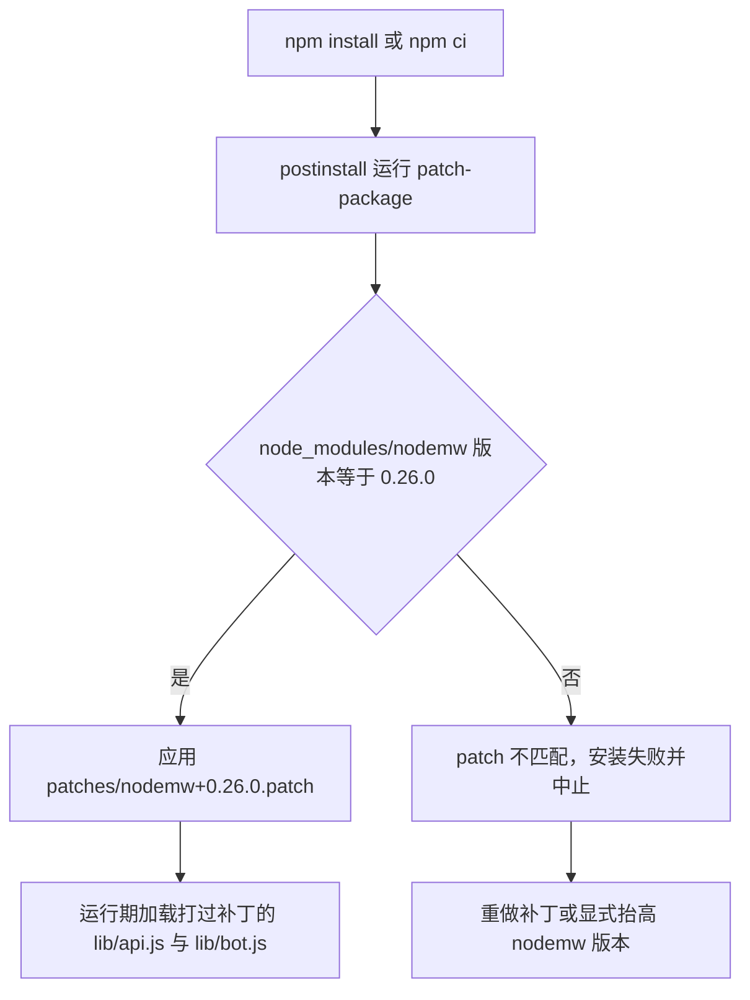
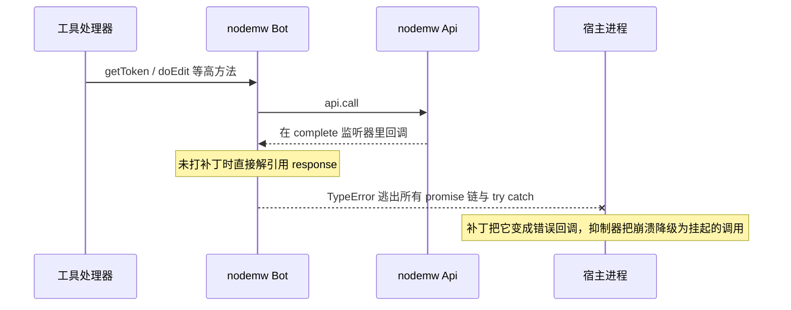
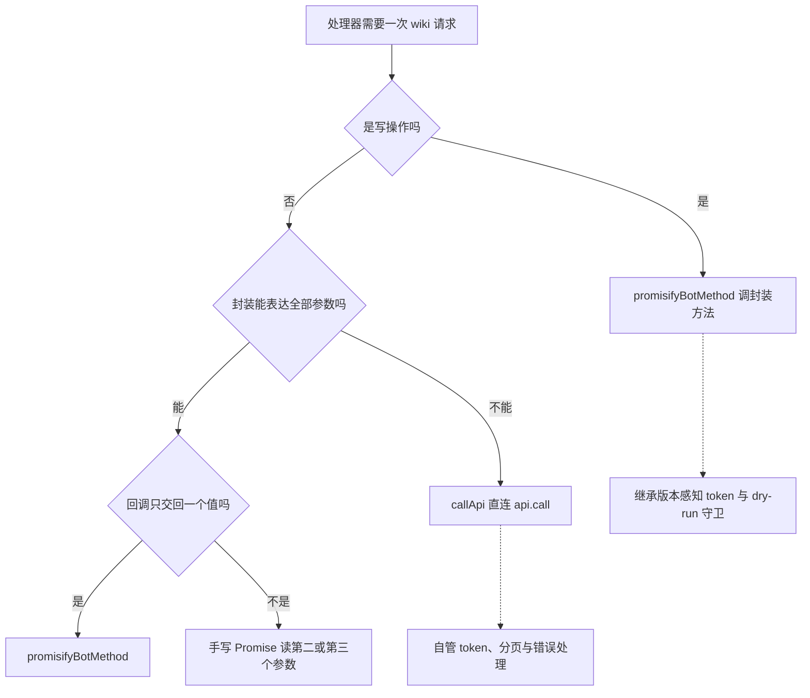

# nodemw 客户端集成：调用面、补丁加固与升级复核

`nodemw` 是这个仓库里唯一懂 MediaWiki 的库，也是唯一一个**部分代码由本仓库改写**的运行时依赖。集成因此有三层，而三者经常被混为一谈：

1. **调用面** —— 每次 wiki 请求走 `promisifyBotMethod`（客户端高层方法）还是 `callApi`（裸 `api.call`），决定了这次请求继承哪些客户端能力（token、dry-run 守卫、内部分页），又放弃哪些。
2. **补丁层** —— `patches/nodemw+0.26.0.patch` 在 `npm install` 时经 `patch-package` 打到 `node_modules/nodemw`，修的是客户端自身的四类缺陷（畸形响应、无超时、cookie jar 泄漏、argv 日志）。
3. **应用层对冲** —— 即使补丁没生效或上游修法不同，服务器也会靠 `process.on('uncaughtException')` 抑制器、`safeFetch` 替换客户端的 URL 抓取、以及"不打印 argv"来限制损失。

同一份代码的运行时视角（Bot 单例、登录、版本缓存）在 [Bot 运行时](../architecture/bot-runtime.md)；逐工具的调用路径表、错误文案匹配表与 dry-run 传播矩阵在 [api-compatibility](../concepts/api-compatibility.md)；构建产物与发布流程在 [build and release](../operations/build-and-release.md)。

## 依赖包络

`nodemw` 只声明一次，是一条运行时依赖（[package.json](../../package.json#L35-L39)），lockfile 解析到 `0.26.0`（[package-lock.json](../../package-lock.json#L4047-L4063)）：

```json
"dependencies": {
  "@modelcontextprotocol/sdk": "^1.0.0",
  "nodemw": "^0.26.0",
  "zod": "^3.23.8"
}
```

四点决定了这层契约的形状：

- **`^0.26.0` 在 `0.x` 上只放行补丁。** npm 对 pre-1.0 的 caret 语义是"同一 minor"，所以 `0.26.1` 会在一次干净的 `npm install` 中静默装上，`0.27.0` 不会。**但补丁把这条静默路径变成了显式失败**：`patches/nodemw+0.26.0.patch` 的文件名编码了精确版本，装到任何非 `0.26.0` 的版本上 `patch-package` 都会报错中止（见下节）。于是"小版本静默升级"的窗口在这条依赖上已经被关掉。
- **锁住实际行为的是 lockfile，不是范围。** `src/` 与构建脚本都不在运行时校验版本；唯一"读版本"的地方是 `src/server.ts` 为拼 `User-Agent` 去 `require('nodemw/package.json')`（[src/server.ts](../../src/server.ts#L33-L37)）。
- **Node 下限两侧一致。** 本包声明 `"node": ">=18.0.0"`（[package.json](../../package.json#L54-L56)），esbuild 目标 `node18`（[scripts/build.js](../../scripts/build.js#L17)），`nodemw` 自己声明 `>=18.0`（[package-lock.json](../../package-lock.json#L4061-L4063)）。升级客户端不需要同时抬 Node 下限，除非客户端先抬。
- **只有一处值导入，工具模块从不导入它。** `import Bot from 'nodemw'` 在源码树里出现一次（[src/common/nodemwBot.ts](../../src/common/nodemwBot.ts#L29)）；`src/common/utils.ts`（[L29](../../src/common/utils.ts#L29)）与 `src/common/compareOutput.ts`（[L29](../../src/common/compareOutput.ts#L29)）只有 `import type Bot`。工具处理器拿到的永远是 `Bot` 类型的实例，经 `getBot()` 取出，再交给两个桥之一。**换掉客户端层要动的是两个 common 模块**（`nodemwBot.ts`、`utils.ts`），不需要扫全部工具 —— 这是本页少数几个刻意保持的性质之一。

## 补丁层：`postinstall` + `patch-package`

补丁工作流只有三个部件：

| 部件 | 位置 | 作用 |
|---|---|---|
| `postinstall` 脚本 | `"postinstall": "patch-package"`（[package.json](../../package.json#L24)） | 每次 `npm install` / `npm ci` 之后自动应用 `patches/` |
| 补丁本体 | `patches/nodemw+0.26.0.patch` | 文件名编码包名与**精确**上游版本 |
| 上游说明 | `patches/UPSTREAM.md` | 四类缺陷的审计记录、修法意图与建议的 PR 拆分 |



该图展示补丁从安装到生效的唯一路径：它只存在于 `patches/` 与 `node_modules` 两处，没有第三条路径。

三条机制上的要点：

- **补丁改的是 `node_modules`，不是仓库源码。** 仓库里的 `src/` 从不体现这些修复；一份 checkout 是否被硬化，取决于 `postinstall` 有没有跑过。判断办法是 grep 三处标记：`node_modules/nodemw/lib/api.js` 里应有 `timeout: 30000` 与 `MediaWiki API returned an empty response`，且**不应**再有 `this.info(process.argv.join(" "))`。作为对照，本仓库快照里的 `node_modules/nodemw/lib/api.js` 仍是未打补丁的原文（`process.argv` 那行还在，也没有 `timeout`），这正好说明补丁不是仓库状态的一部分。
- **补丁与 nodemw 保持 external 是配套的。** esbuild 把 `nodemw` 标成 external（[scripts/build.js](../../scripts/build.js#L19-L23)），所以 `dist/index.js` 里只留 `import Bot from "nodemw"`（[dist/index.js](../../dist/index.js#L118)），运行期加载的就是 `node_modules` 里被补丁改过的文件。若哪天把 `nodemw` 内联进 bundle，补丁就必须在**构建前**应用，产物体内会固化一份补丁快照 —— 打补丁的时机与发布时机从此耦合。
- **`patches/` 不随发布包分发。** `files` 只有 `dist`（[package.json](../../package.json#L51-L53)），`patch-package` 只声明在 `devDependencies`（[package.json](../../package.json#L46)）。因此用 `npm i @xiedada/nodemw-mcp-server` 安装的下游用户既拿不到 `patches/`，也没有 `patch-package` 可执行文件 —— **硬化是"从源码安装的部署"的属性，不是发布产物的属性**；而随 `package.json` 一起发布的 `postinstall` 在缺少该可执行文件的环境里还可能让安装直接报错，这一点在对外发布前值得单独决定。

## 四类缺陷：补丁修的与服务器自己扛的

`patches/UPSTREAM.md` 把审计发现归为四类，每类都按"最小改动、对格式良好的 wiki 行为不变"的原则修，并按主题切成可独立提交的 PR（[patches/UPSTREAM.md](../../patches/UPSTREAM.md#L81-L87)）。下表是这四类在本仓库里的完整责任划分：

| 缺陷（CWE） | 触发方式 | 补丁做了什么 | 应用层做了什么 | 剩余风险 |
|---|---|---|---|---|
| 畸形响应击穿宿主（754 / 248） | 配置的 wiki 或它前面的中间盒对 `api.php` 回 200 + 意外 JSON（`null`、缺 action 键、`{"batchcomplete":""}`） | `lib/api.js` 把 falsy body 路由成 `Error("MediaWiki API returned an empty response")`；`lib/bot.js` 逐处给 convenience 方法的解引用加守卫 | `process.on('uncaughtException')` 抑制器；把大多数路径改走裸传输，绕开 `bot.js` 的解引用 | 抑制器让**本次工具调用挂起**（由 MCP 客户端超时兜底），不是返回错误 |
| 请求没有超时（400） | `api.php` 或 `fetchUrl` 目标卡住不响应 | `doRequest` 与 `fetchUrl` 的 options 都加 `timeout: 30000` | 只在 URL 抓取侧有应用层超时（`safeFetch`），**API 请求本身完全依赖补丁** | 补丁未生效时该缺陷原样存在 |
| `fetchUrl` 泄漏会话 cookie（200 / 384） | `fetchUrl` 把登录后的共享 `RequestJar` 挂到任意 URL；cookie 作用域按主机名、不区分端口，`Domain=` 还匹配兄弟子域 | 只有目标与 wiki 同源（协议 + 主机名 + 端口）时才复用共享 jar，其余用一次性 jar | `upload-by-url` 不再调 `bot.uploadByUrl`（[src/tools/editing/upload-by-url.ts](../../src/tools/editing/upload-by-url.ts#L86-L102)） | 其他直接调用 `fetchUrl` 的新代码会重新引入风险 |
| 记录 `process.argv`（532） | `new Api()` 在 info 级打印整条命令行；下游 CLI 常把 `-p <password>` / `--token` 放在 argv 上，debug 或文件 transport 会把它写进 stdout 与磁盘 | 删除这条 echo，保留 User-Agent 与 referer 两行 | 服务器自身不打印 argv，启动横幅只含 server、站点名、认证用户名 | — |

四类里有两处细节值得单独记住：

- **`getToken` 曾经吞掉版本探测的错误。** 补丁前，`getToken` 的 `getMediaWikiVersion` 回调忽略 `err`，探测失败就静默落到 legacy `intoken` 分支 —— 在现代 wiki 上表现为"token 拿不到，但看不出原因"。补丁让它以错误回调（[patches/nodemw+0.26.0.patch](../../patches/nodemw+0.26.0.patch#L112-L123)）。四个管理工具的 token 全部在这条路径上（[block.ts](../../src/tools/editing/block.ts#L97-L102)、[unblock.ts](../../src/tools/editing/unblock.ts#L79)、[protect.ts](../../src/tools/editing/protect.ts#L85-L90)、[undelete.ts](../../src/tools/editing/undelete.ts#L73)），所以修这一处等于修四个工具的失败可观测性。
- **`uncaughtException` 抑制器不是"修好了"，而是把进程崩溃降级成一次挂起的调用。** 注释写得很清楚：回调跑在 `@cypress/request` 的 `complete` 监听器里，也就是 socket I/O 栈上，任何 `promise` 链与工具 `try/catch` 都拦不到；一个畸形响应本可以杀掉"一进程一会话"的 MCP 通道（[src/index.ts](../../src/index.ts#L117-L129)）。真正的修法是响应形状校验，也就是补丁做的事 —— 抑制器只争取时间，并给运维留一条 stderr 记录。



该序列图展示"畸形响应为什么能杀掉进程"：抛出点不在任何调用方的栈上。

### `safeFetch`：把 URL 抓取从客户端手里拿走

`upload-by-url` 是唯一需要抓取任意 URL 的工具，它整条抓取路径都不经过 nodemw（[upload-by-url.ts](../../src/tools/editing/upload-by-url.ts#L86-L102)），理由写在代码注释里：客户端的 `uploadByUrl` 用 `@cypress/request` 从本进程发起、无超时、无体积上限、带着 wiki 会话 jar，还支持 `http://unix:<socket>:<path>` 伪主机。替代实现是 `fetchSourceSafely`（[src/common/safeFetch.ts](../../src/common/safeFetch.ts#L104-L157)）：

- 每一跳重定向都**重新**做一次地址校验（[L107-L108](../../src/common/safeFetch.ts#L107-L108)），所以一个公网 URL 不能靠 302 跳到 localhost、内网或 unix 伪主机；
- `http`/`https` 之外一律拒绝，`localhost`/`unix` 与解析后落在私有段的地址一律拒绝（[L68-L92](../../src/common/safeFetch.ts#L68-L92)）；
- 硬上限：`MAX_SOURCE_BYTES` 50 MB、`FETCH_TIMEOUT_MS` 30 s（[L33-L34](../../src/common/safeFetch.ts#L33-L34)），并在 body 循环里逐块检查截止时间（Node 18 的 undici 不保证中途 abort）；
- 用全局 `fetch`，不带任何 jar、proxy 与会话凭据。

抓完仍然交给 `promisifyBotMethod(bot, 'upload', ...)`（[L92-L102](../../src/tools/editing/upload-by-url.ts#L92-L102)）—— 也就是把"不可信的出站抓取"和"需要 token 与 dry-run 守卫的写入"分给两个不同的执行者。

## 一处构造点：`ServerConfig` → `BotOptions`

`createBotFromConfig`（[src/common/nodemwBot.ts](../../src/common/nodemwBot.ts#L133-L174)）是唯一调用 `new Bot({...})` 的地方，配置到客户端的映射逐字段如下：

| `ServerConfig` 字段 | 传给 nodemw 的形式 | 适配层做的事 |
|---|---|---|
| `server` | 原样 | 上游 `parseCliArgs` 已把 URL 折叠成主机名 |
| `protocol` | `protocol \|\| 'https'` | 客户端也默认 `https`，这里只是把选择显式化 |
| `port` | 原样 | 只有 URL 里写了端口才有值 |
| `path` | 原样 | 语义是脚本路径前缀，**不含** `/api.php`：客户端自己拼 `${protocol}://${server}[:port]${path}/api.php` |
| `proxy` | 原样 | CLI 无法设置，只有程序化 `initServerConfig` + `initBot` 能填 |
| `userAgent` | **`resolvedUA`** | 三支解析后的结果，`userAgentAppend` 到此为止不再转发 |
| `concurrency` | 原样 | CLI 无法设置；这个值决定共享 `async.queue` 的并发槽数，也就是"卡住几个请求会冻结全部流量" |
| `debug` | 原样 | 只作用于客户端自己的 logger |
| `username` / `password` | `username \|\| undefined` 等 | 空串归一为 `undefined`；同时是 `logIn` 的触发条件 |
| `domain` | 原样 | CLI 无法设置 |
| `dryRun` | 在 `@ts-expect-error` 之后传入 | 客户端运行时读它，发布的 `BotOptions` 类型没有它 |
| `token` | **从不解构、从不转发** | 客户端构造函数本就没有这个字段；只给 `--token` 会得到一个静默的匿名会话 |

其中一条是刻意留下的升级信号：`dryRun` 跟在 `// @ts-expect-error: dryRun is supported by nodemw at runtime but missing from BotOptions types` 之后（[L171-L172](../../src/common/nodemwBot.ts#L171-L172)）。上游一旦把该字段补进类型，这行抑制会变成"未使用的 `@ts-expect-error`"编译错误 —— 这是唯一一处**保证**会被 `tsc` 发现的 nodemw 类型变更。注意 `npm run build` 走 esbuild，不做类型检查，所以这个信号只在 `tsc --noEmit` 时出现。

dry-run 的实际覆盖面（哪些工具继承客户端守卫、哪些裸写）由 [api-compatibility](../concepts/api-compatibility.md) 维护；本页只需要记住方向：**dry-run 是客户端自带的行为，不属于适配层** —— `ServerConfig.dryRun` 只在构造时被转发一次，`src/` 里没有任何工具读回它。

`autoDetectPath`（[L185-L200](../../src/common/nodemwBot.ts#L185-L200)）是这条 URL 拼接规则的唯一例外处理：它只试 `/w` 与 `''` 两个前缀，各构造一个**临时** Bot 并匿名探活，两个都失败就抛出点名两个 URL 的错误。

## 默认 `User-Agent`：确认"跑的是哪个客户端"的唯一手段

默认身份字符串在 `src/server.ts` 模块加载时拼装（[src/server.ts](../../src/server.ts#L33-L37)）：

```ts
const require = createRequire(import.meta.url);
const nodemwPkg = require('nodemw/package.json');
const sdkVersion: string = require('@modelcontextprotocol/sdk/package.json').version;

export const DEFAULT_USER_AGENT = `nodemw/${nodemwPkg.version} (node.js ${process.version}; ${process.platform} ${process.arch}) nodemw-mcp/${pkg.version} (${pkg.name}@${pkg.version}; @modelcontextprotocol/sdk@${sdkVersion})`;
```

`nodemw/<version>` 这一段来自**已安装依赖**（所以它如实反映补丁所针对的版本），`nodemw-mcp/<version>` 这一段是构建期从 `package.json` 内联进 bundle 的。适配层在这里只做一件事：把 `userAgent` / `userAgentAppend` 解析成单一字符串再交给客户端（[L150-L157](../../src/common/nodemwBot.ts#L150-L157)），因此客户端自己的默认 UA 在正常路径上**永远不会出现**。

| `userAgent` | `userAgentAppend` | 最终传给 nodemw 的 UA |
|---|---|---|
| 有值 | 真值 | `DEFAULT_USER_AGENT + ' ' + userAgent`（追加，保留默认身份） |
| 有值 | 假值 | `userAgent`（**完全替换**，版本信息全部消失） |
| 无值 | 任意 | `DEFAULT_USER_AGENT` |

`--user-agent-append` 单独设置没有任何效果，也不报警；`userAgentAppend` 本身从不转发给客户端。排查"某个部署到底加载了哪个 nodemw"时，wiki 的请求日志里这一段比任何本地检查都可靠。

## 调用面：三条路，而不是一条

`nodemw` 的方法是回调风格，附带类型声明也不完整；仓库里因此存在三种封装方式，选择依据是**这次请求需要什么**，而不是工具属于读还是写：



该图展示一次请求如何落到三条路之一；注意"写"这一支有意固定在封装上，读这一支则按参数表达能力分流。

### 决策表：什么时候可以用桥，什么时候必须裸调

| 场景 | 路径 | 代表位置 |
|---|---|---|
| 标题寻址、单值回调、封装的参数够用 | `promisifyBotMethod` | `getSiteInfo`、`getSiteStats`、`getMediaWikiVersion`、`whoami`、`whois`（用户名）、`whoare`（用户名）、`getBacklinks`、`getExternalLinks`、`getPagesInCategory`、`getPagesInNamespace`、`getQueryPage`、`getAllPages`、`getCategories`、`getImageInfo`、`getImageUsage`、`getImagesFromArticle`、`getArticleInfo`（读守卫用它核对 `lastrevid`，[pageState.ts](../../src/common/pageState.ts#L154)） |
| 写操作（要版本感知 token 与 dry-run 守卫） | `promisifyBotMethod` | `doEdit`（`edit` / `write` / `append` / `prepend` / `revert` 写侧）、`delete`、`move`、`purge`、`upload`、`sendEmail`、`createAccount`、`addFlowTopic` |
| `pageids` / `revids` 寻址（封装只构造 `titles`） | `callApi` | `get-article` 的 id 与 revision 分支（[L135-L150](../../src/tools/ro/get-article.ts#L135-L150)）、`get-article-by-revision`（[L59-L68](../../src/tools/ro/get-article-by-revision.ts#L59-L68)）、`get-article-with-lineno` 的 id 分支与取时间戳的第二次请求（[L97-L104](../../src/tools/ro/get-article-with-lineno.ts#L97-L104)、[L133-L143](../../src/tools/ro/get-article-with-lineno.ts#L133-L143)）、`get-article-info` / `-categories` / `-properties` 的 id 分支、`whois` / `whoare` 的数字 id 分支（[whois.ts](../../src/tools/ro/whois.ts#L70-L84)） |
| 封装把参数设错 | `callApi` | `get-users`：封装总发 `auwitheditsonly=0`，MediaWiki 把它当成生效的过滤（[L70-L85](../../src/tools/ro/get-users.ts#L70-L85)）；`protect`：封装把 token 类型硬编码成 `csrf`（[L116](../../src/tools/editing/protect.ts#L116)） |
| 封装硬编码了已被移除或行为不同的参数 | `callApi` | `parse`、`expand-templates`：封装的 `generatexml=1` 在 MW 1.36 被移除（[parse.ts](../../src/tools/ro/parse.ts#L124-L127)、[expand-templates.ts](../../src/tools/ro/expand-templates.ts#L63-L66)） |
| 需要自管分页与续延 | `callApi` + `continue` 循环 | `search`（要 `srnamespace`，[L102-L146](../../src/tools/ro/search.ts#L102-L146)）、`get-pages-by-prefix`（要 `apnamespace`，封装还会在第一页截断，[L107-L130](../../src/tools/ro/get-pages-by-prefix.ts#L107-L130)）、`get-pages-transcluding`（封装的 `getAll` 迭代器在旧 MW 上不终止，改用 `list=embeddedin`，[L72-L110](../../src/tools/ro/get-pages-transcluding.ts#L72-L110)）、`get-article-revisions`、`get-user-contribs` |
| action 没有封装 | `callApi` | `block`、`unblock`、`undelete`、`diff-preview` / `diff-revisions`（`action=compare`） |
| 封装回调会丢字段 | `callApi` | `parse`（第三参数是 `images`，桥只取第一个值） |
| 回调带多个值、桥表达不了 | 手写 `new Promise` | `getArticle` 的 `redirectInfo` 分支（[L202-L214](../../src/tools/ro/get-article.ts#L202-L214)）、`getLog`（[L80-L90](../../src/tools/ro/get-log.ts#L80-L90)）、`getRecentChanges`（[L77-L87](../../src/tools/ro/get-recent-changes.ts#L77-L87)）、`getImages`（[L70-L80](../../src/tools/ro/get-images.ts#L70-L80)） |
| 需要按缓存版本选 token 类型 | 手写 `new Promise` 调 `getToken` | `block`（[L97-L102](../../src/tools/editing/block.ts#L97-L102)）、`unblock`、`protect`（[L85-L90](../../src/tools/editing/protect.ts#L85-L90)）、`undelete` |

### 两个桥与四个咽喉点

- **`promisifyBotMethod`** 追加一个 Node 风格 `(err, result)` 回调，用**字符串方法名**动态派发 `(bot as any)[method](...args, callback)`，只解析第一个结果（[src/common/nodemwBot.ts](../../src/common/nodemwBot.ts#L308-L325)）。字符串派发是被类型声明逼出来的：`nodemw` 附带的是手写的 `lib/bot.d.ts`，它声明了 `BotOptions`（**不含 `dryRun`**）、一部分精确签名与一大批全 `any` 的方法，**既没有声明 `api` 传输成员，也没有声明已实现的 `delete`**。用字符串派发，调用点才能在不加断言的情况下调 `'delete'`。代价是 `<T>` 只是调用方的断言，形状写错会得到静默的错误结果；方法被改名只会变成一次运行时 `TypeError`。
- **`callApi`** 是裸传输的唯一入口，把 `api.call(params, cb, 'GET' | 'POST')` 的四参数回调收敛成**完整响应体**（[src/common/utils.ts](../../src/common/utils.ts#L42-L58)）。`(bot as any).api.call` 在整仓只出现两处：`callApi` 自身，以及 `fetchWhoami` 的登录心跳探测（[src/common/nodemwBot.ts](../../src/common/nodemwBot.ts#L70-L82)）。这意味着"没有类型"的代价集中在一个 helper 里，新增直连点不需要再复制断言。
- **`promisifyBotMethod` 有两份逻辑相同的实现**（[nodemwBot.ts](../../src/common/nodemwBot.ts#L308-L325) 与 [utils.ts](../../src/common/utils.ts#L60-L77)）。工具一律从 `nodemwBot` 导入，`utils.ts` 那份只是 `callApi` 的同模块邻居；这是历史遗留，改动其中一个不会影响另一个。
- **手写 Promise 只剩下两族**：四个管理工具的 `getToken`，以及三个多值回调工具（`getLog` / `getRecentChanges` / `getImages`）与 `get-article` 的 `redirectInfo` 分支。

### 桥的边界：只交回第一个值

这条边界曾经以两个 bug 的形式暴露过，现在都已按正确方式修掉，值得作为不变量的例证保留：`parse` 与 `get-pages-transcluding` 过去把返回类型声明成元组再对解析值做下标（`[1]` 取 XML、`[2]` 取图片、`[1]` 取页面数组），而桥解析的只是**第一个非错误参数**本身 —— 于是 `parse` 拿到的是 XML 字符串（`[1]` 变成它的第二个字符），`get-pages-transcluding` 拿到的是页面数组（`[1]` 变成第二个元素，`Array.isArray` 守卫失败，工具报告 `count: 0`）。两者现在都改走 `callApi` 读完整信封（[parse.ts](../../src/tools/ro/parse.ts#L167)、[get-pages-transcluding.ts](../../src/tools/ro/get-pages-transcluding.ts#L92-L96)）。规则很直白：**当响应的第二、第三个回调参数有意义时，不要用桥。**

### 直连的四个代价

选 `callApi` 就继承了全部负担，新增直连点前应当逐条确认：

1. **没有 dry-run 保护。** 客户端的写方法会在 dry-run 下拒绝执行，`api.call` 不会，于是 `block`、`unblock`、`protect`、`undelete` 在 `--dry-run` 下仍然真实写入。
2. **没有内部翻页。** 封装会一直取到耗尽；裸调用必须自己写 `continue` 循环并自己设上限（现有多为 10 000 条）。
3. **没有版本感知的 token。** 任何带 token 的直连动作都要自己用缓存的版本算 token 类型。
4. **错误码丢失。** 见下节。

逐条的调用路径、代价与例外在 [api-compatibility](../concepts/api-compatibility.md) 里有完整表；本页只保证方向不要被"简化"回去。

## 错误语义：只剩一句由 wiki 渲染的 `info`

这是与 nodemw 交互时最容易被误判的一点。传输层只校验 HTTP 状态、JSON 可解析性与 MediaWiki 的 `error` 键，看到 `error` 就把回调转成 `new Error('Error returned by API: ' + data.error.info)`：

- **`error.code` 在这条路上被丢弃，只有 `info` 活下来。** 补丁只补了 falsy body 这一条旁支（[patches/nodemw+0.26.0.patch](../../patches/nodemw+0.26.0.patch#L16-L35)），没有把 code 保留下来。再往后 `errorResult` 把 `.message` 当作 `details`（[src/common/utils.ts](../../src/common/utils.ts#L136-L147)），工具层能看到的信息只剩一段**由 wiki 渲染、随 wiki 语言变化**的文本。
- **因此需要分流的重试与提示只能匹配文案。** 现有的两张匹配表都在 `utils.ts`：登录过期四式（`/You're not allowed to edit this wiki through the API/`、`/not logged in/i`、`/login required/i`、`/assertuserfailed/i`，[L97-L102](../../src/common/utils.ts#L97-L102)）与编辑冲突（`/editconflict/i`、`/edit conflict/i`、`/编辑冲突/`，[L104-L110](../../src/common/utils.ts#L104-L110)）。后者有专门测试，包括中文消息（[utils.test.ts](../../src/common/__tests__/utils.test.ts#L36-L59)）。匹配不上时行为退化成普通失败 —— 所以正则失效是**静默变差**，不是崩溃。
- **`if (raw.error)` 分支是防御性代码。** 真实的 API 失败在 `callApi` 的拒绝里，落进各工具的 `catch`，以 `errorResult('Failed to ...', err)` 上报（[protect.ts](../../src/tools/editing/protect.ts#L118-L125)、[block.ts](../../src/tools/editing/block.ts#L126-L141)）。保留这些分支是为了假实现与未来可能的传输层改动，不要把它们当主通道。
- **补丁新增了一条可匹配文案**：`MediaWiki API returned an empty response`。它是"200 + 空 body"的唯一可观测信号，若要做针对性提示就从这里匹配。

## 测试与验证

`vitest` 是真实存在的覆盖（`npm test` → `vitest run`，[package.json](../../package.json#L22)），但**没有一行测试执行真实的 nodemw**：

- 工具级 smoke 测试用 `vi.mock('../../common/nodemwBot.js')` 换掉整个客户端模块（[smoke.test.ts](../../src/tools/__tests__/smoke.test.ts#L37-L40)），换成 [`fakeNodemwBot.ts`](../../src/tools/__tests__/fakeNodemwBot.ts#L387-L424) 提供的模块形状：一个 `Proxy`，`api.call` 由 `fakeApiCall` 应答（[L165-L303](../../src/tools/__tests__/fakeNodemwBot.ts#L165-L303)），其余方法按 `METHOD_RETURNS` 表返回"数组 + 对象字段"的混合结果，回调在 `process.nextTick` 上触发，以真正走过 promise 化的调用路径。
- 这个假实现**把两条 nodemw 契约写死成了测试假设**：`api.call` 的回调是 `(err, info, next, data)` 且第四个参数是完整信封；`getArticle` 之类的桥方法回调是 `(err, value)`。上游改动任一条，测试不会失败——它们测的是本仓库自己的假设，而不是客户端。
- 因此补丁本身、以及所有"第二个/第三个回调参数"的真实形状，只能靠真实 wiki 验证。`test-server.js` 只断言 `dist/index.js` 存在、且启动后不立刻崩溃（[test-server.js](../../test-server.js#L11-L18)）。

一次客户端升级因此是这样一条流水线：

1. **改范围。** 越过 `0.26` 必须编辑 `package.json`；连 `0.26.x` 也会因为补丁版本不匹配而在 `npm install` 阶段失败——这是设计好的绊线，不是故障。
2. **重做补丁。** 在目标版本上重新落四类修复，`npx patch-package nodemw` 生成新文件名，或按 `patches/UPSTREAM.md` 的 PR 拆分逐块判断是否已被上游修掉（已修的块应当删除，而不是留着漂移）。
3. **复核被绕过的封装。** `getUsers` 的 `auwitheditsonly`、`protect` 的 token 类型、`parse`/`expandTemplates` 的 `generatexml`、`getPagesByPrefix` 的 `apnamespace` 与续延、`getPagesTranscluding` 的 `getAll`——任何一处被上游修好，对应工具就该简化回去。
4. **复核类型信号。** `dryRun` 获得声明会让 `tsc --noEmit` 失败（期望行为）；`delete` 或 `api` 新增声明则允许收紧字符串派发与断言。
5. **确认补丁真的生效。** grep 那三处标记，而不是相信安装日志。
6. **重建并冒烟。** `npm run build` + `node test-server.js`；外发的 UA 会立刻反映已安装的客户端版本（[src/server.ts](../../src/server.ts#L33-L37)）。

## 失败模式

| 症状 | 原因 | 先看哪里 |
|---|---|---|
| `npm install` 在 `patch-package` 阶段失败 | `node_modules/nodemw` 版本与 `patches/nodemw+0.26.0.patch` 的文件名不一致 | 补丁文件名、lockfile 里的 nodemw 版本 |
| 工具返回 `<method> is not a function` | 客户端改名或删除了某个经字符串派发调用的方法 | 该工具的 `promisifyBotMethod` 调用，再看 `getBot()` |
| 某次工具调用一直不返回，但会话还活着 | 畸形响应在 nodemw 回调里抛出，被 `uncaughtException` 抑制器吞掉 | 抑制器打印的 stderr 行；随后确认补丁是否生效 |
| 整个进程消失且没有工具级错误 | 同一类畸形响应，但抑制器不在（或崩溃发生在模块加载期，例如 `nodemw/package.json` 不可解析） | [src/index.ts](../../src/index.ts#L117-L129)、[src/server.ts](../../src/server.ts#L33-L37) |
| API 请求永久卡住、所有工具一起停摆 | 无超时保护（补丁未生效），共享 `async.queue` 的三个槽位被占满 | `node_modules/nodemw/lib/api.js` 是否有 `timeout: 30000` |
| `upload-by-url` 报 `Refusing to fetch ...` | `safeFetch` 的地址校验命中私有/回环/unix 目标 | [src/common/safeFetch.ts](../../src/common/safeFetch.ts#L68-L92) |
| 升级后某个直连调用点误读响应 | 传输层回调契约属于库，不属于本仓库，测试也覆盖不到 | [api-compatibility](../concepts/api-compatibility.md) 的裸传输响应读法 |
| 下游安装的服务器行为与源码部署不同 | 发布包不含 `patches/`，`patch-package` 也不在其中 | `files` 与 `postinstall` 的组合 |

## 不变量

动这层集成时应当保持的约定：

- 每个进程恰好一个 `Bot`，并且只在一个函数里构造；工具处理器永远经 `getBot()` 拿实例，`registerAllTools` 从不传 bot。
- 每一次 wiki 调用都属于三种形状之一：`promisifyBotMethod`、`callApi`、或一处有注释说明的手写 Promise；`(bot as any)` 只出现在 `callApi`、`fetchWhoami` 与四个 `getToken` 调用点。
- 写操作留在客户端封装里，除非有明确理由放弃它的 token 与 dry-run 守卫；放弃时必须在工具侧补上 token 类型判断。
- 补丁针对精确的 `0.26.0`：换版本必须重做补丁，且"安装失败"就是复核提醒本身。
- 补丁不是运行时契约的一部分 —— 任何新代码都不应假设它已生效（应用层对冲要独立成立）。
- nodemw 保持 external：一旦内联，补丁的生效时机从"安装时"变成"构建时"，本页所有关于安装期硬化的假设都要重写。
