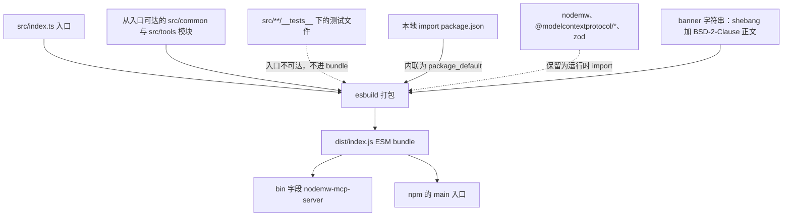
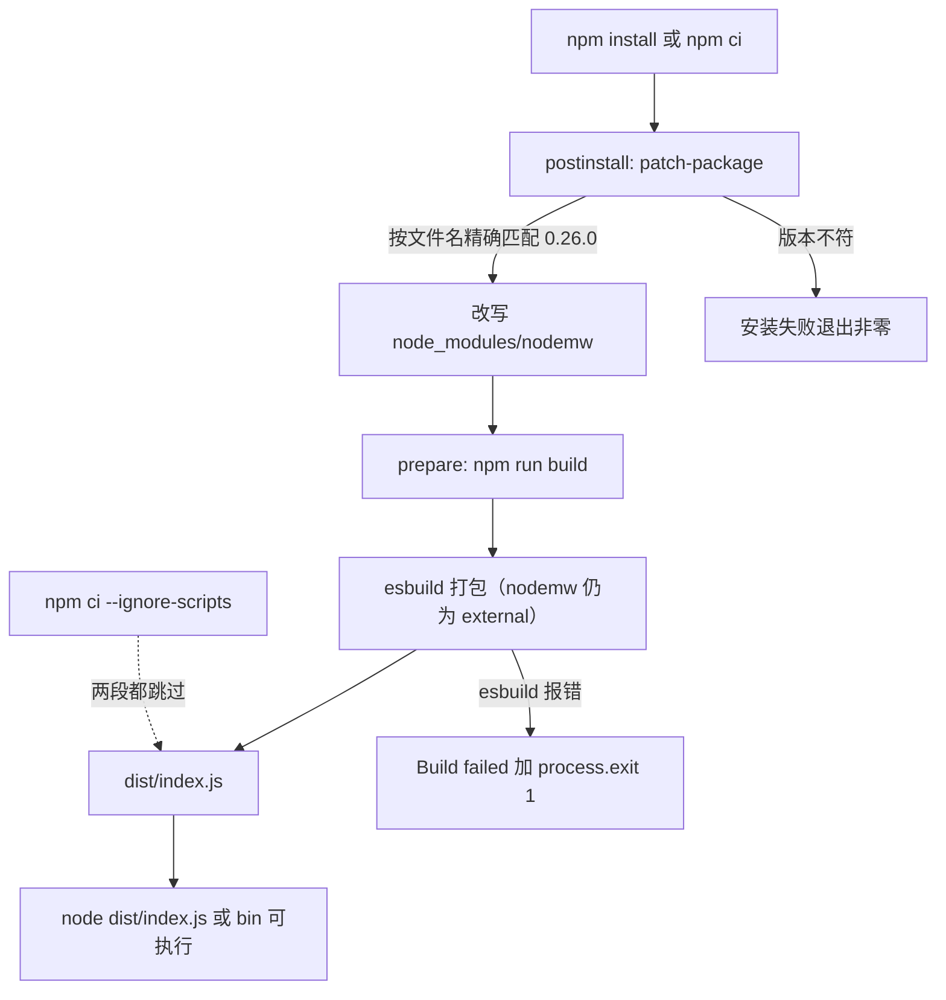
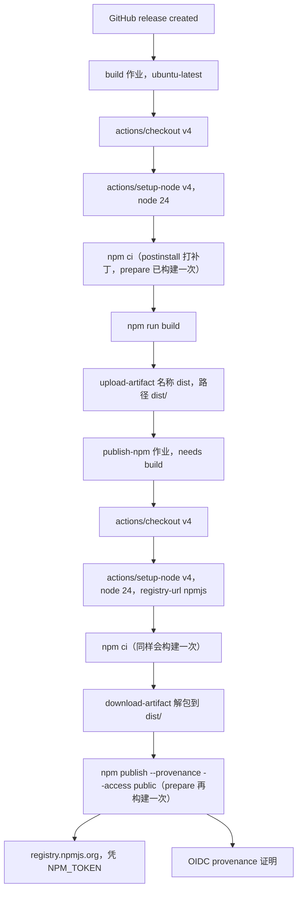
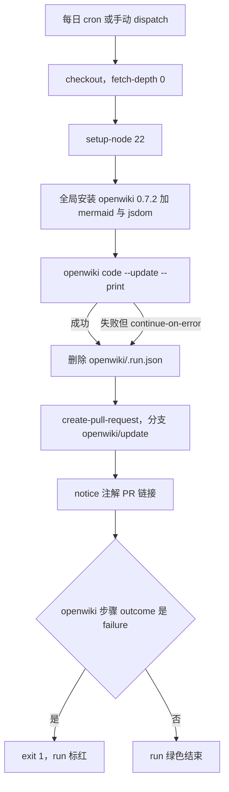

# 构建、发布与 CI 流水线

这个项目对外只发布一个可执行文件。`src/index.ts` 及其可达的模块由 **esbuild** 打包成一个未压缩的 ESM 文件 `dist/index.js`，它同时是包的 `main`、`bin` 入口，也是发布 tarball 里唯一的代码（[package.json](../../package.json#L14-L17)、[scripts/build.js](../../scripts/build.js#L12-L59)）。

三个容易误判的前提决定了本页余下的内容：

- **仓库工作树里带着一份构建产物，但它仍然只是产物。** [`.gitignore`](../../.gitignore#L83) 第 83 行列出了 `dist`，而检出的 `dist/index.js` 确实存在（3,249 行、110 KB）。两者不矛盾：忽略规则只阻止新文件被自动加入索引，已跟踪或被强制加入的文件继续留在工作树里。所以 `git status` 不是判断产物新旧的依据，`npm run build` 才是刷新它的唯一手段。
- **版本号在建包那一刻被冻结进 bundle。** esbuild 把本地 manifest 内联成 `package_default` 字面量，运行时报告的版本就来自那份字面量。当前 `dist/index.js` 里写的是 `version: "0.2.3"`（[dist/index.js](../../dist/index.js#L38-L41)），而 manifest 已经声明 `0.3.1`（[package.json](../../package.json#L2-L3)）——漂移幅度比上一次记录时更大。
- **安装期有两段脚本，顺序固定：`postinstall` 先，`prepare` 后。** `postinstall: patch-package` 把 [`patches/nodemw+0.26.0.patch`](../../patches/nodemw+0.26.0.patch) 打到 `node_modules/nodemw`，`prepare: npm run build` 再产出 bundle（[package.json](../../package.json#L18-L26)）。这决定了"依赖被修补过"和"产物是最新的"是两件分别成立或不成立的事。

启动阶段如何使用这个 bundle（CLI 解析、API 路径探测、登录、MCP stdio 握手）属于[启动生命周期](../architecture/startup-lifecycle.md)与[架构总览](../architecture/overview.md)；发布前该信哪些检查见[测试与验证](../testing/validation.md)。

## 打包产物是什么

`scripts/build.js` 只构造一个选项对象，然后交给 esbuild（[scripts/build.js](../../scripts/build.js#L12-L59)）：

| 选项 | 取值 | 为什么重要 |
|---|---|---|
| `entryPoints` | `src/index.ts` | 单一入口；所有工具模块都经 `registerAllTools` 从它可达，因此整个工具目录都落进同一个文件 |
| `bundle` | `true` | 跟随 import，而不是把 `./server.js` 这类说明符留给 Node 解析 |
| `platform` / `format` | `node` / `esm` | 与 `"type": "module"` 匹配，`dist/index.js` 就是无 `.mjs` 后缀的 ESM |
| `target` | `["node18"]` | 语法下限等于声明的 `engines.node` `>=18.0.0` |
| `outfile` | `dist/index.js` | 唯一输出；没有 chunk 拆分，没有逐模块文件 |
| `external` | `nodemw`、`@modelcontextprotocol/*`、`zod` | 不内联任何第三方代码（见下节） |
| `banner.js` | shebang + 完整 BSD-2-Clause 正文 | 放 shebang 的唯一位置——它必须是文件第一个字节 |
| `minify` | `false` | 保留 esbuild 的 `// src/index.ts`、`// src/server.ts` 作用域注释，生产栈帧仍能指出源模块 |
| `treeShaking` | `true` | 未被引用的导出被丢弃 |
| `legalComments` | `none` | 不搬运第三方 license 注释；本项目自己的 license 通过 banner 进入产物 |
| `sourcemap` | `false` | 有意为之：不发布 `.map` 文件，栈帧指向 bundle 行号（模块注释是补偿） |
| `logLevel` | `info` | esbuild 自己把打包摘要打到终端 |

`--watch` 不改变任何选项：`scripts/build.js` 读到该参数后把**同一个** `opts` 交给 `esbuild.context()` 并 `ctx.watch()`（[scripts/build.js](../../scripts/build.js#L61-L69)）。所以 watch 产物同样是未压缩、无 sourcemap 的，调试 watch 构建与调试已发布的 bundle 是同一件事。

哪些编译进来、哪些留给 Node 解析，是这个产物的核心机制：



*构建内联了什么、把什么留给使用方的 `node_modules`，以及指向结果的两个 package 字段。*

banner 被原样写进输出：`dist/index.js` 第 1 行是 `#!/usr/bin/env node`，第 2–28 行是 BSD-2-Clause 正文（[scripts/build.js](../../scripts/build.js#L24-L53)、[dist/index.js](../../dist/index.js#L1-L28)）。shebang 不是装饰：npm 在安装时会把 `bin` 目标标记为可执行，内核需要这一行才能直接运行该文件。

构建失败的处理极简，而且是有意的：单个 `try`/`catch` 打印 `Build failed:` 后调用 `process.exit(1)`（[scripts/build.js](../../scripts/build.js#L70-L73)）。这个非零退出码是唯一能中断 `prepare`、`npm ci` 和 CI 作业的信号。构建前不会删除旧产物，所以失败一次之后**旧的 `dist/index.js` 仍留在磁盘上**——`npm run clean` 是显式的复位手段。

## 一个 bundle，三个外部依赖

`nodemw`、所有 `@modelcontextprotocol/*` 子路径以及 `zod` 都留在 bundle 之外（[scripts/build.js](../../scripts/build.js#L19-L23)）。产物本身可以作证：`import { z } from "zod"`、`import Bot from "nodemw"`、`import { StdioServerTransport } from "@modelcontextprotocol/sdk/server/stdio.js"` 都原样留在 `dist/index.js` 里（[dist/index.js](../../dist/index.js#L30-L36)、[dist/index.js](../../dist/index.js#L114-L118)）。

三条不同的理由汇成同一份名单：

- **`zod` 必须是同一个实例。** MCP SDK 用它校验工具参数，每个工具也用它声明 schema；bundle 里塞两份就是两套互不兼容的 schema 品牌。把 `zod` 外部化意味着 bundle 解析使用方安装出来的那一份 `node_modules/zod`，SDK 与所有工具共享一个副本。
- **`nodemw` 是本项目不做类型化的 CommonJS 包。** 外部化让 Node 的 ESM→CJS 互操作提供默认导入（`import Bot from "nodemw"`），也把这个客户端自己的动态 require 留在它自己的包里，而不是拉平进 bundle。
- **SDK 是按子路径导入的**（`server/mcp.js`、`server/stdio.js`，之后可能更多），`@modelcontextprotocol/*` 通配符一次覆盖，不必逐个列举入口。

随之而来的打包契约才是重点：**外部化让 `dependencies` 成为承重结构。** `dependencies` 里的每一项（[package.json](../../package.json#L35-L39)）都会由使用方安装；从该块里删掉一个却仍留在 `external` 中，会在第一次 import 时得到 `MODULE_NOT_FOUND`——而这个故障本地 `npm run build` 抓不到，因为本地 `node_modules` 里还有它。反过来，加进 `dependencies` 却没有加进 `external` 的包会被静默内联，同时又作为依赖被安装一次。

### 外部名单、补丁目标与运行时 reading 必须指向同一个包

`nodemw` 同时出现在三处，任何一处单独改动都会打断另外两处：

| 位置 | 作用 |
|---|---|
| [scripts/build.js](../../scripts/build.js#L19-L23) 的 `external` | 让 `import Bot from "nodemw"` 留在 bundle 里，由使用方的 `node_modules` 提供实现 |
| [package.json](../../package.json#L18-L26) 的 `postinstall: patch-package` + [`patches/nodemw+0.26.0.patch`](../../patches/nodemw+0.26.0.patch#L1-L12) | 在安装期改 `node_modules/nodemw` 里的文件（超时、空响应、cookie jar、argv 日志四类缺陷） |
| [src/server.ts](../../src/server.ts#L33-L35) 的 `createRequire()` | 运行时读 `nodemw/package.json` 与 SDK 的 `package.json` 来组装 User-Agent 与版本 |

具体后果：

- 补丁改的是 `node_modules` 里的第三方代码，**只有 `nodemw` 保持 external 时"补丁"与"产物"才是两件事**：补丁影响本地/CI 运行，产物里不含第三方代码。若把 `nodemw` 从 `external` 删掉，esbuild 会在构建时把（当时已打补丁的）源码内联进 bundle，边界消失，且 `require('nodemw/package.json')` 这类运行时读取会开始失败。
- 反过来，`require('nodemw/package.json')` 能被解析，前提正是 `nodemw` 作为依赖被真实安装。因此 `dependencies`、`external`、`postinstall` 的补丁目标必须在同一次提交里一起改；`patches/UPSTREAM.md` 记录了每块修复的上游去向（[patches/UPSTREAM.md](../../patches/UPSTREAM.md#L1-L7)、[patches/UPSTREAM.md](../../patches/UPSTREAM.md#L81-L87)），补丁文件名编码了精确版本 `0.26.0`，lockfile 也钉在 0.26.0（[package-lock.json](../../package-lock.json#L4047-L4051)）——升级 `nodemw` 之前必须先重做补丁，否则 `npm ci` 会先失败。

补丁层的完整分析（四类缺陷、应用层对冲、升级流程）在 [nodemw 客户端集成](../integrations/nodemw-client.md)。

### 为什么外部 `package.json` 的读取要走 `createRequire()`

有两个版本事实在运行时从已安装的包里读取，两者都通过由 bundle 自身 URL 创建的 CommonJS `require`：

```ts
const require = createRequire(import.meta.url);
const nodemwPkg = require('nodemw/package.json');
const sdkVersion: string = require('@modelcontextprotocol/sdk/package.json').version;
```

（[src/server.ts](../../src/server.ts#L30-L35)），这段代码原样进入 bundle（[dist/index.js](../../dist/index.js#L95-L99)）。

这是「ESM + 外部依赖」组合的产物，不是风格选择：Node 的 ESM loader 不接受缺少 `with { type: 'json' }` 属性的 JSON 说明符，而 esbuild 在把一个模块保持为 external 时会丢掉该属性——于是 `import ... from 'nodemw/package.json' with { type: 'json' }` 能编译通过、却在运行时抛错。`createRequire(import.meta.url)` 完全绕过 ESM loader，用 CommonJS 规则解析文件。这条理由记录在仓库指引里（[CLAUDE.md](../../CLAUDE.md#L31-L36)）。

**本地**的 `package.json` 恰好相反：它不外部化，esbuild 直接内联，输出里根本不会出现 import 属性。

## `package.json` 是版本号的唯一来源

`src/index.ts` 用 import 属性导入 manifest（[src/index.ts](../../src/index.ts#L32)），`src/server.ts` 也导入它（[src/server.ts](../../src/server.ts#L31)）。因为该文件是内部的，esbuild 把两处都替换成同一个对象字面量——`var package_default = { name: "@xiedada/nodemw-mcp-server", version: "…", … }`（[dist/index.js](../../dist/index.js#L38-L93)）——而所有 `pkg` 的消费者读的都是这个字面量：

| 使用面 | 位置 | 使用的值 |
|---|---|---|
| `McpServer` 身份（报告给 MCP 客户端的 `version`） | [src/server.ts](../../src/server.ts#L39-L51) | `pkg.version` |
| `DEFAULT_USER_AGENT`（`nodemw-mcp/<version>`） | [src/server.ts](../../src/server.ts#L37) | `pkg.version`、`pkg.name`，以及两个外部读取的版本 |
| stderr 启动横幅（`nodemw-mcp-server v…`） | [src/index.ts](../../src/index.ts#L395-L403) | `pkg.version` |

所以版本号升级是两步操作：改 [package.json](../../package.json#L3) 的 `version`，**并且**重新构建。运行时没有回退去读 `package.json` 的路径，而这正好解释了仓库里那份产物的漂移：它来自 `version: "0.2.3"`（[dist/index.js](../../dist/index.js#L38-L41)），而 manifest 现在声明 `0.3.1`（[package.json](../../package.json#L2-L3)）。在 `npm run build`（或经 `prepare` 的一次安装）重新生成之前，直接 `node dist/index.js` 报告的是旧版本。

lockfile 的根元数据这次与 manifest 一致（name、version、license 三项都对得上，[package-lock.json](../../package-lock.json#L1-L11)），但不应把它当作版本来源：它由 `npm install` 重写，而真正决定运行时报告值的是 bundle 里的那份字面量。

## 安装与构建的生命周期



*一次安装的两段脚本：先修补依赖，再重建产物；跳过脚本的安装会同时失去这两件事。*

`scripts` 里的七个条目（含 `prepare` 与 `postinstall` 这两个生命周期 hook）都在 [package.json](../../package.json#L18-L26)；README 为开发者重复了其中四个（`build`、`dev`、`clean`、`test`）（[README.md](../../README.md#L178-L185)）。

| 脚本 | 命令 | 实际做什么 | 不做什么 |
|---|---|---|---|
| `build` | `node scripts/build.js` | esbuild 打包 → `dist/index.js`，然后打印 `Build complete: dist/index.js` | 不做类型检查、不跑 lint、不先清理 |
| `dev` | `node scripts/build.js --watch` | 同一份选项交给 `esbuild.context()` + `ctx.watch()` | 不重启服务；没有 supervisor，换 bundle 后必须重启 MCP 宿主 |
| `lint` | `eslint src/**/*.ts` | 对源码跑 ESLint（flat config，见下） | 不在任何工作流中运行 |
| `test` | `vitest run` | 单次运行的 Vitest 套件（`src/**/__tests__`） | 不在发布工作流中运行 |
| `prepare` | `npm run build` | 裸 `npm install`、`npm ci`、`npm pack`/`npm publish` 前后重建 | 不做任何构建校验 |
| `postinstall` | `patch-package` | 把 `patches/*.patch` 打到 `node_modules`，版本不匹配即以非零码中止安装 | 不产出 bundle，也不校验补丁语义 |
| `clean` | `rimraf dist` | 删除输出目录 | 不在任何地方被自动调用 |

四个操作层面的后果值得直说：

- **产物没有 dev/prod 分化。** `dev` 不是另一套配置，只是同一份选项加一个实时重建循环。
- **`prepare` 把 `npm install` 和构建绑在一起。** 在全新克隆里 `npm install` 就会产出 bundle，随后 `node dist/index.js` 可以立刻跑起来；代价是构建坏掉就装不上依赖，`npm ci --ignore-scripts` 是不触发构建（也不打补丁）的安装方式。
- **`postinstall` 在 `prepare` 之前跑，而且它会让安装失败。** 典型的触发场景是 `nodemw` 的解析版本不再是精确的 `0.26.0`：补丁文件名编码了版本，`patch-package` 匹配不上就报错退出，安装中断，构建也就不会发生。这把一次静默的小版本升级变成了一次显式失败，但也意味着依赖升级必须先重做补丁。
- **`test` 现在是 `vitest run`，不是裸 `vitest`。** 裸 `vitest` 会进入 watch 并阻塞，`run` 才是一次性、CI 可用的形态。测试文件位于 `src/common/__tests__` 与 `src/tools/__tests__`，用 `vi.mock` 替换 `nodemwBot.js` 并用 `InMemoryTransport` 走真实 MCP 协议（[src/tools/__tests__/smoke.test.ts](../../src/tools/__tests__/smoke.test.ts#L29-L52)）；它们从入口不可达，所以从不进入 bundle。

`package.json` 里还有一个 `allowScripts: { "esbuild@0.28.2": true }`（[package.json](../../package.json#L57-L59)），只是把 esbuild 的安装脚本单独列进白名单；它不属于 npm 的 manifest 规范，`npm ci` 的行为不会因它改变，别指望它替代 `postinstall`。

## `scripts/` 里的东西：一个构建脚本加三个历史 codemod

`scripts/` 只有 `build.js` 参与流水线，其余三个 `.mjs` 是**一次性 codemod**，改完源码就被留在仓库里当变更记录：

| 文件 | 作用 | 现状 |
|---|---|---|
| [scripts/build.js](../../scripts/build.js) | 唯一的构建入口，被 `build`、`dev`、`prepare` 调用 | 活代码，随构建行为变动 |
| [scripts/add-output-schema.mjs](../../scripts/add-output-schema.mjs#L1-L30) | 按工具名批量写入 `outputSchema` 的 Zod 形状 | 一次性改稿，跑过即完成 |
| [scripts/add-annotations.mjs](../../scripts/add-annotations.mjs#L1-L25) | 给每个工具的注解对象补上 `idempotentHint` / `openWorldHint` | 一次性改稿，两个文件 `arguments` 里的白名单只对当时的工具名有意义 |
| [scripts/convert-tools.mjs](../../scripts/convert-tools.mjs#L1-L30) | 从一张 `outputSchemas` 表出发重写工具文件 | 一次性改稿，表内容记录的是当时 54 个工具的形态 |

它们不由任何 npm 脚本调用，也不在 CI 里执行；重新跑一遍会按当时的正则与工具名去改现在的源码，结果是不可预期的。要新增工具或改 schema，走[新增一个工具](../workflows/adding-a-tool.md) 的手工流程，不要"重跑一下脚本"。

## `tsc` 只检查类型，从不产出产物

`esbuild` 只剥离类型、不做检查，而且**没有任何脚本调用 `tsc`**（[package.json](../../package.json#L18-L26)）。类型检查是手工步骤——仓库指引说明 `tsc --noEmit` 是干净的，实际构建由 esbuild 完成（[CLAUDE.md](../../CLAUDE.md#L6-L21)）。

这也解释了 [tsconfig.json](../../tsconfig.json) 为什么是为一个从不参与流水线的编译器配置的：

- `module`/`moduleResolution`: `NodeNext`、`target`: `ES2022`、`strict`: `true`、`types`: `["node"]`——描述的是检查模型，不是输出模型（[tsconfig.json](../../tsconfig.json#L2-L18)）。
- `resolveJsonModule`: `true`——`import pkg from '../package.json' with { type: 'json' }` 这种写法要能通过类型检查就需要它（[tsconfig.json](../../tsconfig.json#L14)、[src/index.ts](../../src/index.ts#L32)）。
- `outDir`: `./dist`、`rootDir`: `./src`，同时 `declaration`、`declarationMap`、`sourceMap` 全为 `true`（[tsconfig.json](../../tsconfig.json#L7-L17)）。**`dist` 恰好就是 tarball 发布的目录**，所以一次裸 `tsc`（不带 `--noEmit`）会把逐模块的 `.js`、`.d.ts`、`.map` 丢进发布目录，而 `files: ["dist"]` 会把它们一并打包。本仓库里只有 `tsc --noEmit` 是安全的。
- `include`: `src/**/*`，`exclude`: `node_modules`、`dist`（[tsconfig.json](../../tsconfig.json#L19-L20)）——测试文件也在检查范围内。

还有一处更隐蔽的错位：`engines.node` 是 `>=18.0.0`、bundle 目标为 `node18`，但 `@types/node` 是 `^22`，CI 用 Node 24 构建和发布（[package.json](../../package.json#L40-L56)、[.github/workflows/npm-publish.yml](../../.github/workflows/npm-publish.yml#L16-L18)）。于是 v22 才有的 Node API 可以在类型层面通过，却在包声称支持的最低运行时上不存在：`node18` 目标会降级语法，但无法替一个缺失的 API 兜底。

### ESLint 是一个不参与发布的闸门

[eslint.config.js](../../eslint.config.js) 是 flat config：先忽略 `dist/` 与 `node_modules/`（[eslint.config.js](../../eslint.config.js#L8-L11)），再对 `src/**/*.ts` 套用 `@typescript-eslint` 的 recommended 规则集，并把 `no-explicit-any` 与 `no-unused-vars`（忽略 `_` 前缀参数）降为 `warn`（[eslint.config.js](../../eslint.config.js#L12-L29)）。因为几乎全是 `warn`，`npm run lint` 的退出码很少非零——它是一份提示，不是闸门，而且任何工作流都不调用它。

一个容易踩的细节：`package.json` 里的 `eslint src/**/*.ts` 由 shell 展开，不是 ESLint 自己的 glob；在常见 sh 下 `**` 等价于 `*`，实际范围约等于 `src/*/*.ts`，`src/index.ts` 与 `src/tools/ro|editing/` 下的文件可能根本不在检查范围内。要对全量源码跑 lint 就直接 `npx eslint 'src/**/*.ts'`（带引号交给 ESLint 展开）。

## 发布出去的 tarball 里有什么

| 字段 | 取值 | 效果 |
|---|---|---|
| `main` | `dist/index.js` | 以包名 `require`/`import` 时解析到它 |
| `bin` | `{ "nodemw-mcp-server": "dist/index.js" }` | `npx @xiedada/nodemw-mcp-server`、全局安装、MCP 客户端配置都启动同一个文件；npm 会把它标记为可执行 |
| `files` | `["dist"]` | 白名单：只有 bundle（加上 npm 总会包含的 `package.json`、`README.md`、`LICENSE` 以及 `main`/`bin` 目标） |
| `engines` | `node >=18.0.0` | 使用侧的下限 |
| `license` | `BSD-2-Clause` | 与 banner 文本和 [LICENSE](../../LICENSE) 一致 |

（[package.json](../../package.json#L14-L17)、[package.json](../../package.json#L51-L56)）

三个缺口是结构性的，不是疏忽：

- **不发布类型声明。** 没有 `types`/`typings` 字段，`dist/` 里只有 `index.js`，声明从未被生成（`tsc` 从不运行）。[tsconfig.json](../../tsconfig.json#L15-L16) 里的 `declaration: true` 描述了一个流水线并不执行的输出动作，TypeScript 使用方拿到的是一个无类型的模块。
- **`main` 不是可用的库入口。** bundle 末尾是无条件的 `main().catch(console.error)`（[dist/index.js](../../dist/index.js#L3249)、[src/index.ts](../../src/index.ts#L406)），而 `main()` 立刻解析命令行参数，在没有服务器目标时调用 `process.exit(1)`（[src/index.ts](../../src/index.ts#L65-L71)）。因此从另一个 Node 程序里 import 这个包，会用那个程序的 `argv` 跑一遍参数解析，并可能把进程杀掉。`main` 只是满足打包惯例；唯一受支持的接口是 `bin` 可执行文件。
- **`postinstall` 会随包发布，但它依赖的东西不会。** 发布清单里带着 `"postinstall": "patch-package"`，然而 `patch-package` 只在 `devDependencies`（[package.json](../../package.json#L40-L50)），`patches/` 也不在 `files` 白名单里。下游安装这个包时 npm 仍会执行该依赖包的 `postinstall`，此时工作目录里既没有可执行的 `patch-package`，也没有 `patches/` 目录，安装很可能以非零码失败——而补丁带来的加固**本来就不在发布产物里**，它与 bundle 无关。发布工作流不做"从 tarball 安装一次"的冒烟，所以这条风险不会在发布前暴露。取舍分析见 [nodemw 客户端集成](../integrations/nodemw-client.md)。

`files: ["dist"]` 同时说明了另一件事：npm 打包读取的是**工作树**里的 `dist/`，与这些文件是否被 git 跟踪无关——所以无论那份 bundle 是历史提交留下的（当前就是：里面写着 `0.2.3`），还是刚刚 `npm run build` 生成的，它都会进入 tarball。

## 发布工作流

发布只由一个事件触发，别无其他：`release: types: [created]`（[.github/workflows/npm-publish.yml](../../.github/workflows/npm-publish.yml#L3-L5)）。没有 tag push 触发、没有 `workflow_dispatch`、没有定时发布——只 `git tag` 什么也不会发布；必须创建 GitHub Release。



*两作业交接：build 作业产出 `dist/`，publish 作业重新检出、安装、下载产物，然后发布。*

分工意图很清楚：只有 build 作业编译并上传 `dist/`，publish 作业在全新 runner 上重新检出、安装，把下载到的产物放进 `dist/` 再发布（[.github/workflows/npm-publish.yml](../../.github/workflows/npm-publish.yml#L11-L46)）。但有两处让"发布的正是 build 作业上传的那份字节"只是意图而非保证：

- **`npm ci` 自己就会触发 `prepare`**，也就是在两个作业里都跑了一遍 `npm run build`（[package.json](../../package.json#L23)）。build 作业里那次显式的 `npm run build` 因此是冗余的（但无害，失败同样会中止作业）。
- **`npm publish` 也会触发 `prepare`**。publish 作业的 `prepare` 会按该作业检出的源码重新打包一次，覆盖刚从 artifact 下载进 `dist/` 的文件。同一提交、同一 esbuild 版本下内容应当一致（esbuild 输出是确定性的），但产物交接并不是最终字节的唯一来源；真正的杀招是 `prepare` 失败——它会让 `npm publish` 直接失败，而这一步的失败原因（源码问题）与下载的产物毫无关系。

发布命令带两个承重参数：

- **`--provenance`** 附上一份签名证明，把 tarball 与工作流运行、提交绑定。它需要 OIDC，这就是工作流在工作流级和作业级都授予 `id-token: write`、同时保持 `contents: read` 的原因（[.github/workflows/npm-publish.yml](../../.github/workflows/npm-publish.yml#L7-L9)、[.github/workflows/npm-publish.yml](../../.github/workflows/npm-publish.yml#L29-L31)）。
- **`--access public`** 是必需的，因为发布的包名是 scoped 的（`@xiedada/nodemw-mcp-server`）；scoped 包默认是 restricted。

认证来自 `NODE_AUTH_TOKEN: ${{ secrets.NPM_TOKEN }}`，外加显式的 `NPM_CONFIG_REGISTRY: https://registry.npmjs.org/`，建在 `setup-node` 写入的 `registry-url` 之上（[.github/workflows/npm-publish.yml](../../.github/workflows/npm-publish.yml#L34-L46)）。仓库里提交的 [.npmrc](../../.npmrc#L1-L5) 把默认 registry 指向 npmjs 并用 `${NPM_TOKEN}` 认证（所以本地 `npm publish` 也要求环境里有该变量），同时把 `@xiedada05` 这个 scope 指向 GitHub Packages——该 scope 与发布用的 `@xiedada` 不匹配，属于遗留的本地配置。

还有一处影响 CI 安装的事实：lockfile 里绝大多数 `resolved` 指向 `registry.npmmirror.com`（约 293 条，而 npmjs 只有 141 条，[package-lock.json](../../package-lock.json#L4047-L4050)）。`npm ci` 按 lockfile 记录的地址取包，所以两个作业的依赖下载依赖这个镜像的可用性；`NPM_CONFIG_REGISTRY` 只影响 publish 的目标 registry，不会改写这些下载地址。

依赖这个工作流之前，有两点必须知道：

- **没有版本步骤。** 没有任何步骤去 bump 版本，也没有任何步骤把 `package.json` 的 `version` 与 release 比较。维护者必须在创建 release *之前*把目标版本提交进 [package.json](../../package.json#L3)；否则 npm 因为该版本已存在而拒绝上传，release 存在却没有对应的发布。
- **除了构建没有闸门。** 全部检查就是 `npm ci`（含 `postinstall` 与 `prepare`）和 `npm run build`（[.github/workflows/npm-publish.yml](../../.github/workflows/npm-publish.yml#L19-L20)、[.github/workflows/npm-publish.yml](../../.github/workflows/npm-publish.yml#L38-L43)）。`npm run lint`、`npm test`、`tsc --noEmit` 都只是本地命令，永远无法拦住一次发布；能阻止发布的只有装不上依赖（含 `patch-package` 失败）、esbuild 报错，或 `npm publish` 自身失败。此外该工作流用的是浮动的主版本标签（`actions/checkout@v4`、`actions/setup-node@v4`、`upload-artifact@v4`、`download-artifact@v4`），而不是 OpenWiki 工作流那种完整提交 SHA，于是一个被重新打标签的 action 会直接走进持有 `id-token: write` 与 `NPM_TOKEN` 的作业。

## 端到端发布一个版本

1. 完成改动；任何新增源文件都保留 BSD-2-Clause 头。
2. 跑 `npm run build`、`npx tsc --noEmit`、`npm test`，并在配置可用时跑 `npx eslint 'src/**/*.ts'`（见[测试与验证](../testing/validation.md)）；用临时 wiki 启动 bundle 走一遍 MCP 握手。
3. 改 [package.json](../../package.json#L3) 的 `version`——这是该数字唯一存在的地方；随后**重新构建**，让 bundle 里的字面量跟上。
4. 如果这次改动涉及 `nodemw` 的版本或 `patches/`，先确认 `npm ci` 仍能通过 `postinstall`（补丁文件名与解析版本必须一致）。
5. 用英文和 conventional commit 前缀（`feat:`、`fix:`、`chore:`、`docs:`）提交，并用 `git push --follow-tags` 推送（[CLAUDE.md](../../CLAUDE.md#L14-L21)）。
6. 为该版本创建 GitHub Release。工作流会构建、上传 `dist/`，并把产物带 provenance 发布到 npm。
7. 验证已发布的包报告的是新版本——启动安装后的 `bin` 访问一个临时 wiki，读 stderr 上的 `nodemw-mcp-server v…` 行——不要假定重建一定吃到了版本变更。

## OpenWiki 定时更新工作流

仓库里还有第二个 CI 工作流，它只生成和更新文档，不运行项目自身的构建、测试或 lint。它由两个事件触发：`workflow_dispatch`（手动）与 `schedule: cron "0 8 * * *"`（每天 08:00 UTC 一次），权限是 `contents: write` 与 `pull-requests: write`——为了能推分支、开 PR，与发布工作流的 `id-token: write` 完全是另一套（[.github/workflows/openwiki-update.yml](../../.github/workflows/openwiki-update.yml#L3-L10)）。



*一次定时更新从检出入到 PR 与最终状态的路径：失败不会阻止 PR，只会把 run 变成红色。*

关键步骤与其理由：

- **`fetch-depth: 0`**：`openwiki code --update` 需要把 HEAD 与它上次文档化的提交做 diff；浅克隆会隐藏那个提交，更新就会针对一份空的变更摘要运行（[.github/workflows/openwiki-update.yml](../../.github/workflows/openwiki-update.yml#L16-L22)）。
- **固定的 action SHA 与 Node 22**：`actions/checkout`、`actions/setup-node`、`peter-evans/create-pull-request` 都用完整提交 SHA 钉住（[.github/workflows/openwiki-update.yml](../../.github/workflows/openwiki-update.yml#L17-L27)、[.github/workflows/openwiki-update.yml](../../.github/workflows/openwiki-update.yml#L68)），这与发布工作流的浮动标签形成对比。
- **工具链是全局安装的**：`npm install --global openwiki@0.7.2 mermaid@11.16.0 jsdom@29.1.1`，后两者是可选的，只为对 Mermaid 图做高保真校验（[.github/workflows/openwiki-update.yml](../../.github/workflows/openwiki-update.yml#L29-L31)）。仓库不使用本项目的 `devDependencies`，因此该工作流与 bundle 是否可构建完全无关。
- **生成命令**：`openwiki code --update --print`，步骤 id 为 `openwiki`，并设置 `continue-on-error: true`；模型侧走 `openai-compatible` provider，模型 `deepseek-flash`，密钥来自 `OPENAI_COMPATIBLE_API_KEY` secret、base URL 来自仓库变量 `OPENAI_COMPATIBLE_BASE_URL`，另有可选的 LangSmith 变量（[.github/workflows/openwiki-update.yml](../../.github/workflows/openwiki-update.yml#L33-L49)）。
- **清理瞬时状态**：`rm -f -- openwiki/.run.json`，在 `if: ${{ !cancelled() }}` 下执行，避免把一次运行的中间状态提交进 PR（[.github/workflows/openwiki-update.yml](../../.github/workflows/openwiki-update.yml#L51-L53)）。
- **PR 收口**：`add-paths` 是 `openwiki`、`AGENTS.md` 与工作流文件自身，并在 `CLAUDE.md` 存在时追加它——因为 `CLAUDE.md` 里嵌了 `@AGENTS.md` 的 OPENWIKI 块；路径在拼接前先做存在性判断，否则 `git add` 会因缺失路径整批失败（[.github/workflows/openwiki-update.yml](../../.github/workflows/openwiki-update.yml#L55-L63)）。PR 分支固定为 `openwiki/update`，commit 与标题都是 `docs: update OpenWiki`，body 里写入 `OpenWiki result: <outcome>`（[.github/workflows/openwiki-update.yml](../../.github/workflows/openwiki-update.yml#L65-L81)）。
- **收尾两步**：有 PR URL 时输出一条 notice 注解；若 `openwiki` 步骤的 outcome 是 `failure`，最后一步 `exit 1`（[.github/workflows/openwiki-update.yml](../../.github/workflows/openwiki-update.yml#L83-L89)）。

### 失败语义：PR 会带着半成品存在，run 会标红

这套组合是有意的，读它的方式应该固定下来：

- `continue-on-error: true` 只改变那一个步骤的结论，后续步骤靠 `if: ${{ !cancelled() }}` 继续，所以**生成中途失败时 PR 依然会被创建**，内容是失败之前已经写完的页面。
- 工作流最后一步把失败传播出去（`exit 1`），于是「run 标红 + PR 已存在」是正常组合，不是配置错误；PR body 里明确写着结果，并说明 failure 时这个 PR 只保留了失败前的进展。
- PR body 同时给出了合并语义：合并它就是把这部分进展作为**下一轮定时运行的基线**（[.github/workflows/openwiki-update.yml](../../.github/workflows/openwiki-update.yml#L74-L81)）。

由此推出 `openwiki/` 下页面需要谨慎人工编辑的原因：一旦半成品 PR 被合并，下一轮 `--update` 会以这份半成品为基线做增量更新，未完成的章节不会自动被重写回来，错误会沿着基线继续传播；反过来，手工改过的页面也会被下一轮更新当作既有内容，只有同时改对应的源码或文档，改动才会被稳定保留。这与 [AGENTS.md](../../AGENTS.md#L60) 的约定一致：除非被明确要求，不要手工编辑生成的页面，优先改源码/文档让 OpenWiki 重新生成。

## 失败模式与表现

| 症状 | 原因 | 处理 |
|---|---|---|
| `Error: target server is required (-s, positional arg, or NODEMW_MCP_SERVER env)` 并退出 1 | bundle 没拿到服务器参数（[src/index.ts](../../src/index.ts#L65-L71)） | 位置参数或 `NODEMW_MCP_SERVER` 提供主机；这正是 `import` 包而不是执行 `bin` 的典型结果 |
| 启动横幅的版本比 `package.json` 旧（当前是 `0.2.3` 对 `0.3.1`） | `dist/index.js` 过期，版本在建包时被烘焙（[dist/index.js](../../dist/index.js#L38-L41)） | `npm run build`（或 `npm run clean && npm run build`） |
| 安装时报 `patch-package` 失败、`npm ci` 非零退出 | 解析到的 `nodemw` 版本与 `patches/nodemw+0.26.0.patch` 的文件名不符 | 按 0.26.0 重做补丁，或回退依赖版本（见 [nodemw 客户端集成](../integrations/nodemw-client.md)） |
| 依赖装好了但行为没有加固（空响应仍然崩、请求不超时） | 安装时跳过了生命周期脚本（`npm ci --ignore-scripts`），或装了非 0.26.0 的 nodemw | 重新 `npm ci`，确认 `postinstall` 真的执行过 |
| 下游用户安装时报 `patch-package: not found` | 发布包带着 `postinstall`，但 `patch-package` 与 `patches/` 都不在发布内容里 | 从发布 manifest 里去掉 `postinstall`，或把所需文件一起发布；这是发布决策，不是 CI 能发现的问题 |
| 安装依赖时卡在 `registry.npmmirror.com` | lockfile 的 `resolved` 大面积指向镜像 | 换网络或在受控环境里重写 lockfile；`NPM_CONFIG_REGISTRY` 不影响这些下载 |
| 安装后报 `Cannot find module 'nodemw'` / `'zod'` | 依赖从 `dependencies` 删除却仍在 `external` 里（[scripts/build.js](../../scripts/build.js#L19-L23)） | 恢复该运行时依赖 |
| 两套不一致的 zod 行为（schema 校验 vs 工具 schema） | `zod` 被内联而不是外部化 | 把 `zod` 加回 `external`，保持单一外部副本 |
| 打印 `Build failed:` 后退出 1 | esbuild 报错；旧的 `dist/index.js` 可能还在（[scripts/build.js](../../scripts/build.js#L70-L73)） | 读 esbuild 错误；不要把能跑的旧 bundle 当成构建成功 |
| `npm publish` 报版本已存在 | release 在版本 bump 之前创建，或发布成功后重跑 | bump 版本后重新发 release；工作流不会替你做 |
| publish 作业在 `npm publish` 阶段失败，日志里是构建错误 | `npm publish` 会跑 `prepare`，覆盖下载来的产物并重新构建 | 修源码后重跑；不要以为 artifact 已经保证发布内容 |
| publish 作业认证失败 | `NPM_TOKEN` secret 缺失/过期，或申请了 provenance 却没有 OIDC 权限 | 检查 `NPM_TOKEN` secret 与 `id-token: write` 权限块 |
| `npm run lint` 大部分文件没被检查 | shell 展开 `src/**/*.ts` 只落到一层 | 用 `npx eslint 'src/**/*.ts'`（带引号） |
| OpenWiki run 标红但 PR 已经创建 | 生成中途失败，`continue-on-error` 让 PR 步骤照常执行 | 看 run 日志与 PR body 的 outcome；合并前确认页面是否完整 |
| 合并半成品 PR 后 wiki 里的错误一直留着 | 上一轮的半成品成了下一轮的基线 | 修正对应页面或改源码后重跑，必要时手工纠正该页面并说明 |

## 流水线依赖的仓库约定

这些是文档化的实践，而不是工具强制执行的规则，也是少数直接影响产物的地方：

- **每个源文件都带 BSD-2-Clause 头。** `src/` 下每个模块都以同一段 27 行注释开头（[src/index.ts](../../src/index.ts#L1-L27)、[src/server.ts](../../src/server.ts#L1-L27)）——它正是构建 banner 输出的文本。`scripts/build.js` 自己不带头注释，该文本存在于它的 `banner.js` 字符串里（[scripts/build.js](../../scripts/build.js#L24-L53)），三个一次性 codemod 也完全不带头注释（[scripts/add-annotations.mjs](../../scripts/add-annotations.mjs#L1-L5)、[scripts/add-output-schema.mjs](../../scripts/add-output-schema.mjs#L1-L5)、[scripts/convert-tools.mjs](../../scripts/convert-tools.mjs#L1-L5)），所以这条头注释是评审约定，不是工具强制。新增 `src/` 文件应当原样复制该头（[CLAUDE.md](../../CLAUDE.md#L103-L105)、[AGENTS.md](../../AGENTS.md#L30-L30)）。
- **提交用英文与 conventional 前缀。** `feat:`/`fix:`/`chore:`/`docs:`，消息用英文，标签用 `--follow-tags` 推送（[CLAUDE.md](../../CLAUDE.md#L14-L21)）。
- **生成的 OpenWiki 页面不做手工编辑。** 定时工作流会刷新 wiki；改动应落在源码里，页面由重新生成跟上（见上文「失败语义」）。

## 改哪里

| 改动 | 触碰位置 |
|---|---|
| 新增 npm 依赖 | [package.json](../../package.json#L35-L39) 的 `dependencies`，以及（若不希望被内联）[scripts/build.js](../../scripts/build.js#L19-L23) 的 `external` 数组 |
| 升级 `nodemw` | 先按新版本重做 [patches/nodemw+0.26.0.patch](../../patches/nodemw+0.26.0.patch) 与 [patches/UPSTREAM.md](../../patches/UPSTREAM.md)，再改 `dependencies` 与 lockfile |
| 改变打包行为（minify、sourcemap、target） | [scripts/build.js](../../scripts/build.js#L12-L59) 里那个唯一的选项对象——`dev` 与 `build` 都继承它 |
| 改变 tarball 内容 | [package.json](../../package.json#L14-L17)、[package.json](../../package.json#L51-L54) 的 `files`/`bin`/`main` |
| 解决发布包的 `postinstall` 缺口 | [package.json](../../package.json#L18-L26) 的脚本块（配合 `files` 与 `dependencies`）——见上文「发布出去的 tarball 里有什么」 |
| 给发布加闸门（lint、类型检查、测试） | [.github/workflows/npm-publish.yml](../../.github/workflows/npm-publish.yml#L11-L24) 的 `build` 作业新增步骤 |
| 改 bundle 里的 license 文本 | [scripts/build.js](../../scripts/build.js#L24-L53) 的 `banner.js` 字符串——它必须与 [LICENSE](../../LICENSE) 保持逐字节一致 |
| 调整 wiki 更新节奏、模型或提交范围 | [.github/workflows/openwiki-update.yml](../../.github/workflows/openwiki-update.yml) 的 `cron`、`OPENWIKI_MODEL_ID` 与 `add-paths` |

新增或修改工具是完全另一套流程：见[新增一个工具](../workflows/adding-a-tool.md)。`nodemw` 依赖侧（版本范围、为何留在 bundle 之外、四类补丁修复）见[nodemw 客户端集成](../integrations/nodemw-client.md)；发布前该信哪些检查见[测试与验证](../testing/validation.md)。
