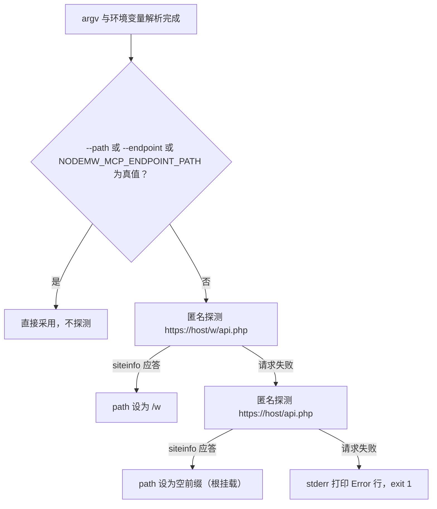

# 配置与连接：CLI 参数、环境变量与优先级

配置只在进程启动时被解析一次：[`parseCliArgs`](../../src/index.ts#L48-L112) 返回 `{ config, pathExplicit, debug }` 三元组（不是单个 `ServerConfig`）；若 `pathExplicit` 为假，引导流程在存配置之前先调 `autoDetectPath` 覆盖 `config.path`（[L131-L140](../../src/index.ts#L131-L140)），`initServerConfig` 把最终配置存进模块变量（[`src/common/nodemwBot.ts` L125-L127](../../src/common/nodemwBot.ts#L125-L127)），`initBot` 随即构造唯一的 `nodemw` `Bot` 并可选登录（[L202-L220](../../src/common/nodemwBot.ts#L202-L220)）。这个会话服务此后所有的工具调用。

没有第二次读环境变量，没有按请求重解析，也没有热重载路径：改宿主配置里的 `env` 块或 `args` 数组，只有在宿主重新 spawn 子进程时才生效。启动之后唯一的周期性动作是已认证会话的登录心跳（[L373-L384](../../src/index.ts#L373-L384)、[`startLoginHeartbeat`](../../src/common/nodemwBot.ts#L94-L123)），它只是每 60 秒查一次 `whoami` 并在掉线时翻转 `authenticated` 标志、打一行告警，**不会**重读任何配置。

由此产生两个贯穿全页的性质。第一，配置面很小但有缺口 —— 少数被文档化的旋钮实际什么也不做，另一些字段只能靠编程方式注入。第二，除了少数几处致命错误（缺目标服务器、探测失败、登录失败、站点信息不可达）之外，一切误配都是静默的：错误的路径、只给了一半的凭据、以及一个惰性 token，都会得到一个"能启动但做不到你想做的事"的服务器，所以**启动横幅**（见[启动生命周期](../architecture/startup-lifecycle.md)与本文的"核对生效配置"一节）才是"实际生效了什么"的唯一权威确认。

## 配置面总表

下表把四件事并排列出：CLI 参数、等价环境变量、默认值，以及该值**是否真的传到了 `nodemw`**。判定依据只有两处 —— [`parseCliArgs`](../../src/index.ts#L48-L112) 与 [`createBotFromConfig`](../../src/common/nodemwBot.ts#L133-L174)；README 只作为对照物（见[README 与代码的落差](#readme-与代码的落差)）。

| CLI 参数 | 等价环境变量 | 默认值 | 是否传入 `nodemw` |
|---|---|---|---|
| `[server]`（第一个位置参数） | `NODEMW_MCP_SERVER` | 无 —— 三种来源全空即致命 | 是（拆成 `server`/`protocol`/`port`） |
| `--server` / `-s` | `NODEMW_MCP_SERVER` | 同上 | 是 |
| `--path` | `NODEMW_MCP_ENDPOINT_PATH` | 字面 `/w`，但只要不是显式给出就总被探测结果覆盖 | 是（作为 `path`） |
| `--endpoint` | 无独立变量（`NODEMW_MCP_ENDPOINT_PATH` 供的是同一个 `path`） | 未设置 | 是（`--path` 的低优先别名） |
| `--user` / `-u` | `NODEMW_MCP_MW_USER` | 未设置 | 是（空串在转发前被归一为 `undefined`），同时决定是否登录 |
| `--pass` / `-p` | `NODEMW_MCP_MW_PASS` | 未设置 | 是（同上） |
| `--token` | **无**（README 记载的 `NODEMW_MCP_MW_TOKEN` 代码从不读取） | 未设置 | **否** |
| `--user-agent` / `-A` | `NODEMW_MCP_USER_AGENT` | 未设置 → `DEFAULT_USER_AGENT` | 是（替换或拼接后的单个 `userAgent`） |
| `--user-agent-append` | `NODEMW_MCP_USER_AGENT_APPEND=1` | `false` | 是（只影响拼接分支，本身不发请求参数） |
| `--debug` | `NODEMW_MCP_DEBUG=1` | `false` | 是（作为 `debug`） |
| `--dry-run` | **无 `NODEMW_MCP_*` 变量**（`nodemw` 自己认环境里的 `DRY_RUN=1`） | 未设置（`undefined`，不是 `false`） | 是，经 `// @ts-expect-error` |
| 无 flag | 无 | 未设置 | `proxy` / `concurrency` / `domain` 只在编程注入时才有值（仍会转发） |

两个"只能 CLI"的旋钮值得单独记住：`--dry-run` 与 `--token` 没有任何 `NODEMW_MCP_*` 等价变量，纯环境变量接线既开不了干运行，也表达不了 token。`port` 与 `protocol` 同样没有独立 flag：它们只能由 URL 形式的目标服务器带出来，或者由嵌入方直接写进 `ServerConfig`。

## 优先级：flag > 位置参数 > 环境变量 > 默认值

所有来源在构造 `ServerConfig` 的那一处按固定顺序合并（[L67](../../src/index.ts#L67)、[L91-L106](../../src/index.ts#L91-L106)）：

| 值 | 最高 | 次之 | 再次 | 兜底 |
|---|---|---|---|---|
| 目标服务器 | `--server` / `-s` | 第一个位置参数 | `NODEMW_MCP_SERVER` | 致命退出 1 |
| API 路径 | `--path` | `--endpoint` | `NODEMW_MCP_ENDPOINT_PATH` | 自动探测覆盖字面 `/w` |
| 凭据 | `--user` / `--pass` | — | `NODEMW_MCP_MW_USER` / `NODEMW_MCP_MW_PASS` | `undefined`（guest） |
| User-Agent | `--user-agent` / `-A` | — | `NODEMW_MCP_USER_AGENT` | `DEFAULT_USER_AGENT` |
| UA 追加 | `--user-agent-append` | — | `NODEMW_MCP_USER_AGENT_APPEND=1` | `false` |
| debug | `--debug` | — | `NODEMW_MCP_DEBUG=1` | `false` |
| 干运行 | `--dry-run` | — | 无 | `undefined`（依赖层另认 `DRY_RUN=1`） |
| token | `--token` | — | 无 | 未设置（且惰性） |

```ts
const serverUrl = (values.server as string) ?? positionals[0] ?? process.env.NODEMW_MCP_SERVER;
const pathFromEnv = process.env.NODEMW_MCP_ENDPOINT_PATH;
const pathExplicit = !!(values.path ?? values.endpoint ?? pathFromEnv);
const debug = !!(values.debug as boolean) || process.env.NODEMW_MCP_DEBUG === '1';
```

完整的环境变量映射（`process.env` 在 `parseCliArgs` 里恰好被读七次，全部是 `NODEMW_MCP_*` 前缀）：

| 环境变量 | 读取位置 | 等价 flag | 备注 |
|---|---|---|---|
| `NODEMW_MCP_SERVER` | [L67](../../src/index.ts#L67) | `--server` / `-s` 或位置参数 | 优先级最低 |
| `NODEMW_MCP_ENDPOINT_PATH` | [L91](../../src/index.ts#L91)、[L100](../../src/index.ts#L100) | `--path` | 同时抑制自动探测 |
| `NODEMW_MCP_MW_USER` | [L101](../../src/index.ts#L101) | `--user` / `-u` | |
| `NODEMW_MCP_MW_PASS` | [L102](../../src/index.ts#L102) | `--pass` / `-p` | |
| `NODEMW_MCP_USER_AGENT` | [L105](../../src/index.ts#L105) | `--user-agent` / `-A` | 替换默认值 |
| `NODEMW_MCP_USER_AGENT_APPEND` | [L106](../../src/index.ts#L106) | `--user-agent-append` | 严格比较 `=== '1'` |
| `NODEMW_MCP_DEBUG` | [L93](../../src/index.ts#L93) | `--debug` | 严格比较 `=== '1'` |
| （无） | — | `--endpoint` | 仅 CLI |
| （无） | — | `--dry-run` | 仅 CLI |
| （无） | — | `--token` | 仅 CLI，且被丢弃 |

两个布尔变量的比较是严格的 `=== '1'`：`true`、`yes`、`01` 都是 false，空值等同于未设置。这四处合并带来四个调试"flag 被忽略"报告时用得上的性质：

- **flag 不能"取消"环境变量。** `??` 只把 `null`/`undefined` 当缺省，所以 `--user ""` 选中的是空串而不是环境变量回退 —— 而空串随后在构造 `Bot` 前被抹成 `undefined`（[L168-L169](../../src/common/nodemwBot.ts#L168-L169)）。布尔项用的是 `||`，所以 `--no-debug` 之类也压不过 `NODEMW_MCP_DEBUG=1`。
- **未知 flag 被接受而不是被拒绝。** `parseArgs` 以 `strict: false`、`allowPositionals: true` 运行（[L62-L63](../../src/index.ts#L62-L63)），所以 `--dryrun`、`--useragent` 这类拼写错误只是变成 `values` 里没人读的条目，服务器照常以默认值启动。只有上面那张矩阵里声明的名字有效。
- **来源冲突不报错。** 位置参数加显式 `-s` 会被静默接受，`-s` 赢；`--path` 与 `--endpoint` 同时给出，前者赢；第二个及以后的位置参数被直接忽略。
- **没有配置文件。** `nodemw` 的构造函数本身支持读一份 JSON 选项文件（版本由 [`package-lock.json` L4047-L4060](../../package-lock.json#L4047-L4060) 钉在 0.26.0），但 `createBotFromConfig` 永远传对象字面量（[L133-L174](../../src/common/nodemwBot.ts#L133-L174)），字符串形式从未被使用。环境里那个 `CONFIG` 变量仍然由 [`test-server.js`](../../test-server.js#L22-L25) 导出，但没有任何代码读它。

## 目标站点与 URL 解析

`--server`、第一个位置参数、`NODEMW_MCP_SERVER` 按这个顺序尝试；三者皆空是解析阶段唯一的致命错误：

```text
Error: target server is required (-s, positional arg, or NODEMW_MCP_SERVER env)
```

随后 `process.exit(1)`（[L67-L71](../../src/index.ts#L67-L71)）。

以 `http://` 或 `https://` 开头的值会被 `new URL` 解析并只保留三段：`hostname`、`protocol`（去掉冒号）、`port`（有则 `parseInt`）（[L76-L89](../../src/index.ts#L76-L89)）。URL 里其余部分 —— 尤其是路径 —— 被丢弃，稍后由自动探测重新推导：

| 输入 | `server` | `protocol` | `port` | `path` |
|---|---|---|---|---|
| `en.wikipedia.org` | `en.wikipedia.org` | 未设置 → `https` | 无 | 自动探测 |
| `https://en.wikipedia.org` | `en.wikipedia.org` | `https` | 无 | 自动探测 |
| `https://en.wikipedia.org/wiki/Main_Page` | `en.wikipedia.org` | `https` | 无 | 自动探测（路径被丢弃） |
| `http://localhost:8080/w` | `localhost` | `http` | `8080` | 自动探测（路径被丢弃） |

四个需要注意的边界：

- **没有 scheme 的"域名 + 路径"不会被当成 URL。** `en.wikipedia.org/wiki` 不满足 `startsWith` 判断，整串会被当作 host，拼出来的 API URL 没有意义。同理 `localhost:8080` 也不会被拆出端口 —— 只有带 scheme 的值才走 `new URL`。
- **解析抛错时回退到原始字符串。** `new URL` 抛异常会把整串当 host，`protocol` 留空（随后在 `Bot` 构造处默认成 `https`）。
- **协议缺省发生在 `nodemw` 一侧。** `config.protocol` 可以是 `undefined`，转发时才写成 `protocol: protocol || 'https'`（[L161](../../src/common/nodemwBot.ts#L161)），所以对 `-s mywiki.example.com` 的请求走 HTTPS。
- **端口会到达 `nodemw` 与真实请求，但不出现在 Agent 描述的端点串里。** 描述里的 endpoint 被重新拼成 `${protocol ?? 'https'}://${server}${path}/api.php`（[L243-L244](../../src/index.ts#L243-L244)），因此非标准端口在 `instructions` 里看起来是错的，而实际请求是对的。

## API 路径：nodemw 的拼接语义、自动探测与失败

`nodemw` 把路径当成裸字符串前缀，再拼上 `/api.php`（这条约定直接写在 `autoDetectPath` 的注释里，[L186](../../src/common/nodemwBot.ts#L186)），所以约定写法是带前导斜杠、不带尾斜杠：`--path /w` 变成 `https://host/w/api.php`，而 `--path /w/` 会变成 `https://host/w//api.php`。空前缀 —— 自动探测的第二个候选 —— 即 `https://host/api.php`。



上图：显式路径会短路探测；否则先试 `/w` 再试根挂载，两条都失败即致命。

连不上一个 wiki 时真正要紧的细节：

- **自动探测是两个用后即弃的匿名 bot。** 每个候选都用 `{ ...config, path }` 新建一个 `Bot` 再调 `getSiteInfo(['general'])`（`testApiConnection`，[L176-L183](../../src/common/nodemwBot.ts#L176-L183)），命中的候选只以字符串返回，其 cookie 全部丢弃（[`autoDetectPath` L185-L200](../../src/common/nodemwBot.ts#L185-L200)）。凭据虽然被复制进配置，但探测过程中不会 `logIn` —— 登录只发生在 `initBot`（[L205-L217](../../src/common/nodemwBot.ts#L205-L217)）—— 所以对匿名客户端隐藏 `api.php` 的 wiki 可能探测失败、却接受之后的已认证会话。
- **失败信息可操作但有一处不成立。** 它读作 `Could not auto-detect MediaWiki API path. Tried /w/api.php and /api.php. Please specify --path explicitly (e.g., --path /w or --path "" for root).`（[L195-L199](../../src/common/nodemwBot.ts#L195-L199)）—— `--path ""` 这条建议无效，因为"显式"的判据是 `!!(values.path ?? values.endpoint ?? pathFromEnv)`（[L91-L92](../../src/index.ts#L91-L92)），而 `''` 是假值。同一句错误建议还出现在站点信息探测失败的诊断块里（[L202](../../src/index.ts#L202)）。
- **配置里那个 `/w` 默认值永远到不了 `nodemw`。** `path` 在返回的配置字面量里初始化为 `'/w'`（[L100](../../src/index.ts#L100)），但只要 `pathExplicit` 为假，引导流程在 `initServerConfig` 之前就先调 `autoDetectPath` 覆盖它，因此最终路径要么显式、要么探测得到。
- **探测顺序不可配置。** 候选列表是硬编码的 `['/w', '']`（[L187](../../src/common/nodemwBot.ts#L187)）；挂在 `/wiki`、`/mediawiki` 之类前缀下的 wiki 必须显式给 `--path`。
- **成功会打到 stderr。** `Auto-detected API path: /w`（空前缀时冒号后为空）是"探测确实发生过"的唯一正向信号（[L135](../../src/index.ts#L135)）。显式设置路径会让这一行消失，这正是"没付探测成本"的预期标志。

## 认证与写工具门控

登录只发生在一处，而且只在**两半**凭据都存在时发生（[`initBot`, L202-L220](../../src/common/nodemwBot.ts#L202-L220)）。`logIn` 成功回调里置位的 `authenticated` 布尔量，正是 `registerAllTools(server, auth)` 用来在只读注册器与全部注册器之间做选择的依据（[L348-L349](../../src/index.ts#L348-L349)、[`src/tools/index.ts` L89-L152](../../src/tools/index.ts#L89-L152)），所以凭据配置决定的是**工具目录**（37 只读 vs 37 + 17 = 54），而不只是权限。

| 配置情况 | 是否尝试登录 | 会话 | 写工具 |
|---|---|---|---|
| `--user` + `--pass`（或两个对应 env 变量） | 是；失败即致命，报 `Login failed for user '<name>': …` | 已认证 | 注册（17 个） |
| 只有 `--user` 或只有 `--pass` | 否 | guest；孤立的那一半照旧传给 `nodemw`，但没有任何登录 | 隐藏 |
| 两者都没有 | 否 | guest | 隐藏 |
| 只有 `--token` | 否 | guest | 隐藏 |

必须记住的失败形态是：半配置或 token-only 部署**不会报错**。它正常启动，只宣传 37 个工具，并在自述里承认自己是 GUEST。相关文案出现在 Agent 描述里 —— `You are in GUEST mode — all write tools are hidden. Start with --username --password or set NODEMW_MCP_MW_USER and NODEMW_MCP_MW_PASS for full access.`（[L275](../../src/index.ts#L275)）—— 它点名的 `--username`/`--password` 并不是已声明选项，真实 flag 是 `--user`/`--pass`。由于未知 flag 会被静默接受，照着这句话操作的运维只会得到另一个 guest 会话。写工具为何是"隐藏"而非"逐次拒绝"，见[安全模型](../concepts/safety-model.md)。

已认证会话还会启动登录心跳（[L373-L384](../../src/index.ts#L373-L384)）：每 60 秒用 `whoami` 复核一次，只有拿到"正向的匿名证据"（`id` 为 0 或 `anon: true`）才把 `authenticated` 翻成 `false` 并打一条 `⚠ LOGIN SESSION EXPIRED` 横幅；网络/API 瞬时错误被忽略（[L97-L116](../../src/common/nodemwBot.ts#L97-L116)）。它不改变本进程已注册的工具目录，也不重读配置 —— 心跳之后响应的仍是启动时那套配置。

## <a id="documented-but-unwired-options"></a>文档记录但未接线的选项：`--token`

README 把 `--token` 说成认证上的"用户名/密码替代方案"（[`README.md` L37](../../README.md#L37)，中文版 [L37](../../README.zh-hans.md#L37)），并把 `NODEMW_MCP_MW_TOKEN` 列进环境变量表（[L78](../../README.md#L78)、[中文版 L78](../../README.zh-hans.md#L78)）。两者都无法完成认证：

- `--token` 被读进 `ServerConfig.token`（[L103](../../src/index.ts#L103)），但 `createBotFromConfig` 的解构列表里没有 `token`，也没有把它转给 `nodemw` 构造函数（[L134-L148](../../src/common/nodemwBot.ts#L134-L148)、[L159-L173](../../src/common/nodemwBot.ts#L159-L173)）；登录门控只看 `username` 与 `password`。它今天唯一的副作用是占住一个字段。
- `NODEMW_MCP_MW_TOKEN` 从未被读取 —— `process.env` 只出现那七个变量（[L67-L106](../../src/index.ts#L67-L106)）。
- `authenticated` 只在 `logIn` 的成功回调里被置位（[L212](../../src/common/nodemwBot.ts#L212)），别处都不写，所以 token-only 会话永远不会把标志翻成已认证；即使某个 wiki 会接受这样的 token，写工具也不会被注册。

只读后果：bot password 流程必须走 `--user`/`--pass` 配一个 bot 账号；只发 bot password 的 wiki 依然能用 —— 前提是提供这一对值，而不是 token。

## README 与代码的落差

逐条核对后，值得写进运维手册的差异如下（"代码实际"一列以 `parseCliArgs` 与 `createBotFromConfig` 为准；中文 README 与英文版逐行同构）：

| 项 | README 记载 | 代码实际 | 运营后果 |
|---|---|---|---|
| `--token` | 认证的替代方案（[L37](../../README.md#L37)） | 解析并存进 `ServerConfig.token`，从不转发 | 照做得到静默 guest 会话 |
| `NODEMW_MCP_MW_TOKEN` | 环境变量表列出（[L78](../../README.md#L78)） | 没有任何代码路径读它 | 同上 |
| "所有设置都可以通过环境变量配置"（[L70](../../README.md#L70)） | 声称全覆盖 | `--dry-run` 与 `--token` 都没有 `NODEMW_MCP_*` 等价变量；`proxy`/`concurrency`/`domain` 既无 flag 也无 env | 纯 env 接线无法开干运行、无法设代理与并发、无法表达 token |
| `--dry-run` | "Dry-run mode (no actual edits)"（[L41](../../README.md#L41)） | 只对有 guard 的 `nodemw` 方法生效，admin/账号类工具仍会执行 | 误以为是安全演练（见[干运行模式](#干运行模式)） |
| `--path` 默认值 | "default: auto-detect; tries `/w` then root"（[L33](../../README.md#L33)） | 描述一致 | 但报错里推荐的 `--path ""` 无法强制根挂载 |
| `--endpoint` | "Alias for `--path`"（[L34](../../README.md#L34)） | 一致，且优先级低于 `--path`、没有独立 env | 与 `NODEMW_MCP_ENDPOINT_PATH` 混用时只有 `--path` 赢它 |
| URL 形式与端口 | 示例只写 `-s https://en.wikipedia.org`（[L53](../../README.md#L53)） | 支持 `http://host:port/path`，拆出 hostname/protocol/port 并丢弃路径 | 端口生效，但 `instructions` 里的端点串不含端口 |
| `--user-agent-append` | "Append custom User-Agent to default"（[L39](../../README.md#L39)） | 一致，且单独使用是空操作 | 必须与 `-A`/`NODEMW_MCP_USER_AGENT` 同时给 |
| guest 提示里的 flag | 代码自述 `--username --password`（[L275](../../src/index.ts#L275)） | 真实 flag 是 `--user`/`--pass` | 照做静默拿到另一个 guest 会话 |
| 工具计数 | 37 只读 + 17 写（[L103-L109](../../README.md#L103-L109)） | 与注册器数组一致 | 两者现在不再有落差，可作为横幅核对基准 |
| `DEBUG` / `DRY_RUN` | 未记载 | `nodemw` 自己在构造时读 `process.env`（见下两节） | 宿主里无关的 `DEBUG=1` / `DRY_RUN=1` 会改变本服务器行为 |

反向的差异也存在：代码支持而 README 未记载的能力包括 URL 形式与端口、`strict: false` 带来的宽容解析、依赖层 `DEBUG`/`DRY_RUN` 环境变量，以及 `proxy`/`concurrency`/`domain` 三个只能编程设置的字段。

## User-Agent 组合

默认身份串只在一个地方拼装，并带运行期版本号，方便 wiki 运维识别客户端：

```text
nodemw/<nodemw version> (node.js <process.version>; <platform> <arch>) nodemw-mcp/<this package version> (<package name>@<version>; @modelcontextprotocol/sdk@<sdk version>)
```

构造位置是 [`src/server.ts` L37](../../src/server.ts#L37)：取 `nodemw` 的 `package.json` 版本、`process.version`、`process.platform`/`process.arch`、本包的 `name`/`version`，以及 MCP SDK 版本 —— 后两者用 `createRequire` 解析，因为产物是 ESM。

每次构造 bot 时做三路判定（[L150-L157](../../src/common/nodemwBot.ts#L150-L157)）：

| `userAgent` | `userAgentAppend` | 生效的 `User-Agent` |
|---|---|---|
| 未设置 | 任意 | `DEFAULT_USER_AGENT` |
| 已设置 | false / 未设置 | 仅自定义串 |
| 已设置 | true | `DEFAULT_USER_AGENT` + 一个空格 + 自定义串 |

只给 `--user-agent-append` 而不给自定义值是空操作；追加形式是 `DEFAULT + ' ' + custom`，自定义值在最后，因此 wiki 的联系方式约定（如 `Tool/1.0 (ops@example.org)`）应当写在自定义部分。替换默认值会抹掉全部版本类识别信息 —— 一些 wiki 的 bot 政策与限流排查依赖这些信息；追加则保留溯源能力。

`autoDetectPath` 里那两个一次性 bot 走的是同一个 `createBotFromConfig`（[L189-L190](../../src/common/nodemwBot.ts#L189-L190)），因此自定义 UA 在探测阶段也会被使用。

## 调试日志

`--debug`（或 `NODEMW_MCP_DEBUG=1`）有两个容易被混为一谈的效果：

1. **引导期诊断打到 stderr。** `[DEBUG] getSiteInfo response: …` 与 `[DEBUG] getMediaWikiVersion response: …` 用 `console.error` 打印（[L167](../../src/index.ts#L167)、[L212](../../src/index.ts#L212)）。对 stdio MCP 会话是安全的。
2. **同进程里的第三方 logger。** 这个 flag 作为 `debug` 转发进 `nodemw` 选项（[L159-L173](../../src/common/nodemwBot.ts#L159-L173)）。在钉住的 `nodemw` 0.26.0 里，它把 winston 的 console transport 从 `error` 提升到 `debug` 级别，而该 transport 没有配置 `stderrLevels` —— 也就是所有级别都写到 **stdout**，正是承载 JSON-RPC 帧的那条流。于是调试会话可能把客户端日志行插进协议帧之间，宿主报出来的往往是解析失败或会话断开，而不是日志问题。

默认级别下同一个隐患以更窄的形式存在：console transport 的 `error` 级别同样落在 stdout，所以 `nodemw` 记录的 API 级错误（`Error returned by API: …`、`Error parsing JSON response: …`）无论有没有 `--debug` 都会污染协议通道。

两处依赖层的地板效应也挂在同一处：`nodemw` 在构造时自己读 `process.env`，`DEBUG=1` 会像 `--debug` 一样抬高 client 日志级别；而只要入口脚本同级的 `log/` 目录存在，它还会额外挂一个文件 transport（`--debug` 时为 `debug` 级别，否则 `info`），把 `nodemw` 的日志写进该目录下的一个 `.log` 文件。两者都是从宿主环境继承的：为一个无关工具导出的 `DEBUG=1` 会静默改变本服务器的行为，而凭空出现的 `log/` 目录会让服务器开始落盘。

<!-- openwiki: broken internal link [../integrations/mcp-transport-and-clients.md#the-stdout-invariant] heading anchor "the-stdout-invariant" does not exist in "../integrations/mcp-transport-and-clients.md". Fix the href or restore the target, then delete this comment. -->
没有 `--quiet`、没有日志级别 flag、也没有把诊断改道的开关。服务器自己写的每条消息本来就都在 stderr —— 见 [stdout 不变量](../integrations/mcp-transport-and-clients.md#the-stdout-invariant)。实践建议：生产宿主不要开 `--debug`，诊断时抓 stderr，并用 `node dist/index.js …` 直接复现。

## 干运行模式

`--dry-run` 以 `dryRun` 之名、藏在 `// @ts-expect-error: dryRun is supported by nodemw at runtime but missing from BotOptions types` 后面传给 `nodemw` 构造函数，因为公开的 `BotOptions` 类型没有这个字段，而运行时认识它（[L171-L172](../../src/common/nodemwBot.ts#L171-L172)、[L104](../../src/index.ts#L104)）。`nodemw` 另外自己认环境里的 `DRY_RUN=1`，所以干运行可以在完全不碰 flag 的情况下被打开。

所有 dry-run 判断都在依赖层，`src/` 里一个也没有（`dryRun` 只出现在 `ServerConfig` 声明与转发处）。它的覆盖面是部分的，这也是该模式最反直觉的性质：

| 写工具 | 底层调用 | 干运行行为 |
|---|---|---|
| `write`、`edit`、`append`、`prepend`、`revert` | `nodemw.doEdit`（`revert` 显式复用 `doEdit` 以保留 token 与 guard，[`revert.ts` L159-L177](../../src/tools/editing/revert.ts#L159-L177)） | 在任何写请求之前拒绝 |
| `delete`、`move`、`purge`、`send-email`、`upload`、`add-flow-topic` | 各自带干运行 guard 的 `nodemw` 方法 | 拒绝 |
| `block`、`unblock`、`protect`、`undelete` | 直接 `bot.api.call` 并自行取 token（[`block.ts` L94-L128](../../src/tools/editing/block.ts#L94-L128)、[`unblock.ts` L74-L98](../../src/tools/editing/unblock.ts#L74-L98)、[`protect.ts` L82-L116](../../src/tools/editing/protect.ts#L82-L116)、[`undelete.ts` L69-L91](../../src/tools/editing/undelete.ts#L69-L91)） | **真的执行** |
| `create-account` | `nodemw.createAccount`，没有 guard（[`create-account.ts` L64-L72](../../src/tools/editing/create-account.ts#L64-L72)） | **真的执行** |
| `upload-by-url` | `fetchSourceSafely` 先抓取源 URL，再委派给有 guard 的 `upload`（[L90-L102](../../src/tools/editing/upload-by-url.ts#L90-L102)） | 远程抓取会发生，上传被拒绝 |

拒绝路径返回的是 `Error("In dry-run mode")`，工具封装把它转成普通的 `isError: true` 结果 —— 于是干运行下的一次写操作看起来像失败，而不像被模拟的成功。启动横幅与 Agent 描述都不提干运行（`dryRun` 在 `src/index.ts` 里没有任何其他引用），Agent 没有渠道知道该模式已开启，只会把这些失败当成真错误。请把 `--dry-run` 当作"仅对编辑形状的工具有效的离线彩排"；对下半张表里的管理类与账号类工具，它一点保护也不提供。写工具本身的语义见[工具注册表](../architecture/tool-registry.md)。

## 只能靠编程设置的字段

`ServerConfig` 带有 CLI 从不直接填充的字段（[L32-L47](../../src/common/nodemwBot.ts#L32-L47)）：

| 字段 | 是否转发给 `nodemw` | 能否从 CLI 到达 |
|---|---|---|
| `proxy` | 是 | 否 |
| `concurrency` | 是（请求队列宽度） | 否 |
| `domain` | 是（用于 LDAP 式登录） | 否 |
| `port` / `protocol` | 是 | 仅当目标写成 URL 形式 |

嵌入运行时 —— 直接调 `initBot` 并传入字面量 `ServerConfig` —— 是设置 `proxy`、`concurrency`、`domain` 的唯一途径。`initServerConfig` 存下的配置虽然有配套的 `getServerConfig` 访问器（[L125-L131](../../src/common/nodemwBot.ts#L125-L131)），但生产代码里没有任何调用者（只有测试替身引用它），所以那份存储仍然是只写的：消费方读的是 bot 单例与版本缓存。运行时自身对这些字段的看法见 [bot 运行时](../architecture/bot-runtime.md) 的"配置面：哪些字段真正到达 nodemw"。

## 接线配方

在宿主配置文件里用纯环境变量是最常见形态，因为凭据不必进 argv：

```json
{
  "mcpServers": {
    "nodemw": {
      "command": "node",
      "args": ["dist/index.js"],
      "env": {
        "NODEMW_MCP_SERVER": "mywiki.example.com",
        "NODEMW_MCP_ENDPOINT_PATH": "/w",
        "NODEMW_MCP_MW_USER": "Editor@BotName",
        "NODEMW_MCP_MW_PASS": "<bot-password>"
      }
    }
  }
}
```

工作副本根目录的 [`.mcp.json`](../../.mcp.json#L1-L18) 是同一形状的**本地覆盖**样例：`command: node`、`args: ["dist/index.js"]`，`env` 块只给 `NODEMW_MCP_SERVER`、`NODEMW_MCP_MW_USER`、`NODEMW_MCP_MW_PASS` 三个变量 —— 没有 `NODEMW_MCP_ENDPOINT_PATH`，所以每次启动都要付一次自动探测。它的 `env` 里填的是一份真实站点与明文口令；本页刻意不复述这些值，也请把它当作活凭据而不是模板：不要复制到文档、工单或其他仓库，泄露后必须在 wiki 侧轮换 bot password。这份文件在 [`.gitignore`](../../.gitignore#L147-L148) 里被忽略，因此新 clone 不会带上它，需要自己写一份。显式设置路径是最便宜的启动优化，也是到达非 `/w`、非根挂载 wiki 的唯一方式。

flag 形式的调用等价，只差优先级：

```bash
# 显式路径 + 显式凭据，不探测
nodemw-mcp-server -u Editor -p '<bot-password>' --path /w mywiki.example.com

# URL 形式：scheme 与 port 保留，路径被丢弃并重新探测
nodemw-mcp-server -s https://mywiki.example.com/w

# 替换 vs 追加默认 User-Agent
nodemw-mcp-server -A "MyBot/1.0 (ops@example.com)" mywiki.example.com
nodemw-mcp-server --user-agent-append -A "MyBot/1.0 (ops@example.com)" mywiki.example.com
```

## 核对生效配置

启动时全部自述打到 stderr，stdout 上什么也没有（[L386-L403](../../src/index.ts#L386-L403)）：

| 疑问 | 信号 |
|---|---|
| 探测跑过吗，结果是什么？ | `Auto-detected API path: /w`（显式给路径时该行不出现） |
| bot 拿到的是哪个 wiki、哪个端点？ | 横幅行 `Site: <sitename> <endpoint>` |
| 登录成功了吗？ | 横幅 `Auth: authenticated as <user>` 对比 `Auth: guest (read-only)`；启动后掉线则出现一次 `⚠ LOGIN SESSION EXPIRED` |
| 本次会话有几件工具？ | 横幅 `Tools: 54 (37 read + 17 write) loaded` 对比 `37 read-only loaded` |
| 知道 wiki 版本吗？ | 横幅 `Version: MediaWiki <major.minor>` 对比 `an unknown MediaWiki version` |

工具计数取的是注册器数组长度而不是成功注册数，所以抛错的注册器照样被计入（[L388-L390](../../src/index.ts#L388-L390)、[`src/tools/index.ts` L149-L162](../../src/tools/index.ts#L149-L162)）。`server.connect` 之后发生的事在这里完全不可见。横幅与退出码的完整语义在[启动生命周期](../architecture/startup-lifecycle.md)。

## 失败模式

| 症状 | 成因 | 退出 |
|---|---|---|
| 配了凭据却是 guest 会话 | 只给了 user/pass 之一，或凭据写在 `NODEMW_MCP_MW_TOKEN` / `--username` 里 | 继续运行 |
| `Error: Could not auto-detect MediaWiki API path…` | wiki 不在 `/w` 或根挂载，或匿名客户端取不到 `api.php` | 1 |
| `Error: Login failed for user '<name>': …` | 凭据对不上，或账号需要 bot password | 1 |
| `Error: target server is required …` | 没有 flag、没有位置参数、也没有 `NODEMW_MCP_SERVER` | 1 |
| 请求打到 `/w//api.php` 这类双斜杠 | 给 `--path` 时带了尾斜杠 | 继续运行，调用可能失败 |
| 开着 `--dry-run` 却仍然写进了 wiki | 该工具绕过 client 的 guard（`block`、`unblock`、`protect`、`undelete`、`create-account`） | 继续运行 |
| 开 debug 后客户端报坏帧 | `nodemw` 的 winston console transport 落在 stdout | 继续运行 |
| 会话先正常后报"not allowed / login required" | cookie 过期；60 秒心跳打一条 `⚠ LOGIN SESSION EXPIRED`，工具目录不变 | 继续运行，需重连 |

## 扩展点

新增一个可配置项需要四处协同修改，因为分层是分开的：

1. 在 [`src/index.ts` L49-L64](../../src/index.ts#L49-L64) 的 `parseArgs` 里声明选项；
2. 在 `config` 字面量（[L95-L111](../../src/index.ts#L95-L111)）里接上环境变量回退；
3. 在 `ServerConfig`（[L32-L47](../../src/common/nodemwBot.ts#L32-L47)）里加字段；
4. 在 `createBotFromConfig`（[L133-L174](../../src/common/nodemwBot.ts#L133-L174)）里解构**并**转发。

外加 README 的两张表（[L29-L41](../../README.md#L29-L41)、[L72-L81](../../README.md#L72-L81)）与其中文对应版本。`token` 字段就是"四处只做了两处"的现有教材：声明了、解析了、存下来了，然后完全惰性。新增布尔型 env 变量应沿用 `=== '1'` 的约定；任何会影响已宣传工具目录的设置，都必须在 `registerAllTools(server, auth)` 之前解析完成（[L348-L349](../../src/index.ts#L348-L349)），因为工具目录在注册那一刻就冻结了。

## 相关页面

- [启动生命周期与 Agent 描述生成](../architecture/startup-lifecycle.md) —— 每个值在引导序列里被消费的位置。
- [Bot 运行时](../architecture/bot-runtime.md) —— 运行时视角的配置面与共享可变状态。
<!-- openwiki: broken internal link [../integrations/mcp-transport-and-clients.md#environment-variable-surface-for-client-configs] heading anchor "environment-variable-surface-for-client-configs" does not exist in "../integrations/mcp-transport-and-clients.md". Fix the href or restore the target, then delete this comment. -->
- [MCP 传输与客户端](../integrations/mcp-transport-and-clients.md) —— 从宿主侧接线，以及[客户端配置里的环境变量面](../integrations/mcp-transport-and-clients.md#environment-variable-surface-for-client-configs)。
- [nodemw 客户端与补丁](../integrations/nodemw-client.md) —— 被转发的选项在依赖层如何变成请求。
- [工具注册表与工具模块契约](../architecture/tool-registry.md) —— 37/17 的注册器清单与干运行覆盖边界。
- [构建与发布](build-and-release.md) —— 进入 `User-Agent` 的那些版本号从哪来。
- [验证与测试](../testing/validation.md) —— 用本地 stub wiki 复现探测与登录分支。
