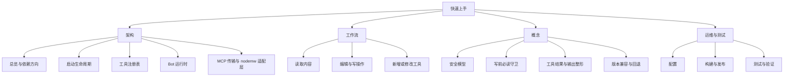

# 快速上手：nodemw MCP Server wiki 的任务路由图

`@xiedada/nodemw-mcp-server` 把任意一个 MediaWiki 站点包装成 MCP 工具集交给 AI agent：37 个只读工具与 17 个写工具，底层用 `nodemw` 客户端调用目标站点的 `api.php`（[`package.json`](../package.json#L1-L16)、[`src/tools/index.ts`](../src/tools/index.ts#L89-L147)）。

**先记住这个形状：一个 Node 进程 = 一个 wiki = 一个 stdio MCP 会话。** 启动时只解析出一个目标站点（`ServerConfig`），只创建一个 `nodemw` `Bot`，只通过一个 `StdioServerTransport` 服务一个客户端（[`src/index.ts`](../src/index.ts#L114-L150)、[`src/index.ts`](../src/index.ts#L366-L368)）。所有可变状态都是 `src/common` 里的模块级变量，而不是注入的请求上下文：

- bot 单例与 `authenticated` 标志（[`src/common/nodemwBot.ts`](../src/common/nodemwBot.ts#L49-L52)）
- 缓存的 MediaWiki 版本与命名空间缓存（[`src/common/nodemwBot.ts`](../src/common/nodemwBot.ts#L234-L252)）
- 写前必读的两张映射表 `readState` / `writeCache`（[`src/common/pageState.ts`](../src/common/pageState.ts#L38-L49)）

推论很直接：重启进程就丢掉登录态与全部已读记录；多开进程等于多个互不共享状态的会话。所以服务器假定每个客户端连接都是一个新进程（`instructions` 里也明确告知了这一点），重连后必须重新读页面再写。

## 先确认证据层级，再相信任何页面

| 层级 | 内容 | 怎么用 |
|---|---|---|
| 权威 | `src/` 与 `src/**/__tests__/` 下的源码和 vitest 套件 | 冲突时以它们为准；重要细节先打开被引用的行 |
| 意图 | [`README.md`](../README.md#L1-L20)、[`README.zh-hans.md`](../README.zh-hans.md)、[`CLAUDE.md`](../CLAUDE.md#L23-L49) | 表达设计意图与用法，是进入状态的好起点，但不随每次提交校对；与源码冲突时同样以源码为准 |
| 生成物 | `openwiki/` 全部页面 | 由[定时工作流](../.github/workflows/openwiki-update.yml#L1-L36)重建；**不要手改**，改源码让它跟上 |

[`AGENTS.md`](../AGENTS.md#L47-L60) 把这条层级写成了使用规则，并且明确本 wiki 只是**按需检索的可选上下文**——不要在任务开始时预载、枚举或全量搜索它；要检索就在确实缺上下文时按需取用，取到能支撑当前判断为止。

## 四个中枢



本页与四个中枢的对应关系：每个中枢下面挂着它承载的页面主题。

四个中枢各管一类问题：**架构**回答「进程怎么跑起来、一次调用经过谁」，**工作流**回答「我要做的事按什么顺序做」，**概念**回答「为什么这样设计、出错意味着什么」，**运维与测试**回答「怎么配置、怎么发布、怎么证明没坏」。集成类页面（MCP 传输、`nodemw` 适配层）挂在架构与运行时下面，因为它们描述的是边界而非流程。

## 想做什么，读哪一页

| 你想做的事 | 读这一页 |
|---|---|
| 把服务器跑起来并接进一个 MCP 客户端 | [MCP 传输与客户端接线](integrations/mcp-transport-and-clients.md) |
| 配一次部署：目标站点、API 路径、凭据、User-Agent、dry-run、优先级 | [配置与连接](operations/configuration.md) |
| 弄清启动的每一步，以及某一步失败为什么退出 | [启动生命周期](architecture/startup-lifecycle.md) |
| 理解共享运行时：bot 单例、登录与心跳、版本缓存、命名空间缓存 | [Bot 运行时](architecture/bot-runtime.md) |
| 先建立整体心智模型（分层、依赖方向、一次工具调用的完整路径） | [架构总览](architecture/overview.md) |
| 排查「工具注册失败」或某个工具莫名消失、游客到底看到什么 | [工具注册表与工具模块契约](architecture/tool-registry.md) |
| 新增、改名或改签名一个工具 | [新增或修改一个工具](workflows/adding-a-tool.md) |
| 读内容：整页、分页、按版本、批量、搜索、渲染、diff | [读取与检查 wiki 内容](workflows/reading-content.md) |
| 改内容并确认没改坏：edit 与 write 的取舍、预览、冲突、事后验证 | [编辑、验证与治理 wiki 内容](workflows/editing-content.md) |
| 写操作被拦下：`has NOT been read`、编辑冲突、登录过期 | [写前必读守卫与编辑冲突保护](concepts/read-before-write-guard.md) |
| 判断某个动作是否安全，或审计服务器对模型说了什么 | [安全模型](concepts/safety-model.md) |
| 解释工具返回结构：`structuredContent`、截断标记、错误注解 | [工具结果与输出整形](concepts/tool-results-and-output-shaping.md) |
| token、权限或老版本 wiki 相关失败（`csrf`、`badaccess`、未知 action） | [MediaWiki 版本兼容性与回退](concepts/api-compatibility.md) |
| 审计本服务器到底怎么依赖 `nodemw`、补丁加固了什么 | [nodemw 客户端集成](integrations/nodemw-client.md) |
| 改 bundle、发布 npm 包、看 CI 流水线 | [构建、发布与 CI 流水线](operations/build-and-release.md) |
| 证明一次改动没坏：现有测试究竟守住哪些不变量 | [测试与验证策略](testing/validation.md) |

## 最小可运行路径

```bash
npm install          # postinstall 会跑 patch-package 加固 nodemw
npm run build        # esbuild 打包 → dist/index.js
npm test             # vitest run，全部离线

node dist/index.js example.org                  # 游客：只有 37 个只读工具
node dist/index.js -u USER -p PASS example.org   # 登录：37 个只读 + 17 个写工具
node dist/index.js --dry-run -u USER -p PASS example.org
```

没传 `--path` / `--endpoint` 时，API 脚本路径会依次按 `/w` 与站点根探测，探测失败是致命错误而不是回退（[`src/common/nodemwBot.ts`](../src/common/nodemwBot.ts#L185-L200)）。参数与环境变量的完整对照和优先级不要在这里背——[配置与连接](operations/configuration.md) 才是参考。仓库根的 [`.mcp.json`](../.mcp.json#L1-L17) 是一个现成的客户端登记示例（`node dist/index.js` 加 `NODEMW_MCP_*` 环境变量）；其中内嵌的凭据只属于该示例文件，不要复制到自己的配置里。

`npm test` 不是空壳：套件在 `src/tools/__tests__/` 与 `src/common/__tests__/`，用 `vi.mock` 替换掉 `nodemwBot.js` 的假 bot 加 `InMemoryTransport` 配对，全程不联网（[`smoke.test.ts`](../src/tools/__tests__/smoke.test.ts#L29-L52)）。[`test-server.js`](../test-server.js#L1-L56) 仍是手工冒烟脚本：确认 `dist/index.js` 存在并 spawn 两秒看它不崩。两者各证明什么、漏掉什么，见 [测试与验证策略](testing/validation.md)。

## 建议阅读顺序

1. [架构总览](architecture/overview.md)——五个域、依赖方向，以及从 MCP 请求到 `api.php` 的路径。
2. [启动生命周期](architecture/startup-lifecycle.md)——编号化的引导顺序：工具目录与 Agent 描述是怎么造出来的。
3. [工具注册表与工具模块契约](architecture/tool-registry.md)——每个工具文件必须满足的契约。
4. [读取与检查 wiki 内容](workflows/reading-content.md)，然后 [编辑、验证与治理 wiki 内容](workflows/editing-content.md)——两个功能域。
5. [安全模型](concepts/safety-model.md) 与 [写前必读守卫](concepts/read-before-write-guard.md)——约束写工具的分层防护。
6. [构建、发布与 CI 流水线](operations/build-and-release.md) 与 [测试与验证策略](testing/validation.md)——源码如何变成发布产物，以及怎么证明它没坏。

## 容易误解的几个约定

- **游客会话不是「会报错的降级模式」。** 写工具根本不会出现在工具目录里：`registerAllTools(server, auth)` 在注册那一刻只挑一组 registrar，未认证会话拿到的目录里没有写工具（[`src/tools/index.ts`](../src/tools/index.ts#L149-L162)）。
- **写前必读守卫只覆盖页面内容类写工具，不覆盖所有写工具。** `edit`、`write`、`revert`、`append`、`prepend`、`move`、`delete`、`protect` 会调用 `requireRead(title)`；`block`、`upload`、`upload-by-url`、`purge`、`send-email`、`create-account` 等不调用。守卫也放行尚不存在的页面（返回 0），所以新建页面从不被拦（[`src/common/pageState.ts`](../src/common/pageState.ts#L210-L267)）。细节见 [写前必读守卫](concepts/read-before-write-guard.md)。
- **读证据只由少数读取工具留下。** 整页读取类工具（`get-article`、`get-article-with-lineno`、`get-articles`、`get-module-source`）与成功的写操作会登记 pageid + revid；局部读取、旧版本读取、diff 与 `parse` 不留证据。所以「我明明读过」与守卫的判断可能不一致。
- **注册期异常会被吞掉。** `registerAllTools` 逐个调用 registrar 并用 `try/catch` 包裹，单个工具注册抛错只往 stderr 打一行 `Error registering tool`，服务器照常启动——工具「莫名不见了」时先看启动 stderr。
- **`promisifyBotMethod` 是访问 `nodemw` 的常规路径，裸 `api.call` 是有记录的例外**（`pageids`/`revids`、错误的固定参数、错误的 token 类型等）。理由集中在 [nodemw 客户端集成](integrations/nodemw-client.md)。
- **bundle 是单文件，但运行时依赖外置**（`nodemw`、`@modelcontextprotocol/*`、`zod`），所以只把 `dist/index.js` 拷走并不是一个能跑的安装（[`scripts/build.js`](../scripts/build.js#L11-L59)）。
- **一个畸形响应不会杀死会话。** `main()` 安装了一个 `uncaughtException` 抑制器，因为在 nodemw 回调（socket I/O 栈，位于所有 promise 链之外）里抛出的异常会直接干掉这个「一进程一会话」的 MCP 通道；代价是那次工具调用会挂到客户端超时（[`src/index.ts`](../src/index.ts#L117-L129)）。
- **本 wiki 自身也是流水线产物。** 定时工作流以 `openwiki/update` 分支开 PR，失败时保留已完成页面作为下次基线——要改文档就先改代码。
