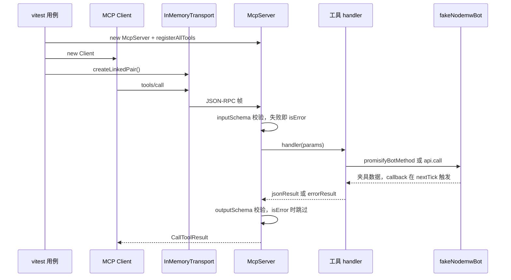
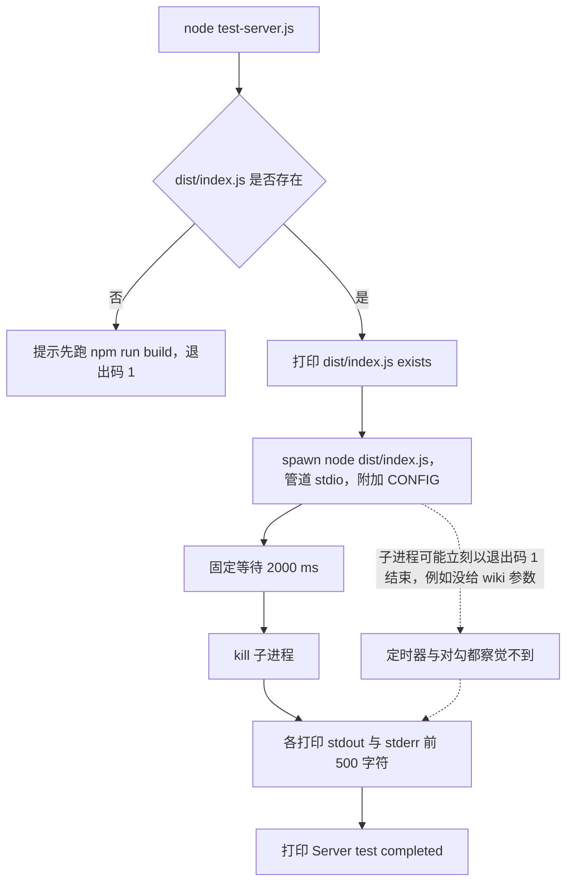
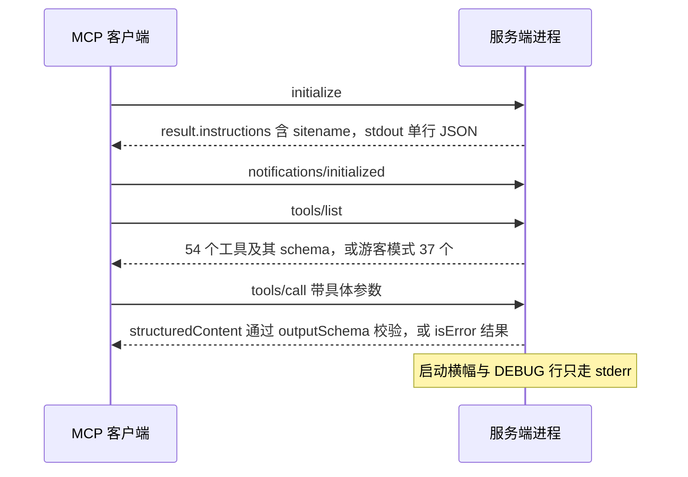

# 测试与验证策略

这个仓库现在有一层真实的、完全不联网的自动化覆盖：`npm test` 是 `vitest run`，`src/common/__tests__` 有 7 个纯函数/模块级套件，`src/tools/__tests__` 有 3 个工具级套件，其中一个把 54 个工具逐个通过 MCP 协议调用一遍（[package.json](../../package.json#L18-L26)）。夹具把 `nodemwBot.js` 整个换成假 bot，把 DNS 与 `fetch` 桩掉，所以跑测试既不需要构建产物，也不需要 wiki。

另一半同样重要：不在闸门里的东西仍然不在。启动流程、`--dry-run`、错误结果的 schema、以及 CI 全都没有被覆盖；lint 与发布流水线各有各的洞。下面把"哪条命令证明了什么"和"哪条命令只是看起来证明了什么"分开写。

## 闸门一览

| 闸门 | 命令 | 变绿说明 | 盲区 |
|---|---|---|---|
| 测试 | `npm test` | 10 个套件离线通过：工具目录/注解契约、写前读守卫加固、结果助手与错误文案、diff 与 HTML 解析器、`safeFetch` 边界、命名空间缓存、`pageState` 时间戳（[annotations.test.ts](../../src/tools/__tests__/annotations.test.ts)、[smoke.test.ts](../../src/tools/__tests__/smoke.test.ts)、[readGuard.test.ts](../../src/tools/__tests__/readGuard.test.ts)） | 启动与 CLI、`--dry-run`、`isError` 结果的 payload schema、真实 MediaWiki/nodemw 的响应形状 |
| 构建 | `npm run build` | esbuild 解析了从 `src/index.ts` 可达的每个模块并重写 `dist/index.js`（[scripts/build.js](../../scripts/build.js#L11-L73)） | 类型（esbuild 直接剥掉）、运行时行为、测试文件 |
| 类型检查 | `npx tsc --noEmit` | `strict` 下 TypeScript 接受 `src/**/*`，**包含测试文件**（[tsconfig.json](../../tsconfig.json#L19-L20)） | `scripts/`、`test-server.js`，以及只在运行时才炸的东西 |
| Lint | `npm run lint` | ESLint 9 能加载 [eslint.config.js](../../eslint.config.js#L8-L29) 并在被展开到的文件上跑完 | 未加引号的 glob 让 `src/index.ts`、`src/server.ts`、`src/tools/ro/*`、`src/tools/editing/*` 与全部测试文件被跳过；规则只是 `recommended`，没有类型感知 |
| 冒烟 | `node test-server.js` | `dist/index.js` 存在；一个子进程被拉起、两秒后被杀掉（[test-server.js](../../test-server.js#L11-L56)） | 子进程的退出状态、MCP 握手、所有工具 |
| 真实会话 | 在 MCP 客户端里跑 `node dist/index.js <wiki>`，或手写 JSON-RPC 帧 | 握手、认证，以及你确实调用过的那几个工具在这个 wiki 上是对的 | 你没调用的一切，以及这个 wiki 不具备的版本相关分支 |
| CI（发布） | release workflow | `npm ci` 与 `npm run build` 成功（[npm-publish.yml](../../.github/workflows/npm-publish.yml#L11-L24)） | 测试、lint、类型检查、全部运行时行为 |
| CI（文档） | OpenWiki 更新 workflow | OpenWiki 生成了文档并开了 PR，且它一步 `npm run build` 都不跑（[openwiki-update.yml](../../.github/workflows/openwiki-update.yml#L33-L89)） | 代码行为 |

三条命令的形态值得记住：干净的 `npm run build` 只打印一行 `Build complete: dist/index.js`，干净的 `npx tsc --noEmit` 什么都不打印，`npm test` 打印每个套件的用例计数（[scripts/build.js](../../scripts/build.js#L61-L69)）。所以"通过"通常只有几行输出，失败才需要保留完整输出——这正是仓库要求的"用能证明改动行为的最窄的安静验证"（[AGENTS.md](../../AGENTS.md#L58)）。

bundle 怎么产出、发布了什么，见[构建与发布](../operations/build-and-release.md)；`nodemw` 为什么是最难测的边界，见[nodemw 客户端集成](../integrations/nodemw-client.md)。

## 命令参考

```bash
npm test                     # = vitest run，一次性跑完全部套件
npx vitest run src/tools/__tests__/readGuard.test.ts   # 只跑一个文件
npx vitest                   # 监视模式，会阻塞，本地开发用
npm run lint                 # eslint src/**/*.ts（glob 由 shell 展开，见下）
npm run build                # esbuild → dist/index.js
npx tsc --noEmit             # 唯一类型闸门，手工跑
node test-server.js          # 手工冒烟，不属于 vitest
```

`npm test` 展开就是 `vitest run`（[package.json](../../package.json#L22)），不是裸 `vitest`，所以不会进监视模式，适合 CI。仓库里没有 `vitest.config.*`，`package.json` 里也没有 `vitest` 键，套件完全靠 vitest 的默认 include 发现：`src/common/__tests__/*.test.ts` 与 `src/tools/__tests__/*.test.ts` 命中，同目录的辅助文件 `fakeNodemwBot.ts` 不命中。要加配置（覆盖率、别名、全局 setup）就得先建这个文件，而今天不需要。

`npx tsc --noEmit` 仍是唯一的类型闸门，而且只能手工跑：`npm run build` 走 esbuild，剥掉类型从不检查；`package.json` 里没有 `typecheck` 脚本，两个 workflow 也都不调用 `tsc`（[CLAUDE.md](../../CLAUDE.md#L21)、[scripts/build.js](../../scripts/build.js#L11-L20)）。测试文件在 `src/` 内，因此**在配置上**也被同一份 `strict` 检查覆盖；但 vitest 自身只用 esbuild 转译，测试里的类型错误不会让 `npm test` 变红。

`tsconfig.json` 有两个后果值得记住（[tsconfig.json](../../tsconfig.json#L2-L20)）：`include` 只有 `src/**/*`，所以 `scripts/` 与 `test-server.js` 对仓库里每一个闸门都是隐形的；`outDir` 是 `./dist` 且没有 `noEmit`，裸 `tsc` 是一次**会写文件**的构建，目标目录正是 esbuild 产物住的地方，因此永远带上 `--noEmit`。

## 离线夹具：一次工具调用到底经过了什么

工具级套件的价值全在夹具的形状上，读测试前先理解这张图。



*工具级套件走的全是真实协议路径，只有最下面一层被替换成假 bot。*

这些拼起来构成"没有 wiki 的 wiki"：

- **模块替换** — `vi.mock('../../common/nodemwBot.js', ...)` 返回 `createNodemwBotMock()`（[smoke.test.ts](../../src/tools/__tests__/smoke.test.ts#L37-L40)）。真实的 `nodemwBot.js` 在 `initBot` 之前不该被构造，替换它同时消除了网络客户端与登录。
- **假 bot 是 Proxy** — 已知方法（`getArticle`、`getArticleInfo`、`doEdit`、`uploadByUrl`……）返回贴近 nodemw 真实形状的对象；未知方法统一回落到 `hybridResult()`，即"一个既带对象字段、又是单元素数组"的结果，让既遍历列表又解构对象的 handler 都能工作；所有回调都走 `process.nextTick`，于是被 promisify 的调用路径是真的异步走了一遍（[fakeNodemwBot.ts](../../src/tools/__tests__/fakeNodemwBot.ts#L305-L423)）。
- **裸 API 调用有交换机** — `bot.api.call` 由 `fakeApiCall` 按 `params.action` 回答 `query`/`parse`/`edit`/`block`/`protect`/`undelete`/`purge`/`createaccount`/`move`/`emailuser`/`compare`（[fakeNodemwBot.ts](../../src/tools/__tests__/fakeNodemwBot.ts#L165-L303)）。`compare` 的 HTML 片段是照真实 `action=compare` 响应写下来的，本地化 diff-lineno、context 双边、`<ins>`/`<del>` 都在。
- **可变夹具** — `setFakePageContent`、`setFakePageMissing`、`setFakeLastrevid`、`setFakeHistoricalContent` 让同一个假页面在不同用例间换内容、换 `lastrevid`、变成"不存在"，其中历史版本内容独立于当前内容，供 `revert` 取旧修订（[fakeNodemwBot.ts](../../src/tools/__tests__/fakeNodemwBot.ts#L40-L67)）。`readGuard.test.ts` 在 `afterEach` 里把它们和 `clearReadState()` 一起复位（[readGuard.test.ts](../../src/tools/__tests__/readGuard.test.ts#L85-L92)）。
- **协议对** — `InMemoryTransport.createLinkedPair()` 把真实 `McpServer` 与真实 `Client` 接到一起，不需要 stdio、不需要子进程（[inMemory.d.ts](../../node_modules/@modelcontextprotocol/sdk/dist/esm/inMemory.d.ts#L16-L19)、[annotations.test.ts](../../src/tools/__tests__/annotations.test.ts#L89-L94)）。
- **网络彻底关掉** — `upload-by-url` 走 `src/common/safeFetch.ts`（全局 `fetch` + `node:dns/promises` 的 `lookup`），所以 `smoke.test.ts` 把 DNS 解析固定成公网地址、把 `fetch` 桩成返回一个假 PNG（[smoke.test.ts](../../src/tools/__tests__/smoke.test.ts#L42-L51)）；`safeFetch.test.ts` 自己用 `vi.hoisted` 建 lookup mock，并逐个用例替换 `globalThis.fetch`，测完还原（[safeFetch.test.ts](../../src/common/__tests__/safeFetch.test.ts#L32-L37)）。

`pageState` 的两个 Map 是模块级状态，因此工具级套件用真实的 `pageState`，只在边界处重置：`clearReadState()` 在 `afterAll`，夹具与它一起在 `afterEach`（[smoke.test.ts](../../src/tools/__tests__/smoke.test.ts#L122-L138)、[readGuard.test.ts](../../src/tools/__tests__/readGuard.test.ts#L85-L92)）。需要断言"某个函数没被调用"时，套件用 `importOriginal` 做局部替换，保留真实实现只加一层 spy（[readGuard.test.ts](../../src/tools/__tests__/readGuard.test.ts#L50-L55)）。纯函数套件则尽量不碰这块状态：`pageState.test.ts` 用 90 001 起的互不相同的 pageid，因此不需要清理（[pageState.test.ts](../../src/common/__tests__/pageState.test.ts#L45-L77)）。

## 每个套件守住的不变量

| 套件 | 守住的不变量 | 与代码一起改的硬编码 |
|---|---|---|
| [annotations.test.ts](../../src/tools/__tests__/annotations.test.ts) | 注册表规模与只读子集：全量 54 = 读 37 + 写 17，名字唯一；每个工具四个 hint 都是显式 boolean 且取值符合预期；每个工具都有 >10 字符的 description | `readToolRegistrars.length === 37`、`writeToolRegistrars.length === 17`、`IDEMPOTENT_WRITES` 与 `NON_DESTRUCTIVE_WRITES` 两个集合 |
| [smoke.test.ts](../../src/tools/__tests__/smoke.test.ts) | 目录里的每个工具都能被真的调用一次并返回成功结果（`isError` 为假、至少有 text part）；`get-module-source` 与 `get-articles` 把修订时间戳写进读记录，`revert` 不得把自己的输出当成读证据 | `TOOL_ARGUMENTS` 里每个工具名与最小参数、期望的时间戳字符串 |
| [readGuard.test.ts](../../src/tools/__tests__/readGuard.test.ts) | 局部读取（`offset` 越界、截断 `maxlen`、`revision`、行窗口）不解锁写入；标题重绑与"会话内写过却被删除"被拒；`revert` 的 CAS 与 1/10 擦除下限；`revert` 不洗白读证据而普通写工具会 `markAsWritten`；`edit` 的 1/10 下限但小删除放行 | 断言里的错误文案片段（`has NOT been read`、`moved or recreated`、`no longer exists`、`Page was modified`、`accidental page wipe`）、`PAGE_ID`/`REVID`/`CONTENT` |
| [pageState.test.ts](../../src/common/__tests__/pageState.test.ts) | `toMwTimestamp` 去掉毫秒；`conflictGuardParams` 只在读过页时给 `starttimestamp`，只有拿到修订时间戳才加 `basetimestamp` | `2026-09-01T00:00:00Z` 这类时间串与时间戳正则 |
| [safeFetch.test.ts](../../src/common/__tests__/safeFetch.test.ts) | 私网/保留地址识别（IPv4 回环、RFC1918、CGNAT、link-local、云元数据、IPv6 ULA/link-local/IPv4-mapped、畸形字面量一律拒）；非 http(s)、`localhost`、`unix` 伪主机与解析到私网的域名被拒；重定向逐跳复检；非 200 报错；50 MiB 上限 | `MAX_SOURCE_BYTES === 50 * 1024 * 1024`、`/scheme/i`、`/private\/reserved/i`、`/download limit/` 等错误文案正则 |
| [namespaceCache.test.ts](../../src/common/__tests__/namespaceCache.test.ts) | canonical/本地化/别名大小写不敏感解析；负 id 伪命名空间被跳过；真实形状下别名来自独立的 `namespacealiases` 列表而非内联字段 | 本地化名（`模板`、`文件`、`檔案`、`模组`）与 id 映射 |
| [compareOutput.test.ts](../../src/common/__tests__/compareOutput.test.ts) | 真实 `action=compare` HTML 被解析成按行的 diff 文本；旧式 `div.diffchange`、单引号 class、实体解码、双边行号都处理；未识别的行降级为去标签文本而不是抛错；超预算时按字符截断并报告省略行数 | `@@ 第112行 @@`、`[-png-]`、`{+jpg+}`、`[truncated — …]` 等逐行期望 |
| [parseOutput.test.ts](../../src/common/__tests__/parseOutput.test.ts) | 只把 `error`/`errorbox` 一类的元素当成解析错误（`errata`、`terror` 不算），实体解码并压空白，样本最多 3 条、每条 160 字符，警告行带溢出提示 | `5 error element(s)`、`… and 2 more`、160 字符上限 |
| [siteInfo.test.ts](../../src/common/__tests__/siteInfo.test.ts) | compact 模式只把 `extensions` 压成 name/type/version，其余区段原样透传；full 模式返回同一对象；缺 extensions 或 `null` 不抛错 | 压缩后的 extensions 数组形状 |
| [utils.test.ts](../../src/common/__tests__/utils.test.ts) | `errorResult` 给编辑冲突（英文与中文）追加恢复提示，给登录过期追加重连提示，其他错误原样返回 | `Edit conflict`、`Re-read it with get-article`、`login session has likely expired` |

三条工具级套件分工明确：`annotations.test.ts` 管"注册表里有什么、宣称了什么"，`smoke.test.ts` 管"每个工具都能跑通并产出符合 `outputSchema` 的成功结果"，`readGuard.test.ts` 管"守卫在坏路径上确实拒绝"。第三条尤其重要：写前读守卫的规则（全量读才建立证据、标题重绑要重读、`revert` 不能洗白读记录）不是靠单元测试的假设，而是靠真实 MCP 调用里返回的 `isError` 与文案固定的（[读前写守卫](../concepts/read-before-write-guard.md)）。

`smoke.test.ts` 顺带成了 `outputSchema` 的回归网：SDK 会对每个成功结果的 `structuredContent` 做一次 zod 校验，校验失败会变成一条 `isError` 结果，而用例正好断言 `isError` 为假（[SDK 输出校验](../../node_modules/@modelcontextprotocol/sdk/dist/esm/server/mcp.js#L185-L206)）。它同时也是新增工具最容易漏掉的一步：`names.length` 与 `TOOL_ARGUMENTS` 的键数比较，忘加参数就红（[smoke.test.ts](../../src/tools/__tests__/smoke.test.ts#L140-L161)）。

## 验证一处新的守卫行为

改 `pageState`、给写工具加前置检查、或者调整拒绝文案时，按这个顺序做，就能拿到与现有套件同级的证据：

1. **种状态，而不是先读一遍。** 用 `markAsRead(PAGE_ID, REVID, timestamp)` 或 `markAsWritten(title, pageid, revid)` 直接构造会话状态，避免让用例依赖页面内容与行号。只有在测"真读一次会不会建立证据"时才通过 `client.callTool` 调 `get-article`。
2. **通过 MCP 客户端调用被测工具。** `new McpServer(...)` → `registerAllTools(server)` → `InMemoryTransport.createLinkedPair()` → `client.callTool({ name, arguments })`。不要直接 import handler：工具模块只导出 registrar 工厂，逻辑函数是模块私有的（[edit.ts](../../src/tools/editing/edit.ts#L36-L90)、[write.ts](../../src/tools/editing/write.ts#L36-L70)），这也正是现有套件走协议层的原因。
3. **断言外部契约。** 首选 `result.isError` 加上 text part 里的关键片段（守卫文案、阈值、工具名），因为那才是 agent 真正读到的东西；只有当不变量本身是"状态如何传播"（`basetimestamp`/`starttimestamp`）时才断言 `conflictGuardParams(pageid)` 这类内部状态，`smoke.test.ts` 的读状态用例就是这么做的（[smoke.test.ts](../../src/tools/__tests__/smoke.test.ts#L163-L190)）。
4. **一条拒绝、一条放行。** 只写拒绝用例很容易把守卫改成"永远拒绝"还能全绿；`readGuard.test.ts` 每条加固规则都配了放行对照组（局部读取被拒 vs 全量读解锁、擦除被拒 vs 小删除放行）。
5. **在 `afterEach` 里复位。** 夹具（`setFakePageContent` 等）、`clearReadState()`、以及 spy 的调用记录一起清，否则用例顺序会变成隐藏输入（[readGuard.test.ts](../../src/tools/__tests__/readGuard.test.ts#L85-L92)）。
6. **需要"没被调用"时用局部 mock。** `vi.mock('../../common/pageState.js', importOriginal)` 保留真实实现再加 spy，是 `revert` 不得调用 `markAsWritten` 这条断言的写法（[readGuard.test.ts](../../src/tools/__tests__/readGuard.test.ts#L50-L55)）。

最小骨架：

```ts
import { describe, it, expect, beforeEach, afterEach, vi } from 'vitest';
import { Client } from '@modelcontextprotocol/sdk/client/index.js';
import { McpServer } from '@modelcontextprotocol/sdk/server/mcp.js';
import { InMemoryTransport } from '@modelcontextprotocol/sdk/inMemory.js';
import { registerAllTools } from '../index.js';
import { clearReadState, markAsRead } from '../../common/pageState.js';
import { CONTENT, PAGE_ID, REVID, setFakePageContent } from './fakeNodemwBot.js';

vi.mock('../../common/nodemwBot.js', async () => {
    const { createNodemwBotMock } = await import('./fakeNodemwBot.js');
    return createNodemwBotMock();
});

// beforeAll: 建 server/client 对；afterEach: 复位夹具 + clearReadState()
// 用例：种状态 → client.callTool(...) → 断言 isError 与 text 片段
```

## 新增或改动一个工具时要一起改的测试

`AGENTS.md` 把这件事写成清单的第 5、6 步（[AGENTS.md](../../AGENTS.md#L36-L45)），代码里的对应物是：

- **`TOOL_ARGUMENTS`** — 在 `smoke.test.ts` 里给新工具补一行"工具名 → 最小合法参数"。漏了它，目录比较会直接失败。
- **注解矩阵** — 四个 hint 必须是显式 boolean；判断"幂等/破坏性"的那两个集合（`IDEMPOTENT_WRITES`、`NON_DESTRUCTIVE_WRITES`）要按新工具的实际语义决定是否加入，否则断言会说出你不同意的期望。新增/删除工具还要把 `37`/`17` 两个数字一起改（[annotations.test.ts](../../src/tools/__tests__/annotations.test.ts#L106-L116)）。
- **假 bot 的方法表** — 如果新工具调用了假 bot 没建模的 nodemw 方法或 `action`，就补 `METHOD_RETURNS` 或 `fakeApiCall` 的一个分支；否则它会拿到 `hybridResult()` 回落值，测试仍然"通过"，但断言的是你对响应形状的猜测（[fakeNodemwBot.ts](../../src/tools/__tests__/fakeNodemwBot.ts#L305-L384)）。
- **读状态** — 任何把整页内容交给 agent 的读工具都必须 `markAsRead(...)` 或 `recordReadFromApi(...)` 并带上修订时间戳，现有实现见 `get-article`、`get-article-with-lineno`、`get-articles`、`get-module-source`；否则写工具要么撞守卫，要么在后续保存里丢掉 `basetimestamp`。
- **解析器** — 改 diff 或 HTML 输出时，先在 `compareOutput.test.ts` / `parseOutput.test.ts` 里加一条按真实响应形状写的用例，再动实现。
- **注册表** — 忘记把 registrar 加进 `readToolRegistrars`/`writeToolRegistrars` 会被 `annotations.test.ts` 的总数与名字集合同时抓住；顺序与分组的语义见[工具注册表](../architecture/tool-registry.md)，完整改动流程见[新增一个工具](../workflows/adding-a-tool.md)。

## `test-server.js`：两个阶段，一个断言

仓库里唯一沿用下来的手工检查是 [`test-server.js`](../../test-server.js)，纯手工运行——没有任何 npm script 引用它（[package.json](../../package.json#L18-L26)）。它不属于 vitest，也不在 `npm test` 里。

**第一阶段是真断言。** `fs.existsSync(dist/index.js)`；失败时打印 `dist/index.js not found. Please run "npm run build" first.` 并以退出码 1 结束（[test-server.js](../../test-server.js#L11-L18)）。因此构建产物必须先存在。不过 `prepare` 脚本就是 `npm run build`（[package.json](../../package.json#L23)），装过依赖的 checkout 通常已经有 `dist/index.js`；真正会让第一阶段失败的是 `npm ci --ignore-scripts` 这类跳过生命周期脚本的安装，或者手工删掉 `dist/` 之后没重建。

**第二阶段什么都不断言。** 它用 `stdio: ['pipe', 'pipe', 'pipe']` 拉起 `node dist/index.js`，额外注入一个环境变量，累积两条流，然后在固定的 2000 ms 定时器里杀掉子进程，把两条流各打印前 500 个字符，最后打印 `✓ Server test completed`（[test-server.js](../../test-server.js#L20-L56)）。



*两个阶段：只有存在性检查能让脚本失败；spawn 阶段只记录输出，并总是报告完成。*

第二阶段缺三样东西，每一样都足以说明它不能当功能测试读：不检查退出状态（没有 `server.on('exit')`，也不看 `exitCode`）；没有就绪条件（那两秒是固定睡眠，不是等横幅或协议响应）；stdin 上一个字节都不写（没有 `initialize`、没有 `tools/list`、没有 `tools/call`）。

后果在干净 shell 里立刻生效：被拉起的服务端拿不到目标 wiki，于是 `parseCliArgs` 打印 `Error: target server is required (-s, positional arg, or NODEMW_MCP_SERVER env)` 并调用 `process.exit(1)`（[src/index.ts](../../src/index.ts#L66-L71)）。脚本照样打印两个 ✓。**可信的信号是它 dump 出来的 `Stderr output:` 块，不是对勾**：横幅在场说明启动走到了那一步，`target server is required` 在场说明这次运行根本没起来；两种情况下脚本的退出码都是 0。

另外两个细节：它注入的 `CONFIG` 指向 `config.json`——这个文件被 gitignore，仓库里并不存在，而服务端没有任何代码读取 `process.env.CONFIG`，也没有配置文件加载器，参数只来自 CLI 与环境变量（[src/index.ts](../../src/index.ts#L46-L112)、[配置](../operations/configuration.md)）；因为 `tsconfig.json` 只 include `src/**/*`，这个脚本自己从不被类型检查。

## 启动与 CLI：只能 spawn 着测

`parseCliArgs` 是模块私有函数，缺少 server 时直接 `process.exit(1)`，所以这一层没有进程内测试可写（[src/index.ts](../../src/index.ts#L46-L112)）。能做的检查是 spawn 一次产物、读 stderr 与退出码：

```bash
npm run build

node dist/index.js; echo "exit=$?"
# stderr: Error: target server is required (-s, positional arg, or NODEMW_MCP_SERVER env)
# exit=1

node dist/index.js not-a-wiki.invalid; echo "exit=$?"
# stderr: Error: Could not auto-detect MediaWiki API path. Tried /w/api.php and /api.php. ...
# exit=1

NODEMW_MCP_SERVER=mywiki.example.com node dist/index.js </dev/null >/tmp/out.txt; echo "exit=$?"
# 预期 stdout 为空文件；stderr 是横幅：nodemw-mcp-server v<version> / Site / Version / Auth / Tools / Stats

node dist/index.js -u baduser -p badpass mywiki.example.com; echo "exit=$?"
# stderr: Error: Login failed for user 'baduser': ...
# exit=1
```

- 四条命令分别命中三条显式退出路径与一次成功启动（[src/index.ts](../../src/index.ts#L66-L71)、[src/index.ts](../../src/index.ts#L132-L150)）。
- 不传 `--path` 时应出现 `Auto-detected API path:`；显式传 `--path`、`--endpoint` 或 `NODEMW_MCP_ENDPOINT_PATH` 时不应出现（[src/index.ts](../../src/index.ts#L91-L140)）。
- 站点信息抓不到是第四条显式退出路径（[src/index.ts](../../src/index.ts#L196-L207)），但版本与 `whoami` 抓取失败被静默吞掉（[src/index.ts](../../src/index.ts#L209-L237)）；而 `main()` 以 `.catch(console.error)` 收尾，所以这四步之外的异常只会打印、不会变成非零退出码。判断启动成功看横幅，不看退出码。

## 手工验证：真实会话与 `--dry-run`

自动化覆盖不到的部分只能对真实 wiki 验证。最窄的版本：

1. `npm run build`。
2. 挑一个测试或沙箱 wiki（不要用生产站），用测试账号的凭据。
3. 讲协议。一个帧就够证明握手：

```bash
printf '%s\n' '{"jsonrpc":"2.0","id":1,"method":"initialize","params":{"protocolVersion":"2024-11-05","capabilities":{},"clientInfo":{"name":"smoke","version":"0.0.0"}}}' \
  | node dist/index.js mywiki.example.com
```



*一次手工会话能观察到的四件事：握手、instructions、工具目录、以及具体某次调用的输入/输出契约。*

从这次运行里读三样东西：

- **stdout 只有一行 JSON。** stdout 是协议通道，启动横幅走 stderr，所以任何横幅文本漏进 stdout 都是真缺陷。
- **`result.instructions` 里带 sitename。** `instructions` 是启动时用站点信息、统计、用户权限和操作原则拼出来的 Agent 描述（[src/index.ts](../../src/index.ts#L205-L346)）。
- **stderr 横幅是项目里最便宜的复合断言**（[src/index.ts](../../src/index.ts#L386-L403)）：`Site:` 行证明 API 路径自动探测成功或显式 `--path` 生效；`Version:` 只有版本抓取成功并缓存时才显示成 `MediaWiki x.yy`，否则是 `an unknown MediaWiki version`——而后者正是 `csrf` token 选择的前置条件；`Auth:` 证明登录模式；`Tools:` 报出 `54 (37 read + 17 write)` 或 `37 read-only`。

关于一次真实会话到底证明了什么，有两条限定：

- **`--dry-run` 是演练写路径最安全的方式，但覆盖是部分的。** `nodemw` 会用 `In dry-run mode` 拒绝被闸门保护的写调用（[nodemw 闸门](../../node_modules/nodemw/lib/bot.js#L644-L648)），工具的 `catch` 把它变成一个 `isError` 结果、`details` 里正是这句话——这证明请求走到了写调用（守卫通过、内容取到、参数组装完毕）而没有落盘。但闸门在 `nodemw` 的高层方法里；`block`、`unblock`、`protect`、`undelete` 发的是裸 `callApi` 请求，不受影响（[block.ts](../../src/tools/editing/block.ts#L94-L124)、[安全模型](../concepts/safety-model.md)）。不要用 `--dry-run` 去验证管理工具，也没有任何 vitest 用例走过 dry-run 这条路径。
- **客户端不一定看得到服务端注册的全部东西。** `createServer` 只声明了 `tools` 能力，尽管 `src/index.ts` 还注册了一个 `operating-principles` prompt（[src/index.ts](../../src/index.ts#L348-L364)）。严格的客户端只列能力声明里的东西；这个 prompt 到底能不能拿到，只有在协议层写测试才能定论（[MCP 传输与客户端](../integrations/mcp-transport-and-clients.md)）。

给真实客户端写配置时，形状见 [README.md](../../README.md#L83-L99)——`command` 用 `npx @xiedada/nodemw-mcp-server` 或本地的 `node dist/index.js`，目标与凭据走 `NODEMW_MCP_*` 环境变量。把这类文件留在 git 之外：`config.json` 与 `.mcp.json` 都被忽略。`--debug` 会把请求/响应 JSON 打到 stderr，通常比读工具错误更快。

## 仍然没有闸门的盲区

下面这些是"正常人会以为工具链或测试能抓到"、但今天确实没人抓的失败。

| 盲区 | 为什么没人抓 |
|---|---|
| `write` 的 intent 体量启发式 | 它比较 UTF-8 字节长度，缩水超过 200 B 才启用 `add`/`revise`/`rewrite`/`delete` 的阈值（[write.ts](../../src/tools/editing/write.ts#L86-L131)），但没有任何用例断言这四条文案；有覆盖的是 `edit` 与 `revert` 各自的 1/10 下限 |
| `--dry-run` 的整条路径 | 没有用例构造 dry-run bot；它只在手工会话里被验证过 |
| 启动流程与 CLI 参数解析 | `parseCliArgs` 是模块私有函数，且缺少 server 时直接 `process.exit(1)`（[src/index.ts](../../src/index.ts#L66-L71)），所以测试只能 spawn CLI 并断言 stderr 与退出码——而今天没有这样的测试 |
| 启动末尾的异常不会变成退出码 | `main()` 以 `.catch(console.error)` 收尾（[src/index.ts](../../src/index.ts#L406)），所以四步显式 `process.exit(1)`（缺 server、路径探测失败、登录失败、站点信息抓不到）之外的异常只打印；版本与 `whoami` 抓取失败则被静默吞掉 |
| `isError` 结果永不参与 schema 校验 | SDK 在校验前直接跳过 `isError` 结果（[SDK 输出校验](../../node_modules/@modelcontextprotocol/sdk/dist/esm/server/mcp.js#L185-L206)），所以 `errorResult()` 的 payload 形状写错了、`details` 少字段了，全部套件照样绿（[errorResult](../../src/common/utils.ts#L136-L148)、[工具结果与输出整形](../concepts/tool-results-and-output-shaping.md)） |
| MediaWiki < 1.24 的 legacy token 分支 | 四个管理工具按缓存的版本挑 `csrf` 或 action token（[block.ts](../../src/tools/editing/block.ts#L94-L95)），假 bot 永远报告 `1.43`；`getMediaWikiVersion` 还把 major.minor 解析成 float，minor ≥ 100 会错序，两件事都没有用例固定 |
| lint 只覆盖到一半源码 | 脚本里的 glob 没加引号，`src/**/*.ts` 由 shell 展开成 `src/*/*.ts`，于是 `src/index.ts`、`src/server.ts`、`src/tools/ro/*`、`src/tools/editing/*` 和全部测试文件都不会被 lint（[package.json](../../package.json#L21)）；规则集也只是 `recommended` 加两条 warn 级覆盖，没有类型感知（[eslint.config.js](../../eslint.config.js#L8-L29)） |
| CI 不跑测试 | 发布工作流只有 `npm ci` 与 `npm run build`（[npm-publish.yml](../../.github/workflows/npm-publish.yml#L11-L24)），没有任何一步会执行 `npm test`、`npm run lint` 或 `tsc --noEmit` |
| bundle 与 `package.json` 的版本漂移 | 上报的版本在构建期被烤进 `dist/index.js`，所以一份旧产物会报旧版本而所有闸门都是绿的。工作树里就是这个状态：产物里是 `0.2.3`（[dist/index.js](../../dist/index.js#L38-L41)），manifest 是 `0.3.1`（[package.json](../../package.json#L3)） |
| `scripts/` 与 `test-server.js` 的类型/语法错误 | 两者都在 `tsconfig.json` 的 `include` 之外，也没有 lint 覆盖 |

还有一条不是缺陷、但会误导人的事实：`registerAllTools` 用 `try`/`catch` 包住每个 registrar，只打印一句 `console.error`（[src/tools/index.ts](../../src/tools/index.ts#L149-L163)），而启动横幅的计数来自 registrar **数组长度**而不是实际注册结果（[src/index.ts](../../src/index.ts#L386-L390)）。所以横幅报满 54 个工具时，可能有一个工具在注册期就抛异常消失了。`annotations.test.ts` 与 `smoke.test.ts` 会抓住这种情况——它们比较的是 `tools/list` 的真实返回，而不是数组长度。

## 最小验证清单

| 改动类型 | 最小但够用的验证 |
|---|---|
| handler 内部逻辑、错误文案 | `npm test` + `npx tsc --noEmit`；涉及写路径文案时再补一条 `readGuard.test.ts` 风格的拒绝用例 |
| 注册表、zod 参数、`outputSchema`、注解 | `npm test`（两个工具级套件会分别抓目录与 schema），再 `npm run build` |
| 启动、配置、横幅 | `npm run build`，然后手工跑无参数、坏域名、好域名、坏凭据四种调用并观察 stderr 与退出码；**不要**指望 `node test-server.js` |
| 写操作与守卫 | `npm test`，并在沙箱 wiki 上用 `--dry-run` 走一次写路径（管理工具除外，它们必须用可回滚对象） |
| 发布前 | `npm ci` → `npx tsc --noEmit` → `npm run clean && npm run build` → `npm test` → 对比 `package.json` 与产物里的版本号，确认 `dist/` 只有 `index.js` |

## 把闸门接进 CI

测试已经离线、几秒跑完，接进 CI 的边际成本近乎为零：把 `npm test` 与 `npx tsc --noEmit` 加进 [.github/workflows/npm-publish.yml](../../.github/workflows/npm-publish.yml#L11-L24) 的 `build` 作业（并在同一步顺手修掉 lint 的 glob 引号），就能把三条目前只活在散文里的约定变成会失败的闸门。相关流程见[改内容](../workflows/editing-content.md)、[读内容](../workflows/reading-content.md)与[构建与发布](../operations/build-and-release.md)。
