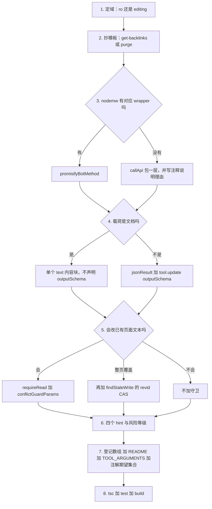

# 新增或修改一个工具

一个工具就是 `src/tools/` 下的一个 TypeScript 模块，加上 [`src/tools/index.ts`](../../src/tools/index.ts#L89-L147) 静态数组里的一行。没有自动发现、没有依赖注入、没有逐工具开关：目录里现有 54 个模块（37 读 + 17 写），所有模块形态相同靠的是三个工具级测试套件（`annotations`、`smoke`、`readGuard`）加评审，而不是类型或框架强制。

本页按"后一步受前一步约束"的顺序给出可直接照做的清单。契约每一条的由来（位置重载的历史、annotation 的分布、SDK 究竟校验什么）在[工具注册表与工具模块契约](../architecture/tool-registry.md)；测试夹具怎么搭在[测试与验证策略](../testing/validation.md)。本页只讲顺序、机制与坑。



*八个互相约束的决策，也是本页的章节顺序。*

## 1. 清单：一次改动要碰的所有地方

| # | 改什么 | 改哪里 | 漏了的症状 |
|---|---|---|---|
| 1 | BSD-2-Clause 许可证头，27 行，第一段内容 | 新文件开头 | 评审打回；没有任何机械检查 |
| 2 | `export function <tool>Tool( server: McpServer ): RegisteredTool` | 模块顶层，唯一导出 | 注册表 import 不到 |
| 3 | 定域：`src/tools/ro/` 还是 `src/tools/editing/` | 目录 | 写工具被暴露给游客会话 |
| 4 | import + **恰好一个**数组条目 | [`src/tools/index.ts`](../../src/tools/index.ts#L31-L147) | `tools/list` 里不存在，且不报错 |
| 5 | 四个 hint 全部显式 boolean | `server.tool` 第四参 | [`annotations.test.ts`](../../src/tools/__tests__/annotations.test.ts#L118-L133) 直接失败 |
| 6 | `tool.update({ outputSchema })` 或刻意不声明 | 注册之后 | schema 与载荷不符只在调用时炸 |
| 7 | XOR 双标识符校验 | handler 开头 | 模型同时给两个标识符时行为未定义 |
| 8 | `jsonResult(data)` / `errorResult(message, error)` | handler 每条返回路径 | 异常漏给传输层；声明了 schema 却返回文本必失败 |
| 9 | 写工具：`requireRead` + `conflictGuardParams` + `[nodemw-mcp.<tool>]` 前缀 | handler | 守卫静默失效 |
| 10 | `TOOL_ARGUMENTS` 一行最小参数 | [`smoke.test.ts`](../../src/tools/__tests__/smoke.test.ts#L53-L115) | `npm test` 红：目录键数不匹配 |
| 11 | 注解期望集合与两个计数 | [`annotations.test.ts`](../../src/tools/__tests__/annotations.test.ts#L57-L61)、[L106-L116](../../src/tools/__tests__/annotations.test.ts#L106-L116) | `npm test` 红 |
| 12 | README 中英两份工具清单与数量 | [`README.md`](../../README.md#L103-L109)、[`README.zh-hans.md`](../../README.zh-hans.md#L101-L109) | 文档与真实目录分叉 |
| 13 | `npx tsc --noEmit`、`npm test`、`npm run lint`、`npm run build` | — | 类型错误、契约违约、产物坏掉 |

`AGENTS.md` 把这件事压缩成六步（[`AGENTS.md`](../../AGENTS.md#L36-L45)），并且点名了第 5、10 两处：**四个 hint 必须显式**、**每个工具在 `TOOL_ARGUMENTS` 里要有参数**。第 11 步没有写在那里，但它同样是硬性的——三处测试耦合（第 10、11 步加假 bot 的方法表）是本页最容易被漏掉的部分，详见第 10 节。

## 2. 先定域：`ro/` 还是 `editing/`

| | 读工具 | 写工具 |
|---|---|---|
| 目录 | `src/tools/ro/` | `src/tools/editing/` |
| 数组 | `readToolRegistrars` | `writeToolRegistrars` |
| 数量 | 37 | 17 |
| Annotations | 四个 hint 同构：`readOnlyHint: true`、`destructiveHint: false`、`idempotentHint: true`、`openWorldHint: true` | `readOnlyHint: false`、`openWorldHint: true`；`destructiveHint` 仅 `purge`、`undelete` 为 `false`；`idempotentHint` 仅 `purge`、`protect`、`unblock`、`write` 为 `true` |
| description | 纯散文 | 动作说明 + `(requires authentication).`，随后一句以 `LOW/MEDIUM/HIGH RISK:` 开头 |
| 读前守卫 | 若返回整页内容，应 `markAsRead(...)` | 若改已有页面文本，必须 `await requireRead(...)` |

这个划分不是装饰：`registerAllTools(server, includeWriteTools)` 只在布尔为真时拼接两个数组（[`src/tools/index.ts`](../../src/tools/index.ts#L149-L163)），而启动流程传的是登录快照（[`src/index.ts`](../../src/index.ts#L348-L349)），所以未认证会话永远看不到写工具，横幅也相应报告 `37 read-only`（[`src/index.ts`](../../src/index.ts#L386-L403)）。把会改状态的工具放进 `readToolRegistrars`，就等于把它暴露给游客会话——目录和数组是这条边界唯一被声明的地方。

"写"指*改变 wiki*，不是*毁数据*：`purge` 放在 `editing/` 里，因为它在服务端制造状态变化，同时诚实地声明 `destructiveHint: false`（[`purge.ts`](../../src/tools/editing/purge.ts#L43-L49)）。先按副作用选数组，再在第 7 节单独评估风险等级。

## 3. 复制模板：读写各一个最小文件

有两个文件小到可以整篇读完再照抄。

**读模板：[`src/tools/ro/get-backlinks.ts`](../../src/tools/ro/get-backlinks.ts#L41-L59)** —— 许可证头、五个 import、一个局部接口、一个导出工厂、一个 handler，就是全部：

```ts
export function getBacklinksTool( server: McpServer ): RegisteredTool {
    const tool = server.tool(
        'get-backlinks',
        'Get all backlinks to a specific page',
        {
            title: z.string().describe('Target page title to find backlinks for')
        },
        {
            title: 'Get backlinks',
            readOnlyHint: true,
            destructiveHint: false,
            idempotentHint: true,
            openWorldHint: true
        } as ToolAnnotations,
        async ( { title } ) => handleGetBacklinksTool( title )
    );
    tool.update({ outputSchema: { target: z.string(), backlinks: z.array(z.record(z.unknown())), count: z.number() } });
    return tool;
}

async function handleGetBacklinksTool( title: string ): Promise<CallToolResult> {
    try {
        const bot = await getBot();
        const backlinks = await promisifyBotMethod<Backlink[]>( bot, 'getBacklinks', title );
        return jsonResult({ target: title, backlinks, count: backlinks.length });
    } catch ( error ) {
        return errorResult('Failed to get backlinks', error as Error);
    }
}
```

**写模板：[`src/tools/editing/purge.ts`](../../src/tools/editing/purge.ts#L35-L54)** —— 同一个骨架，加上写工具特有的三条：

```ts
const tool = server.tool(
    'purge',
    'Purge the server-side cache for one or more wiki pages (requires authentication). ' +
    'LOW RISK: Forces MediaWiki to regenerate the page — non-destructive, cache-only operation.',
    {
        titles: z.union([z.string(), z.array(z.string())]).describe( 'Page title(s) or category name to purge' ),
    },
    {
        title: 'Purge pages',
        readOnlyHint: false,
        destructiveHint: false,
        idempotentHint: true,
        openWorldHint: true
    } as ToolAnnotations,
    async ( params ) => handlePurgeTool( params )
);
tool.update({ outputSchema: { pages: z.array(z.record(z.unknown())) } });
return tool;
```

`purge` 之所以能做写模板，正因为它异常简单；它**不调** `requireRead`，所以不要把这个省略抄进任何会改页面文本的工具（见第 8 节）。

两个模板里不可协商的细节：

- **保留 BSD-2-Clause 许可证头。** 从任意现有 `.ts` 文件原样复制那 27 行，它是每个模块的第一段内容。评审会查，没有任何工具会机械地检查。
- **import 带 `.js` 后缀**（`../../common/nodemwBot.js`、`../../common/utils.js`）。项目是 `module: NodeNext` 的 ESM，由 esbuild 打包；省掉后缀过不了类型检查。
- **一个导出工厂，命名 `<tool>Tool`**，签名 `( server: McpServer ) => RegisteredTool`。注册表按名字 import 它。
- **把 handler 拆出去**，写成 `async function handle<Tool>Tool(...): Promise<CallToolResult>`。注册闭包保持一行，handler 读起来就是它执行的那个操作。
- **通过 `getBot()` 取模块状态**（`initBot` 未运行时它会抛错）。`promisifyBotMethod` 在 [`src/common/utils.ts`](../../src/common/utils.ts#L60-L77) 也有一份实现；现有工具一律从 `common/nodemwBot.js` 导入，新增工具照办即可。

## 4. 为模型写输入 schema，而不是为编译器写

第三个参数是 zod 的 raw shape（字段的普通对象），它是 agent 能读到的唯一参数文档。几条约定实际上是强制的：

- **每个字段都 `.describe()`。** 对比 [`edit.ts`](../../src/tools/editing/edit.ts#L48-L61) 里 `title` 的一行说明和 `old_lines` 解释 JSON 转义的那一段。
- **默认值写在 schema 上**，这样它们出现在 `tools/list` 里并在分派前生效：`edit` 的 `minor` 默认 `false`、`get-article` 的 `followRedirect` 默认 `true`、`block` 的 `expiry` 默认 `'indefinite'`（[`block.ts`](../../src/tools/editing/block.ts#L42-L55)）。
- **互斥标识符无法在 raw shape 里表达**，所以声明成 `.optional()`，并在 handler 开头两条判断里返回 `errorResult` 而不是抛异常（[`whois.ts`](../../src/tools/ro/whois.ts#L61-L67)）。现有 12 个工具这样做，覆盖 `title`/`id`、`username`/`id`、`usernames`/`ids` 三类配对，外加 `parse` 的 `text`/`page` 模式互斥。新增这样的配对时沿用同样的措辞——错误字符串就是模型学会规则的地方。
- **集合放在一个字段里用 union**，不要拆成两个参数：`purge` 的 `titles: z.union([z.string(), z.array(z.string())])`（[`purge.ts`](../../src/tools/editing/purge.ts#L40-L42)）。
- **别学 `get-articles` 的宽松写法。** 它 `titles` 必需、`ids` 可选，两者同时给出时静默以 `ids` 为准、不做互斥校验（[`get-articles.ts`](../../src/tools/ro/get-articles.ts#L87-L98)）——这是目录里唯一的反例，不是可以照抄的模式。

## 5. 选择访问 wiki 的路径：`promisifyBotMethod`、`callApi` 与版本门控

`promisifyBotMethod(bot, 'methodName', ...args)` 把 nodemw 的某个回调方法包成 Promise（[`nodemwBot.ts`](../../src/common/nodemwBot.ts#L176-L193)），是默认路线。需要绕过封装时，新代码走 [`src/common/utils.ts`](../../src/common/utils.ts#L42-L58) 的 `callApi(bot, params, 'GET' | 'POST')`：它把 `api.call` 的四参数回调收敛成**完整响应信封**（含 `query`、`continue`、`error`），并且是整个 `src/` 里除 `fetchWhoami` 之外唯一碰 `(bot as any).api.call` 的地方。**把理由写成注释**——`get-users` 是范本：

```ts
// Use low-level API: nodemw's getUsers always passes auwitheditsonly=0
// which MediaWiki incorrectly interprets as a filter, hiding users.
```

（[`get-users.ts`](../../src/tools/ro/get-users.ts#L66-L90)）

<!-- openwiki: broken internal link [../concepts/api-compatibility.md#promisifybotmethod-versus-apicall] heading anchor "promisifybotmethod-versus-apicall" does not exist in "../concepts/api-compatibility.md". Fix the href or restore the target, then delete this comment. -->
哪些情形该降级到直连、每个现有工具各自走哪条路，判定表与理由清单在[MediaWiki 版本兼容性与回退](../concepts/api-compatibility.md#promisifybotmethod-versus-apicall)，本页不重复。新工具真正需要记住的是直连的四个代价，因为它们决定你还要写多少代码：

- **没有 dry-run 保护。** nodemw 的写方法在 `--dry-run` 下拒绝执行，`callApi` 不会。
- **没有内部翻页。** 走封装的方法会一直取到耗尽；裸调用必须自己循环并自定上限。
- **没有版本感知的 token。** 带 token 的直连动作要自己按 `getMediaWikiVersion()` 算 token 类型（`csrf` 与旧式动作名的 1.24 边界）。
- **错误码丢失。** nodemw 把 MediaWiki 的 `error` 转成 `new Error('Error returned by API: ' + info)`，`code` 不保留，所以分流与重试只能匹配文案。因此 `if (raw.error) throw new Error(info)` 是防御性代码而不是主错误通道：`block` 就这么写，真实失败落进 `catch` 变成 `errorResult('Failed to block user', error)`（[`block.ts`](../../src/tools/editing/block.ts#L124-L142)）。

新增一处直连调用点还须遵守该页“新增直连调用点必须遵守的规则”一节：先确认参数确实有版本阈值、`null` 走能成功的那条分支、拒绝时把替代路径写进错误文案。`diff-preview` 是完整范例——它在**已知**低于 1.24 时拒绝并指向 `get-article`，在版本未知时照发 `topst` 并在被拒后去掉重发（[`diff-preview.ts`](../../src/tools/ro/diff-preview.ts#L95-L126)）。

## 6. 输出形状：`jsonResult`、`outputSchema` 与 `errorResult`

输出约定只有两种，由载荷形态强制：

| 载荷 | 约定 | 模块 |
|---|---|---|
| 客户端可以后处理的数据对象 | `jsonResult(data)` + `tool.update({ outputSchema })`，schema 逐键对应载荷 | 54 个里的 48 个 |
| 一份文档——wikitext、解析后的 XML | 一个 `{ type: 'text' }` 内容块，**不声明** `outputSchema` | `get-article`、`get-article-by-revision`、`parse`、`expand-templates` |

另有 `get-module-source` 与 `get-articles`：它们**已经**返回 `jsonResult`，只是没人给它们写 schema（[`get-module-source.ts`](../../src/tools/ro/get-module-source.ts#L132-L141)、[`get-articles.ts`](../../src/tools/ro/get-articles.ts#L146)）。这证明 `jsonResult` 与 `outputSchema` 是两件独立的事——反向则不成立：

**声明 schema 就是承诺所有成功路径都返回 `jsonResult`。** 在声明了 `outputSchema` 的工具上返回裸文本成功结果，会变成每次调用一句 `Output validation error: ... has an output schema but no structured content`，而不是启动时报错。

`outputSchema` 从不作为 `server.tool` 的参数出现，而是注册之后合并：

```ts
const tool = server.tool( ... );
tool.update({ outputSchema: { ... } });
return tool;
```

不声明 schema 的模块直接 `return server.tool( ... )` 就结束（[`get-article-by-revision.ts`](../../src/tools/ro/get-article-by-revision.ts#L34-L48)）。SDK 那个接受内联 `outputSchema` 的 `registerTool` 形态，本仓库没有任何模块使用。

无论 schema 怎么来的，**都要拿 handler 实际的 `jsonResult` 载荷核对它**。已声明的字段会被强制、未声明的键会被剥掉：写错一个必需字段，或该用 `z.union([z.string(), z.number()])` 却写了 `z.string()`，都会让这个工具的每次调用变成运行期输出校验错误。回显 `title`-或-`id` 标识符的工具用的正是三支 union（[`get-article-info.ts`](../../src/tools/ro/get-article-info.ts#L62)）。

错误路径被豁免：`errorResult` 只填 `content` 与 `isError: true`，不填 `structuredContent`（[`utils.ts`](../../src/common/utils.ts#L136-L148)），所以可以携带任意文案而不受 schema 约束。它还会先看错误文本是否命中登录过期与编辑冲突的模式表，命中就换上一句带恢复建议的 `details`（[`utils.ts`](../../src/common/utils.ts#L95-L134)）——错误路径因此也承担一部分自愈引导。唯一的例外是 `get-article`：它没有 schema，于是干脆内联构造 `{ content, isError: true }` 而不是调 `errorResult`（[`get-article.ts`](../../src/tools/ro/get-article.ts#L121-L133)）。

### 三个一次性脚本，以及它们不是什么

`scripts/` 下有三个 codemod 式脚本：`add-output-schema.mjs`（补 `outputSchema`）、`add-annotations.mjs`（把两个 hint 补成四个）、`convert-tools.mjs`（重写成 `registerTool` 形态）。它们都**只能手工跑**，且都不在构建或验证流程里：`package.json` 的 scripts 没有引用它们（[`package.json`](../../package.json#L18-L26)），`tsconfig.json` 的 `include` 只有 `src/**`（[`tsconfig.json`](../../tsconfig.json#L19-L20)），所以既不被构建也不被类型检查。它们还**原地覆写源文件**，运行前请确保工作树干净，运行后逐文件看 `git diff`。

由此直接得出的规则：

1. **新工具必须自己写那几行，脚本帮不上忙。** `add-output-schema.mjs` 找字面量 `tool.update` 跳过已转换文件（[`add-output-schema.mjs`](../../scripts/add-output-schema.mjs#L61-L65)），结构化工具不在它那张 40 项映射里时只打印 `FAIL (no schema): <file> / <tool-name>` 并放着文件不动。
2. **映射描述的是第一遍批量注入，不是当前真相。** 之后几乎每份 schema 都被手工收紧过：映射里仍写着 `purge: z.object({}).passthrough()`，文件声明的是 `{ pages: z.array(z.record(z.unknown())) }`（[映射](../../scripts/add-output-schema.mjs#L43)、[文件](../../src/tools/editing/purge.ts#L52)）；`whoami` 同理（[映射](../../scripts/add-output-schema.mjs#L33)、[文件](../../src/tools/ro/whoami.ts#L57)）。
3. **文档型工具靠文件名排除，而 skip 集合是旧的。** 两个脚本都写死 `get-article.ts`、`expand-templates.ts`、`parse.ts`（[`add-output-schema.mjs`](../../scripts/add-output-schema.mjs#L49)、[`convert-tools.mjs`](../../scripts/convert-tools.mjs#L52-L53)）。`get-article-by-revision`、`get-module-source`、`get-articles` 都不在任何 skip 集合里，躲过一劫只是因为映射里没有它们。新增文档型工具时要么把文件名加进 skip 集合，要么别给映射条目；绝不要两者都加，否则脚本会把它改成一个永远失败的工具。
4. **`convert-tools.mjs` 产出的形态在 `src/` 里没人用。** 今天运行它会把注册调用改写成带 `description:` 字段的 `registerTool`（[`convert-tools.mjs`](../../scripts/convert-tools.mjs#L123-L128)），与既定风格相反——[工具注册表](../architecture/tool-registry.md)把它记为历史形态。
5. **它们现在还会走进 `src/tools/__tests__/`。** 两个脚本都递归遍历 `src/tools`，只跳过 `index.ts`（[`add-output-schema.mjs`](../../scripts/add-output-schema.mjs#L51-L59)、[`convert-tools.mjs`](../../scripts/convert-tools.mjs#L144-L156)），所以每个测试文件都会被扫到并打印 `FAIL (no name)`。把三个脚本都当作用完即弃：只有确实想再做一次同样的批量改写时才扩展它们。

## 7. 如实写 description 和 annotations

写工具的 description 以风险等级作判断句，等级词汇与面向 agent 的操作原则共用一套（[`CLAUDE.md`](../../CLAUDE.md#L95-L101)）：

| 等级 | 工具 | 含义 |
|---|---|---|
| `HIGH RISK` | `block`、`unblock`、`delete`、`undelete`、`protect`、`send-email`、`create-account` | 影响真实的人或移除内容；需要操作者明确下令 |
| `MEDIUM RISK` | `write`、`revert`、`move`、`upload`、`upload-by-url`、`add-flow-topic` | 可能破坏结构或静默覆盖；可恢复 |
| `LOW RISK` | `edit`、`append`、`prepend`、`purge` | 追加式或单点匹配；撤消代价小 |

annotations 是同一判断的第二条通道，但比散文更硬：**四个 hint 必须显式给 boolean**，因为严格宿主会拒绝缺字段的工具，而 [`annotations.test.ts`](../../src/tools/__tests__/annotations.test.ts#L118-L133) 直接把整张矩阵写成断言：

| 域 | `readOnlyHint` | `destructiveHint` | `idempotentHint` | `openWorldHint` |
|---|---|---|---|---|
| 只读工具（37） | 全 `true` | 全 `false` | 全 `true` | 全 `true` |
| 写工具（17） | 全 `false` | 除 `purge`、`undelete` 外全 `true` | 仅 `purge`、`protect`、`unblock`、`write` 为 `true` | 全 `true` |

判据：`destructiveHint` 按"是否销毁数据"给（`protect` 可逆但仍算破坏性，因为它限制他人编辑）；`idempotentHint` 按"重复同一调用是否收敛到同一 wiki 状态"给。两条都与散文分级独立，而且确实不一致：`append` 的说明写着 `LOW RISK: Additive only`，却把 `destructiveHint` 设为 `true`（[`append.ts`](../../src/tools/editing/append.ts#L36-L54)）。散文是模型读到的，hint 是客户端可以据以拦截审批的，两条都要填，别让新工具继承一个和自己那句话矛盾的值。

如果你的工具套不进这三档，那是"该重新考虑这个工具"的信号，不是该发明第四个词的理由——词汇表被系统提示词消费。分级与 annotations 背后的安全推理见[安全模型](../concepts/safety-model.md)。

写工具还有一条审计约定：**摘要/理由/评论统一加 `[nodemw-mcp.<tool>]` 前缀**，让 wiki 历史能归因到具体工具。现有 13/17 个写模块这样做（[`edit.ts`](../../src/tools/editing/edit.ts#L151)、[`upload.ts`](../../src/tools/editing/upload.ts#L77)），`add-flow-topic`、`create-account`、`purge`、`send-email` 是没做的四个。标签语义见[安全模型](../concepts/safety-model.md)的审计标签一节。

## 8. 写工具：读前守卫与冲突参数

守卫的主体是一张 `Map<pageid, { revid, revTimestamp, readAt }>`，外加一张 `Map<title, { pageid, revid }>` 的写缓存（[`pageState.ts`](../../src/common/pageState.ts#L38-L49)）：

- 内容读取工具在成功取到**整页**当前内容后调 `markAsRead(pageid, lastrevid, revTimestamp)`；`get-article` 与 `get-article-with-lineno` 只在视图覆盖整页时记录（见第 9 节）。
- 写工具在 handler 里动手之前 `await requireRead(title)`。它每次都用 API 重新把标题解析成 pageid，页面存在但从未被读过时抛出并点名两个合法读取工具，页面不存在时返回 `0` 所以创建流程照常可用（[`pageState.ts`](../../src/common/pageState.ts#L210-L267)）。解析还兼做两件防护：标题被移动或删除重建后指向了**另一个** pageid 时拒绝（写缓存不能跨页面授权）；本会话写过、随后被别人删除的标题要重读后才能重建。

`requireRead` 的调用者恰好是八个定位页面文本的写工具——`edit`、`write`、`revert`、`append`、`prepend`、`delete`、`move`、`protect`；跳过它的九个工具目标不是可读页面文本：`purge`、`block`、`unblock`、`undelete`、`send-email`、`create-account`、`upload`、`upload-by-url`、`add-flow-topic`。判据是"对未读内容动手会不会毁掉别人的编辑"，不是"工具名里有没有 get"。

拿到 pageid 之后，写路径还要接上冲突保护，分两层：

1. **所有 `doEdit` 类写入**把 `conflictGuardParams(pageid)` 合并进参数，于是保存带上 `basetimestamp`（读到的修订时间戳）与 `starttimestamp`（读取时刻）。用 `doEdit` 而不是 `bot.edit()` 的原因正是后者传不了这些参数（[`edit.ts`](../../src/tools/editing/edit.ts#L156-L174)、[`write.ts`](../../src/tools/editing/write.ts#L143-L163)）。
2. **整页覆盖**（`write`、`revert`）另加 `findStaleWrite(title, pageid)` 的 revid CAS 预检：MediaWiki 的 `basetimestamp` 只拦文本重叠的冲突，一次全量替换总能干净地三方合并，所以这两个工具自己比对 revid，不一致就返回"重新读取再改"（[`pageState.ts`](../../src/common/pageState.ts#L140-L171)、[`revert.ts`](../../src/tools/editing/revert.ts#L82-L89)）。

成功之后 `markAsWritten(title, pageid, newrevid, newtimestamp)` 把页面同时标成"已写"和"已读"，后续写因此跳过守卫并继续带着新的 `basetimestamp`（[`edit.ts`](../../src/tools/editing/edit.ts#L176-L179)）。两个例外值得记住：`revert` **刻意不调** `markAsWritten`，否则它会用自己的输出洗白读证据（[`readGuard.test.ts`](../../src/tools/__tests__/readGuard.test.ts#L183-L196)）；`delete` 与 `move` 在成功后调 `invalidateTitle`，让旧标题的绑定失效（[`delete.ts`](../../src/tools/editing/delete.ts#L83)、[`move.ts`](../../src/tools/editing/move.ts#L86)）。

最后一条容易漏的：**体量下限不能只留在 `write` 里。** `write` 按 `intent` 分流（`add` 不许缩小、`revise` 保 3/4、`rewrite`/`delete` 拦 1/10 以下的擦除，[`write.ts`](../../src/tools/editing/write.ts#L85-L131)），`edit` 与 `revert` 各自复刻同一块 1/10 地板。新加的整页改写类工具如果跳过它，就成了绕过守卫的低摩擦路径。

## 9. 读工具：只在整页读取时记录读证据

这条规则由 [`readGuard.test.ts`](../../src/tools/__tests__/readGuard.test.ts#L104-L146) 逐条守住：**局部读取不能解锁写入。**

- `get-article` 用 `isFullView(content, maxlen, offset)` 判定：`offset > 0` 或 `maxlen` 真截断了文本就**不**记录（[`get-article.ts`](../../src/tools/ro/get-article.ts#L44-L54)、[L193-L195](../../src/tools/ro/get-article.ts#L193-L195)）。
- `get-article-with-lineno` 同理：`offset`、`limit` 或截断任一存在就跳过（[`get-article-with-lineno.ts`](../../src/tools/ro/get-article-with-lineno.ts#L189-L196)）。
- `get-articles` 与 `get-module-source` 逐页 `markAsRead(page.pageid, rev.revid, rev.timestamp)`（[`get-articles.ts`](../../src/tools/ro/get-articles.ts#L138-L141)、[`get-module-source.ts`](../../src/tools/ro/get-module-source.ts#L127-L130)）。
- 只返回**旧**修订作参考的工具（`get-article-by-revision`，以及带 `revision` 参数的 `get-article`）**不能**标记为已读——那会用过期文本满足守卫（[`get-article.ts`](../../src/tools/ro/get-article.ts#L173-L181)）。

`markAsRead` 的第三个参数不是可选的装饰：没有 `revTimestamp` 就没有 `basetimestamp`，后续保存只剩 `starttimestamp`，冲突保护退化成"至少没人在我读之前删过页面"。`smoke.test.ts` 因此专门为 `get-module-source` 与 `get-articles` 断言读记录里带时间戳（[`smoke.test.ts`](../../src/tools/__tests__/smoke.test.ts#L163-L190)）。

## 10. 登记，以及登记覆盖不到的地方

在 [`src/tools/index.ts`](../../src/tools/index.ts#L31-L87) 里 import 工厂，然后放进**一个**数组。启动横幅自己按 `readToolRegistrars.length + writeToolRegistrars.length` 算数字（[`src/index.ts`](../../src/index.ts#L386-L403)），代码里没有要手动加一的地方。容易漏掉的登记点有五个，只有一个是代码：

1. **`readToolRegistrars` / `writeToolRegistrars`——恰好一个数组。** 漏掉这一行，工具在 `tools/list` 里根本不存在，而且没有任何报错：esbuild 照样把它打进产物，只是没人引用那个工厂。放错数组则更糟——会改状态的工具被暴露给游客会话。
2. **`README.md` 的工具清单与数量。** 英文 `Read Operations (37 tools)` / `Write Operations (17 tools, require authentication)`（[`README.md`](../../README.md#L103-L109)）。加名字并同时改计数，否则文档与真实目录立刻分叉。
3. **`README.zh-hans.md` 的同一份清单。** 中文是独立文件，不是同一页的另一节：`读取操作（37 个工具）` / `写入操作（17 个工具，需要认证）`（[`README.zh-hans.md`](../../README.zh-hans.md#L101-L109)）。改一处忘一处是最常见的漂移。
4. **`src/index.ts` 里面向 agent 的描述按类别给写工具分级**——`ADMIN TOOLS ARE DANGEROUS`、`DESTRUCTIVE WRITE TOOLS`、`USER-IMPACTING TOOLS`、`CONTENT TOOLS`（[`src/index.ts`](../../src/index.ts#L304-L327)），并且同一段文本被原样再次分发为 `operating-principles` prompt（[`src/index.ts`](../../src/index.ts#L353-L364)）。新的写工具如果套不进任何一类，模型的规则里就不会提到它；`revert` 就是这个缺口的现成例子（它是 `MEDIUM RISK`，却不在任何类别里）。
5. **三处测试耦合，全部硬编码**（下一小节）。

### 测试侧的三处耦合

`npm test` 就是 `vitest run`（[`package.json`](../../package.json#L22)），`src/tools/__tests__/` 下的三个套件把契约固定在 CI 里。新增或删除一个工具，会同时撞上：

- **`annotations.test.ts` 写死注册表规模与两个例外集合。** 它断言 `readToolRegistrars.length === 37`、`writeToolRegistrars.length === 17`、`tools/list` 的条数等于两者之和、名字唯一、只读集合是全集子集（[`annotations.test.ts`](../../src/tools/__tests__/annotations.test.ts#L106-L116)）；再逐工具比对四个 hint 与 `IDEMPOTENT_WRITES = {purge, protect, unblock, write}`、`NON_DESTRUCTIVE_WRITES = {purge, undelete}` 推出的期望矩阵，并要求每件工具的 description 长度大于 10（[L57-L73](../../src/tools/__tests__/annotations.test.ts#L57-L73)、[L118-L140](../../src/tools/__tests__/annotations.test.ts#L118-L140)）。加工具要改计数；语义上该幂等或该非破坏的新工具要加进对应集合，否则断言会说出你不同意的期望。
- **`smoke.test.ts` 要求每个工具在 `TOOL_ARGUMENTS` 里有一份最小参数。** 它先比较 `tools/list` 的条数与表的键数，再逐个 `client.callTool`，断言至少一个 text part 且 `isError` 为假（[`smoke.test.ts`](../../src/tools/__tests__/smoke.test.ts#L53-L115)、[L140-L161](../../src/tools/__tests__/smoke.test.ts#L140-L161)）。**这是 `outputSchema` 违约的唯一自动化探测点**：SDK 对每个成功结果做一次 zod 校验，失败会变成一条 `isError` 结果。`vi.mock('../../common/nodemwBot.js', …)` 把运行时整个换成假 bot（[L37-L40](../../src/tools/__tests__/smoke.test.ts#L37-L40)），`upload-by-url` 需要的 DNS 与 `fetch` 也被桩掉（[L42-L51](../../src/tools/__tests__/smoke.test.ts#L42-L51)）。
- **假 bot 的方法表可能不认识你的调用。** `fakeNodemwBot` 用一个 Proxy 兜底：已知方法（`getArticle`、`getArticleInfo`、`doEdit`、`uploadByUrl`……）返回贴近 nodemw 真实形状的对象，未知方法统一回落到 `hybridResult()`——"既是单元素数组、又带对象字段"的结果（[`fakeNodemwBot.ts`](../../src/tools/__tests__/fakeNodemwBot.ts#L305-L384)）。裸 API 调用则由 `fakeApiCall` 按 `params.action` 回答（[L165-L303](../../src/tools/__tests__/fakeNodemwBot.ts#L165-L303)）。如果新工具调用了一个没建模的方法或 action，测试**仍然会通过**，只是断言的是你对响应形状的猜测：这时应补 `METHOD_RETURNS` 或 `fakeApiCall` 的一个分支。

改守卫行为时还有第四个套件：`readGuard.test.ts` 用 `setFakePageContent`、`setFakeLastrevid`、`setFakeHistoricalContent` 这套可变夹具种状态，断言 `isError` 与文案片段，并且每条"拒绝"都配一条"放行"对照（[`readGuard.test.ts`](../../src/tools/__tests__/readGuard.test.ts#L104-L214)）。写新守卫的套路见[测试与验证策略](../testing/validation.md)。

## 11. 验证：每条命令证明什么，漏掉什么

| 命令 | 变绿说明 | 盲区 |
|---|---|---|
| `npm test` | 三个工具级套件离线通过：注解矩阵与计数、每个工具一次真实 MCP 调用、守卫的拒绝/放行对照 | 真实 MediaWiki 的响应形状、启动与 CLI、认证 |
| `npx tsc --noEmit` | `strict` 下 TypeScript 接受 `src/**/*`，**包含测试文件**（[`tsconfig.json`](../../tsconfig.json#L19-L20)） | `scripts/`、`test-server.js`，以及只在运行时才炸的东西 |
| `npm run build` | esbuild 解析了从 `src/index.ts` 可达的每个模块并重写 `dist/index.js`（[`scripts/build.js`](../../scripts/build.js#L11-L73)） | 类型（直接剥掉）、行为、测试文件 |
| `npm run lint` | ESLint 9 能加载配置并跑完（[`eslint.config.js`](../../eslint.config.js#L12-L29)） | `eslint src/**/*.ts` 这条命令没有加引号（[`package.json`](../../package.json#L21)），glob 由 shell 展开成 `src/*/*.ts`，所以 `src/index.ts`、`src/server.ts`、`src/tools/ro/*`、`src/tools/editing/*` 与全部测试文件都不在 lint 范围内——新增的工具模块几乎肯定没被 lint 过 |
| `node test-server.js` | `dist/index.js` 存在，一个子进程被拉起、两秒后被杀掉（[`test-server.js`](../../test-server.js#L11-L56)） | 退出状态、MCP 握手、所有工具；可信信号是它 dump 出的 stderr 横幅，不是对勾 |

所以真正能证明"这次改动没错"的是前三行加一次真实调用：**对着真实 wiki 调一次新工具**，这是唯一能验证 `outputSchema`、分页、截断与 token 路径实际行为的手段。分场景的验证清单在[验证](../testing/validation.md)；产物与发布节奏见[构建与发布](../operations/build-and-release.md)。

## 12. 加完之后要一起复核的页面

这个仓库里描述工具目录的散文不止一处，它们都写死了数字或分组，加完工具必须逐个核对：

- **[工具注册表与工具模块契约](../architecture/tool-registry.md)** —— 两个数组的条目数（37/17，合计 54）、四个 hint 的矩阵、没有 `outputSchema` 的六个工具、XOR 配对清单、`LOW/MEDIUM/HIGH` 各档的工具名单，全都写在正文里。
- **[阅读内容工作流](reading-content.md)** 与 **[编辑与写操作工作流](editing-content.md)** —— 新工具属于哪一侧、参数表与返回约定；守卫类改动还要看[读前写守卫](../concepts/read-before-write-guard.md)。
- **[快速上手](../quickstart.md)** —— 两个域的工具数与任务路由表（"新增、改名或改签名一个工具"那一行指向本页）。
- **[安全模型](../concepts/safety-model.md)** —— 风险分级、annotations、审计标签与"新增防护应该放在哪一层"。
- **[测试与验证策略](../testing/validation.md)** —— 每个套件守住的不变量，以及"新增或改动一个工具时要一起改的测试"那一节。
- `README.md`、`README.zh-hans.md`、`AGENTS.md` —— 手写文档，同样会漂移；与源码冲突时以源码为准。

## 失败模式与对应症状

| 错误 | 你会看到什么 |
|---|---|
| 工厂写好了但没进数组 | `tools/list` 里没有该工具，任何地方都不报错 |
| 同一个工具名注册两次 | stderr 出现 `Error registering tool: ...`，其中一个在注册时消失 |
| 四个 hint 缺一个或取值不符 | `npm test` 红，报 `<tool>.<hint> must be an explicit boolean` 或 hint 与期望不等 |
| 加了工具但没改 37/17 计数 | `npm test` 红，计数与 `tools/list` 条数不一致 |
| 加了工具但没进 `TOOL_ARGUMENTS` | `npm test` 红，`names.length` 与表的键数不等 |
| 新工具调了假 bot 没建模的方法 | 测试照样绿，但断言的是 `hybridResult()` 的猜测形状 |
| `jsonResult` 与 schema 不一致 | 每次调用都 `Output validation error`，只在运行期出现（`smoke.test.ts` 会红） |
| 声明了 `outputSchema` 却返回文本结果 | 输出校验错误：有 schema、没有结构化内容 |
| 新结构化工具没进 codemod 映射 | 脚本运行时打印 `FAIL (no schema): ...`，文件不动 |
| 文档型工具被写进 codemod 映射 | 工具被改写成永远满足不了的 `outputSchema` |
| 写工具漏了 `requireRead` | 守卫静默失效，无报错，只是少了保护 |
| 写工具漏了 `conflictGuardParams` / `findStaleWrite` | 并发编辑被静默覆盖，MediaWiki 不会报冲突 |
| 读工具在截断或旧修订视图上 `markAsRead` | 守卫被过期或局部内容满足，`readGuard.test.ts` 红 |
| 写工具进了 `readToolRegistrars` | 会改状态的工具出现在游客会话里 |
| 缺 BSD-2-Clause 头 | 评审被打回；没有机械检查 |
| 只改了 README 一处或只改了 `src/index.ts` 的提示文案 | 文档漂移，模型手里的规则与真实目录不一致 |
| 只跑了 `npm run lint` | 新增的工具模块根本没被检查到，绿得毫无意义 |

## 相关页面

- [工具注册表与工具模块契约](../architecture/tool-registry.md) —— 两个数组、gating 语义，以及契约的每一条。
- [MediaWiki 版本兼容性与回退](../concepts/api-compatibility.md) —— `promisifyBotMethod` 与 `callApi` 的选择规则、token 边界与错误文案匹配。
- [读前写守卫](../concepts/read-before-write-guard.md) —— 为什么写前必须读、`basetimestamp` 与 CAS 的分工。
- [测试与验证策略](../testing/validation.md) —— 三个工具级套件的夹具、断言与扩展方式。
- [安全模型](../concepts/safety-model.md) —— 风险分级、annotations、`[nodemw-mcp.<tool>]` 标签与系统提示原则。
- [构建与发布](../operations/build-and-release.md) —— 产物如何生成、发布了什么。
