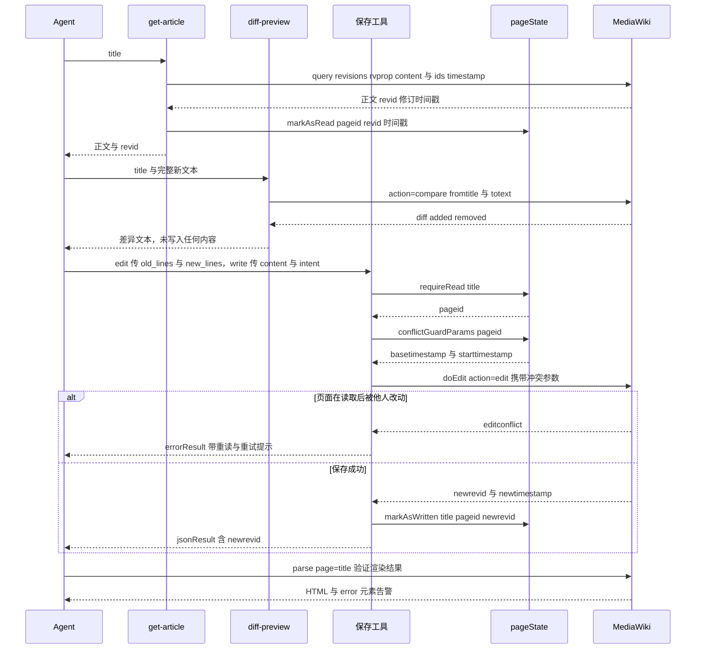
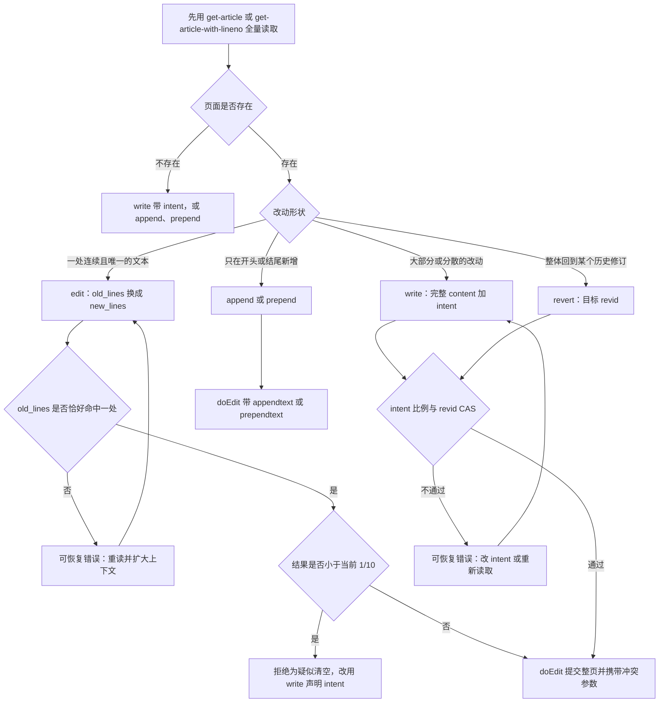

# 编辑、验证与治理内容的工作流

`src/tools/editing/` 下的 17 个写工具全部由 [`writeToolRegistrars`](../../src/tools/index.ts#L129-L147) 注册，但只有 5 个会改写页面正文：`edit`、`write`、`revert`、`append`、`prepend`。这 5 个共享同一条"读证据 → 预览 → 保存 → 验证"回路，回路里每一次保存都经过 nodemw 的 `doEdit`，并携带由本会话读到的修订时间算出的冲突参数。其余 12 个工具各自映射到一条带自己日志的 MediaWiki action，它们的安全性质不在这条回路上。

本页按这条回路的顺序展开，并在最后给出管理类动作的运行规则。守卫的数据结构、`requireRead` 的判定顺序与逐工具覆盖表在 [read-before-write 检查](../concepts/read-before-write-guard.md)；能力门控、风险分级与注入的 instructions 在[安全模型](../concepts/safety-model.md)；token 类型、直连 `api.call` 与 dry-run 的逐方法覆盖在 [API 兼容性](../concepts/api-compatibility.md)。

## 安全编辑回路



*图：一次安全的内容修改。唯一"可跳过"的环节是 `diff-preview`；其余四步（读取留下证据、保存携带时间戳、`markAsWritten` 续期、保存后验证）都在代码或协议里各有一条路径支撑。*

六个环节各自回答一个问题，展开在下面各节：

| 环节 | 回答的问题 | 失败时的形态 |
|---|---|---|
| 读取 | 本进程是否见过这一页的当前内容 | `requireRead` 抛错，工具返回 `isError` |
| `diff-preview` | 整页变化到底长什么样 | 只读工具，不会失败在写上 |
| 选原语 | 该用精确匹配还是整页覆写 | 匹配失败、体量不符，都是可恢复错误 |
| 保存 | 保存时页面是否仍是读过的那一版 | MediaWiki `editconflict`，或 `write`/`revert` 的 revid CAS 拒绝 |
| 续期 | 后续调用还需不需要重新读 | `markAsWritten` 记录新修订 |
| 验证 | 保存后的页面渲染是否正确 | `parse` 的 error 元素告警 |

## 请求形态：5 个正文工具，一条 `doEdit`

这 17 个工具的请求形状只有三组，划分比工具数量更重要：

| 组 | 工具 | 请求实际是什么 |
|---|---|---|
| 正文写入 | `edit`、`write`、`revert` | 客户端取回当前内容或目标修订、在本地拼出完整新 wikitext，再以 `action=edit&text=…` 整体提交 |
| 正文插入 | `append`、`prepend` | 以 `action=edit&appendtext=…` / `prependtext=…` 提交，由 MediaWiki 在服务端拼接，本进程从不持有整页正文 |
| 管理与身份动作 | `move`、`delete`、`undelete`、`protect`、`block`、`unblock`、`purge`、`upload`、`upload-by-url`、`send-email`、`create-account`、`add-flow-topic` | 各自对应一条带日志的 MediaWiki action |

前两组都走 nodemw 的 `doEdit(type, title, summary, params, callback)`，这正是它们能携带冲突参数的原因：[`doEdit`](../../node_modules/nodemw/lib/bot.js#L644-L683) 把固定字段 `{ action: 'edit', bot: '', title, summary }` 与调用方给的 `params`、`{ token }` 依次合并成一个 `action=edit` 请求。nodemw 自己的 `edit()`/`append()`/`prepend()` 封装无法传 `starttimestamp`，所以 5 个正文工具都绕过它们直接调用 `doEdit`（[`edit.ts`](../../src/tools/editing/edit.ts#L153-L174)、[`write.ts`](../../src/tools/editing/write.ts#L141-L163)、[`revert.ts`](../../src/tools/editing/revert.ts#L152-L177)、[`append.ts`](../../src/tools/editing/append.ts#L75-L95)、[`prepend.ts`](../../src/tools/editing/prepend.ts#L73-L93)）。`doEdit` 的第一个 `type` 参数只影响日志文本，不改变请求。

由此得到三条对使用者直接相关的性质：

- **每个正文写入都被标成 bot 编辑。** `doEdit` 无条件附加 `bot: ''`，与由哪个工具发起无关。
- **每个正文写入都显式声明 minor 或 non-minor。** `edit`/`write` 按 `minor` 参数给出 `minor: ''` 或 `notminor: ''`；`revert`、`append`、`prepend` 没有 `minor` 参数，固定发 `notminor: ''`。
- **dry-run 在取 token 之前就拒绝。** `doEdit` 的第一行是 `if (this.dryRun) callback(new Error('In dry-run mode'))`，因此这 5 个工具在演练模式下一次请求都不会发出（覆盖范围见后文"编辑冲突、登录过期与失败形状"一节）。

## 第 1 步：读到位，才有写权限

`requireRead(title)` 是这条回路的第一道门，也是唯一由代码强制的写前规则：它先用 `getArticleInfo(title, { prop: 'info' })` 把标题解析成 `pageid`，再检查本进程是否读过这个 `pageid`，未读则抛出错误（[`pageState.ts`](../../src/common/pageState.ts#L210-L267)）。17 个写工具中有 8 个调用它：`edit`、`write`、`revert`、`append`、`prepend`、`delete`、`protect`，以及只校验源标题的 `move`。

读取环节有三条与编辑直接相关的规则：

- **只有"看全整页"的读取才算读过。** `get-article-with-lineno` 只在 `offset === 0`、未给 `limit`、且响应未被 `maxlen` 截断时调用 `markAsRead`（[`get-article-with-lineno.ts`](../../src/tools/ro/get-article-with-lineno.ts#L189-L196)）；`get-article` 用同样的 `isFullView` 判定（[`get-article.ts`](../../src/tools/ro/get-article.ts#L44-L54)）。读十行不解锁整页写入，这是刻意的，逐条清单见 [read-before-write 检查](../concepts/read-before-write-guard.md)。
- **`old_lines` 必须逐字来自 `get-article-with-lineno`。** 它返回 `{ title, totalLines, shownLines, offset, lines: [{ lineno, content }] }`，描述写明结果 "can be copy-pasted directly into `old_lines` without any escaping"（[`get-article-with-lineno.ts`](../../src/tools/ro/get-article-with-lineno.ts#L41-L73)）。`edit` 的参数描述再把 JSON 规则重复一遍：`"` → `\"`、`\` → `\\`、换行 → `\n`，且 "Do NOT 'HTML-escape' anything"（[`edit.ts`](../../src/tools/editing/edit.ts#L50-L57)）。因为比较是 `indexOf` 子串比较，一次 HTML 转义必然表现为"没找到"，而不是"转义错了"。
- **读证据只属于当前进程。** 一次受守卫的写至少四次往返（解析标题、取内容、取 token、保存）。重连（含 `/mcp` 重连）会起新进程，读状态清零，必须重新 `get-article`——工具描述与 `SESSION NOTE` 都明说了这一点（[`src/index.ts`](../../src/index.ts#L290-L294)）。

**重定向要按"哪个页面会被写"来读。** `edit` 与 `write` 现在都用 `getArticle(title, false)` 取内容，即**不**跟随 `#REDIRECT`（[`edit.ts`](../../src/tools/editing/edit.ts#L95-L105)、[`write.ts`](../../src/tools/editing/write.ts#L86)），与 `action=edit` 的实际写入目标一致。而 `get-article` 默认跟随重定向，并把读证据记在目标页的 `pageid` 上——于是"用默认参数读了重定向标题"之后再去 `edit` 那个标题，会被守卫拒绝（证据在目标页，写入目标是重定向页）。要改重定向页本身，就用 `followRedirect: false` 重新读一次。

## 第 2 步：用 `diff-preview` 预览整页后果

`diff-preview` 是这条回路上唯一的只读环节，也是 37 个读工具里唯一专门为"保存前"设计的：它把你提议的完整新文本交给服务端的 diff 引擎，与页面当前修订比较（[`diff-preview.ts`](../../src/tools/ro/diff-preview.ts#L48-L85)）：

| 方面 | 行为 |
|---|---|
| 请求 | `action=compare`，`fromtitle` 为标题，`totext` 为提议文本；**不写任何东西** |
| 预保存变换 | MediaWiki ≥ 1.27 或版本未知时附加 `topst=1`，使 `{{subst:}}` 之类展开结果与真实保存一致；被服务端以 `unrecognized parameter … topst` 拒绝时去掉该参数重发（[L105-L126](../../src/tools/ro/diff-preview.ts#L105-L126)） |
| 版本门槛 | 已知低于 1.24 时直接拒绝，并提示改用 `get-article` / `get-article-by-revision` 自行比较（[L95-L103](../../src/tools/ro/diff-preview.ts#L95-L103)） |
| 页面不存在 | 返回 `Page "X" does not exist yet — creating it is a new-page write…`，指向 `write`（[L128-L136](../../src/tools/ro/diff-preview.ts#L128-L136)） |
| 输出 | `{ title, current_revid, diff, added, removed, truncated, identical }`；`identical` 为真表示这份文本保存后不产生任何差异 |
| 截断 | `maxlen` 限制差异文本长度，超出以 marker 标出并置 `truncated` |

三条使用规则值得记住：

- **它要的是整页结果，不是补丁。** `edit` 与 `append`/`prepend` 没有"提议的整页文本"这个参数，所以要用它预览，必须先在本地把拼接结果算出来（工具描述明确要求 "assemble the full resulting text first"）。这也意味着 `diff-preview` 的结果验证的是**你已经想清楚的那份文本**，而不是 `edit` 的真实 `old_lines` 匹配逻辑——匹配失败仍然只在保存时才会暴露。
- **它不产生读证据。** 该模块不引用 `pageState`，预览不能替代 `get-article`：预览之后直接 `edit` 仍会被守卫拒绝。
- **差异文本是给人和模型读的，不是给机器解析的。** 行基于 `@@` 头部、`-`/`+` 标记，词级变化用 `[-removed-]` / `{+added+}`（GNU wdiff 约定）。

## 第 3 步：`edit` 还是 `write`



*图：一次内容修改的原语选择。三个拒绝点（唯一性、1/10 地板、intent 比例与 CAS）都让 agent 重试或换工具，而不是升级给人。*

`edit` 是定点修改的默认选择，也是唯一对改动范围有**机械**保证的工具：无论模型写什么，只有匹配 `old_lines` 的那一段可能变化。`write` 是"范围太大或太分散，无法表达成一次匹配"时的出口，也是唯一把调用方给出的文本原样当作整页内容的路径，因此也是完全控制页面内容的建页方式。两者的守卫差异是选型的关键：

| | `edit` | `write` |
|---|---|---|
| 输入 | `old_lines`、`new_lines` | 完整 `content` + 必填 `intent` |
| 当前内容 | `getArticle(title, false)`，不跟随重定向 | `getArticle(title, false)`，同上 |
| 匹配约束 | 必须**恰好命中一处**；未命中与多次命中都拒绝 | 无匹配概念 |
| 体量约束 | 结果小于当前的 1/10 且缩小超过 200 字节时拒绝 | 按 `intent` 应用对应的字节比例 |
| 版本约束 | 仅 `basetimestamp`/`starttimestamp`（三方合并） | 同样的时间戳 **加上** 显式 revid CAS |
| 报告形状 | 原始 `edit` 响应，含 `newrevid`、`newtimestamp` | 原始 `edit` 响应 |
| 能创建页面 | 不能，返回 `Page "X" not found.` | 能 |

两条由此推出的实践结论：

- **`edit` 不是绕过 `write` 检查的低摩擦路径。** 它有自己的一块地板（判断"这次编辑会不会把页面压到十分之一以下"），源码注释写明 `edit` must not be a lower-friction path around `write`'s guards（[`edit.ts`](../../src/tools/editing/edit.ts#L134-L149)）。但地板只看最终大小，不看删掉的是哪一段：删掉整段导言而保住了九成篇幅的编辑会通过。
- **整页覆写必须用 `write` 之外的机制发现陈旧内容。** MediaWiki 的 `basetimestamp` 是三方合并：一次干净的整页替换总能"合并成功"，因此 `write` 与 `revert` 额外做 revid CAS。`edit`、`append`、`prepend` 没有 CAS，只靠三方合并，重叠的并发改动会被 MediaWiki 拒绝，不重叠的会被静默接受。

## 第 4 步：`edit` 的唯一精确匹配

handler 短到可以当规格书读（[`edit.ts`](../../src/tools/editing/edit.ts#L84-L184)）：

1. `requireRead(title)`，守卫先于取内容。
2. `getArticle(title, false)` 取回当前 wikitext；内容为 `null` 时立即返回 `Page "X" not found.`（[L100-L109](../../src/tools/editing/edit.ts#L100-L109)），所以这个工具无法创建页面。
3. `indexOf(old_lines) === -1` → 返回 `old_lines not found in the current page content. … Use get-article-with-lineno to verify the current content before retrying.`（[L112-L119](../../src/tools/editing/edit.ts#L112-L119)）。
4. 从 `firstIdx + 1` 再找一次，命中即说明有第二处：返回 `old_lines matches multiple locations in the page (lines A and B). Provide more surrounding context to make the match unique.`（[L122-L130](../../src/tools/editing/edit.ts#L122-L130)）。两个行号由匹配起点前缀里 `\n` 的个数 + 1 算出，因此就是 `get-article-with-lineno` 显示的行号。
5. 拼接：`currentContent.slice(0, firstIdx) + new_lines + currentContent.slice(firstIdx + old_lines.length)`（[L132](../../src/tools/editing/edit.ts#L132)）。
6. 体量地板：`currentBytes - newBytes > 200 && newBytes < currentBytes / 10` 时拒绝，并把"确属整页替换请改用 `write` 并声明 intent"写进消息（[L140-L149](../../src/tools/editing/edit.ts#L140-L149)）。
7. 给 summary 加前缀，通过 `doEdit('edit', …)` 提交整页，并在响应同时带 `pageid` 与 `newrevid` 时调用 `markAsWritten`（[L151-L179](../../src/tools/editing/edit.ts#L151-L179)）。

两个内容拒绝（未命中、多次命中）都是刻意可行动的普通工具结果：一个点明"必须逐字匹配"并给出应该用来重读的工具，另一个直接给出两个冲突行号。handler 从不自动重试、不回退到 `write`、也没有模糊匹配的逃生门（[`utils.ts`](../../src/common/utils.ts#L60-L77) 只负责把 Promise 化，不含重试逻辑）。

实现方式留下的尖锐边缘：

- **唯一性在原始子串上判断，不在行上。** 空行、`|-` 或 `}}` 会命中几十处，只有多行上下文才能唯一；反过来，`old_lines` 不必落在行边界上。
- **空 `old_lines` 会走"多次匹配"分支。** `indexOf('')` 是 `0`，`indexOf('', 1)` 是 `1`，于是空串被报告成重复匹配，而不是被当成插入点。
- **失败的编辑不留痕迹。** 所有拒绝都发生在加前缀与发请求之前，wiki 侧历史里只出现成功的修订。

## 第 5 步：`write` 的声明式 `intent` 与 CAS

`write` 要求显式的 `intent` 枚举，并用它校验改动体量（[`write.ts`](../../src/tools/editing/write.ts#L48-L54)）：

| `intent` | 拒绝条件（仅在 `delta = 当前字节 − 提议字节 > 200` 时评估） | 它声明的语义 |
|---|---|---|
| `add` | 提议字节 < 当前字节 | 只新增内容 |
| `revise` | 提议字节 < 当前字节 × 3/4 | 小幅修改，保留大部分正文 |
| `rewrite` | 提议字节 < 当前字节 × 1/10 | 声明式大重构（例如把硬编码 wikitext 改成模板调用） |
| `delete` | 提议字节 < 当前字节 × 1/10 | 大幅删除 |

```ts
const delta = currentBytes - proposedBytes;
if (delta > 200) {
    // add: 不许变短；revise: 保留 3/4；rewrite 与 delete: 保留 1/10
}
```

（[`write.ts`](../../src/tools/editing/write.ts#L87-L131)）

**200 字节的死区是这套启发式能活下来的原因。** 没有它，`intent: "add"` 会拒绝每一次规范化、每一次模板重排。它同时意味着四种情形完全绕过检查：

| 情形 | 门的行为 |
|---|---|
| 页面变大（`delta ≤ 0`） | 四条规则全部跳过 |
| 缩小不超过 200 字节 | 四条规则全部跳过，无论 intent 是什么 |
| 页面不存在（`currentContent == null`） | 整段跳过；`intent` 仍由 schema 强制必填，但不可能失败 |
| `rewrite` 只要求留在 1/10 以上 | 一次声称"重构"的近乎全量改写可以合规通过 |

三个因为复核会踩到而值得直说的后果：

- **这道门不是策略，只是一个工具的反意外检查。** 保住 ≥ 3/4 字节却改写每个词的重写能通过 `revise`；同样的删除量走 `edit` 只要没跌破 1/10 也毫无阻碍。
- **`rewrite`/`delete` 报错里的建议无法执行。** 消息说 "If intentional, verify the content is correct and retry"，但检查是两个字节数的纯函数——原样重试必然原样失败。出路只有更小的删除量、另一个 intent，或另一个工具。
- **字节数随内容语言漂移。** `Buffer.byteLength(…, 'utf8')` 对中日韩字符按 3 字节计、ASCII 按 1 字节计，混排页面可能在丢掉超过四分之一**字符**的情况下通过 `revise`；阈值用精确浮点比较而报错文本用 `Math.floor` 展示，因此拒绝消息可能引用一个提案其实等于的阈值。

体量检查之后、`doEdit` 之前还有一道与体量无关的硬检查：`findStaleWrite(title, pageid)` 重新查页面的 `lastrevid`，与读记录里的 `revid` 不同就拒绝，消息给出两个 revid 并提示"重新读、重放改动、再保存"（[`write.ts`](../../src/tools/editing/write.ts#L133-L139)、[`pageState.ts`](../../src/common/pageState.ts#L147-L171)）。这正是补三方合并盲点的那一层。它对重定向标题有个已知的弱化：基线用 `getArticle(title, false)` 取到的是 `#REDIRECT` 桩文本，`delta` 深度为负，体量门静默失效——真正拦住覆写的是 revid CAS。

## 第 6 步：`append` 与 `prepend` 交给服务端拼接

这两个是最薄的内容 handler：守卫、前缀、一次 `doEdit`（[`append.ts`](../../src/tools/editing/append.ts#L63-L105)、[`prepend.ts`](../../src/tools/editing/prepend.ts#L61-L103)）。请求体是 `{ appendtext | prependtext, notminor: '', …conflictGuardParams(pageid) }`，MediaWiki 在保存的同一次动作里完成拼接：

- **本进程从不持有页面正文。** 没有读取—拼接—覆盖的窗口，因此不存在"读到旧版再整体写回"的丢更新问题；并发改动的安全性交给 `basetimestamp` 的三方合并（重叠即冲突）。
- **文本按原样插入，分隔符由调用方负责。** 工具描述的做法是示例而不是自动补换行：`"\\n[[Category:MyCategory]]"`、`"{{Cleanup}}\\n"`（[`append.ts`](../../src/tools/editing/append.ts#L45)、[`prepend.ts`](../../src/tools/editing/prepend.ts#L45)）。
- **两个工具的报告仍不一致。** `prepend` 原样返回 nodemw 的 `edit` 响应（`pageid`、`newrevid`、`newtimestamp`）并在 `outputSchema` 里声明该形状；`append` 返回 `{ success: true, title, pageid, newrevid }`——新修订号现在有了，但**没有** `newtimestamp`，也没有 `result`/`contentmodel` 字段（[`append.ts`](../../src/tools/editing/append.ts#L59)、[L102](../../src/tools/editing/append.ts#L102)）。

两者成功后都会调用 `markAsWritten`，把新修订与时间戳写回读记录，所以连续追加不需要重新读页面。

## 第 7 步：响应、`markAsWritten` 与 `parse` 验证

一次成功的正文保存，返回的是 MediaWiki `action=edit` 的响应，关键字段是 `newrevid` 与 `newtimestamp`（`edit`/`write`/`revert`/`prepend` 的 `outputSchema` 都声明了这一组，`append` 只回传 `pageid`/`newrevid`）。拿这三个字段做三件事：

1. **确认保存的是你以为的那一版。** `newrevid` 是这次保存产生的修订号；把它与 `get-article-revisions`、`get-log` 或页面历史对照，是唯一不依赖工具自述的确认方式。
2. **让状态层续期。** `markAsWritten(title, pageid, newrevid, newtimestamp)` 做两件事：用新修订调用 `markAsRead`，并把 `{ pageid, revid }` 写进 `writeCache`（[`pageState.ts`](../../src/common/pageState.ts#L180-L183)）。于是后续 `requireRead` 不会因为"读到的是上一版"而拒绝，下一次保存的 `basetimestamp` 也指向刚保存的版本。`edit`、`write`、`append`、`prepend` 在响应同时含 `pageid` 与 `newrevid` 时才调用它。
3. **验证渲染。** `parse` 用 `page=<title>` 渲染**已保存**的页面，是工具描述里明确推荐的"写完之后"动作（[`parse.ts`](../../src/tools/ro/parse.ts#L62-L95)）：它返回 HTML（或 `format: "xml"` 的解析树），并把渲染结果里 `class="error"` 的元素（Widget 编译失败、`#iferror`、Scribunto 报错）作为 `[parse warning]` 输出（[`parseOutput.ts`](../../src/common/parseOutput.ts#L29-L44)）。API 调用本身仍然是成功的，所以不看这条告警的 agent 会把坏页面当成好页面。

**`revert` 是这条规则的唯一例外，而且是故意的。** 它不调用 `markAsWritten`：revert 恢复的内容模型通常来自一个旧修订号、模型并没有读过，若用它的输出重置读记录，就等于用一次写"洗白"了读证据，让后续整页覆写跳过 CAS（[`revert.ts`](../../src/tools/editing/revert.ts#L179-L183)，测试断言见 [`readGuard.test.ts`](../../src/tools/__tests__/readGuard.test.ts#L183-L190)）。后果是：revert 成功后，读记录仍指向 revert 之前的 `revid`，下一次 `write` 或 `revert` 的 CAS 会拒绝，直到 agent 真正重新读一遍页面。

## 第 8 步：`[nodemw-mcp.<tool>]` 摘要前缀与审计

12 个写 handler 会无条件构造字面前缀，并在 API 调用之前立刻拼到调用方的文本前面（`protect` 是第 13 处，但只在调用方给了 `reason` 时才加）：

```ts
const prefixedSummary = `[nodemw-mcp.edit] ${summary}`;
```

（[`edit.ts`](../../src/tools/editing/edit.ts#L151)；同样的单行模式出现在 `write`、`revert`、`append`、`prepend`、`move`、`delete`、`undelete`、`block`、`unblock`、`upload`、`upload-by-url`，以及有条件的 `protect`。）

| 工具 | 标签落在哪个字段 | 在哪里可见 |
|---|---|---|
| `edit`、`write`、`revert`、`append`、`prepend` | `summary` | 页面历史、最近更改、监视列表 |
| `move` | `reason`（工具的 `summary` 参数即移动 `reason`） | 移动日志 |
| `delete`、`undelete` | `reason` | 删除日志 |
| `block`、`unblock` | `reason` | 封锁日志 |
| `protect` | `reason`，**仅在传入 `reason` 时** | 保护日志 |
| `upload`、`upload-by-url` | `comment`，缺省回退为 `File upload` / `File upload from URL` | 上传日志 |
| `purge`、`send-email`、`create-account`、`add-flow-topic` | — 没有可承载的字段 | 只有 API 日志 |

逐工具清单与回退字符串维护在[安全模型](../concepts/safety-model.md)。对编辑工作流而言，要紧的是前缀**何时**被加上，以及它能为复核者证明什么：

- **加在校验之后、请求之前。** 守卫拒绝、`old_lines` 未命中、体量不符、CAS 陈旧都在加前缀之前返回，所以一次失败的尝试在 wiki 历史里不留痕迹；wiki 侧审计只显示成功的变更。
- **它归属的是工具，不是操作者。** 标签是每个工具的固定字符串：共用同一个 bot 账号的两个 agent，或同一 agent 的两个会话，在历史里无法区分。要把动作关联到某段提示，只能靠会话记录。
- **它是前缀，不是约束。** 没有任何地方校验、清洗或限长调用方给的 summary/reason，模型文本原样跟在标签后面。按 `[nodemw-mcp.` 搜索日志因此是找出"agent 做过什么"的可靠方法——这也正是那四个无标签工具构成审计缺口的原因。
- **`protect` 会静默降级。** `reason` 是可选的，标签只在 `if (params.reason)` 里附加（[`protect.ts`](../../src/tools/editing/protect.ts#L109-L111)）；省略 reason 产生一次既无标签也无说明的保护变更。

## 编辑冲突、登录过期与失败形状

每个 handler 都是 `try { … } catch { return errorResult(message, error) }`，两个结果 helper 定义了完整的错误契约（[`utils.ts`](../../src/common/utils.ts#L85-L148)）：

- `jsonResult(data)` → `{ content: [{ type: 'text', text: JSON.stringify(data, null, 2) }], structuredContent: data }`
- `errorResult(message, error)` → `isError: true`，正文是 `{ "error": message, "details": … }`

所以这个工作流里的每次失败都是**一次成功的 MCP 调用**，携带 `isError: true`；声明的 `outputSchema` 在错误路径上从不被参考，也没有任何自动重试。`details` 有明确的三级来源：

```ts
const details = annotateLoginError(message, error)
    ?? annotateEditConflict(message, error)
    ?? error?.message
    ?? '';
```

- **handler 自己生成的拒绝**（未命中、多次匹配、体量不符、页面不存在、参数互斥）不传 `error`，于是 `details` 是**空串**——字段存在但为空，不再是"被省略"。
- **被 `catch` 抓住的异常**把固定摘要写进 `error`（`Failed to edit page`、`Failed to write page` 等），把底层消息写进 `details`。
- **两类运行时状况会在 `details` 里被追加恢复提示**，因为 nodemw 的传输层只保留 `data.error.info`、丢掉了错误码，只能按文案匹配（[`api.js`](../../node_modules/nodemw/lib/api.js#L158-L172)）：
  - **编辑冲突**（`/editconflict/i`、`/edit conflict/i`、`/编辑冲突/`）→ 追加 "Edit conflict: the page was modified by someone else after it was read in this session. Re-read it with get-article (or get-article-with-lineno), re-apply your change, then save again."（[`utils.ts`](../../src/common/utils.ts#L104-L134)）。
  - **登录过期**（`You're not allowed to edit this wiki through the API`、`not logged in`、`login required`、`assertuserfailed`）→ 追加 "your login session has likely expired. Reconnect via /mcp to log in again."（[`utils.ts`](../../src/common/utils.ts#L95-L121)）。登录匹配优先于冲突匹配。

处置方式因此是固定的三步，不需要猜测：**冲突 → 重新读取（读状态会被本次失败留在旧修订上，必须重新读才能真正拿到新基线）→ 重放改动 → 再保存**；**登录过期 → 重连 `/mcp` → 重新读取 → 重放改动**。`write` 与 `revert` 通常会更早在 CAS 处被拒（消息含 "read revid … current revid …" 与 "Re-read the page with get-article, re-apply your change, then save again"），处置相同。

`--dry-run` 的覆盖是部分的，而且分界线与"风险高低"无关（详见 [API 兼容性](../concepts/api-compatibility.md)）。在 nodemw 受控方法里拒绝的是 `doEdit`（服务于 `edit`、`write`、`revert`、`append`、`prepend`）加上 `move`、`delete`、`purge`、`sendEmail`、`upload`、`addFlowTopic`，`upload-by-url` 因复用 `upload` 一并覆盖，共 **12 个工具**；`block`、`unblock`、`undelete`、`protect` 自己发 `(bot as any).api.call(...)`，`create-account` 调用的 `createAccount` 自身没有 dry-run 分支，这 **5 个在 dry-run 下会真正生效**（[`block.ts`](../../src/tools/editing/block.ts#L124)、[`protect.ts`](../../src/tools/editing/protect.ts#L116)、[`undelete.ts`](../../src/tools/editing/undelete.ts#L91)、[`create-account.ts`](../../src/tools/editing/create-account.ts#L67-L72)、[`bot.js`](../../node_modules/nodemw/lib/bot.js#L1081-L1111)）。把 `--dry-run` 当成高危动作的硬安全网是错的。

另外两处失败形状不属于上面几种，操作管理动作时要知道：`move`、`delete`、`upload`、`addFlowTopic` 的 nodemw 封装会校验响应形状，不匹配时用**空的**错误调用回调，于是 `promisifyBotMethod` **resolve** 出 `undefined`，agent 收到的是一次"没有 payload 的成功"（[`bot.js`](../../node_modules/nodemw/lib/bot.js#L1137-L1143)、[L794-L800](../../node_modules/nodemw/lib/bot.js#L794-L800)、[L1443-L1449](../../node_modules/nodemw/lib/bot.js#L1443-L1449)、[L748-L768](../../node_modules/nodemw/lib/bot.js#L748-L768)）；`create-account` 则把响应对象放在回调第一位，被当成错误，于是已完成的建号表现为 `Failed to create account`（[`bot.js`](../../node_modules/nodemw/lib/bot.js#L1081-L1111)）。细节见[工具结果与输出形状](../concepts/tool-results-and-output-shaping.md)。

## 管理与破坏性动作：只列运行规则

这些工具不碰正文回路。下表只记录与"编辑工作流的一致性"有关的三列——读守卫是否适用、标签是否存在、请求走哪条路径；工具该不该调用、由谁批准，见[安全模型](../concepts/safety-model.md)。

其中 `block`、`unblock`、`undelete`、`protect` 绕过 nodemw 封装、自己调 `getToken`，并按 `getMediaWikiVersion()` 的 1.24 边界在 `csrf` 与各自的旧 token 名（`block`、`undelete`、`protect`）之间切换；这样做的代价与版本精度问题见 [API 兼容性](../concepts/api-compatibility.md)。

| 工具 | MediaWiki action | 读守卫 | 标签 | 路由与运行要点 |
|---|---|---|---|---|
| `move` | `move` | 仅 `from` | `[nodemw-mcp.move]` | `bot.move`；成功后 `invalidateTitle(from)` |
| `delete` | `delete` | 是 | `[nodemw-mcp.delete]` | `bot.delete`；成功后 `invalidateTitle(title)` |
| `undelete` | `undelete` | 否 | `[nodemw-mcp.undelete]` | 直连 `api.call`，按版本选 token |
| `protect` | `protect` | 是 | 仅在有 `reason` 时 | 直连 `api.call`，自建 `protections`/`expiry` |
| `block` | `block` | 否 | `[nodemw-mcp.block]` | 直连 `api.call`，`username` XOR `id` |
| `unblock` | `unblock` | 否 | `[nodemw-mcp.unblock]` | 直连 `api.call`，同上 |
| `purge` | `purge` | 否 | 无字段可承载 | `bot.purge`；单个 `Category:` 标题被特判成 `generator=categorymembers`，一次调用可能清掉整个分类的缓存 |
| `upload` | `upload` | 否 | `[nodemw-mcp.upload]` | `bot.upload`，静默覆盖同名文件 |
| `upload-by-url` | 先取回再 `upload` | 否 | `[nodemw-mcp.upload-by-url]` | 走 `fetchSourceSafely`，不碰 nodemw 的抓取 |
| `send-email` | `emailuser` | 否 | 无字段可承载 | `bot.sendEmail` |
| `create-account` | `createaccount` | 否 | 无字段可承载 | `bot.createAccount`，无 dry-run |
| `add-flow-topic` | `flow` 的 `new-topic` | 否 | 无字段可承载 | `bot.addFlowTopic` |

**四条让守卫在变更后仍然自洽的规则**，改动这些 handler 时要一起维护：

- **`move` 与 `delete` 必须让标题绑定失效。** 两者成功后都调用 `invalidateTitle`，只删 `writeCache` 里的条目，不动以 `pageid` 为键的读记录（[`move.ts`](../../src/tools/editing/move.ts#L84-L87)、[`delete.ts`](../../src/tools/editing/delete.ts#L81-L84)）。旧标题现在是一个新页面（重定向或待重建），缓存里的 `pageid` 与冲突时间戳不能跨页面复用——`requireRead` 的第 3、4 步是这条规则的另一半。
- **`revert` 不得用自身输出续期读证据。** 见上文第 7 步：它做 CAS、做 1/10 地板检查、带冲突参数保存，但刻意不 `markAsWritten`。
- **`upload` 与 `upload-by-url` 会静默覆盖同名文件。** nodemw 总是发送 `ignorewarnings: ''`，网页端上传会弹出的重名警告根本不出现；文件描述页的初始 wikitext 现在可以通过 `initial_description` 设定（作为 `text` 覆盖 nodemw 的空默认值），但它只在文件页**尚不存在**时生效（[`bot.js`](../../node_modules/nodemw/lib/bot.js#L1405-L1426)、[`upload.ts`](../../src/tools/editing/upload.ts#L74-L94)）。`upload-by-url` 先用 `fetchSourceSafely` 下载：只允许公网 http(s)，每跳重定向重新校验，50 MB 与 30 秒硬上限，且不携带 wiki 会话凭据（[`upload-by-url.ts`](../../src/tools/editing/upload-by-url.ts#L86-L102)、[`safeFetch.ts`](../../src/common/safeFetch.ts#L33-L157)）。两者都不经过 `requireRead`，因此可以在从未读过 `File:` 页面的情况下覆盖它。
- **`undelete` 结构上无法被守卫覆盖。** 已删除页面没有可读内容，`getArticleInfo` 不返回 `pageid`；它默认恢复**所有**已删除修订，也可以用 `timestamps` 指定子集（数组被 `|` 连接进请求），而恢复出来的内容可能当初是因法律、隐私或安全原因被隐藏的（[`undelete.ts`](../../src/tools/editing/undelete.ts#L35-L103)）。

`protect` 是唯一绕过 nodemw 对应封装、自己拼保护参数的动作：每个 `{type, level, expiry}` 条目在两条独立以 `|` 连接的字符串里各占一个槽位（`edit=sysop|move=autoconfirmed` 与 `1 week|infinite`），省略的 `level` 变成 `all`、省略的 `expiry` 变成 `infinite`，两条字符串必须按位置对齐；`cascade` 只在为真时发送（[`protect.ts`](../../src/tools/editing/protect.ts#L92-L114)）。

`move` 还值得单独记一句：nodemw 的请求就是 `{ action: 'move', from, to, bot, reason, token }`，没有 `noredirect` 或 `movetalk`，所以是否留下重定向完全由 wiki 配置决定，尽管工具描述承诺 "creates a redirect from the old name"、`outputSchema` 里还列了 `redirectcreated`；工具报告的也只是 nodemw `move` 响应的透传（[`bot.js`](../../node_modules/nodemw/lib/bot.js#L1113-L1147)、[`move.ts`](../../src/tools/editing/move.ts#L36-L56)、[L88](../../src/tools/editing/move.ts#L88)）。

`block` 的默认值同样反直觉：`expiry: "indefinite"`、`nocreate`/`autoblock`/`noemail` 为真，所以"看起来最无害"的调用其实是一次永久性的、关闭邮件与建号、并自动封锁所用 IP 的封锁（[`block.ts`](../../src/tools/editing/block.ts#L46-L54)）。这些动作的判据是人的明确指令，不是模型的判断，规则本身在[安全模型](../concepts/safety-model.md)。

## 扩展这个工作流

新增一个变更工具，只有在复现整条链、而不只是发出 API 请求时才算正确：

1. 对将要触碰的页面调用 `requireRead`，或者写下它做不到的理由（`undelete` 就是后者的先例）。
2. 需要冲突保护就用 `doEdit` 而不是 `bot.edit`/`bot.append`，并把 `conflictGuardParams(pageid)` 合并进参数；不要让新工具成为绕开 `basetimestamp` 的旁路。
3. 成功后按语义决定是否 `markAsWritten`：改了正文并希望后续操作免读，就调用；写了别人的历史内容（如 `revert`），就不调用。标题被重绑的动作要调用 `invalidateTitle`。
4. 在任何日志可见字符串上加 `[nodemw-mcp.<tool>]` 前缀，并用 `try/catch` 返回 `errorResult`。
5. 需要整页预览就提示调用方先用 `diff-preview`；需要写后验证就提示 `parse page=<title>`。
6. 给出正确的风险前缀与 `ToolAnnotations`，让 `outputSchema` 与 handler 实际返回一致，并在 `writeToolRegistrars` 里登记。

清单与理由见[工具注册表](../architecture/tool-registry.md)，机械步骤见[新增一个工具](adding-a-tool.md)；`promisifyBotMethod` 与直连 `api.call` 的取舍见 [API 兼容性](../concepts/api-compatibility.md)。回归测试的现有锚点是 [`readGuard.test.ts`](../../src/tools/__tests__/readGuard.test.ts#L104-L214)（局部读取不解锁写入、`edit` 的 1/10 地板、`revert` 的 CAS 与"不洗白读证据"）、[`smoke.test.ts`](../../src/tools/__tests__/smoke.test.ts#L163-L190)（每个工具都能在离线 fake bot 上跑通、读记录带出 `basetimestamp`）与 [`utils.test.ts`](../../src/common/__tests__/utils.test.ts#L36-L60)（冲突与登录过期的文案注解）。

## 相关页面

- [读取内容](reading-content.md) —— 哪些读取会留下证据、重定向与截断的逐工具行为。
- [read-before-write 检查与编辑冲突保护](../concepts/read-before-write-guard.md) —— 读证据结构、`requireRead` 判定顺序、8/17 的守卫覆盖与两层冲突保护。
- [API 兼容性](../concepts/api-compatibility.md) —— token 的 1.24 边界、直连 `api.call` 的五个工具与 dry-run 的传播。
- [安全模型](../concepts/safety-model.md) —— 注册期能力门控、风险分级、注入的 instructions 与审计标签的完整清单。
- [工具结果与输出形状](../concepts/tool-results-and-output-shaping.md) —— `jsonResult`/`errorResult` 契约与各工具载荷的差异。
- [工具注册表与逐工具契约](../architecture/tool-registry.md) —— `writeToolRegistrars`、注解约定与结果成形。
- [新增一个工具](adding-a-tool.md) —— 把以上约定落到一次具体改动。
