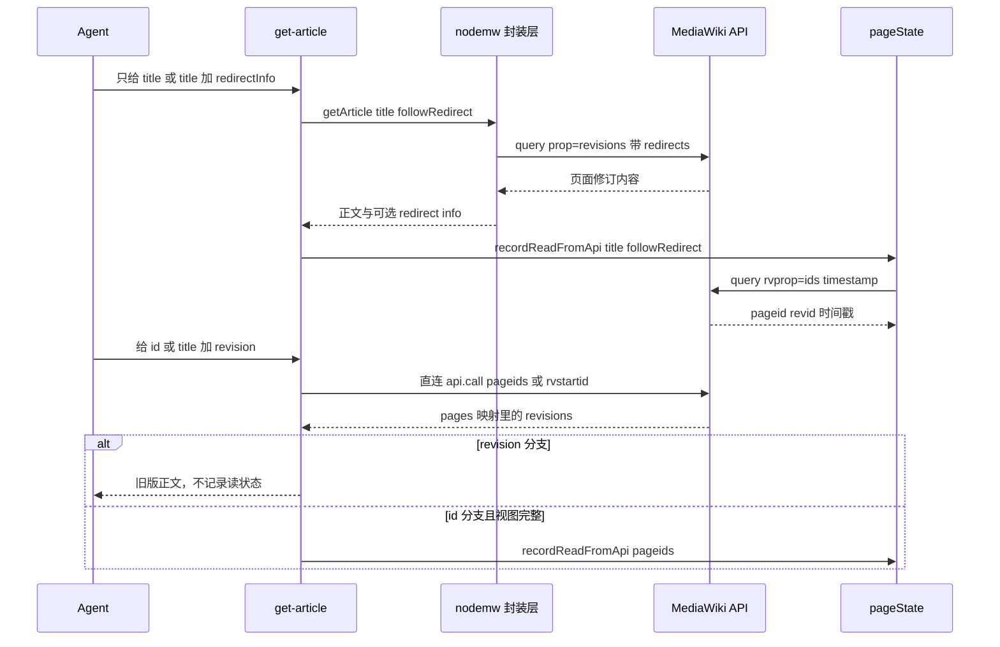
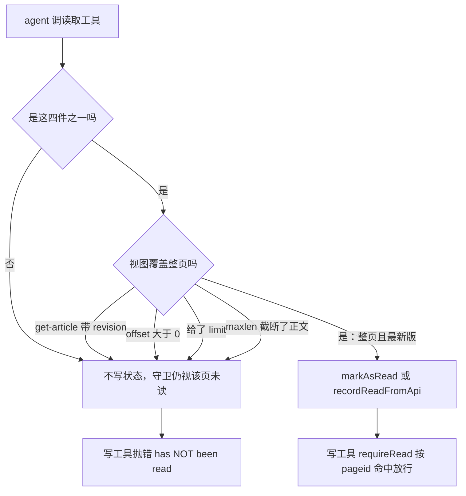
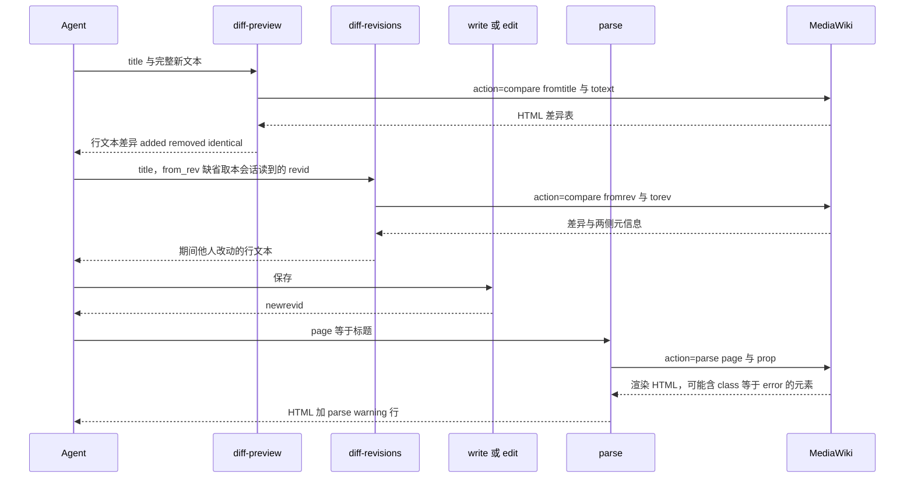

# 读取与检查 wiki 内容：意图选型、分页语义与读证据

服务器共 54 件工具，其中 37 件只读：`src/tools/ro/` 下的全部模块，按顺序列在 `readToolRegistrars` 里（[`src/tools/index.ts`](../../src/tools/index.ts#L89-L127)）。它们共享同一种外壳——一个工厂函数、一次 `server.tool` 调用、四键 `ToolAnnotations`、多数还有 `outputSchema`——但没有任何共享实现。因此描述它们最有用的维度不是文件，而是"它回答哪个问题"（注册机制见 [工具注册表](../architecture/tool-registry.md)）。

有三条性质决定了下文全部内容：

- **只有五件工具交付页面或模块的原始正文。** 其余返回元信息、列表、派生文本或生成的 HTML/XML。读正文是一条窄而刻意的通道，而"读正文"又是唯一能留下写前必读证据的通道。
- **结果信封有五种，不是一种。** 声明 `outputSchema` 的 `jsonResult`、未声明 schema 的 `jsonResult`、裸文本、`errorResult`，以及只见于 `get-article` 的手写错误。客户端能不能读 `structuredContent`，取决于它调的是哪一类。
- **分页不统一。** 有的工具把游标交给调用方，有的返回完整结果集，还有几件只返回一批 MediaWiki 响应装得下的数据。分清哪些是哪些，就是"这个 wiki 有 500 个页面"与"我拿到了 500 条结果"的差别。

下面的顺序是：意图选型 → 结果信封 → 正文通道与窗口/截断 → 读证据 → 验证回路 → 分页与上限 → 已知缺口 → 改动清单。写入侧见[编辑内容](editing-content.md)，守卫的数据结构见[写前必读守卫](../concepts/read-before-write-guard.md)，信封与整形 helper 的细节见[工具结果与输出整形](../concepts/tool-results-and-output-shaping.md)。

## 一、按问题选工具

下表与 `readToolRegistrars` 一一对应：37 个工具名各出现一次，不多不少，`diff-preview`、`diff-revisions`、`get-articles`、`get-module-source` 也在其中。

| 要回答的问题 | 全部工具 | 返回类型 |
|---|---|---|
| 这一页现在写了什么？ | `get-article`、`get-article-with-lineno` | 裸 wikitext / 带行号的 JSON |
| 某个历史版本写了什么？ | `get-article-by-revision` | 裸修订正文 |
| 一次读多页或整批模块 | `get-articles` | 每页一条带 `content` 的 JSON |
| 模块的原始源码（字节级） | `get-module-source` | JSON，含 `content` 与 `contentmodel` |
| 它有哪些版本？ | `get-article-revisions` | 修订元信息，无正文 |
| 自上次读取以来改了什么？ | `diff-revisions` | 差异文本 + `from`/`to` 元信息 |
| 我准备保存的文本会改什么？ | `diff-preview` | 差异文本，未写入 |
| 这个页面**是什么**？ | `get-article-info`、`get-article-categories`、`get-article-properties` | 页面对象、（可选）模板链、分类标题、`pageprops` |
| 谁链向它、它包含什么？ | `get-backlinks`、`get-external-links`、`get-pages-transcluding`、`get-images-from-article`、`get-image-usage`、`get-image-info` | 标题、URL、文件元信息 |
| 有哪些页面？ | `get-all-pages`、`get-pages-in-namespace`、`get-pages-in-category`、`get-pages-by-prefix`、`get-categories`、`get-images`、`get-query-page` | 标题与 id |
| 按时间发生了什么？ | `get-log`、`get-recent-changes`、`get-user-contribs` | 带时间戳的条目 |
| 这个用户是谁？ | `whoami`、`whois`、`whoare`、`get-users` | 用户对象、组与权限 |
| 这个 wiki 是什么？ | `get-site-info`、`get-site-stats`、`get-mediawiki-version` | 单个对象 |
| 这段 wikitext 会变成什么？ | `parse`、`expand-templates` | HTML / XML / 展开后的 wikitext |
| 关键词出现在哪？ | `search` | 带摘要的命中列表 |

有三个名字容易读错。`get-query-page` 不是通用查询工具，它代理 MediaWiki 的 `querypage` 特殊页面，例如 `Ancientpages`、`Lonelypages`、`Wantedpages`（[`get-query-page.ts`](../../src/tools/ro/get-query-page.ts#L41-L77)），并且只发一次 `qplimit: API_LIMIT` 的请求（[`bot.js`](../../node_modules/nodemw/lib/bot.js#L1381-L1403)）。`get-site-info` 由调用方必填的 `properties` 列表驱动，返回的是那份列表点到的东西（[`get-site-info.ts`](../../src/tools/ro/get-site-info.ts#L60-L76)）。`get-articles` 不是"把 `get-article` 调 N 次"的糖：它把标题或 pageid 用 `|` 拼进一个请求，回包逐页拆开（[`get-articles.ts`](../../src/tools/ro/get-articles.ts#L80-L150)）。

## 二、结果信封：三种成功形态，两种失败形态

37 件只读工具里 31 件在 `server.tool` 之后调用 `tool.update({ outputSchema: ... })`；剩下 6 件不声明 schema，但其中 2 件仍然返回 `jsonResult`。

| 形态 | 工具 | `content[0].text` | `structuredContent` |
|---|---|---|---|
| 结构化成功（有 schema） | 31 件 | `JSON.stringify(data, null, 2)` | 同一个对象，受 schema 校验 |
| 结构化成功（无 schema） | `get-module-source`、`get-articles` | 同上 | 存在，但完全不受校验 |
| 裸文本成功 | `get-article`、`get-article-by-revision`、`expand-templates`，以及 `parse` 的默认模式 | 正文本身（wikitext、展开结果、HTML/XML 片段） | 无 |
| 工具失败 | 除 `get-article` 外的 36 件 | `{ "error": ..., "details": ... }` | 无，`isError: true` |
| 手写失败 | 仅 `get-article` | 一句话，例如 `Page "id 5" not found.` | 无，`isError: true` |

成形函数都在 [`src/common/utils.ts`](../../src/common/utils.ts#L85-L149)：`jsonResult` 不克隆、不校验，`text` 与 `structuredContent` 携带同一份数据；`errorResult` 只填文本通道，并在 `details` 里按正则追加登录过期或编辑冲突的恢复提示。

四个"裸文本"判断都是刻意的。`get-article` 与 `get-article-by-revision` 的成功载荷**就是**文档本身，套一层 JSON 只会引入二次转义（[`get-article.ts`](../../src/tools/ro/get-article.ts#L179-L198)、[`get-article-by-revision.ts`](../../src/tools/ro/get-article-by-revision.ts#L93-L95)）；`expand-templates` 返回展开后的 wikitext（[`expand-templates.ts`](../../src/tools/ro/expand-templates.ts#L91-L93)）。`parse` 是混合体：默认把 HTML 或 parse tree 作为文本块返回，一旦传 `include` 或 `limit_report` 就切成 `jsonResult`（[`parse.ts`](../../src/tools/ro/parse.ts#L178-L238)），所以它无法声明一个既正确又不撒谎的 `outputSchema`。`get-module-source` 与 `get-articles` 的情况不同：它们已经是 `jsonResult({...})`，却从未调用 `tool.update({ outputSchema })`——结构化通道存在但不受约束，属于遗留缺口（[`get-module-source.ts`](../../src/tools/ro/get-module-source.ts#L132-L141)、[`get-articles.ts`](../../src/tools/ro/get-articles.ts#L146)）。

对调用方有三个实际后果：

1. **`maxlen` 的标记落在哪里取决于信封。** `get-article` 的标记直接追加在返回的正文里；`diff-preview`、`diff-revisions` 把它放进 `diff` 字段，并另给一个 `truncated` 布尔量；`get-article-with-lineno` 把它做成 `lines` 里的一条伪条目。
2. **错误形状不一致。** 只有 `get-article` 的 7 处失败是手写句子，因此它永远不会附带登录过期或编辑冲突提示；其余工具都是 `{ error, details }`。
3. **"有 `structuredContent`"不等于"有 schema"。** 读 `get-module-source`/`get-articles` 的结构化客户端拿到的是未经声明的对象，字段改名不会触发任何校验错误。

## 三、交付正文的五条通道

| 工具 | 寻址 | 载荷 | 留下读证据 |
|---|---|---|---|
| `get-article` | `title` XOR `id`，另加可选 `revision`；`offset`/`maxlen` 字符窗口 | 裸 wikitext | 仅整页视图 |
| `get-article-with-lineno` | `title` XOR `id`；`offset`/`limit` 行窗口 + `maxlen` | `{ title, totalLines, shownLines, offset, lines[] }` | 仅整页视图 |
| `get-articles` | `titles[]` XOR `ids[]`，各上限 50 | `{ pages: [{ title, pageid, ns, revid, content, missing }] }` | 每个存在的页面 |
| `get-module-source` | 仅 `title` | `{ title, pageid, ns, revid, timestamp, contentmodel, contentformat, content }` | 是 |
| `get-article-by-revision` | 仅 `revision` | 裸修订正文 | 从不 |

### `get-article` 在两条传输之间二选一

handler 按拿到的实参分流（[`get-article.ts`](../../src/tools/ro/get-article.ts#L121-L263)）：

- **给了 `id`，或给了 `revision`** → 直连 `api.call`，参数 `prop=revisions&rvprop=content&rvlimit=1`，id 形式用 `pageids`，revision 形式用 `rvstartid`；`redirects` 只在"给的是标题且 `followRedirect` 为真"时附加（[L137-L150](../../src/tools/ro/get-article.ts#L137-L150)）。
- **只给 `title`** → nodemw 的 `getArticle`；`redirectInfo: true` 时改走手写回调，拿回 `[content, redirectInfo]` 两元组，并以 `Content:` / `Redirect Information:` 分段输出（[L201-L231](../../src/tools/ro/get-article.ts#L201-L231)）。

两条传输的分工与各自的副作用见图 1。



*图 1：`get-article` 的两条传输。只有"内容视图覆盖整页"的分支才写读证据，revision 分支在设计上直接返回。*

传输选择对调用方有四处可见差别：

- `redirectInfo` 只在纯标题路径上被读取，所以只要给了 `id` 或 `revision` 它就静默失效。
- `followRedirect` 对 id 路径不起作用，因为 MediaWiki 在带 `pageids` 时会忽略 `redirects`，源码里对此有内联注释（[L146-L147](../../src/tools/ro/get-article.ts#L146-L147)）。
- 两条路径构造"未找到"消息的方式不同：直连路径会退化成合成标识符，所以按 id 找不到的页面会报成 `Page "id 5" not found.` 而不是标题（[L155-L161](../../src/tools/ro/get-article.ts#L155-L161)）。
- 空页面的表述不同：id 路径返回 `Page ID N is empty.`（`isError: false`），标题路径返回 `(empty page)` 作为正文（[L186-L197](../../src/tools/ro/get-article.ts#L186-L197)）。

`revision` 参数值得说得更准确：它是一个**向后起始游标**（`rvstartid` 配 `rvlimit: 1`），不是精确修订查找，handler 也从不把返回的 `revid` 与请求的那个比对。要"不管属于哪个页面，给我恰好第 N 版"，应该用发 `revids` 的 `get-article-by-revision`。

### 字符窗口：`offset` 与 `maxlen`

`get-article` 是唯一按**字符**续读的工具（[`applyMaxlen`](../../src/tools/ro/get-article.ts#L96-L107)）：

- `offset` 先切（`offset >= text.length` 时直接返回 `(reached end of article)`），`maxlen` 后截。
- `maxlen` 未给或 `<= 0` 表示关闭截断，所以 `maxlen: 0` 是"全发"而不是"什么都不发"，尽管 schema 接受 `0`（[L74-L82](../../src/tools/ro/get-article.ts#L74-L82)、[L104](../../src/tools/ro/get-article.ts#L104)）。
- 截断时在 `text.slice(0, maxlen)` 之后追加固定一句：

```
[truncated — article exceeds maxlen, call get-article again with offset=<n> to continue reading]
```

因此响应长度是 `maxlen` 加上标记本身，`maxlen` 是正文前缀的软边界，不是工具响应的硬上限；而 schema 描述里宣传的仍是裸 `[truncated]` 标记，两者并不一致。

### 行窗口：`get-article-with-lineno`

行窗口只存在于这一件工具，返回 `{ title, totalLines, shownLines, offset, lines: [{ lineno, content }] }`（[`get-article-with-lineno.ts`](../../src/tools/ro/get-article-with-lineno.ts#L41-L74)）：

- `lineno` 从 1 开始，描述**整页**的行号，不是窗口内的序号。
- `offset` 是从 0 开始计的要跳过的行数；`limit` 是要返回的行数（`min: 1`），在 `offset` 之后生效。
- `totalLines` 统计取回文本的每一行；`shownLines` 统计实际返回的条数，截断标记也算在内。
- 顺序是：取全文 → 切分 → `slice(offset)` → `slice(0, limit)` → 按 `maxlen` 行粒度截断 → 决定是否 `markAsRead` → 拼标记（[L175-L201](../../src/tools/ro/get-article-with-lineno.ts#L175-L201)）。

`maxlen` 在这里是**行粒度**的：逐行连同换行分隔符累加，直到下一行会超出为止，然后追加一条伪条目，其 `lineno` 是最后保留行 + 1（什么都没保留时是 `offset + 1`），`content` 是 `[truncated]`（[`truncateLines`](../../src/tools/ro/get-article-with-lineno.ts#L76-L91)、[L198-L201](../../src/tools/ro/get-article-with-lineno.ts#L198-L201)）。由此有三个性质：

- 如果窗口第一行本身就比 `maxlen` 长，结果里**只有**那条标记：零行正文，`shownLines: 1`。
- 标记计入 `shownLines` 但不计入 `maxlen`，所以 `shownLines` 可能等于 `limit + 1`。
- 标记就坐在 `lines` 里，形状与页面正文无法区分。把 `lines` 喂给 `edit` 的 `old_lines` 的调用方必须把它去掉；而工具描述承诺的恰是相反的那种便利（"copy-pasted directly into `old_lines` without any escaping"）。

下一个窗口从最后一条正文行的 `lineno` 加一开始，走完 `totalLines` 就结束。窗口**不减少 API 载荷**（整页总是先取回），但它确实缩小了守卫记录的资格范围，见第四节。

### 批量与原始源码

`get-articles` 用一次请求读最多 50 页：`titles` 是 schema 必填（`min(1).max(50)`），`ids` 是可选替代（`max(50)`），handler 在有 `ids` 时把 pageid 用 `|` 拼进 `pageids`，否则拼 `titles`（[`get-articles.ts`](../../src/tools/ro/get-articles.ts#L61-L67)、[L88-L98](../../src/tools/ro/get-articles.ts#L88-L98)）。两个边角：

- 因为 `titles` 是必填字段，只传 `ids` 的调用会被 zod 拒绝，尽管描述把 `ids` 写成 "alternative to titles"。
- 它从不发送 `redirects`，所以给一个重定向标题读到的是重定向页自己的正文，与 `get-module-source` 一致（[L88-L92](../../src/tools/ro/get-articles.ts#L88-L92)）。

`get-module-source` 专攻 Scribunto 模块：发 `prop=revisions&rvprop=ids|timestamp|content&rvlimit=1`，同时接受新版 `slots.main['*']` 与旧版直接挂在 revision 上的 `'*'`，因此能拿到未经预保存变换的源码（[`get-module-source.ts`](../../src/tools/ro/get-module-source.ts#L82-L125)）。它只有 `title` 一个参数，没有 `maxlen`，一个巨大的模块会原样返回。

`get-article-by-revision` 在每个方向上都是例外：不需要标题或 page id，发 `revids=<revision>` 做精确查找，返回裸的 `revisions[0]['*']` 字符串，没有 `maxlen`，没有 `outputSchema`，也从不碰守卫（[`get-article-by-revision.ts`](../../src/tools/ro/get-article-by-revision.ts#L56-L98)）。

## 四、读证据：哪些读取能让写通过

[写前必读守卫](../concepts/read-before-write-guard.md)只被写了状态的读取满足，而 37 件读取工具里只有 **4 件**调用 `markAsRead` / `recordReadFromApi`（[`pageState.ts`](../../src/common/pageState.ts#L59-L104)）：

| 读取者 | 留下证据的条件 | 记录内容 |
|---|---|---|
| `get-article` | `isFullView`：`offset` 缺省或为 0，且 `maxlen` 未截断；revision 分支恒不记录 | 通过 `recordReadFromApi` 重查当前 `revid` + 时间戳，并按需跟随重定向（[L36-L54](../../src/tools/ro/get-article.ts#L36-L54)、[L193-L195](../../src/tools/ro/get-article.ts#L193-L195)、[L226-L247](../../src/tools/ro/get-article.ts#L226-L247)） |
| `get-article-with-lineno` | `offset === 0` 且未给 `limit` 且 `!truncated` | 取自响应或解析查询的 `pageid` + `lastrevid` + 时间戳（[L189-L196](../../src/tools/ro/get-article-with-lineno.ts#L189-L196)） |
| `get-articles` | 每个同时有 `pageid` 与 `revid` 的页面，无条件 | 每页 `pageid` + `revid` + 时间戳（[L138-L141](../../src/tools/ro/get-articles.ts#L138-L141)） |
| `get-module-source` | 取到主槽内容即记录 | `pageid` + `revid` + 时间戳（[L127-L130](../../src/tools/ro/get-module-source.ts#L127-L130)） |

其余 33 件读取工具对守卫完全不可见，包括 `parse`、`expand-templates`、`diff-preview`、`diff-revisions` 和 `get-article-by-revision`。



*图 2：读证据的判定路径。守卫只看 `pageid`，所以"读了局部"与"没读"在它眼里没有区别。*

这层设计有三条要紧的推论：

- **读十行不解锁整页写入。** `get-article-with-lineno` 的 `limit`、`offset`、截断标记都会让 `fullView` 为假，`src/tools/__tests__/readGuard.test.ts` 逐个用例把这几条路径固定成"后续 `write` 失败并报 `has NOT been read`"（[`readGuard.test.ts`](../../src/tools/__tests__/readGuard.test.ts#L104-L146)）。
- **重定向绑定的是内容来源页。** `recordReadFromApi(identifier, followRedirect)` 在按标题读且跟随重定向时会给自己的解析查询也带上 `redirects`，使记录属于正文实际来自的那一页；`get-article` 随后还追加一段提示，告诉调用方应该把解析后的标题传给 `edit`/`write`（[`pageState.ts`](../../src/common/pageState.ts#L74-L104)、[`get-article.ts`](../../src/tools/ro/get-article.ts#L246-L262)）。`get-articles` 与 `get-module-source` 不跟随重定向，所以结论相反但同样自洽：证据记在重定向页上。
- **读证据有第二个消费者。** `diff-revisions` 在没给 `from_rev` 时用 `getReadRecord(pageid)` 取本会话读到的 `revid` 当比较基线，没有记录就报错要求先 `get-article`（[`diff-revisions.ts`](../../src/tools/ro/diff-revisions.ts#L168-L179)）。因此"读一次"同时买到写权限和一个 diff 基线。

## 五、验证回路：写前 diff，写后 parse

读取侧对正确性的贡献集中在三个工具上：写前用 `diff-preview` 预览整页后果，判断"改了哪些、是否真有改动"，以及用 `diff-revisions` 核对"自上次读取以来别人改了什么"；写后用 `parse(page=...)` 重渲染，把 HTML 里的错误元素当成正确性信号。



*图 3：读取侧支撑的验证回路。两个 diff 工具都不写任何东西，`parse` 也不写，但它是唯一能发现"保存成功、渲染已坏"的环节。*

四个要点：

- **`diff-preview` 要整页结果，不要补丁。** 它把 `totext` 交给服务端 diff 引擎，与页面当前修订比较，返回 `{ title, current_revid, diff, added, removed, truncated, identical }`；`identical` 为真表示这份文本保存后不产生任何差异（[`diff-preview.ts`](../../src/tools/ro/diff-preview.ts#L105-L151)）。`edit`/`append` 没有"提议的整页文本"参数，所以预览前必须在本地把拼接结果算出来。
- **版本门槛是显式的。** 已知 MediaWiki < 1.24 时 `diff-preview` 直接拒绝，并建议改用 `get-article` / `get-article-by-revision` 自行比较；`topst`（预保存变换）在 1.27+ 或版本未知时附加，被服务端以 `unrecognized parameter … topst` 拒绝时去掉重发（[L95-L126](../../src/tools/ro/diff-preview.ts#L95-L126)）。两个 diff 工具都经 `callCompareApi` 发请求，富元数据 props 失败时自动退回只请求 `diff`，因此在老 wiki 上 `from`/`to` 只剩 `revid`（[`compareOutput.ts`](../../src/common/compareOutput.ts#L215-L239)）。
- **diff 的 `maxlen` 与 `get-article` 的 `maxlen` 形状不同。** 差异按行累加、至少保留一行，超出时追加 `[truncated — diff exceeds maxlen; N more line(s) omitted]` 并另置 `truncated: true`，调用方不必解析文本就知道是否完整（[`compareOutput.ts`](../../src/common/compareOutput.ts#L189-L213)）。
- **`parse(page=...)` 的警告是"去看 HTML"的指令，不是失败判定。** 它用 `class="[^"]*\berror[^"]*"` 统计渲染结果里的错误元素（Widgets 的 `<div class="error">`、`#iferror` 的 `<span class="error">`、Scribunto 的 `<strong class="error">`），最多保留 3 个样本，并在默认文本模式下把 `[parse warning] N error element(s) detected …` 前置到 HTML 之前、在结构化模式下放进 `warnings` 数组（[`parseOutput.ts`](../../src/common/parseOutput.ts#L29-L112)、[`parse.ts`](../../src/tools/ro/parse.ts#L178-L238)）。API 调用本身仍返回成功，所以不看警告就会把破损页面当成功。`format: 'xml'` 时根本不计算警告，因为检测只针对 HTML 文本。

## 六、分页、限额与截断标记

没有任何只读工具把不透明的续延令牌交给调用方。续延要么是内部的（nodemw 的 `getAll`、各 handler 自己的 `continue` 循环），要么完全不存在；调用方能驱动的只有时间戳、文件名、行偏移和字符偏移。这让"这次读取完不完整"成为必须自己推理的问题。

### 批次上限与循环上限

| 工具 | 单批请求的上限 | 是否有续延 | 结果上界 |
|---|---|---|---|
| `get-articles` | 50 个标题 / 50 个 pageid（schema 强制） | 无（一次性请求） | 恰为这一批 |
| `search` | `srlimit: 500` | 有，自建循环 | 10 000 条后停 |
| `get-pages-by-prefix` | `aplimit: 5000` | 有，自建循环 | 10 000 条后停 |
| `get-pages-transcluding` | `eilimit: 500` | 有，自建循环 | 10 000 条后停 |
| `get-article-revisions`（id 路径） | `rvlimit: 500` | 有，自建循环 | 10 000 条后停 |
| `get-all-pages`、`get-categories`、`get-pages-in-category`、`get-pages-in-namespace` | nodemw 的 `API_LIMIT`（5000） | 有，nodemw 的 `getAll` | 全量 |
| `get-log`、`get-recent-changes`、`get-images`、`get-query-page` | nodemw 的 `API_LIMIT`（5000） | 无，续延被丢弃 | 单个批次 |
| `get-users` | `aulimit` 就是调用方的 `limit` | 无 | 恰为 `limit` |
| `get-user-contribs` | `uclimit: min(limit, 500)` | 有，但凑够 `limit` 就停 | 至多 `limit + perPage - 1` |

三条推论：

- **`limit` 在穷举类工具里是显示控制，不是成本控制。** `get-all-pages` 即使 `limit: 10` 也会把 wiki 上所有非重定向页面拉一遍再切片（[`get-all-pages.ts`](../../src/tools/ro/get-all-pages.ts#L62-L84)、[`bot.js`](../../node_modules/nodemw/lib/bot.js#L295-L350)）；`search` 即使 `limit: 10` 也会按 `srlimit: 500` 逐批翻到 10 000 条上限（[`search.ts`](../../src/tools/ro/search.ts#L105-L157)）。`get-pages-in-category`、`get-pages-in-namespace`、`get-pages-transcluding`、`get-categories` 连 `limit` 参数都没有。
- **`get-log` 与 `get-recent-changes` 的 `limit` 在批次之后生效。** 两者对收到的数组做 `.slice(0, limit)`，从不把 `limit` 传给上游，所以把 `limit` 提到一个批次以上不会多返回任何东西（[`get-log.ts`](../../src/tools/ro/get-log.ts#L92-L102)、[`get-recent-changes.ts`](../../src/tools/ro/get-recent-changes.ts#L89-L97)）。
- **`get-pages-by-prefix` 的命名空间是"解析出来的"，不是硬编码的。** 前缀里带已知命名空间（`Widget:Foo`、`模板:Cite`）且调用方没给 `namespace` 时，handler 用启动时从 `meta=siteinfo` 建立的命名空间缓存解析出 id，并把前缀剥成冒号后的部分（[`nodemwBot.ts`](../../src/common/nodemwBot.ts#L293-L302)、[`get-pages-by-prefix.ts`](../../src/tools/ro/get-pages-by-prefix.ts#L96-L120)）。缓存里查不到就返回 `null`，handler 退回"整个前缀按主命名空间匹配"的旧行为——所以自定义命名空间在缓存未建立时会静默漏掉。

### 三种截断标记，三种续读方式

| 标记 | 出现位置 | 怎么续 |
|---|---|---|
| `[truncated — article exceeds maxlen, call get-article again with offset=<n> to continue reading]` | `get-article` 正文尾部 | 提高 `maxlen`，或按标记提示用 `offset` 续读；`offset` 超出长度时正文变成 `(reached end of article)` |
| `[truncated]` 伪行（`lineno` = 最后保留行 + 1） | `get-article-with-lineno` 的 `lines` 数组内 | 用最后一条正文行的 `lineno` 加一作为下一个 `offset`，或提高 `maxlen`；记得把伪行从 `old_lines` 里去掉 |
| `[truncated — diff exceeds maxlen; N more line(s) omitted]` + `truncated: true` | `diff-preview`、`diff-revisions` 的 `diff` 字段 | 提高 `maxlen`；布尔字段可直接判断是否完整 |

### `total` 的四种含义

只有三件工具同时返回 `total` 与 `displayed`——`get-all-pages`、`get-log`、`get-user-contribs`；多数列表工具只返回一个 `count`；`search`、`get-recent-changes` 与 `get-images` 给 `total` 但从不给 `displayed`（[`get-all-pages.ts`](../../src/tools/ro/get-all-pages.ts#L75-L80)、[`get-log.ts`](../../src/tools/ro/get-log.ts#L95-L102)、[`get-user-contribs.ts`](../../src/tools/ro/get-user-contribs.ts#L156-L167)）。这些数字不是一回事：

| 含义 | 工具 | 原因 |
|---|---|---|
| 完整匹配数（封顶 10 000 或全量） | `get-all-pages`、`search`，以及 `get-pages-in-category`、`get-pages-in-namespace`、`get-pages-transcluding`、`get-categories`、`get-pages-by-prefix` 的 `count` | 循环到 wiki 不再返回 `continue` 为止，或撞上 10 000 条上限 |
| 单个 API 批次的大小（`total` 或 `count`） | `get-log`、`get-recent-changes`、`get-images`、`get-query-page`、`get-users` | 一次 `api.call`，续延被丢弃 |
| 已取到的条目数 | `get-user-contribs` | 循环凑够 `limit` 条就停 |
| 调用方给的上限 | `get-users` | `aulimit` 就是调用方的 `limit`，没有续延也没有游标 |

对第二行来说，`total` 是**批次**大小：`displayed < total` 能如实报告该批内的截断，但 `total` 永远不可能超过服务器为这次请求装得下的量——`API_LIMIT` 是请求的量，不是被批准的量。一个匹配条目远多于此的日志，在走查的每一页上都会报同一个 `total`。

`get-recent-changes` 还有一个额外的坑：它的描述与 `get-log` 一样声称响应里有 `total` 和 `displayed`，但它的 `outputSchema` 与 `jsonResult` 只给 `total`、`limit`、`start`、`changes`（[`get-recent-changes.ts`](../../src/tools/ro/get-recent-changes.ts#L66-L97)）。调用方得自己用 `changes.length` 当 `displayed`。

对 `get-user-contribs` 来说，这套启发式在常见场景下直接失效。`perPage = min(limit, 500)`，循环在 `allContribs.length >= limit` 时立刻 break，`total` 就等于已取到的长度，所以一个有 1000 次编辑的用户在 `limit: 50` 下会返回 `total: 50, displayed: 50`（[`get-user-contribs.ts`](../../src/tools/ro/get-user-contribs.ts#L113-L166)）。描述里的两条规则——"`displayed < total` 说明还有"和"重复直到 `displayed < limit`"——都发现不了还有更多数据。唯一可靠的终止信号是下一次调用返回空。

### 时间戳、文件名与偏移

- **时间戳游标。** `get-log`、`get-recent-changes` 与 `get-user-contribs` 共用一套设计：一个 `start` 字符串，接受 ISO 8601、MediaWiki 的 `YYYYMMDDHHMMSS` 或 unix 时间戳，按 UTC 解释，原样转发到 `lestart`、`rcstart` 或 `ucstart`（[`get-log.ts`](../../src/tools/ro/get-log.ts#L50-L58)、[`get-recent-changes.ts`](../../src/tools/ro/get-recent-changes.ts#L50-L56)、[`get-user-contribs.ts`](../../src/tools/ro/get-user-contribs.ts#L64-L69)）。工具不减去一秒、不加上一秒、也不去重，所以把上一页最后一条的时间戳传回去时，边界那条仍是候选，需要按 `revid` 或日志 id 去重。
- **唯一的名字游标。** `get-images` 的 `startFrom` 变成 `aifrom`；nodemw 把下一个 `aifrom` 作为第三个回调参数交回来，但 handler 手写的 Promise 只保留 `args[0]`，于是游标从不露面——调用方只能用最后返回的文件名（[`get-images.ts`](../../src/tools/ro/get-images.ts#L70-L90)、[`bot.js`](../../node_modules/nodemw/lib/bot.js#L1149-L1165)）。
- **两种偏移。** `get-article` 按字符，`get-article-with-lineno` 按行；两者都不减少 API 载荷，因为整页总是先取回。

## 七、读取面上的已知缺口

下面这些是当前源码可见的行为，而不是设计声明。每一条都是"调用方应当核对输出而不是相信 schema 的地方"。

| 症状 | 原因 | 位置 |
|---|---|---|
| `get-articles` 只传 `ids` 会被拒绝 | `titles` 在 schema 里是必填（`min(1).max(50)`），`ids` 只是可选的替代路径 | [`get-articles.ts`](../../src/tools/ro/get-articles.ts#L61-L67) |
| `get-module-source`、`get-articles` 的结构化输出不受校验 | 返回 `jsonResult` 但从未调用 `tool.update({ outputSchema })` | [`get-module-source.ts`](../../src/tools/ro/get-module-source.ts#L132-L141)、[`get-articles.ts`](../../src/tools/ro/get-articles.ts#L146) |
| `get-user-contribs` 从不报告还有更多 | `total` 是已取到的长度，循环凑够 `limit` 就 break | [`get-user-contribs.ts`](../../src/tools/ro/get-user-contribs.ts#L113-L166) |
| `get-recent-changes` 的描述承诺 `displayed`，载荷里没有 | `outputSchema` 与 `jsonResult` 只包含 `total`、`limit`、`start`、`changes` | [`get-recent-changes.ts`](../../src/tools/ro/get-recent-changes.ts#L66-L97) |
| `get-images` 手里有下一个 `aifrom` 却不返回 | 手写回调只保留 `args[0]`，丢掉了 `next.aifrom` | [`get-images.ts`](../../src/tools/ro/get-images.ts#L70-L80)、[`bot.js`](../../node_modules/nodemw/lib/bot.js#L1149-L1165) |
| `get-users` 从不报告还有更多用户 | 没有续延、没有游标，`aulimit` 就是调用方的 `limit` | [`get-users.ts`](../../src/tools/ro/get-users.ts#L68-L93) |
| `get-backlinks` 只能找到主命名空间的链入 | nodemw 硬编码 `blnamespace: 0` | [`bot.js`](../../node_modules/nodemw/lib/bot.js#L1525-L1538) |
| `get-external-links`、`get-images-from-article` 的"page ID"形式不可靠 | 参数声明 `union([string, number])`，却原样传给只设置 `titles` 的 nodemw 方法 | [`get-external-links.ts`](../../src/tools/ro/get-external-links.ts#L61-L76)、[`get-images-from-article.ts`](../../src/tools/ro/get-images-from-article.ts#L61-L76)、[`bot.js`](../../node_modules/nodemw/lib/bot.js#L1511-L1523) |
| `get-article` 的 `revision` 不是精确修订 | `rvstartid` + `rvlimit: 1` 是向后起始游标，返回的 `revid` 从不与请求值比对 | [`get-article.ts`](../../src/tools/ro/get-article.ts#L139-L182) |
| `get-article` 的 id 路径找不到页面时报合成标识符 | 直连路径没有标题可报，退化成 `Page "id 5" not found.` | [`get-article.ts`](../../src/tools/ro/get-article.ts#L155-L161) |
| `get-article` 的 `maxlen` 描述与真实标记不一致 | 描述宣传裸 `[truncated]`，实际追加一整句续读提示 | [`get-article.ts`](../../src/tools/ro/get-article.ts#L74-L78)、[L104-L106](../../src/tools/ro/get-article.ts#L104-L106) |

有一处值得单独说：`get-article-with-lineno` 的标题路径会额外发一次 `prop=revisions&rvprop=ids|timestamp&redirects` 查询，用它的 `pageid`/`revid`/`timestamp` 记录读证据，并报告**解析后目标页**的标题（解析不到时才退回调用方给的字符串）。这让"返回的 `title`"与"证据记在哪个 `pageid`"保持一致，代价是标题路径多一次往返；旧行为（报告调用方给的标题）已被修掉（[`get-article-with-lineno.ts`](../../src/tools/ro/get-article-with-lineno.ts#L125-L155)）。

## 八、安全地改动读取面

新增或修改读取工具时，上面的不变量意味着下面这份清单；机械步骤在[新增工具](adding-a-tool.md)，契约条款在[工具注册表](../architecture/tool-registry.md)。

1. **选对返回信封。** 载荷本身就是文档（wikitext、展开结果、HTML）→ 裸文本且不声明 schema；其他一律 `jsonResult` + `tool.update({ outputSchema })`，两者缺一就是 `get-module-source`/`get-articles` 那样的遗留缺口。
2. **按标识符选传输。** 只按标题 → nodemw 封装；`pageids`/`revids` → 直连 `api.call`，今天所有 id 路径都这样（`get-article`、`get-article-with-lineno`、`get-article-info`、`get-article-categories`、`get-article-properties`、`get-article-revisions`、`diff-revisions`）。
3. **只在整页视图上写读证据，并用 API 刚返回的 id。** 局部或旧版视图必须明确不记录；拿到的 `revid`/时间戳优先于再查一次 `getArticleInfo`，因为 `basetimestamp` 需要它。
4. **确定 `total` 的含义并写进描述。** 经 `getAll` 的穷举、单个批次、已取到的数量，是三种不同的承诺；描述是调用方唯一能得知是哪一种的地方。
5. **封顶就交出游标。** 要避免的失败形态就是 `get-users` 与 `get-images`：一个被截断的列表，既没有标记、也没有游标、也没有警告。
6. **要截断就沿用既有标记**——正文用结尾追加的句子、行视图用行内伪条目、diff 用带省略行数的句子加布尔字段——并让 `.describe()` 的文字与真实字符串保持一致，因为那段描述是 agent 能看到的唯一文档。

## 相关页面

- [工具注册表与工具模块契约](../architecture/tool-registry.md)
- [架构总览](../architecture/overview.md)
- [API 兼容性](../concepts/api-compatibility.md)
- [写前必读守卫](../concepts/read-before-write-guard.md)
- [工具结果与输出整形](../concepts/tool-results-and-output-shaping.md)
- [编辑内容](editing-content.md)
